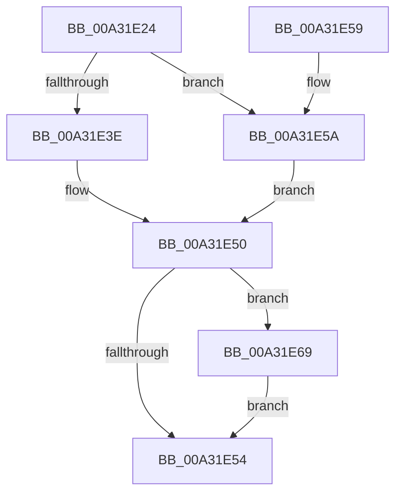

# PopUpdateLastUserInputTime

- RVA: `0x00A31E24`–`0x00A31E73` (길이 `79` bytes)
- VA: `0x0000000140A31E24`
- 실행 섹션: `PAGE`
- PDB 이름 있음: `예`; PDB Function 태그: `아니요`
- unwind 정보 RVA: `0x0005E0D8`
- 디코드: `20`개 명령, `79/79` bytes 표시
- 미해석 바이트: `0` (있으면 어셈블리에 `.byte`로 보존)

> 이 문서는 커널 이미지의 기계어와 PDB 기호를 분석해 생성했습니다. 4번과 5번은 함수 원형과 자료형을 바이너리 사용 방식에서 추정한 C 해석이며 원본 소스 복구 결과는 아닙니다.

## 1. Dependencies

- 직접 호출 지점: **1**; 고유 호출 대상: **1**
- 직접 호출자로 확인된 함수: **2**
- RIP 상대 이미지 참조: **3**

### Outgoing calls
- `0x00A31E6C` → [PopPulseSystemIdleEvent](PopPulseSystemIdleEvent_function_00A31B8C.md) (function, `0x00A31B8C`)

### Direct callers
- [PopUpdateConsoleDisplayState](PopUpdateConsoleDisplayState_function_00A31298.md) at `0x00A313B9`
- [PopSystemIdleWorker](PopSystemIdleWorker_function_00A31A60.md) at `0x00A31AC0`

### Static image references
- `0x00A31E36` → RVA `0x00E0B6C4` (`.data`; read)
- `0x00A31E3E` → RVA `0x00E0B6C0` (`.data`; read)
- `0x00A31E5A` → RVA `0x00E0B6BC` (`.data`; read)

## 2. Other-region calls and transfers

- 다른 실행 섹션으로 향하는 call: **0**
- 별도 외부 분기/꼬리 이동을 확인하지 못했습니다.

## 3. Assembly (complete function range)

```asm
00A31E24  48 83 EC 28                     sub rsp, 0x28
00A31E28  48 B8 E4 02 00 00 80 F7 FF FF   movabs rax, 0xfffff780000002e4
00A31E32  33 C9                           xor ecx, ecx
00A31E34  8B 00                           mov eax, dword ptr [rax]
00A31E36  39 0D 88 98 3D 00               cmp dword ptr [rip + 0x3d9888], ecx
00A31E3C  74 1C                           je 0x140a31e5a
00A31E3E  8B 15 7C 98 3D 00               mov edx, dword ptr [rip + 0x3d987c]
00A31E44  4C 8D 05 75 98 3D 00            lea r8, [rip + 0x3d9875]
00A31E4B  B9 01 00 00 00                  mov ecx, 1
00A31E50  3B D0                           cmp edx, eax
00A31E52  75 15                           jne 0x140a31e69
00A31E54  48 83 C4 28                     add rsp, 0x28
00A31E58  C3                              ret
00A31E59  CC                              int3
00A31E5A  8B 15 5C 98 3D 00               mov edx, dword ptr [rip + 0x3d985c]
00A31E60  4C 8D 05 55 98 3D 00            lea r8, [rip + 0x3d9855]
00A31E67  EB E7                           jmp 0x140a31e50
00A31E69  41 89 00                        mov dword ptr [r8], eax
00A31E6C  E8 1B FD FF FF                  call 0x140a31b8c
00A31E71  EB E1                           jmp 0x140a31e54
```

## 4. C-style interpretation (structured pseudocode)

```c
__int64 __fastcall PopUpdateLastUserInputTime(int a1)
{
    __int64 result;
    __int64 v_rsp;

    v_rsp = (v_rsp) - (40);
    a1 = 0;
    if ((*(unsigned int *)(v_rip + 4036744)) == 0) goto loc_00A31E5A;
loc_00A31E50:
    if (((unsigned int)((unsigned int)(*(unsigned int *)(v_rip + 4036732)))) != ((unsigned int)((unsigned int)(*(unsigned int *)(result))))) goto loc_00A31E69;
loc_00A31E54:
    v_rsp = (v_rsp) + (40);
    return (unsigned int)(*(unsigned int *)(result));
loc_00A31E5A:
    goto loc_00A31E50;
loc_00A31E69:
    *(unsigned int *)(v_rip + 4036693) = (unsigned int)((unsigned int)(*(unsigned int *)(result)));
    result = PopPulseSystemIdleEvent(1, (unsigned int)(*(unsigned int *)(v_rip + 4036700)), v_rip + 4036693, a4);
    goto loc_00A31E54;
}
```

## 5. (Beta) C Style

```c
int64_t PopUpdateLastUserInputTime(int32_t Arg1)
{
    int64_t result;
    int64_t local_rsp;

    local_rsp = (local_rsp) - (40);
    Arg1 = 0;
    if ((*(uint32_t *)(v_rip + 0x3D9888)) == 0) goto loc_00A31E5A;
loc_00A31E50:
    if (((uint32_t)((uint32_t)(*(uint32_t *)(v_rip + 0x3D987C)))) != ((uint32_t)((uint32_t)(*(uint32_t *)(result))))) goto loc_00A31E69;
loc_00A31E54:
    local_rsp = (local_rsp) + (40);
    return (uint32_t)(*(uint32_t *)(result));
loc_00A31E5A:
    goto loc_00A31E50;
loc_00A31E69:
    *(uint32_t *)(v_rip + 0x3D9855) = (uint32_t)((uint32_t)(*(uint32_t *)(result)));
    result = PopPulseSystemIdleEvent(1, (uint32_t)(*(uint32_t *)(v_rip + 0x3D985C)), v_rip + 4036693, a4);
    goto loc_00A31E54;
}
```

## 6. Execution-region graph

[열기: 2D/3D 그래프와 함수 탐색 컨트롤 패널](../../../control-panel.html?section=page&rva=0x00A31E24&view=graph)

- 2D 그래프는 위에서 아래로 흐르고, 3D 그래프는 빈 공간을 드래그해 회전합니다. Shift+드래그는 이동, 휠은 확대·축소, 함수 노드 선택은 대상 보고서 이동입니다.

### Static fallback


