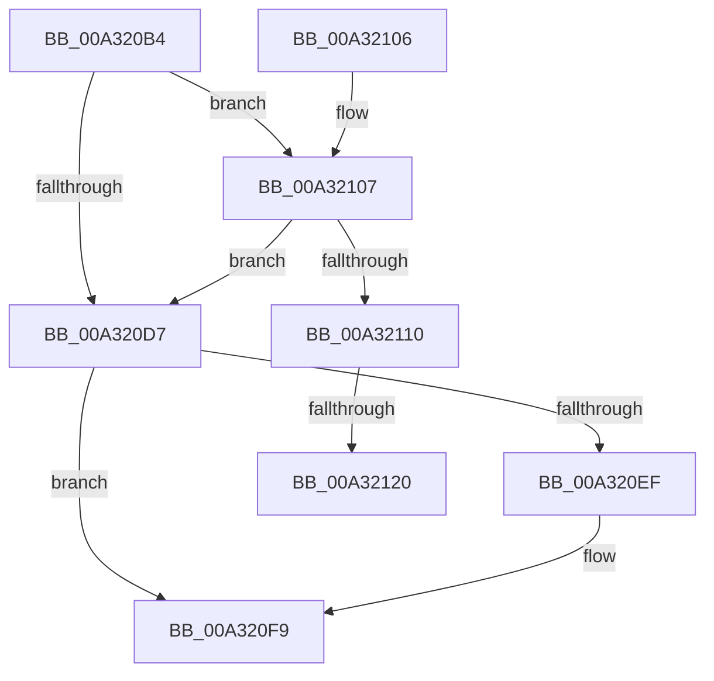

# PopUpdatePdcSystemIdleState

- RVA: `0x00A320B4`–`0x00A3213F` (길이 `139` bytes)
- VA: `0x0000000140A320B4`
- 실행 섹션: `PAGE`
- PDB 이름 있음: `예`; PDB Function 태그: `예`
- unwind 정보 RVA: `0x00088A30`
- 디코드: `34`개 명령, `139/139` bytes 표시
- 미해석 바이트: `0` (있으면 어셈블리에 `.byte`로 보존)

> 이 문서는 커널 이미지의 기계어와 PDB 기호를 분석해 생성했습니다. 4번과 5번은 함수 원형과 자료형을 바이너리 사용 방식에서 추정한 C 해석이며 원본 소스 복구 결과는 아닙니다.

## 1. Dependencies

- 직접 호출 지점: **4**; 고유 호출 대상: **4**
- 직접 호출자로 확인된 함수: **1**
- RIP 상대 이미지 참조: **6**

### Outgoing calls
- `0x00A320C8` → [PopAcquireRwLockExclusive](../../text/43/PopAcquireRwLockExclusive_function_00430B44.md) (function, `0x00430B44`)
- `0x00A320DE` → [PopReleaseRwLock](../../text/2D/PopReleaseRwLock_function_002DFBBC.md) (function, `0x002DFBBC`)
- `0x00A320F2` → [guard_dispatch_icall](../../text/6B/guard_dispatch_icall_function_006BAAD0.md) (function, `0x006BAAD0`)
- `0x00A32134` → [PopPowerRequestSetExecutionRequiredTimeoutTimer](../75/PopPowerRequestSetExecutionRequiredTimeoutTimer_function_00754C5C.md) (function, `0x00754C5C`)

### Direct callers
- [PopExecuteSystemIdleAction](PopExecuteSystemIdleAction_function_00A31E7C.md) at `0x00A31EE1`

### Static image references
- `0x00A320C1` → RVA `0x00F0ED20` (`.data`; read)
- `0x00A320CF` → RVA `0x00F0CED4` (`.data`; read)
- `0x00A320E3` → RVA `0x00E677B0` (`.data`; read)
- `0x00A32107` → RVA `0x00F0EFC3` (`.data`; read)
- `0x00A32110` → RVA `0x00F0EFC3` (`.data`; write)
- `0x00A3212D` → RVA `0x00F0EFC8` (`.data`; write)

## 2. Other-region calls and transfers

- 다른 실행 섹션으로 향하는 call: **3**
  - `0x00A320C8` → [PopAcquireRwLockExclusive](../../text/43/PopAcquireRwLockExclusive_function_00430B44.md) (`PAGE` → `.text`)
  - `0x00A320DE` → [PopReleaseRwLock](../../text/2D/PopReleaseRwLock_function_002DFBBC.md) (`PAGE` → `.text`)
  - `0x00A320F2` → [guard_dispatch_icall](../../text/6B/guard_dispatch_icall_function_006BAAD0.md) (`PAGE` → `.text`)
- call이 아닌 외부 분기/꼬리 이동: **2**
  - `0x00A3211A` → [sub_00B39B90](../B3/Unknown_function_00B39B90.md) (`tail-transfer`)
  - `0x00A3213A` → [sub_00B39B90 + 0x15](../B3/Unknown_function_00B39B90.md) (`tail-transfer`)

## 3. Assembly (complete function range)

```asm
00A320B4  48 89 5C 24 08                  mov qword ptr [rsp + 8], rbx
00A320B9  57                              push rdi
00A320BA  48 83 EC 20                     sub rsp, 0x20
00A320BE  40 8A F9                        mov dil, cl
00A320C1  48 8D 0D 58 CC 4D 00            lea rcx, [rip + 0x4dcc58]
00A320C8  E8 77 EA 9F FF                  call 0x140430b44
00A320CD  33 DB                           xor ebx, ebx
00A320CF  38 1D FF AD 4D 00               cmp byte ptr [rip + 0x4dadff], bl
00A320D5  75 30                           jne 0x140a32107
00A320D7  48 8D 0D 42 CC 4D 00            lea rcx, [rip + 0x4dcc42]
00A320DE  E8 D9 DA 8A FF                  call 0x1402dfbbc
00A320E3  48 8B 05 C6 56 43 00            mov rax, qword ptr [rip + 0x4356c6]
00A320EA  48 85 C0                        test rax, rax
00A320ED  74 0A                           je 0x140a320f9
00A320EF  40 8A CF                        mov cl, dil
00A320F2  E8 D9 89 C8 FF                  call 0x1406baad0
00A320F7  8B D8                           mov ebx, eax
00A320F9  8B C3                           mov eax, ebx
00A320FB  48 8B 5C 24 30                  mov rbx, qword ptr [rsp + 0x30]
00A32100  48 83 C4 20                     add rsp, 0x20
00A32104  5F                              pop rdi
00A32105  C3                              ret
00A32106  CC                              int3
00A32107  40 38 3D B5 CE 4D 00            cmp byte ptr [rip + 0x4dceb5], dil
00A3210E  74 C7                           je 0x140a320d7
00A32110  40 88 3D AC CE 4D 00            mov byte ptr [rip + 0x4dceac], dil
00A32117  40 84 FF                        test dil, dil
00A3211A  0F 84 70 7A 10 00               je 0x140b39b90
00A32120  48 B8 08 00 00 00 80 F7 FF FF   movabs rax, 0xfffff78000000008
00A3212A  48 8B 00                        mov rax, qword ptr [rax]
00A3212D  48 89 05 94 CE 4D 00            mov qword ptr [rip + 0x4dce94], rax
00A32134  E8 23 2B D2 FF                  call 0x140754c5c
00A32139  90                              nop
00A3213A  E9 66 7A 10 00                  jmp 0x140b39ba5
```

## 4. C-style interpretation (structured pseudocode)

```c
__int64 __fastcall PopUpdatePdcSystemIdleState(unsigned __int8 a1)
{
    __int64 result;
    __int64 v_rbx;
    __int64 v_rsp;
    unsigned __int64 v_stack_p8;

    v_stack_p8 = v_rbx;
    v_rsp = (v_rsp) - (32);
    result = PopAcquireRwLockExclusive(v_rip + 5098584, a2, a3, a4);
    v_rbx = 0;
    if ((*(unsigned __int8 *)(v_rip + 5090815)) != 0) goto loc_00A32107;
loc_00A320D7:
    result = PopReleaseRwLock(v_rip + 5098562, a2, a3, a4);
    result = *(unsigned __int64 *)(v_rip + 4413126);
    if (*(unsigned __int64 *)(v_rip + 4413126) != 0) {
        a1 = a1;
        result = guard_dispatch_icall(a1, a2, a3, a4);
        v_rbx = (unsigned int)(result);
    }
    v_rsp = (v_rsp) + (32);
    return (unsigned int)((unsigned int)(v_rbx));
loc_00A32107:
    if ((*(unsigned __int8 *)(v_rip + 5099189)) == a1) goto loc_00A320D7;
    *(unsigned __int8 *)(v_rip + 5099180) = a1;
    *(unsigned __int64 *)(v_rip + 5099156) = *(unsigned __int64 *)((unsigned int)((unsigned int)(v_rbx)));
    result = PopPowerRequestSetExecutionRequiredTimeoutTimer(a1, a2, a3, a4);
}
```

## 5. (Beta) C Style

```c
int64_t PopUpdatePdcSystemIdleState(uint8_t Arg1)
{
    int64_t result;
    int64_t local_rbx;
    int64_t local_rsp;
    uint64_t v_stack_p8;

    v_stack_p8 = local_rbx;
    local_rsp = (local_rsp) - (32);
    result = PopAcquireRwLockExclusive(v_rip + 5098584, a2, a3, a4);
    local_rbx = 0;
    if ((*(uint8_t *)(v_rip + 0x4DADFF)) != 0) goto loc_00A32107;
loc_00A320D7:
    result = PopReleaseRwLock(v_rip + 5098562, a2, a3, a4);
    result = *(uint64_t *)(v_rip + 0x4356C6);
    if (*(uint64_t *)(v_rip + 0x4356C6) != 0) {
        Arg1 = Arg1;
        result = guard_dispatch_icall(Arg1, a2, a3, a4);
        local_rbx = (uint32_t)(result);
    }
    local_rsp = (local_rsp) + (32);
    return (uint32_t)((uint32_t)(local_rbx));
loc_00A32107:
    if ((*(uint8_t *)(v_rip + 0x4DCEB5)) == Arg1) goto loc_00A320D7;
    *(uint8_t *)(v_rip + 0x4DCEAC) = Arg1;
    *(uint64_t *)(v_rip + 0x4DCE94) = *(uint64_t *)((uint32_t)((uint32_t)(local_rbx)));
    result = PopPowerRequestSetExecutionRequiredTimeoutTimer(Arg1, a2, a3, a4);
}
```

## 6. Execution-region graph

[열기: 2D/3D 그래프와 함수 탐색 컨트롤 패널](../../../control-panel.html?section=page&rva=0x00A320B4&view=graph)

- 2D 그래프는 위에서 아래로 흐르고, 3D 그래프는 빈 공간을 드래그해 회전합니다. Shift+드래그는 이동, 휠은 확대·축소, 함수 노드 선택은 대상 보고서 이동입니다.

### Static fallback


