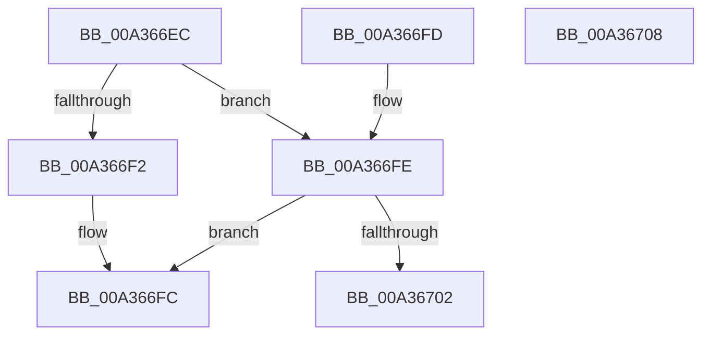

# PpmHeteroComputeBias

- RVA: `0x00A366EC`–`0x00A36709` (길이 `29` bytes)
- VA: `0x0000000140A366EC`
- 실행 섹션: `PAGE`
- PDB 이름 있음: `예`; PDB Function 태그: `아니요`
- unwind 정보 RVA: `0x000DB714`
- 디코드: `14`개 명령, `29/29` bytes 표시
- 미해석 바이트: `0` (있으면 어셈블리에 `.byte`로 보존)

> 이 문서는 커널 이미지의 기계어와 PDB 기호를 분석해 생성했습니다. 4번과 5번은 함수 원형과 자료형을 바이너리 사용 방식에서 추정한 C 해석이며 원본 소스 복구 결과는 아닙니다.

## 1. Dependencies

- 직접 호출 지점: **0**; 고유 호출 대상: **0**
- 직접 호출자로 확인된 함수: **1**
- RIP 상대 이미지 참조: **0**

### Outgoing calls
- 직접 디코드된 call 명령이 없습니다.

### Direct callers
- [PopConfigureHeteroPolicies](PopConfigureHeteroPolicies_function_00A35B30.md) at `0x00A35F7C`
- [PopConfigureHeteroPolicies](PopConfigureHeteroPolicies_function_00A35B30.md) at `0x00A35FD5`

### Static image references
- 디코드된 RIP-relative 메모리 참조가 없습니다.

## 2. Other-region calls and transfers

- 다른 실행 섹션으로 향하는 call: **0**
- 별도 외부 분기/꼬리 이동을 확인하지 못했습니다.

## 3. Assembly (complete function range)

```asm
00A366EC  33 C0                           xor eax, eax
00A366EE  84 C9                           test cl, cl
00A366F0  74 0C                           je 0x140a366fe
00A366F2  F6 DA                           neg dl
00A366F4  1B C0                           sbb eax, eax
00A366F6  83 E0 FE                        and eax, 0xfffffffe
00A366F9  83 C0 03                        add eax, 3
00A366FC  C3                              ret
00A366FD  CC                              int3
00A366FE  84 D2                           test dl, dl
00A36700  74 FA                           je 0x140a366fc
00A36702  B8 02 00 00 00                  mov eax, 2
00A36707  C3                              ret
00A36708  CC                              int3
```

## 4. C-style interpretation (structured pseudocode)

```c
__int64 __fastcall PpmHeteroComputeBias(unsigned __int8 a1, unsigned __int8 a2)
{
    __int64 result;

    result = 0;
    if (a1 == 0) goto loc_00A366FE;
    a2 = (unsigned __int8)(-(a2));
    result = (unsigned int)((result) & (0xFFFFFFFEULL));
    result = (unsigned int)((result) + (3));
loc_00A366FC:
    return result;
loc_00A366FE:
    if (a2 == 0) goto loc_00A366FC;
    return 2;
}
```

## 5. (Beta) C Style

```c
int64_t PpmHeteroComputeBias(uint8_t Arg1, uint8_t Arg2)
{
    int64_t result;

    result = 0;
    if (Arg1 == 0) goto loc_00A366FE;
    Arg2 = (uint8_t)(-(Arg2));
    result = (uint32_t)((result) & (0xFFFFFFFEULL));
    result = (uint32_t)((result) + (3));
loc_00A366FC:
    return result;
loc_00A366FE:
    if (Arg2 == 0) goto loc_00A366FC;
    return 2;
}
```

## 6. Execution-region graph

[열기: 2D/3D 그래프와 함수 탐색 컨트롤 패널](../../../control-panel.html?section=page&rva=0x00A366EC&view=graph)

- 2D 그래프는 위에서 아래로 흐르고, 3D 그래프는 빈 공간을 드래그해 회전합니다. Shift+드래그는 이동, 휠은 확대·축소, 함수 노드 선택은 대상 보고서 이동입니다.

### Static fallback


