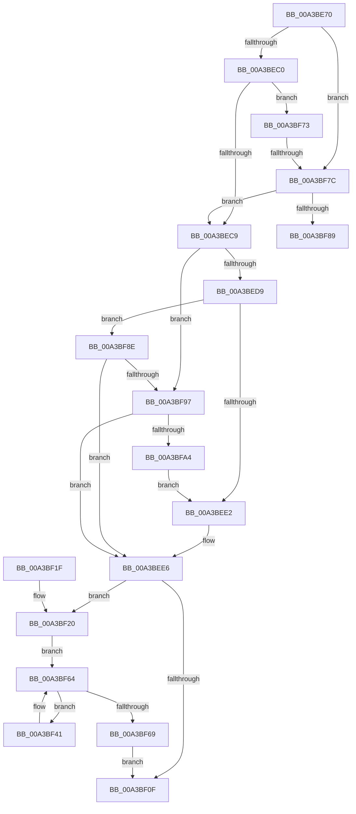

# PsChangeQuantumTable

- RVA: `0x00A3BE70`–`0x00A3BFA9` (길이 `313` bytes)
- VA: `0x0000000140A3BE70`
- 실행 섹션: `PAGE`
- PDB 이름 있음: `예`; PDB Function 태그: `예`
- unwind 정보 RVA: `0x000AE400`
- 디코드: `73`개 명령, `313/313` bytes 표시
- 미해석 바이트: `0` (있으면 어셈블리에 `.byte`로 보존)

> 이 문서는 커널 이미지의 기계어와 PDB 기호를 분석해 생성했습니다. 4번과 5번은 함수 원형과 자료형을 바이너리 사용 방식에서 추정한 C 해석이며 원본 소스 복구 결과는 아닙니다.

## 1. Dependencies

- 직접 호출 지점: **6**; 고유 호출 대상: **5**
- 직접 호출자로 확인된 함수: **2**
- RIP 상대 이미지 참조: **10**

### Outgoing calls
- `0x00A3BF2C` → [PspLockProcessListShared](../../text/41/PspLockProcessListShared_function_0041BAB0.md) (function, `0x0041BAB0`)
- `0x00A3BF52` → [PspComputeQuantum](PspComputeQuantum_function_00A3C084.md) (function, `0x00A3C084`)
- `0x00A3BF5C` → [KeSetQuantumProcess](../../text/3C/KeSetQuantumProcess_function_003C1EF0.md) (function, `0x003C1EF0`)
- `0x00A3BF6C` → [PspUnlockProcessListShared](../../text/2E/PspUnlockProcessListShared_function_002E2920.md) (function, `0x002E2920`)
- `0x00A3BF7C` → [MmIsThisAnNtAsSystem](../../text/4B/MmIsThisAnNtAsSystem_function_004B2860.md) (function, `0x004B2860`)
- `0x00A3BF97` → [MmIsThisAnNtAsSystem](../../text/4B/MmIsThisAnNtAsSystem_function_004B2860.md) (function, `0x004B2860`)

### Direct callers
- [NtSetSystemInformation](../AF/NtSetSystemInformation_function_00AF4A60.md) at `0x00AF5166`
- [PspInitPhase0](../../init/C7/PspInitPhase0_function_00C77E2C.md) at `0x00C78080`

### Static image references
- `0x00A3BE81` → RVA `0x00B4B194` (`PspVariableQuantums_With_ShortQuantum`; read)
- `0x00A3BE9A` → RVA `0x00FC6B38` (`ALMOSTRO`; read)
- `0x00A3BEA4` → RVA `0x00FC6C9C` (`ALMOSTRO`; write)
- `0x00A3BEAA` → RVA `0x00B4B18C` (`PspVariableQuantums`; read)
- `0x00A3BEC9` → RVA `0x00FC6AF5` (`ALMOSTRO`; write)
- `0x00A3BEE6` → RVA `0x00B4AE6B` (`PAGE`; read)
- `0x00A3BEF3` → RVA `0x00FD9ADC` (`PAGEDATA`; write)
- `0x00A3BEFD` → RVA `0x00FD9A66` (`PAGEDATA`; write)
- `0x00A3BF04` → RVA `0x00FD9ADE` (`PAGEDATA`; write)
- `0x00A3BF31` → RVA `0x00F067C0` (`.data`; read)

## 2. Other-region calls and transfers

- 다른 실행 섹션으로 향하는 call: **5**
  - `0x00A3BF2C` → [PspLockProcessListShared](../../text/41/PspLockProcessListShared_function_0041BAB0.md) (`PAGE` → `.text`)
  - `0x00A3BF5C` → [KeSetQuantumProcess](../../text/3C/KeSetQuantumProcess_function_003C1EF0.md) (`PAGE` → `.text`)
  - `0x00A3BF6C` → [PspUnlockProcessListShared](../../text/2E/PspUnlockProcessListShared_function_002E2920.md) (`PAGE` → `.text`)
  - `0x00A3BF7C` → [MmIsThisAnNtAsSystem](../../text/4B/MmIsThisAnNtAsSystem_function_004B2860.md) (`PAGE` → `.text`)
  - `0x00A3BF97` → [MmIsThisAnNtAsSystem](../../text/4B/MmIsThisAnNtAsSystem_function_004B2860.md) (`PAGE` → `.text`)
- call이 아닌 외부 분기/꼬리 이동: **2**
  - `0x00A3BF76` → [sub_00B3A3BC](../B3/Unknown_function_00B3A3BC.md) (`tail-transfer`)
  - `0x00A3BF89` → [sub_00B3A3BC](../B3/Unknown_function_00B3A3BC.md) (`tail-transfer`)

## 3. Assembly (complete function range)

```asm
00A3BE70  48 89 5C 24 08                  mov qword ptr [rsp + 8], rbx
00A3BE75  48 89 74 24 10                  mov qword ptr [rsp + 0x10], rsi
00A3BE7A  57                              push rdi
00A3BE7B  48 83 EC 20                     sub rsp, 0x20
00A3BE7F  8B C2                           mov eax, edx
00A3BE81  48 8D 1D 0C F3 10 00            lea rbx, [rip + 0x10f30c]
00A3BE88  83 E0 03                        and eax, 3
00A3BE8B  40 8A F1                        mov sil, cl
00A3BE8E  B9 02 00 00 00                  mov ecx, 2
00A3BE93  8B FA                           mov edi, edx
00A3BE95  3B C1                           cmp eax, ecx
00A3BE97  0F 43 C1                        cmovae eax, ecx
00A3BE9A  F7 05 94 AC 58 00 00 00 04 00   test dword ptr [rip + 0x58ac94], 0x40000
00A3BEA4  89 05 F2 AD 58 00               mov dword ptr [rip + 0x58adf2], eax
00A3BEAA  48 8D 05 DB F2 10 00            lea rax, [rip + 0x10f2db]
00A3BEB1  48 0F 44 D8                     cmove rbx, rax
00A3BEB5  8B C2                           mov eax, edx
00A3BEB7  83 E0 0C                        and eax, 0xc
00A3BEBA  0F 84 BC 00 00 00               je 0x140a3bf7c
00A3BEC0  83 F8 04                        cmp eax, 4
00A3BEC3  0F 85 AA 00 00 00               jne 0x140a3bf73
00A3BEC9  C6 05 25 AC 58 00 01            mov byte ptr [rip + 0x58ac25], 1
00A3BED0  83 E7 30                        and edi, 0x30
00A3BED3  0F 84 BE 00 00 00               je 0x140a3bf97
00A3BED9  83 FF 10                        cmp edi, 0x10
00A3BEDC  0F 85 AC 00 00 00               jne 0x140a3bf8e
00A3BEE2  48 83 C3 03                     add rbx, 3
00A3BEE6  48 8D 05 7E EF 10 00            lea rax, [rip + 0x10ef7e]
00A3BEED  48 3B D8                        cmp rbx, rax
00A3BEF0  0F B7 03                        movzx eax, word ptr [rbx]
00A3BEF3  66 89 05 E2 DB 59 00            mov word ptr [rip + 0x59dbe2], ax
00A3BEFA  8A 43 02                        mov al, byte ptr [rbx + 2]
00A3BEFD  0F 94 05 62 DB 59 00            sete byte ptr [rip + 0x59db62]
00A3BF04  88 05 D4 DB 59 00               mov byte ptr [rip + 0x59dbd4], al
00A3BF0A  40 84 F6                        test sil, sil
00A3BF0D  75 11                           jne 0x140a3bf20
00A3BF0F  48 8B 5C 24 30                  mov rbx, qword ptr [rsp + 0x30]
00A3BF14  48 8B 74 24 38                  mov rsi, qword ptr [rsp + 0x38]
00A3BF19  48 83 C4 20                     add rsp, 0x20
00A3BF1D  5F                              pop rdi
00A3BF1E  C3                              ret
00A3BF1F  CC                              int3
00A3BF20  65 48 8B 3C 25 88 01 00 00      mov rdi, qword ptr gs:[0x188]
00A3BF29  48 8B CF                        mov rcx, rdi
00A3BF2C  E8 7F FB 9D FF                  call 0x14041bab0
00A3BF31  48 8B 1D 88 A8 4C 00            mov rbx, qword ptr [rip + 0x4ca888]
00A3BF38  48 8D 35 81 A8 4C 00            lea rsi, [rip + 0x4ca881]
00A3BF3F  EB 23                           jmp 0x140a3bf64
00A3BF41  4C 8D 83 28 FE FF FF            lea r8, [rbx - 0x1d8]
00A3BF48  41 8A 90 BA 04 00 00            mov dl, byte ptr [r8 + 0x4ba]
00A3BF4F  49 8B C8                        mov rcx, r8
00A3BF52  E8 2D 01 00 00                  call 0x140a3c084
00A3BF57  8A D0                           mov dl, al
00A3BF59  49 8B C8                        mov rcx, r8
00A3BF5C  E8 8F 5F 98 FF                  call 0x1403c1ef0
00A3BF61  48 8B 1B                        mov rbx, qword ptr [rbx]
00A3BF64  48 3B DE                        cmp rbx, rsi
00A3BF67  75 D8                           jne 0x140a3bf41
00A3BF69  48 8B CF                        mov rcx, rdi
00A3BF6C  E8 AF 69 8A FF                  call 0x1402e2920
00A3BF71  EB 9C                           jmp 0x140a3bf0f
00A3BF73  83 F8 08                        cmp eax, 8
00A3BF76  0F 84 40 E4 0F 00               je 0x140b3a3bc
00A3BF7C  E8 DF 68 A7 FF                  call 0x1404b2860
00A3BF81  84 C0                           test al, al
00A3BF83  0F 84 40 FF FF FF               je 0x140a3bec9
00A3BF89  E9 2E E4 0F 00                  jmp 0x140b3a3bc
00A3BF8E  83 FF 20                        cmp edi, 0x20
00A3BF91  0F 84 4F FF FF FF               je 0x140a3bee6
00A3BF97  E8 C4 68 A7 FF                  call 0x1404b2860
00A3BF9C  84 C0                           test al, al
00A3BF9E  0F 84 42 FF FF FF               je 0x140a3bee6
00A3BFA4  E9 39 FF FF FF                  jmp 0x140a3bee2
```

## 4. C-style interpretation (structured pseudocode)

```c
__int64 __fastcall PsChangeQuantumTable(unsigned __int8 a1, int a2)
{
    __int64 result;
    __int64 v_rbx;
    __int64 v_rdi;
    __int64 v_rsp;
    unsigned __int64 v_stack_p10;
    unsigned __int64 v_stack_p8;

    v_stack_p8 = v_rbx;
    v_stack_p10 = v_rsi;
    v_rsp = (v_rsp) - (32);
    result = (unsigned int)(((unsigned int)(a2)) & (3));
    if (((unsigned int)(result)) >= 2) { result = 2; }
    *(unsigned int *)(v_rip + 5811698) = (unsigned int)(result);
    v_rbx = v_rip + 1110796;
    if (((*(unsigned int *)(v_rip + 5811348)) & (0x40000ULL)) == 0) { v_rbx = v_rip + 1110747; }
    result = (unsigned int)(((unsigned int)(a2)) & (12));
    if (condition_is_equal) goto loc_00A3BF7C;
    if (((unsigned int)(result)) != 4) goto loc_00A3BF73;
loc_00A3BEC9:
    *(unsigned __int8 *)(v_rip + 5811237) = 1;
    v_rdi = (unsigned int)(((unsigned int)(a2)) & (48));
    if (condition_is_equal) goto loc_00A3BF97;
    if (((unsigned int)(v_rdi)) != 16) goto loc_00A3BF8E;
loc_00A3BEE2:
    v_rbx = (v_rbx) + (3);
loc_00A3BEE6:
    *(unsigned __int16 *)(v_rip + 5888994) = (unsigned __int16)(*(unsigned __int16 *)(v_rbx));
    *(unsigned __int8 *)(v_rip + 5888980) = (unsigned __int8)(*(unsigned __int8 *)(v_rbx + 2));
    if (a1 != 0) goto loc_00A3BF20;
loc_00A3BF0F:
    v_rsp = (v_rsp) + (32);
    return *(unsigned __int8 *)(v_rbx + 2);
loc_00A3BF20:
    result = PspLockProcessListShared(*(unsigned __int64 *)(gs_base + (0 + 392)), a2, a3, a4);
    goto loc_00A3BF64;
loc_00A3BF41:
    result = PspComputeQuantum(*(unsigned __int64 *)(v_rip + 5023880) - 472, *(unsigned __int8 *)(*(unsigned __int64 *)(v_rip + 5023880) - 472 + 1210), *(unsigned __int64 *)(v_rip + 5023880) - 472, a4);
    result = KeSetQuantumProcess(*(unsigned __int64 *)(v_rip + 5023880) - 472, (unsigned __int8)(result), *(unsigned __int64 *)(v_rip + 5023880) - 472, a4);
loc_00A3BF64:
    if ((*(unsigned __int64 *)(*(unsigned __int64 *)(v_rip + 5023880))) != (v_rip + 5023873)) goto loc_00A3BF41;
    result = PspUnlockProcessListShared(*(unsigned __int64 *)(gs_base + (0 + 392)), (unsigned __int8)(result), *(unsigned __int64 *)(v_rip + 5023880) - 472, a4);
    goto loc_00A3BF0F;
loc_00A3BF73:
loc_00A3BF7C:
    result = MmIsThisAnNtAsSystem(*(unsigned __int64 *)(gs_base + (0 + 392)), (unsigned __int8)(result), *(unsigned __int64 *)(v_rip + 5023880) - 472, a4);
    if ((unsigned __int8)(result) == 0) goto loc_00A3BEC9;
loc_00A3BF8E:
    if (((unsigned int)(*(unsigned __int64 *)(gs_base + (0 + 392)))) == 32) goto loc_00A3BEE6;
loc_00A3BF97:
    result = MmIsThisAnNtAsSystem(*(unsigned __int64 *)(gs_base + (0 + 392)), (unsigned __int8)(result), *(unsigned __int64 *)(v_rip + 5023880) - 472, a4);
    if ((unsigned __int8)(result) == 0) goto loc_00A3BEE6;
    goto loc_00A3BEE2;
}
```

## 5. (Beta) C Style

```c
int64_t PsChangeQuantumTable(uint8_t Arg1, int32_t Arg2)
{
    int64_t result;
    int64_t local_rbx;
    int64_t local_rdi;
    int64_t local_rsp;
    uint64_t v_stack_p10;
    uint64_t v_stack_p8;

    v_stack_p8 = local_rbx;
    v_stack_p10 = local_rsi;
    local_rsp = (local_rsp) - (32);
    result = (uint32_t)(((uint32_t)(Arg2)) & (3));
    if (((uint32_t)(result)) >= 2) { result = 2; }
    *(uint32_t *)(v_rip + 0x58ADF2) = (uint32_t)(result);
    local_rbx = v_rip + 1110796;
    if (((*(uint32_t *)(v_rip + 0x58AC94)) & (0x40000ULL)) == 0) { local_rbx = v_rip + 1110747; }
    result = (uint32_t)(((uint32_t)(Arg2)) & (12));
    if (condition_is_equal) goto loc_00A3BF7C;
    if (((uint32_t)(result)) != 4) goto loc_00A3BF73;
loc_00A3BEC9:
    *(uint8_t *)(v_rip + 0x58AC25) = 1;
    local_rdi = (uint32_t)(((uint32_t)(Arg2)) & (48));
    if (condition_is_equal) goto loc_00A3BF97;
    if (((uint32_t)(local_rdi)) != 16) goto loc_00A3BF8E;
loc_00A3BEE2:
    local_rbx = (local_rbx) + (3);
loc_00A3BEE6:
    *(uint16_t *)(v_rip + 0x59DBE2) = (uint16_t)(*(uint16_t *)(local_rbx));
    *(uint8_t *)(v_rip + 0x59DBD4) = (uint8_t)(*(uint8_t *)(local_rbx + 0x2));
    if (Arg1 != 0) goto loc_00A3BF20;
loc_00A3BF0F:
    local_rsp = (local_rsp) + (32);
    return *(uint8_t *)(local_rbx + 0x2);
loc_00A3BF20:
    result = PspLockProcessListShared(*(uint64_t *)(gs_base + (0 + 0x188)), Arg2, a3, a4);
    goto loc_00A3BF64;
loc_00A3BF41:
    result = PspComputeQuantum(*(uint64_t *)(v_rip + 0x4CA888) - 472, *(uint8_t *)(*(uint64_t *)(v_rip + 0x4CA888) - 0x1D8 + 0x4BA), *(uint64_t *)(v_rip + 0x4CA888) - 472, a4);
    result = KeSetQuantumProcess(*(uint64_t *)(v_rip + 0x4CA888) - 472, (uint8_t)(result), *(uint64_t *)(v_rip + 0x4CA888) - 472, a4);
loc_00A3BF64:
    if ((*(uint64_t *)(*(uint64_t *)(v_rip + 0x4CA888))) != (v_rip + 5023873)) goto loc_00A3BF41;
    result = PspUnlockProcessListShared(*(uint64_t *)(gs_base + (0 + 0x188)), (uint8_t)(result), *(uint64_t *)(v_rip + 0x4CA888) - 472, a4);
    goto loc_00A3BF0F;
loc_00A3BF73:
loc_00A3BF7C:
    result = MmIsThisAnNtAsSystem(*(uint64_t *)(gs_base + (0 + 0x188)), (uint8_t)(result), *(uint64_t *)(v_rip + 0x4CA888) - 472, a4);
    if ((uint8_t)(result) == 0) goto loc_00A3BEC9;
loc_00A3BF8E:
    if (((uint32_t)(*(uint64_t *)(gs_base + (0 + 0x188)))) == 32) goto loc_00A3BEE6;
loc_00A3BF97:
    result = MmIsThisAnNtAsSystem(*(uint64_t *)(gs_base + (0 + 0x188)), (uint8_t)(result), *(uint64_t *)(v_rip + 0x4CA888) - 472, a4);
    if ((uint8_t)(result) == 0) goto loc_00A3BEE6;
    goto loc_00A3BEE2;
}
```

## 6. Execution-region graph

[열기: 2D/3D 그래프와 함수 탐색 컨트롤 패널](../../../control-panel.html?section=page&rva=0x00A3BE70&view=graph)

- 2D 그래프는 위에서 아래로 흐르고, 3D 그래프는 빈 공간을 드래그해 회전합니다. Shift+드래그는 이동, 휠은 확대·축소, 함수 노드 선택은 대상 보고서 이동입니다.

### Static fallback


