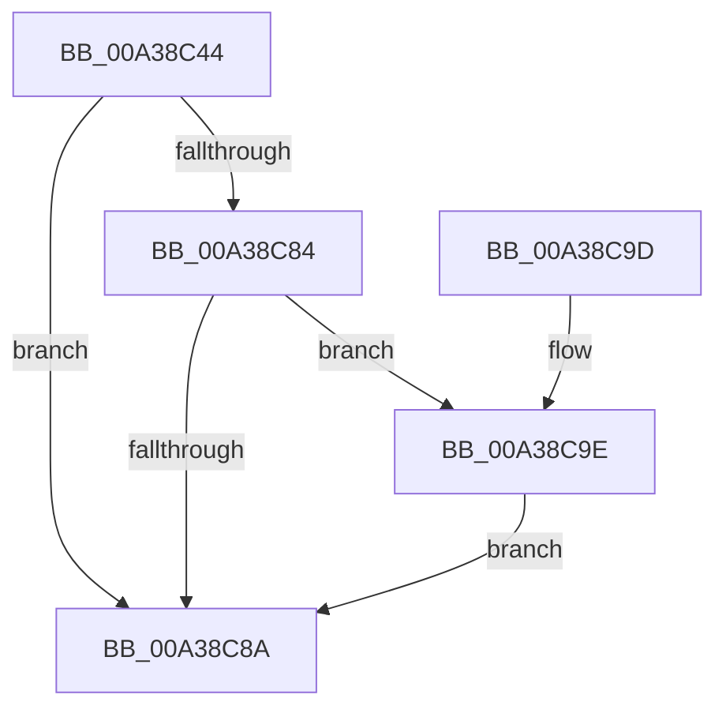

# PsIsProcessAppContainer

- RVA: `0x00A38C44`–`0x00A38CA3` (길이 `95` bytes)
- VA: `0x0000000140A38C44`
- 실행 섹션: `PAGE`
- PDB 이름 있음: `예`; PDB Function 태그: `아니요`
- unwind 정보 RVA: `0x000ADE30`
- 디코드: `29`개 명령, `95/95` bytes 표시
- 미해석 바이트: `0` (있으면 어셈블리에 `.byte`로 보존)

> 이 문서는 커널 이미지의 기계어와 PDB 기호를 분석해 생성했습니다. 4번과 5번은 함수 원형과 자료형을 바이너리 사용 방식에서 추정한 C 해석이며 원본 소스 복구 결과는 아닙니다.

## 1. Dependencies

- 직접 호출 지점: **3**; 고유 호출 대상: **3**
- 직접 호출자로 확인된 함수: **10**
- RIP 상대 이미지 참조: **0**

### Outgoing calls
- `0x00A38C5E` → [PsReferencePrimaryTokenWithTag](../../text/20/PsReferencePrimaryTokenWithTag_function_0020FF80.md) (function, `0x0020FF80`)
- `0x00A38C71` → [SeQueryInformationToken](../8B/SeQueryInformationToken_function_008B5090.md) (function, `0x008B5090`)
- `0x00A38C7B` → [ObfDereferenceObject](../../text/2F/ObfDereferenceObject_function_002F9350.md) (function, `0x002F9350`)

### Direct callers
- [IopReferenceFileObject](../../text/29/IopReferenceFileObject_function_0029D530.md) at `0x0029D59A`
- [IopFileObjectRevoked](../../text/41/IopFileObjectRevoked_function_004159D0.md) at `0x004159FF`
- [IoRevokeHandlesForProcess](../../text/59/IoRevokeHandlesForProcess_function_005981A8.md) at `0x005981D9`
- [PiUEventGetDmObjectFromUserHandle](../72/PiUEventGetDmObjectFromUserHandle_function_0072DF88.md) at `0x0072E03A`
- [NtSetSystemEnvironmentValueEx](../7C/NtSetSystemEnvironmentValueEx_function_007CE990.md) at `0x007CEADF`
- [NtWriteFile](../8E/NtWriteFile_function_008E92D0.md) at `0x008E9665`
- [IopSynchronousServiceTail](../8E/IopSynchronousServiceTail_function_008EB440.md) at `0x008EB5D6`
- [NtQuerySystemEnvironmentValueEx](../95/NtQuerySystemEnvironmentValueEx_function_00952180.md) at `0x009524B7`
- [PiUEventGetDeviceInstanceIdFromUserHandle](PiUEventGetDeviceInstanceIdFromUserHandle_function_00A38954.md) at `0x00A389FC`
- [ExpGetSystemFirmwareTableInformation](ExpGetSystemFirmwareTableInformation_function_00A38A2C.md) at `0x00A38B7A`

### Static image references
- 디코드된 RIP-relative 메모리 참조가 없습니다.

## 2. Other-region calls and transfers

- 다른 실행 섹션으로 향하는 call: **2**
  - `0x00A38C5E` → [PsReferencePrimaryTokenWithTag](../../text/20/PsReferencePrimaryTokenWithTag_function_0020FF80.md) (`PAGE` → `.text`)
  - `0x00A38C7B` → [ObfDereferenceObject](../../text/2F/ObfDereferenceObject_function_002F9350.md) (`PAGE` → `.text`)
- 별도 외부 분기/꼬리 이동을 확인하지 못했습니다.

## 3. Assembly (complete function range)

```asm
00A38C44  48 89 5C 24 08                  mov qword ptr [rsp + 8], rbx
00A38C49  48 89 74 24 18                  mov qword ptr [rsp + 0x18], rsi
00A38C4E  57                              push rdi
00A38C4F  48 83 EC 20                     sub rsp, 0x20
00A38C53  33 F6                           xor esi, esi
00A38C55  BA 44 66 6C 74                  mov edx, 0x746c6644
00A38C5A  89 74 24 38                     mov dword ptr [rsp + 0x38], esi
00A38C5E  E8 1D 73 7D FF                  call 0x14020ff80
00A38C63  4C 8D 44 24 38                  lea r8, [rsp + 0x38]
00A38C68  48 8B C8                        mov rcx, rax
00A38C6B  8D 56 1D                        lea edx, [rsi + 0x1d]
00A38C6E  48 8B F8                        mov rdi, rax
00A38C71  E8 1A C4 E7 FF                  call 0x1408b5090
00A38C76  48 8B CF                        mov rcx, rdi
00A38C79  8B D8                           mov ebx, eax
00A38C7B  E8 D0 06 8C FF                  call 0x1402f9350
00A38C80  85 DB                           test ebx, ebx
00A38C82  78 06                           js 0x140a38c8a
00A38C84  39 74 24 38                     cmp dword ptr [rsp + 0x38], esi
00A38C88  75 14                           jne 0x140a38c9e
00A38C8A  48 8B 5C 24 30                  mov rbx, qword ptr [rsp + 0x30]
00A38C8F  40 8A C6                        mov al, sil
00A38C92  48 8B 74 24 40                  mov rsi, qword ptr [rsp + 0x40]
00A38C97  48 83 C4 20                     add rsp, 0x20
00A38C9B  5F                              pop rdi
00A38C9C  C3                              ret
00A38C9D  CC                              int3
00A38C9E  40 B6 01                        mov sil, 1
00A38CA1  EB E7                           jmp 0x140a38c8a
```

## 4. C-style interpretation (structured pseudocode)

```c
__int64 __fastcall PsIsProcessAppContainer(void)
{
    __int64 result;
    __int64 v_rsi;
    __int64 v_rsp;
    unsigned int v_stack_p10;
    unsigned __int64 v_stack_p18;
    unsigned __int64 v_stack_p8;

    v_stack_p8 = v_rbx;
    v_stack_p18 = v_rsi;
    v_rsp = (v_rsp) - (32);
    v_rsi = 0;
    v_stack_p10 = 0;
    result = PsReferencePrimaryTokenWithTag(a1, (unsigned int)(0x746C6644ULL), a3, a4);
    result = SeQueryInformationToken(result, v_rsi + 29, v_stack_p10, a4);
    result = ObfDereferenceObject(result, v_rsi + 29, v_stack_p10, a4);
    if (sign_flag) goto loc_00A38C8A;
    if (v_stack_p10 != 0) goto loc_00A38C9E;
loc_00A38C8A:
    v_rsp = (v_rsp) + (32);
    return 0;
loc_00A38C9E:
    goto loc_00A38C8A;
}
```

## 5. (Beta) C Style

```c
void PsIsProcessAppContainer(void)
{
    int64_t result;
    int64_t local_rsi;
    int64_t local_rsp;
    uint32_t v_stack_p10;
    uint64_t v_stack_p18;
    uint64_t v_stack_p8;

    v_stack_p8 = local_rbx;
    v_stack_p18 = local_rsi;
    local_rsp = (local_rsp) - (32);
    local_rsi = 0;
    v_stack_p10 = 0;
    result = PsReferencePrimaryTokenWithTag(a1, (uint32_t)(0x746C6644ULL), a3, a4);
    result = SeQueryInformationToken(result, local_rsi + 29, v_stack_p10, a4);
    result = ObfDereferenceObject(result, local_rsi + 29, v_stack_p10, a4);
    if (sign_flag) goto loc_00A38C8A;
    if (v_stack_p10 != 0) goto loc_00A38C9E;
loc_00A38C8A:
    local_rsp = (local_rsp) + (32);
    return 0;
loc_00A38C9E:
    goto loc_00A38C8A;
}
```

## 6. Execution-region graph

[열기: 2D/3D 그래프와 함수 탐색 컨트롤 패널](../../../control-panel.html?section=page&rva=0x00A38C44&view=graph)

- 2D 그래프는 위에서 아래로 흐르고, 3D 그래프는 빈 공간을 드래그해 회전합니다. Shift+드래그는 이동, 휠은 확대·축소, 함수 노드 선택은 대상 보고서 이동입니다.

### Static fallback


