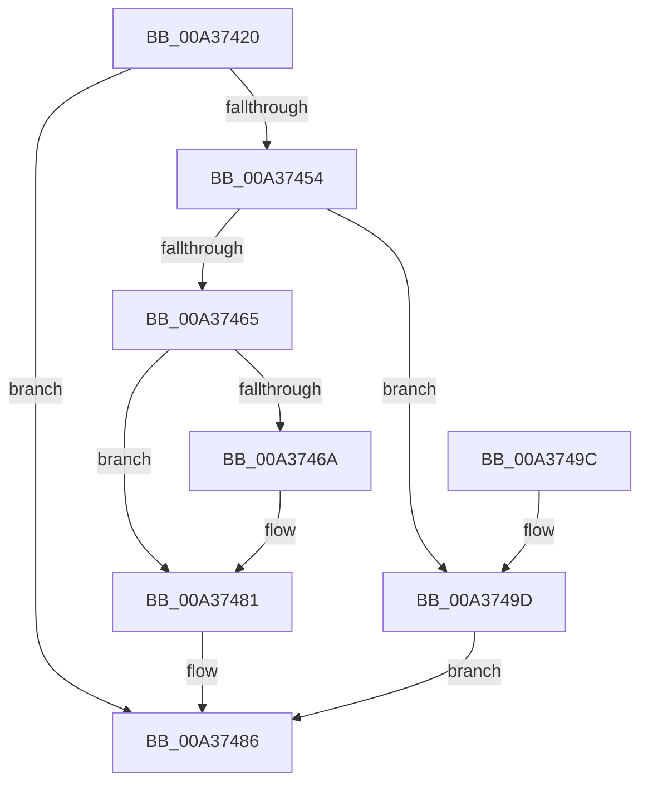

# PsLookupProcessThreadByCid

- RVA: `0x00A37420`–`0x00A374AC` (길이 `140` bytes)
- VA: `0x0000000140A37420`
- 실행 섹션: `PAGE`
- PDB 이름 있음: `예`; PDB Function 태그: `아니요`
- unwind 정보 RVA: `0x000ADA88`
- 디코드: `39`개 명령, `140/140` bytes 표시
- 미해석 바이트: `0` (있으면 어셈블리에 `.byte`로 보존)

> 이 문서는 커널 이미지의 기계어와 PDB 기호를 분석해 생성했습니다. 4번과 5번은 함수 원형과 자료형을 바이너리 사용 방식에서 추정한 C 해석이며 원본 소스 복구 결과는 아닙니다.

## 1. Dependencies

- 직접 호출 지점: **3**; 고유 호출 대상: **3**
- 직접 호출자로 확인된 함수: **1**
- RIP 상대 이미지 참조: **0**

### Outgoing calls
- `0x00A3744B` → [PsLookupThreadByThreadId](../86/PsLookupThreadByThreadId_function_00868300.md) (function, `0x00868300`)
- `0x00A37479` → [ObfReferenceObjectWithTag](../../text/21/ObfReferenceObjectWithTag_function_00210710.md) (function, `0x00210710`)
- `0x00A374A0` → [ObfDereferenceObject](../../text/2F/ObfDereferenceObject_function_002F9350.md) (function, `0x002F9350`)

### Direct callers
- [NtSetSystemInformation](../AF/NtSetSystemInformation_function_00AF4A60.md) at `0x00AF580E`

### Static image references
- 디코드된 RIP-relative 메모리 참조가 없습니다.

## 2. Other-region calls and transfers

- 다른 실행 섹션으로 향하는 call: **2**
  - `0x00A37479` → [ObfReferenceObjectWithTag](../../text/21/ObfReferenceObjectWithTag_function_00210710.md) (`PAGE` → `.text`)
  - `0x00A374A0` → [ObfDereferenceObject](../../text/2F/ObfDereferenceObject_function_002F9350.md) (`PAGE` → `.text`)
- 별도 외부 분기/꼬리 이동을 확인하지 못했습니다.

## 3. Assembly (complete function range)

```asm
00A37420  48 8B C4                        mov rax, rsp
00A37423  48 89 58 10                     mov qword ptr [rax + 0x10], rbx
00A37427  48 89 70 18                     mov qword ptr [rax + 0x18], rsi
00A3742B  48 89 78 20                     mov qword ptr [rax + 0x20], rdi
00A3742F  41 56                           push r14
00A37431  48 83 EC 20                     sub rsp, 0x20
00A37435  48 83 60 08 00                  and qword ptr [rax + 8], 0
00A3743A  48 8B F2                        mov rsi, rdx
00A3743D  48 8B D9                        mov rbx, rcx
00A37440  48 8D 50 08                     lea rdx, [rax + 8]
00A37444  48 8B 49 08                     mov rcx, qword ptr [rcx + 8]
00A37448  4D 8B F0                        mov r14, r8
00A3744B  E8 B0 0E E3 FF                  call 0x140868300
00A37450  85 C0                           test eax, eax
00A37452  78 32                           js 0x140a37486
00A37454  48 8B 7C 24 30                  mov rdi, qword ptr [rsp + 0x30]
00A37459  48 8B 03                        mov rax, qword ptr [rbx]
00A3745C  48 39 87 08 05 00 00            cmp qword ptr [rdi + 0x508], rax
00A37463  75 38                           jne 0x140a3749d
00A37465  48 85 F6                        test rsi, rsi
00A37468  74 17                           je 0x140a37481
00A3746A  48 8B 9F 20 02 00 00            mov rbx, qword ptr [rdi + 0x220]
00A37471  BA 44 66 6C 74                  mov edx, 0x746c6644
00A37476  48 8B CB                        mov rcx, rbx
00A37479  E8 92 92 7D FF                  call 0x140210710
00A3747E  48 89 1E                        mov qword ptr [rsi], rbx
00A37481  49 89 3E                        mov qword ptr [r14], rdi
00A37484  33 C0                           xor eax, eax
00A37486  48 8B 5C 24 38                  mov rbx, qword ptr [rsp + 0x38]
00A3748B  48 8B 74 24 40                  mov rsi, qword ptr [rsp + 0x40]
00A37490  48 8B 7C 24 48                  mov rdi, qword ptr [rsp + 0x48]
00A37495  48 83 C4 20                     add rsp, 0x20
00A37499  41 5E                           pop r14
00A3749B  C3                              ret
00A3749C  CC                              int3
00A3749D  48 8B CF                        mov rcx, rdi
00A374A0  E8 AB 1E 8C FF                  call 0x1402f9350
00A374A5  B8 0B 00 00 C0                  mov eax, 0xc000000b
00A374AA  EB DA                           jmp 0x140a37486
```

## 4. C-style interpretation (structured pseudocode)

```c
__int64 __fastcall PsLookupProcessThreadByCid(__int64 a1, __int64 a2, __int64 a3)
{
    __int64 result;
    __int64 v_rbx;
    __int64 v_rsp;
    unsigned __int64 v_stack_p10;
    unsigned __int64 v_stack_p18;
    unsigned __int64 v_stack_p20;
    unsigned __int64 v_stack_p8;

    *(unsigned __int64 *)(v_rsp + 16) = v_rbx;
    *(unsigned __int64 *)(v_rsp + 24) = v_rsi;
    *(unsigned __int64 *)(v_rsp + 32) = v_rdi;
    v_rsp = (v_rsp) - (32);
    result = PsLookupThreadByThreadId(*(unsigned __int64 *)(a1 + 8), v_rsp + 8, a3, a4);
    if (sign_flag) goto loc_00A37486;
    if ((*(unsigned __int64 *)(v_stack_p8 + 1288)) != (*(unsigned __int64 *)(a1))) goto loc_00A3749D;
    result = *(unsigned __int64 *)(a1);
    v_rbx = a1;
    if (a2 != 0) {
        v_rbx = *(unsigned __int64 *)(v_stack_p8 + 544);
        a2 = 0x746C6644ULL;
        a1 = v_rbx;
        result = ObfReferenceObjectWithTag(a1, a2, a3, a4);
        *(unsigned __int64 *)(a2) = v_rbx;
    }
    *(unsigned __int64 *)(a3) = v_stack_p8;
    result = 0;
loc_00A37486:
    v_rsp = (v_rsp) + (32);
    return result;
loc_00A3749D:
    result = ObfDereferenceObject(v_stack_p20, a2, a3, a4);
    goto loc_00A37486;
}
```

## 5. (Beta) C Style

```c
int64_t PsLookupProcessThreadByCid(void *Arg1, int64_t Arg2, void *Arg3)
{
    uint8_t *arg1 = (uint8_t *)Arg1;
    uint8_t *arg3 = (uint8_t *)Arg3;

    int64_t result;
    int64_t local_rbx;
    int64_t local_rsp;
    uint64_t v_stack_p10;
    uint64_t v_stack_p18;
    uint64_t v_stack_p20;
    uint64_t v_stack_p8;

    *(uint64_t *)(local_rsp + 0x10) = local_rbx;
    *(uint64_t *)(local_rsp + 0x18) = local_rsi;
    *(uint64_t *)(local_rsp + 0x20) = local_rdi;
    local_rsp = (local_rsp) - (32);
    result = PsLookupThreadByThreadId(*(uint64_t *)(arg1 + 0x8), local_rsp + 8, Arg3, a4);
    if (sign_flag) goto loc_00A37486;
    if ((*(uint64_t *)(v_stack_p8 + 0x508)) != (*(uint64_t *)(arg1))) goto loc_00A3749D;
    result = *(uint64_t *)(arg1);
    local_rbx = Arg1;
    if (Arg2 != 0) {
        local_rbx = *(uint64_t *)(v_stack_p8 + 0x220);
        Arg2 = 0x746C6644ULL;
        Arg1 = local_rbx;
        result = ObfReferenceObjectWithTag(Arg1, Arg2, Arg3, a4);
        *(uint64_t *)(Arg2) = local_rbx;
    }
    *(uint64_t *)(arg3) = v_stack_p8;
    result = 0;
loc_00A37486:
    local_rsp = (local_rsp) + (32);
    return result;
loc_00A3749D:
    result = ObfDereferenceObject(v_stack_p20, Arg2, Arg3, a4);
    goto loc_00A37486;
}
```

### 관측된 메모리 오프셋

구조체 형식이 확인되지 않은 접근은 인자 기준의 오프셋으로만 기록했습니다.

| 기준 인자 | 오프셋 표현 | 폭 (bit) | 접근 |
|---|---:|---:|---|
| `Arg1` | `+ 0x0` | `64` | `R` |
| `Arg1` | `+ 0x8` | `64` | `R` |
| `Arg3` | `+ 0x0` | `64` | `W` |

## 6. Execution-region graph

[열기: 2D/3D 그래프와 함수 탐색 컨트롤 패널](../../../control-panel.html?section=page&rva=0x00A37420&view=graph)

- 2D 그래프는 위에서 아래로 흐르고, 3D 그래프는 빈 공간을 드래그해 회전합니다. Shift+드래그는 이동, 휠은 확대·축소, 함수 노드 선택은 대상 보고서 이동입니다.

### Static fallback


