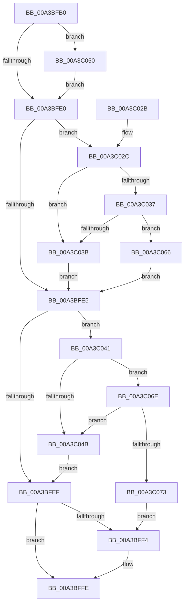

# PspComputeQuantumAndPriority

- RVA: `0x00A3BFB0`–`0x00A3C07B` (길이 `203` bytes)
- VA: `0x0000000140A3BFB0`
- 실행 섹션: `PAGE`
- PDB 이름 있음: `예`; PDB Function 태그: `아니요`
- unwind 정보 RVA: `0x0008B3A0`
- 디코드: `59`개 명령, `203/203` bytes 표시
- 미해석 바이트: `0` (있으면 어셈블리에 `.byte`로 보존)

> 이 문서는 커널 이미지의 기계어와 PDB 기호를 분석해 생성했습니다. 4번과 5번은 함수 원형과 자료형을 바이너리 사용 방식에서 추정한 C 해석이며 원본 소스 복구 결과는 아닙니다.

## 1. Dependencies

- 직접 호출 지점: **2**; 고유 호출 대상: **2**
- 직접 호출자로 확인된 함수: **2**
- RIP 상대 이미지 참조: **2**

### Outgoing calls
- `0x00A3BFF9` → [MmSetMemoryPriorityProcess](../../text/49/MmSetMemoryPriorityProcess_function_00494EF4.md) (function, `0x00494EF4`)
- `0x00A3C003` → [PspComputeQuantum](PspComputeQuantum_function_00A3C084.md) (function, `0x00A3C084`)

### Direct callers
- [PspSetProcessPriorityByClass](../../text/4E/PspSetProcessPriorityByClass_function_004E9754.md) at `0x004E977D`
- [PspAllocateProcess](../A1/PspAllocateProcess_function_00A13B3C.md) at `0x00A155A6`

### Static image references
- `0x00A3C00D` → RVA `0x00B4BB88` (`PspPriorityTable`; read)
- `0x00A3C050` → RVA `0x00FC6B38` (`ALMOSTRO`; read)

## 2. Other-region calls and transfers

- 다른 실행 섹션으로 향하는 call: **1**
  - `0x00A3BFF9` → [MmSetMemoryPriorityProcess](../../text/49/MmSetMemoryPriorityProcess_function_00494EF4.md) (`PAGE` → `.text`)
- 별도 외부 분기/꼬리 이동을 확인하지 못했습니다.

## 3. Assembly (complete function range)

```asm
00A3BFB0  48 89 5C 24 08                  mov qword ptr [rsp + 8], rbx
00A3BFB5  48 89 74 24 10                  mov qword ptr [rsp + 0x10], rsi
00A3BFBA  57                              push rdi
00A3BFBB  48 83 EC 20                     sub rsp, 0x20
00A3BFBF  49 8B F0                        mov rsi, r8
00A3BFC2  48 8B F9                        mov rdi, rcx
00A3BFC5  41 B8 01 00 00 00               mov r8d, 1
00A3BFCB  41 3B D0                        cmp edx, r8d
00A3BFCE  0F 95 C3                        setne bl
00A3BFD1  41 2A D8                        sub bl, r8b
00A3BFD4  45 8D 50 01                     lea r10d, [r8 + 1]
00A3BFD8  41 22 DA                        and bl, r10b
00A3BFDB  41 3B D2                        cmp edx, r10d
00A3BFDE  74 70                           je 0x140a3c050
00A3BFE0  4D 85 C9                        test r9, r9
00A3BFE3  75 47                           jne 0x140a3c02c
00A3BFE5  48 8B 4C 24 50                  mov rcx, qword ptr [rsp + 0x50]
00A3BFEA  48 85 C9                        test rcx, rcx
00A3BFED  75 52                           jne 0x140a3c041
00A3BFEF  41 3B D2                        cmp edx, r10d
00A3BFF2  74 0A                           je 0x140a3bffe
00A3BFF4  8A D3                           mov dl, bl
00A3BFF6  48 8B CF                        mov rcx, rdi
00A3BFF9  E8 F6 8E A5 FF                  call 0x140494ef4
00A3BFFE  8A D3                           mov dl, bl
00A3C000  48 8B CF                        mov rcx, rdi
00A3C003  E8 7C 00 00 00                  call 0x140a3c084
00A3C008  48 8B 5C 24 30                  mov rbx, qword ptr [rsp + 0x30]
00A3C00D  48 8D 0D 74 FB 10 00            lea rcx, [rip + 0x10fb74]
00A3C014  88 06                           mov byte ptr [rsi], al
00A3C016  0F B6 87 47 03 00 00            movzx eax, byte ptr [rdi + 0x347]
00A3C01D  48 8B 74 24 38                  mov rsi, qword ptr [rsp + 0x38]
00A3C022  8B 04 81                        mov eax, dword ptr [rcx + rax*4]
00A3C025  48 83 C4 20                     add rsp, 0x20
00A3C029  5F                              pop rdi
00A3C02A  C3                              ret
00A3C02B  CC                              int3
00A3C02C  8A 81 BA 04 00 00               mov al, byte ptr [rcx + 0x4ba]
00A3C032  41 3A C2                        cmp al, r10b
00A3C035  75 04                           jne 0x140a3c03b
00A3C037  85 D2                           test edx, edx
00A3C039  74 2B                           je 0x140a3c066
00A3C03B  41 83 21 00                     and dword ptr [r9], 0
00A3C03F  EB A4                           jmp 0x140a3bfe5
00A3C041  8A 87 BA 04 00 00               mov al, byte ptr [rdi + 0x4ba]
00A3C047  84 C0                           test al, al
00A3C049  74 23                           je 0x140a3c06e
00A3C04B  83 21 00                        and dword ptr [rcx], 0
00A3C04E  EB 9F                           jmp 0x140a3bfef
00A3C050  F7 05 DE AA 58 00 00 00 04 00   test dword ptr [rip + 0x58aade], 0x40000
00A3C05A  0F B6 DB                        movzx ebx, bl
00A3C05D  41 0F 45 DA                     cmovne ebx, r10d
00A3C061  E9 7A FF FF FF                  jmp 0x140a3bfe0
00A3C066  45 89 01                        mov dword ptr [r9], r8d
00A3C069  E9 77 FF FF FF                  jmp 0x140a3bfe5
00A3C06E  41 3B D0                        cmp edx, r8d
00A3C071  75 D8                           jne 0x140a3c04b
00A3C073  44 89 01                        mov dword ptr [rcx], r8d
00A3C076  E9 79 FF FF FF                  jmp 0x140a3bff4
```

## 4. C-style interpretation (structured pseudocode)

```c
__int64 __fastcall PspComputeQuantumAndPriority(__int64 a1, int a2, __int64 a3, __int64 a4, __int64 a5)
{
    __int64 result;
    __int64 v_rbx;
    __int64 v_rsp;
    unsigned __int64 v_stack_p10;
    unsigned __int64 v_stack_p8;

    v_stack_p8 = v_rbx;
    v_stack_p10 = v_rsi;
    v_rsp = (v_rsp) - (32);
    v_rbx = (a2 != 1) ? 1 : 0;
    v_rbx = (unsigned __int8)((v_rbx) - (1));
    v_rbx = (unsigned __int8)((v_rbx) & ((unsigned __int8)(1 + 1)));
    if (a2 == ((unsigned int)(1 + 1))) goto loc_00A3C050;
loc_00A3BFE0:
    if (a4 != 0) goto loc_00A3C02C;
loc_00A3BFE5:
    if (a5 != 0) goto loc_00A3C041;
loc_00A3BFEF:
    if (a2 != ((unsigned int)(1 + 1))) {
        a2 = (unsigned __int8)(v_rbx);
        a1 = a1;
        result = MmSetMemoryPriorityProcess(a1, a2, 1, a4);
    }
    result = PspComputeQuantum(a1, (unsigned __int8)(v_rbx), 1, a4);
    *(unsigned __int8 *)(a3) = (unsigned __int8)(result);
    v_rsp = (v_rsp) + (32);
    return (unsigned int)(*(unsigned int *)(v_rip + 1112948 + *(unsigned __int8 *)(a1 + 839) * 4));
loc_00A3C02C:
    if (((unsigned __int8)(*(unsigned __int8 *)(v_rip + 1112948 + 1210))) != ((unsigned __int8)(1 + 1))) goto loc_00A3C03B;
    if ((unsigned int)((unsigned __int8)(v_rbx)) == 0) goto loc_00A3C066;
loc_00A3C03B:
    goto loc_00A3BFE5;
loc_00A3C041:
    if ((unsigned __int8)(*(unsigned __int8 *)(a1 + 1210)) == 0) goto loc_00A3C06E;
loc_00A3C04B:
    goto loc_00A3BFEF;
loc_00A3C050:
    v_rbx = (unsigned __int8)(v_stack_p8);
    if (((*(unsigned int *)(v_rip + 5810910)) & (0x40000ULL)) != 0) { v_rbx = (unsigned int)(1 + 1); }
    goto loc_00A3BFE0;
loc_00A3C066:
    *(unsigned int *)(a4) = 1;
    goto loc_00A3BFE5;
loc_00A3C06E:
    if (((unsigned int)((unsigned __int8)(v_rbx))) != 1) goto loc_00A3C04B;
    *(unsigned int *)(v_rip + 1112948) = 1;
    goto loc_00A3BFF4;
}
```

## 5. (Beta) C Style

```c
int64_t PspComputeQuantumAndPriority(void *Arg1, int32_t Arg2, void *Arg3, int64_t Arg4, int64_t Arg5)
{
    uint8_t *arg1 = (uint8_t *)Arg1;
    uint8_t *arg3 = (uint8_t *)Arg3;

    int64_t result;
    int64_t local_rbx;
    int64_t local_rsp;
    uint64_t v_stack_p10;
    uint64_t v_stack_p8;

    v_stack_p8 = local_rbx;
    v_stack_p10 = local_rsi;
    local_rsp = (local_rsp) - (32);
    local_rbx = (Arg2 != 1) ? 1 : 0;
    local_rbx = (uint8_t)((local_rbx) - (1));
    local_rbx = (uint8_t)((local_rbx) & ((uint8_t)(1 + 1)));
    if (Arg2 == ((uint32_t)(1 + 1))) goto loc_00A3C050;
loc_00A3BFE0:
    if (Arg4 != 0) goto loc_00A3C02C;
loc_00A3BFE5:
    if (Arg5 != 0) goto loc_00A3C041;
loc_00A3BFEF:
    if (Arg2 != ((uint32_t)(1 + 1))) {
        Arg2 = (uint8_t)(local_rbx);
        Arg1 = Arg1;
        result = MmSetMemoryPriorityProcess(Arg1, Arg2, 1, Arg4);
    }
    result = PspComputeQuantum(Arg1, (uint8_t)(local_rbx), 1, Arg4);
    *(uint8_t *)(arg3) = (uint8_t)(result);
    local_rsp = (local_rsp) + (32);
    return (uint32_t)(*(uint32_t *)(v_rip + 0x10FB74 + *(uint8_t *)(arg1 + 0x347) * 4));
loc_00A3C02C:
    if (((uint8_t)(*(uint8_t *)(v_rip + 0x10FB74 + 0x4BA))) != ((uint8_t)(1 + 1))) goto loc_00A3C03B;
    if ((uint32_t)((uint8_t)(local_rbx)) == 0) goto loc_00A3C066;
loc_00A3C03B:
    goto loc_00A3BFE5;
loc_00A3C041:
    if ((uint8_t)(*(uint8_t *)(arg1 + 0x4BA)) == 0) goto loc_00A3C06E;
loc_00A3C04B:
    goto loc_00A3BFEF;
loc_00A3C050:
    local_rbx = (uint8_t)(v_stack_p8);
    if (((*(uint32_t *)(v_rip + 0x58AADE)) & (0x40000ULL)) != 0) { local_rbx = (uint32_t)(1 + 1); }
    goto loc_00A3BFE0;
loc_00A3C066:
    *(uint32_t *)(Arg4) = 1;
    goto loc_00A3BFE5;
loc_00A3C06E:
    if (((uint32_t)((uint8_t)(local_rbx))) != 1) goto loc_00A3C04B;
    *(uint32_t *)(v_rip + 0x10FB74) = 1;
    goto loc_00A3BFF4;
}
```

### 관측된 메모리 오프셋

구조체 형식이 확인되지 않은 접근은 인자 기준의 오프셋으로만 기록했습니다.

| 기준 인자 | 오프셋 표현 | 폭 (bit) | 접근 |
|---|---:|---:|---|
| `Arg1` | `+ 0x347` | `8` | `R` |
| `Arg1` | `+ 0x4BA` | `8` | `R` |
| `Arg3` | `+ 0x0` | `8` | `W` |

## 6. Execution-region graph

[열기: 2D/3D 그래프와 함수 탐색 컨트롤 패널](../../../control-panel.html?section=page&rva=0x00A3BFB0&view=graph)

- 2D 그래프는 위에서 아래로 흐르고, 3D 그래프는 빈 공간을 드래그해 회전합니다. Shift+드래그는 이동, 휠은 확대·축소, 함수 노드 선택은 대상 보고서 이동입니다.

### Static fallback


