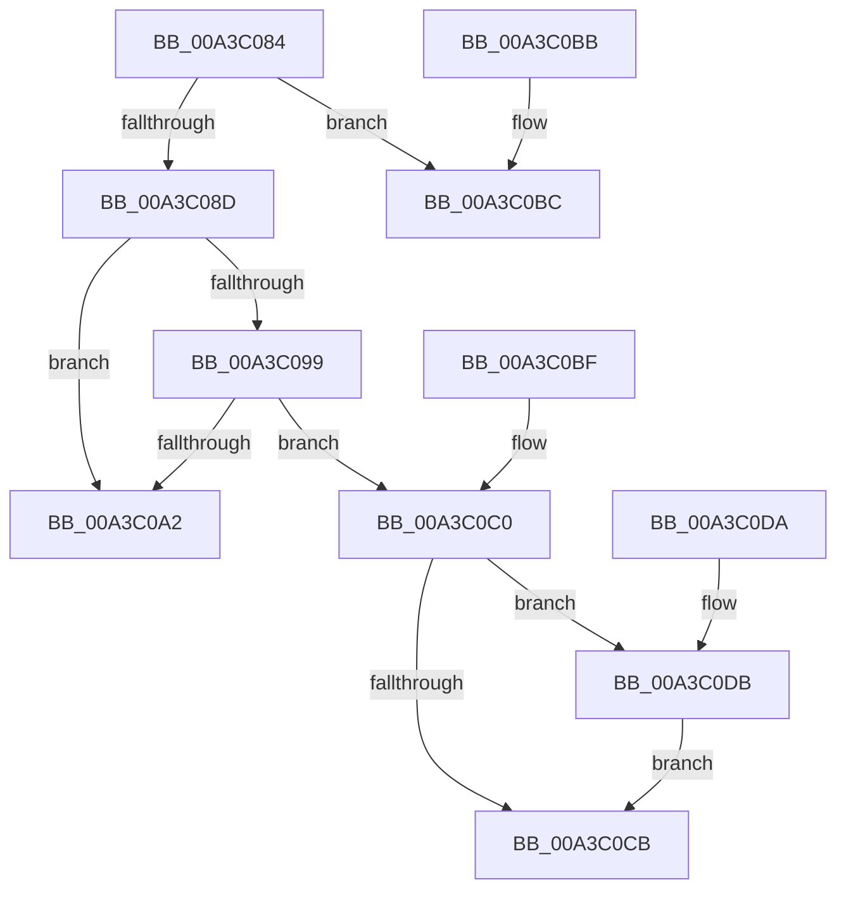

# PspComputeQuantum

- RVA: `0x00A3C084`–`0x00A3C0E3` (길이 `95` bytes)
- VA: `0x0000000140A3C084`
- 실행 섹션: `PAGE`
- PDB 이름 있음: `예`; PDB Function 태그: `아니요`
- unwind 정보 RVA: `0x000DB714`
- 디코드: `26`개 명령, `95/95` bytes 표시
- 미해석 바이트: `0` (있으면 어셈블리에 `.byte`로 보존)

> 이 문서는 커널 이미지의 기계어와 PDB 기호를 분석해 생성했습니다. 4번과 5번은 함수 원형과 자료형을 바이너리 사용 방식에서 추정한 C 해석이며 원본 소스 복구 결과는 아닙니다.

## 1. Dependencies

- 직접 호출 지점: **0**; 고유 호출 대상: **0**
- 직접 호출자로 확인된 함수: **2**
- RIP 상대 이미지 참조: **3**

### Outgoing calls
- 직접 디코드된 call 명령이 없습니다.

### Direct callers
- [PsChangeQuantumTable](PsChangeQuantumTable_function_00A3BE70.md) at `0x00A3BF52`
- [PspComputeQuantumAndPriority](PspComputeQuantumAndPriority_function_00A3BFB0.md) at `0x00A3C003`

### Static image references
- `0x00A3C099` → RVA `0x00FD9A66` (`PAGEDATA`; read)
- `0x00A3C0A4` → RVA `0x00000000` (`image boundary/outside`; read)
- `0x00A3C0AD` → RVA `0x00FC6C9C` (`ALMOSTRO`; read)

## 2. Other-region calls and transfers

- 다른 실행 섹션으로 향하는 call: **0**
- 별도 외부 분기/꼬리 이동을 확인하지 못했습니다.

## 3. Assembly (complete function range)

```asm
00A3C084  80 B9 47 03 00 00 01            cmp byte ptr [rcx + 0x347], 1
00A3C08B  74 2F                           je 0x140a3c0bc
00A3C08D  48 8B 89 A0 02 00 00            mov rcx, qword ptr [rcx + 0x2a0]
00A3C094  48 85 C9                        test rcx, rcx
00A3C097  74 09                           je 0x140a3c0a2
00A3C099  80 3D C6 D9 59 00 00            cmp byte ptr [rip + 0x59d9c6], 0
00A3C0A0  75 1E                           jne 0x140a3c0c0
00A3C0A2  F6 DA                           neg dl
00A3C0A4  48 8D 15 55 3F 5C FF            lea rdx, [rip - 0xa3c0ab]
00A3C0AB  1B C0                           sbb eax, eax
00A3C0AD  23 05 E9 AB 58 00               and eax, dword ptr [rip + 0x58abe9]
00A3C0B3  8A 84 10 DC 9A FD 00            mov al, byte ptr [rax + rdx + 0xfd9adc]
00A3C0BA  C3                              ret
00A3C0BB  CC                              int3
00A3C0BC  B0 06                           mov al, 6
00A3C0BE  C3                              ret
00A3C0BF  CC                              int3
00A3C0C0  8B 81 24 04 00 00               mov eax, dword ptr [rcx + 0x424]
00A3C0C6  83 F8 0A                        cmp eax, 0xa
00A3C0C9  73 10                           jae 0x140a3c0db
00A3C0CB  48 8D 15 2E 3F 5C FF            lea rdx, [rip - 0xa3c0d2]
00A3C0D2  8A 84 10 50 B0 B4 00            mov al, byte ptr [rax + rdx + 0xb4b050]
00A3C0D9  C3                              ret
00A3C0DA  CC                              int3
00A3C0DB  8B 81 44 02 00 00               mov eax, dword ptr [rcx + 0x244]
00A3C0E1  EB E8                           jmp 0x140a3c0cb
```

## 4. C-style interpretation (structured pseudocode)

```c
__int64 __fastcall PspComputeQuantum(__int64 a1, unsigned __int8 a2)
{
    __int64 result;

    if ((*(unsigned __int8 *)(a1 + 839)) == 1) goto loc_00A3C0BC;
    if (*(unsigned __int64 *)(a1 + 672) == 0) goto loc_00A3C0A2;
    if ((*(unsigned __int8 *)(v_rip + 5888454)) != 0) goto loc_00A3C0C0;
loc_00A3C0A2:
    a2 = (unsigned __int8)(-(a2));
    result = (unsigned int)((result) & (*(unsigned int *)(v_rip + 5811177)));
    return *(unsigned __int8 *)(result + v_rip - 10731691 * 1 + 16620252);
loc_00A3C0BC:
    return 6;
loc_00A3C0C0:
    if (((unsigned int)((unsigned int)(*(unsigned int *)(*(unsigned __int64 *)(a1 + 672) + 1060)))) >= 10) goto loc_00A3C0DB;
loc_00A3C0CB:
    return *(unsigned __int8 *)((unsigned int)(*(unsigned int *)(*(unsigned __int64 *)(a1 + 672) + 1060)) + v_rip - 10731730 * 1 + 11841616);
loc_00A3C0DB:
    goto loc_00A3C0CB;
}
```

## 5. (Beta) C Style

```c
int64_t PspComputeQuantum(void *Arg1, uint8_t Arg2)
{
    uint8_t *arg1 = (uint8_t *)Arg1;

    int64_t result;

    if ((*(uint8_t *)(arg1 + 0x347)) == 1) goto loc_00A3C0BC;
    if (*(uint64_t *)(arg1 + 0x2A0) == 0) goto loc_00A3C0A2;
    if ((*(uint8_t *)(v_rip + 0x59D9C6)) != 0) goto loc_00A3C0C0;
loc_00A3C0A2:
    Arg2 = (uint8_t)(-(Arg2));
    result = (uint32_t)((result) & (*(uint32_t *)(v_rip + 0x58ABE9)));
    return *(uint8_t *)(result + v_rip - 0xA3C0AB * 1 + 0xFD9ADC);
loc_00A3C0BC:
    return 6;
loc_00A3C0C0:
    if (((uint32_t)((uint32_t)(*(uint32_t *)(*(uint64_t *)(arg1 + 0x2A0) + 0x424)))) >= 10) goto loc_00A3C0DB;
loc_00A3C0CB:
    return *(uint8_t *)((uint32_t)(*(uint32_t *)(*(uint64_t *)(arg1 + 0x2A0) + 0x424)) + v_rip - 0xA3C0D2 * 1 + 0xB4B050);
loc_00A3C0DB:
    goto loc_00A3C0CB;
}
```

### 관측된 메모리 오프셋

구조체 형식이 확인되지 않은 접근은 인자 기준의 오프셋으로만 기록했습니다.

| 기준 인자 | 오프셋 표현 | 폭 (bit) | 접근 |
|---|---:|---:|---|
| `Arg1` | `+ 0x2A0` | `64` | `R` |
| `Arg1` | `+ 0x347` | `8` | `R` |

## 6. Execution-region graph

[열기: 2D/3D 그래프와 함수 탐색 컨트롤 패널](../../../control-panel.html?section=page&rva=0x00A3C084&view=graph)

- 2D 그래프는 위에서 아래로 흐르고, 3D 그래프는 빈 공간을 드래그해 회전합니다. Shift+드래그는 이동, 휠은 확대·축소, 함수 노드 선택은 대상 보고서 이동입니다.

### Static fallback


