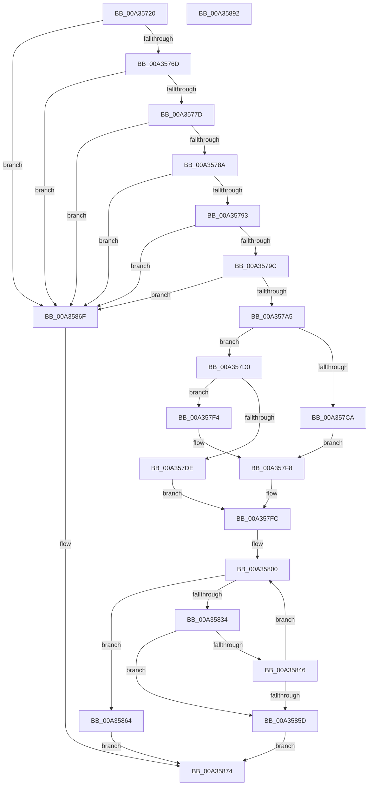

# RtlFindRange

- RVA: `0x00A35720`–`0x00A35893` (길이 `371` bytes)
- VA: `0x0000000140A35720`
- 실행 섹션: `PAGE`
- PDB 이름 있음: `예`; PDB Function 태그: `아니요`
- unwind 정보 RVA: `0x000AD928`
- 디코드: `109`개 명령, `371/371` bytes 표시
- 미해석 바이트: `0` (있으면 어셈블리에 `.byte`로 보존)

> 이 문서는 커널 이미지의 기계어와 PDB 기호를 분석해 생성했습니다. 4번과 5번은 함수 원형과 자료형을 바이너리 사용 방식에서 추정한 C 해석이며 원본 소스 복구 결과는 아닙니다.

## 1. Dependencies

- 직접 호출 지점: **1**; 고유 호출 대상: **1**
- 직접 호출자로 확인된 함수: **2**
- RIP 상대 이미지 참조: **0**

### Outgoing calls
- `0x00A35828` → [RtlpIsRangeAvailable](RtlpIsRangeAvailable_function_00A35950.md) (function, `0x00A35950`)

### Direct callers
- [ArbFindSuitableRange](../70/ArbFindSuitableRange_function_0070E9D0.md) at `0x0070EAA4`
- [IopPortFindSuitableRange](../72/IopPortFindSuitableRange_function_0072F3F0.md) at `0x0072F47F`

### Static image references
- 디코드된 RIP-relative 메모리 참조가 없습니다.

## 2. Other-region calls and transfers

- 다른 실행 섹션으로 향하는 call: **0**
- 별도 외부 분기/꼬리 이동을 확인하지 못했습니다.

## 3. Assembly (complete function range)

```asm
00A35720  48 89 5C 24 08                  mov qword ptr [rsp + 8], rbx
00A35725  48 89 74 24 10                  mov qword ptr [rsp + 0x10], rsi
00A3572A  48 89 7C 24 18                  mov qword ptr [rsp + 0x18], rdi
00A3572F  55                              push rbp
00A35730  41 54                           push r12
00A35732  41 55                           push r13
00A35734  41 56                           push r14
00A35736  41 57                           push r15
00A35738  48 8B EC                        mov rbp, rsp
00A3573B  48 83 EC 70                     sub rsp, 0x70
00A3573F  4C 8B 75 50                     mov r14, qword ptr [rbp + 0x50]
00A35743  48 8B FA                        mov rdi, rdx
00A35746  49 8B F1                        mov rsi, r9
00A35749  33 D2                           xor edx, edx
00A3574B  49 8B D8                        mov rbx, r8
00A3574E  45 33 C9                        xor r9d, r9d
00A35751  48 2B DE                        sub rbx, rsi
00A35754  44 89 4D FC                     mov dword ptr [rbp - 4], r9d
00A35758  48 FF C3                        inc rbx
00A3575B  48 8B C3                        mov rax, rbx
00A3575E  49 F7 F6                        div r14
00A35761  48 2B DA                        sub rbx, rdx
00A35764  49 3B F8                        cmp rdi, r8
00A35767  0F 87 02 01 00 00               ja 0x140a3586f
00A3576D  4C 2B C7                        sub r8, rdi
00A35770  48 8D 46 FF                     lea rax, [rsi - 1]
00A35774  4C 3B C0                        cmp r8, rax
00A35777  0F 82 F2 00 00 00               jb 0x140a3586f
00A3577D  4A 8D 04 37                     lea rax, [rdi + r14]
00A35781  48 3B C7                        cmp rax, rdi
00A35784  0F 82 E5 00 00 00               jb 0x140a3586f
00A3578A  48 3B DF                        cmp rbx, rdi
00A3578D  0F 82 DC 00 00 00               jb 0x140a3586f
00A35793  48 85 F6                        test rsi, rsi
00A35796  0F 84 D3 00 00 00               je 0x140a3586f
00A3579C  4D 85 F6                        test r14, r14
00A3579F  0F 84 CA 00 00 00               je 0x140a3586f
00A357A5  44 8A 7D 58                     mov r15b, byte ptr [rbp + 0x58]
00A357A9  4C 8D 46 FF                     lea r8, [rsi - 1]
00A357AD  8B 41 18                        mov eax, dword ptr [rcx + 0x18]
00A357B0  45 8A E7                        mov r12b, r15b
00A357B3  41 80 E4 01                     and r12b, 1
00A357B7  48 89 4D E0                     mov qword ptr [rbp - 0x20], rcx
00A357BB  41 80 E7 02                     and r15b, 2
00A357BF  89 45 F8                        mov dword ptr [rbp - 8], eax
00A357C2  4C 03 C3                        add r8, rbx
00A357C5  48 39 09                        cmp qword ptr [rcx], rcx
00A357C8  75 06                           jne 0x140a357d0
00A357CA  4C 89 4D F0                     mov qword ptr [rbp - 0x10], r9
00A357CE  EB 28                           jmp 0x140a357f8
00A357D0  48 8B 49 08                     mov rcx, qword ptr [rcx + 8]
00A357D4  48 83 E9 28                     sub rcx, 0x28
00A357D8  F6 41 22 01                     test byte ptr [rcx + 0x22], 1
00A357DC  74 16                           je 0x140a357f4
00A357DE  48 8D 41 10                     lea rax, [rcx + 0x10]
00A357E2  48 89 45 E8                     mov qword ptr [rbp - 0x18], rax
00A357E6  48 8B 41 18                     mov rax, qword ptr [rcx + 0x18]
00A357EA  48 83 E8 28                     sub rax, 0x28
00A357EE  48 89 45 F0                     mov qword ptr [rbp - 0x10], rax
00A357F2  EB 08                           jmp 0x140a357fc
00A357F4  48 89 4D F0                     mov qword ptr [rbp - 0x10], rcx
00A357F8  4C 89 4D E8                     mov qword ptr [rbp - 0x18], r9
00A357FC  4C 8B 6D 70                     mov r13, qword ptr [rbp + 0x70]
00A35800  48 8B 45 68                     mov rax, qword ptr [rbp + 0x68]
00A35804  48 8D 4D E0                     lea rcx, [rbp - 0x20]
00A35808  4C 89 6C 24 40                  mov qword ptr [rsp + 0x40], r13
00A3580D  48 8B D3                        mov rdx, rbx
00A35810  48 89 44 24 38                  mov qword ptr [rsp + 0x38], rax
00A35815  44 88 4C 24 30                  mov byte ptr [rsp + 0x30], r9b
00A3581A  44 8A 4D 60                     mov r9b, byte ptr [rbp + 0x60]
00A3581E  44 88 7C 24 28                  mov byte ptr [rsp + 0x28], r15b
00A35823  44 88 64 24 20                  mov byte ptr [rsp + 0x20], r12b
00A35828  E8 23 01 00 00                  call 0x140a35950
00A3582D  45 33 C9                        xor r9d, r9d
00A35830  84 C0                           test al, al
00A35832  75 30                           jne 0x140a35864
00A35834  48 8B 45 F0                     mov rax, qword ptr [rbp - 0x10]
00A35838  48 8B 08                        mov rcx, qword ptr [rax]
00A3583B  48 8B D9                        mov rbx, rcx
00A3583E  48 2B DE                        sub rbx, rsi
00A35841  48 3B D9                        cmp rbx, rcx
00A35844  77 17                           ja 0x140a3585d
00A35846  33 D2                           xor edx, edx
00A35848  4C 8D 46 FF                     lea r8, [rsi - 1]
00A3584C  48 8B C3                        mov rax, rbx
00A3584F  49 F7 F6                        div r14
00A35852  48 2B DA                        sub rbx, rdx
00A35855  4C 03 C3                        add r8, rbx
00A35858  48 3B DF                        cmp rbx, rdi
00A3585B  73 A3                           jae 0x140a35800
00A3585D  B8 01 00 00 C0                  mov eax, 0xc0000001
00A35862  EB 10                           jmp 0x140a35874
00A35864  48 8B 45 78                     mov rax, qword ptr [rbp + 0x78]
00A35868  48 89 18                        mov qword ptr [rax], rbx
00A3586B  33 C0                           xor eax, eax
00A3586D  EB 05                           jmp 0x140a35874
00A3586F  B8 0D 00 00 C0                  mov eax, 0xc000000d
00A35874  4C 8D 5C 24 70                  lea r11, [rsp + 0x70]
00A35879  49 8B 5B 30                     mov rbx, qword ptr [r11 + 0x30]
00A3587D  49 8B 73 38                     mov rsi, qword ptr [r11 + 0x38]
00A35881  49 8B 7B 40                     mov rdi, qword ptr [r11 + 0x40]
00A35885  49 8B E3                        mov rsp, r11
00A35888  41 5F                           pop r15
00A3588A  41 5E                           pop r14
00A3588C  41 5D                           pop r13
00A3588E  41 5C                           pop r12
00A35890  5D                              pop rbp
00A35891  C3                              ret
00A35892  CC                              int3
```

## 4. C-style interpretation (structured pseudocode)

```c
__int64 __fastcall RtlFindRange(__int64 a1, __int64 a2, __int64 a3, __int64 a4, __int64 a5, unsigned __int8 a6, unsigned __int8 a7, __int64 a8, __int64 a9, __int64 a10)
{
    __int64 result;
    __int64 v_r12;
    __int64 v_r15;
    __int64 v_rbx;
    __int64 v_rsp;
    unsigned __int64 v_stack_m28;
    unsigned int v_stack_m2C;
    unsigned int v_stack_m30;
    unsigned __int64 v_stack_m38;
    unsigned __int64 v_stack_m40;
    unsigned __int64 v_stack_m48;
    unsigned __int64 v_stack_m58;
    unsigned __int64 v_stack_m60;
    unsigned __int8 v_stack_m68;
    unsigned __int8 v_stack_m70;
    unsigned __int8 v_stack_m78;
    unsigned __int64 v_stack_p10;
    unsigned __int64 v_stack_p18;
    unsigned __int64 v_stack_p8;

    v_stack_p8 = v_rbx;
    v_stack_p10 = v_rsi;
    v_stack_p18 = v_rdi;
    v_rsp = (v_rsp) - (112);
    a2 = 0;
    a4 = 0;
    v_rbx = (a3) - (0);
    v_stack_m2C = 0;
    v_rbx = (v_rbx) + 1;
    v_rbx = (v_rbx) - (0);
    if (0 > a3) goto loc_00A3586F;
    a3 = (a3) - (0);
    if (a3 < (a4 - 1)) goto loc_00A3586F;
    if ((a2 + a5 * 1) < 0) goto loc_00A3586F;
    if (v_rbx < 0) goto loc_00A3586F;
    if (0 == 0) goto loc_00A3586F;
    if (a5 == 0) goto loc_00A3586F;
    v_r12 = (unsigned __int8)((a6) & (1));
    v_stack_m48 = a1;
    v_r15 = (unsigned __int8)((a6) & (2));
    v_stack_m30 = (unsigned int)((unsigned int)(*(unsigned int *)(a1 + 24)));
    a3 = (a4 - 1) + (v_rbx);
    if ((*(unsigned __int64 *)(a1)) != a1) goto loc_00A357D0;
    v_stack_m38 = 0;
    goto loc_00A357F8;
loc_00A357D0:
    a1 = (*(unsigned __int64 *)(a1 + 8)) - (40);
    if (((*(unsigned __int8 *)(a1 + 34)) & (1)) == 0) goto loc_00A357F4;
    v_stack_m40 = a1 + 16;
    result = (*(unsigned __int64 *)(a1 + 24)) - (40);
    v_stack_m38 = result;
    goto loc_00A357FC;
loc_00A357F4:
    v_stack_m38 = a1;
loc_00A357F8:
    v_stack_m40 = 0;
loc_00A357FC:
loc_00A35800:
    v_stack_m58 = a9;
    v_stack_m60 = a8;
    v_stack_m68 = 0;
    v_stack_m70 = (unsigned __int8)(v_r15);
    v_stack_m78 = (unsigned __int8)(v_r12);
    result = RtlpIsRangeAvailable(v_stack_m48, v_rbx, a3, a7);
    a4 = 0;
    if ((unsigned __int8)(result) != 0) goto loc_00A35864;
    v_rbx = (*(unsigned __int64 *)(v_stack_m38)) - (0);
    if (v_rbx > (*(unsigned __int64 *)(v_stack_m38))) goto loc_00A3585D;
    a2 = 0;
    v_rbx = (v_rbx) - (0);
    a3 = (a4 - 1) + (v_rbx);
    if (v_rbx >= 0) goto loc_00A35800;
loc_00A3585D:
    goto loc_00A35874;
loc_00A35864:
    *(unsigned __int64 *)(a10) = v_rbx;
    result = 0;
    goto loc_00A35874;
loc_00A3586F:
loc_00A35874:
    return (unsigned int)(0xC000000DULL);
}
```

## 5. (Beta) C Style

```c
int64_t RtlFindRange(void *Arg1, int64_t Arg2, int64_t Arg3, void *Arg4, int64_t Arg5, uint8_t Arg6, uint8_t Arg7, int64_t Arg8, int64_t Arg9, void *Arg10)
{
    uint8_t *arg1 = (uint8_t *)Arg1;
    uint8_t *arg4 = (uint8_t *)Arg4;
    uint8_t *arg10 = (uint8_t *)Arg10;

    int64_t result;
    int64_t local_r12;
    int64_t local_r15;
    int64_t local_rbx;
    int64_t local_rsp;
    uint64_t v_stack_m28;
    uint32_t v_stack_m2C;
    uint32_t v_stack_m30;
    uint64_t v_stack_m38;
    uint64_t v_stack_m40;
    uint64_t v_stack_m48;
    uint64_t v_stack_m58;
    uint64_t v_stack_m60;
    uint8_t v_stack_m68;
    uint8_t v_stack_m70;
    uint8_t v_stack_m78;
    uint64_t v_stack_p10;
    uint64_t v_stack_p18;
    uint64_t v_stack_p8;

    v_stack_p8 = local_rbx;
    v_stack_p10 = local_rsi;
    v_stack_p18 = local_rdi;
    local_rsp = (local_rsp) - (112);
    Arg2 = 0;
    Arg4 = 0;
    local_rbx = (Arg3) - (0);
    v_stack_m2C = 0;
    local_rbx = (local_rbx) + 1;
    local_rbx = (local_rbx) - (0);
    if (0 > Arg3) goto loc_00A3586F;
    Arg3 = (Arg3) - (0);
    if (Arg3 < (Arg4 - 1)) goto loc_00A3586F;
    if ((Arg2 + Arg5 * 1) < 0) goto loc_00A3586F;
    if (local_rbx < 0) goto loc_00A3586F;
    if (0 == 0) goto loc_00A3586F;
    if (Arg5 == 0) goto loc_00A3586F;
    local_r12 = (uint8_t)((Arg6) & (1));
    v_stack_m48 = Arg1;
    local_r15 = (uint8_t)((Arg6) & (2));
    v_stack_m30 = (uint32_t)((uint32_t)(*(uint32_t *)(arg1 + 0x18)));
    Arg3 = (Arg4 - 1) + (local_rbx);
    if ((*(uint64_t *)(arg1)) != Arg1) goto loc_00A357D0;
    v_stack_m38 = 0;
    goto loc_00A357F8;
loc_00A357D0:
    Arg1 = (*(uint64_t *)(arg1 + 0x8)) - (40);
    if (((*(uint8_t *)(arg1 + 0x22)) & (1)) == 0) goto loc_00A357F4;
    v_stack_m40 = Arg1 + 16;
    result = (*(uint64_t *)(arg1 + 0x18)) - (40);
    v_stack_m38 = result;
    goto loc_00A357FC;
loc_00A357F4:
    v_stack_m38 = Arg1;
loc_00A357F8:
    v_stack_m40 = 0;
loc_00A357FC:
loc_00A35800:
    v_stack_m58 = Arg9;
    v_stack_m60 = Arg8;
    v_stack_m68 = 0;
    v_stack_m70 = (uint8_t)(local_r15);
    v_stack_m78 = (uint8_t)(local_r12);
    result = RtlpIsRangeAvailable(v_stack_m48, local_rbx, Arg3, Arg7);
    Arg4 = 0;
    if ((uint8_t)(result) != 0) goto loc_00A35864;
    local_rbx = (*(uint64_t *)(v_stack_m38)) - (0);
    if (local_rbx > (*(uint64_t *)(v_stack_m38))) goto loc_00A3585D;
    Arg2 = 0;
    local_rbx = (local_rbx) - (0);
    Arg3 = (Arg4 - 1) + (local_rbx);
    if (local_rbx >= 0) goto loc_00A35800;
loc_00A3585D:
    goto loc_00A35874;
loc_00A35864:
    *(uint64_t *)(arg10) = local_rbx;
    result = 0;
    goto loc_00A35874;
loc_00A3586F:
loc_00A35874:
    return (uint32_t)(0xC000000DULL);
}
```

### 관측된 메모리 오프셋

구조체 형식이 확인되지 않은 접근은 인자 기준의 오프셋으로만 기록했습니다.

| 기준 인자 | 오프셋 표현 | 폭 (bit) | 접근 |
|---|---:|---:|---|
| `Arg1` | `+ 0x0` | `64` | `R` |
| `Arg1` | `+ 0x8` | `64` | `R` |
| `Arg1` | `+ 0x18` | `32` | `R` |
| `Arg4` | `- 0x1` | `64` | `R` |
| `Arg10` | `+ 0x0` | `64` | `W` |

## 6. Execution-region graph

[열기: 2D/3D 그래프와 함수 탐색 컨트롤 패널](../../../control-panel.html?section=page&rva=0x00A35720&view=graph)

- 2D 그래프는 위에서 아래로 흐르고, 3D 그래프는 빈 공간을 드래그해 회전합니다. Shift+드래그는 이동, 휠은 확대·축소, 함수 노드 선택은 대상 보고서 이동입니다.

### Static fallback


