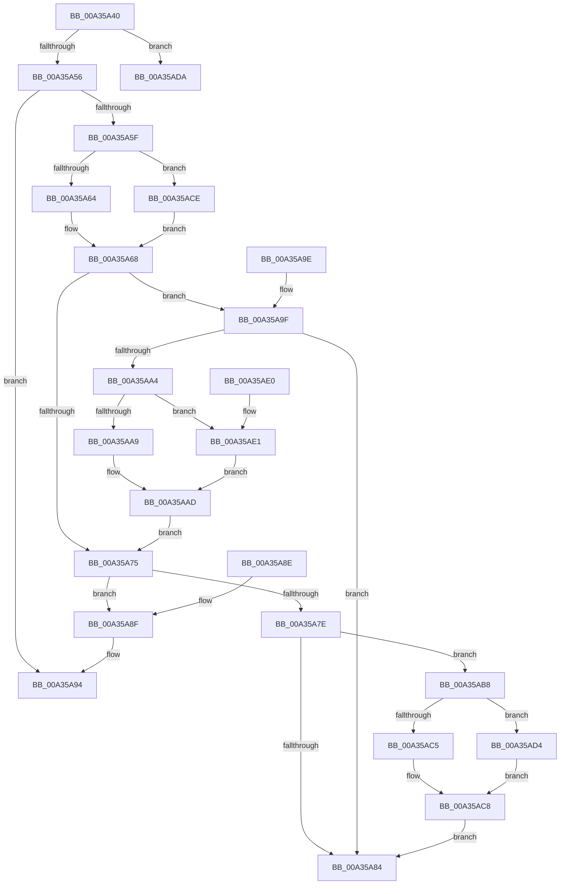

# RtlGetNextRange

- RVA: `0x00A35A40`–`0x00A35AE7` (길이 `167` bytes)
- VA: `0x0000000140A35A40`
- 실행 섹션: `PAGE`
- PDB 이름 있음: `예`; PDB Function 태그: `아니요`
- unwind 정보 RVA: `0x000DB714`
- 디코드: `55`개 명령, `167/167` bytes 표시
- 미해석 바이트: `0` (있으면 어셈블리에 `.byte`로 보존)

> 이 문서는 커널 이미지의 기계어와 PDB 기호를 분석해 생성했습니다. 4번과 5번은 함수 원형과 자료형을 바이너리 사용 방식에서 추정한 C 해석이며 원본 소스 복구 결과는 아닙니다.

## 1. Dependencies

- 직접 호출 지점: **0**; 고유 호출 대상: **0**
- 직접 호출자로 확인된 함수: **3**
- RIP 상대 이미지 참조: **0**

### Outgoing calls
- 직접 디코드된 call 명령이 없습니다.

### Direct callers
- [ArbOverrideConflict](../70/ArbOverrideConflict_function_0070F1A0.md) at `0x0070F24B`
- [ArbShareDriverExclusive](../70/ArbShareDriverExclusive_function_0070FB1C.md) at `0x0070FCB9`
- [RtlpIsRangeAvailable](RtlpIsRangeAvailable_function_00A35950.md) at `0x00A359AE`

### Static image references
- 디코드된 RIP-relative 메모리 참조가 없습니다.

## 2. Other-region calls and transfers

- 다른 실행 섹션으로 향하는 call: **0**
- 별도 외부 분기/꼬리 이동을 확인하지 못했습니다.

## 3. Assembly (complete function range)

```asm
00A35A40  4C 8B 19                        mov r11, qword ptr [rcx]
00A35A43  45 8A D0                        mov r10b, r8b
00A35A46  8B 41 18                        mov eax, dword ptr [rcx + 0x18]
00A35A49  4C 8B C9                        mov r9, rcx
00A35A4C  41 39 43 18                     cmp dword ptr [r11 + 0x18], eax
00A35A50  0F 85 84 00 00 00               jne 0x140a35ada
00A35A56  48 8B 41 10                     mov rax, qword ptr [rcx + 0x10]
00A35A5A  48 85 C0                        test rax, rax
00A35A5D  74 35                           je 0x140a35a94
00A35A5F  45 84 C0                        test r8b, r8b
00A35A62  74 6A                           je 0x140a35ace
00A35A64  4C 8B 40 28                     mov r8, qword ptr [rax + 0x28]
00A35A68  49 8B 41 08                     mov rax, qword ptr [r9 + 8]
00A35A6C  49 8D 48 D8                     lea rcx, [r8 - 0x28]
00A35A70  48 85 C0                        test rax, rax
00A35A73  75 2A                           jne 0x140a35a9f
00A35A75  48 8D 41 28                     lea rax, [rcx + 0x28]
00A35A79  49 3B C3                        cmp rax, r11
00A35A7C  74 11                           je 0x140a35a8f
00A35A7E  F6 41 22 01                     test byte ptr [rcx + 0x22], 1
00A35A82  75 34                           jne 0x140a35ab8
00A35A84  49 89 49 10                     mov qword ptr [r9 + 0x10], rcx
00A35A88  33 C0                           xor eax, eax
00A35A8A  48 89 0A                        mov qword ptr [rdx], rcx
00A35A8D  C3                              ret
00A35A8E  CC                              int3
00A35A8F  49 83 61 10 00                  and qword ptr [r9 + 0x10], 0
00A35A94  48 83 22 00                     and qword ptr [rdx], 0
00A35A98  B8 1A 00 00 80                  mov eax, 0x8000001a
00A35A9D  C3                              ret
00A35A9E  CC                              int3
00A35A9F  4C 3B C0                        cmp r8, rax
00A35AA2  75 E0                           jne 0x140a35a84
00A35AA4  45 84 D2                        test r10b, r10b
00A35AA7  74 38                           je 0x140a35ae1
00A35AA9  48 8B 48 18                     mov rcx, qword ptr [rax + 0x18]
00A35AAD  49 83 61 08 00                  and qword ptr [r9 + 8], 0
00A35AB2  48 83 C1 D8                     add rcx, -0x28
00A35AB6  EB BD                           jmp 0x140a35a75
00A35AB8  48 8D 41 10                     lea rax, [rcx + 0x10]
00A35ABC  49 89 41 08                     mov qword ptr [r9 + 8], rax
00A35AC0  45 84 D2                        test r10b, r10b
00A35AC3  74 0F                           je 0x140a35ad4
00A35AC5  48 8B 08                        mov rcx, qword ptr [rax]
00A35AC8  48 83 C1 D8                     add rcx, -0x28
00A35ACC  EB B6                           jmp 0x140a35a84
00A35ACE  4C 8B 40 30                     mov r8, qword ptr [rax + 0x30]
00A35AD2  EB 94                           jmp 0x140a35a68
00A35AD4  48 8B 49 18                     mov rcx, qword ptr [rcx + 0x18]
00A35AD8  EB EE                           jmp 0x140a35ac8
00A35ADA  B8 0D 00 00 C0                  mov eax, 0xc000000d
00A35ADF  C3                              ret
00A35AE0  CC                              int3
00A35AE1  48 8B 48 20                     mov rcx, qword ptr [rax + 0x20]
00A35AE5  EB C6                           jmp 0x140a35aad
```

## 4. C-style interpretation (structured pseudocode)

```c
__int64 __fastcall RtlGetNextRange(__int64 a1, __int64 a2, unsigned __int8 a3)
{
    __int64 result;

    if ((*(unsigned int *)(*(unsigned __int64 *)(a1) + 24)) != ((unsigned int)((unsigned int)(*(unsigned int *)(a1 + 24))))) goto loc_00A35ADA;
    if (*(unsigned __int64 *)(a1 + 16) == 0) goto loc_00A35A94;
    if (a3 == 0) goto loc_00A35ACE;
loc_00A35A68:
    if (*(unsigned __int64 *)(a1 + 8) != 0) goto loc_00A35A9F;
loc_00A35A75:
    if ((*(unsigned __int64 *)(*(unsigned __int64 *)(a1 + 16) + 40) - 40 + 40) == (*(unsigned __int64 *)(a1))) goto loc_00A35A8F;
    if (((*(unsigned __int8 *)(*(unsigned __int64 *)(*(unsigned __int64 *)(a1 + 16) + 40) - 40 + 34)) & (1)) != 0) goto loc_00A35AB8;
loc_00A35A84:
    *(unsigned __int64 *)(a1 + 16) = *(unsigned __int64 *)(*(unsigned __int64 *)(a1 + 16) + 40) - 40;
    result = 0;
    *(unsigned __int64 *)(a2) = *(unsigned __int64 *)(*(unsigned __int64 *)(a1 + 16) + 40) - 40;
    return result;
loc_00A35A8F:
loc_00A35A94:
    return (unsigned int)(0x8000001AULL);
loc_00A35A9F:
    if ((*(unsigned __int64 *)(*(unsigned __int64 *)(a1 + 16) + 40)) != ((unsigned int)(0x8000001AULL))) goto loc_00A35A84;
    if (a3 == 0) goto loc_00A35AE1;
loc_00A35AAD:
    a1 = (*(unsigned __int64 *)((unsigned int)(0x8000001AULL) + 24)) + (-40);
    goto loc_00A35A75;
loc_00A35AB8:
    *(unsigned __int64 *)(a1 + 8) = a1 + 16;
    if (a3 == 0) goto loc_00A35AD4;
loc_00A35AC8:
    a1 = (*(unsigned __int64 *)(a1 + 16)) + (-40);
    goto loc_00A35A84;
loc_00A35ACE:
    goto loc_00A35A68;
loc_00A35AD4:
    goto loc_00A35AC8;
loc_00A35ADA:
    return (unsigned int)(0xC000000DULL);
loc_00A35AE1:
    goto loc_00A35AAD;
}
```

## 5. (Beta) C Style

```c
int64_t RtlGetNextRange(void *Arg1, void *Arg2, uint8_t Arg3)
{
    uint8_t *arg1 = (uint8_t *)Arg1;
    uint8_t *arg2 = (uint8_t *)Arg2;

    int64_t result;

    if ((*(uint32_t *)(*(uint64_t *)(arg1) + 0x18)) != ((uint32_t)((uint32_t)(*(uint32_t *)(arg1 + 0x18))))) goto loc_00A35ADA;
    if (*(uint64_t *)(arg1 + 0x10) == 0) goto loc_00A35A94;
    if (Arg3 == 0) goto loc_00A35ACE;
loc_00A35A68:
    if (*(uint64_t *)(arg1 + 0x8) != 0) goto loc_00A35A9F;
loc_00A35A75:
    if ((*(uint64_t *)(*(uint64_t *)(arg1 + 0x10) + 0x28) - 40 + 40) == (*(uint64_t *)(arg1))) goto loc_00A35A8F;
    if (((*(uint8_t *)(*(uint64_t *)(*(uint64_t *)(arg1 + 0x10) + 0x28) - 0x28 + 0x22)) & (1)) != 0) goto loc_00A35AB8;
loc_00A35A84:
    *(uint64_t *)(arg1 + 0x10) = *(uint64_t *)(*(uint64_t *)(arg1 + 0x10) + 0x28) - 40;
    result = 0;
    *(uint64_t *)(arg2) = *(uint64_t *)(*(uint64_t *)(arg1 + 0x10) + 0x28) - 40;
    return result;
loc_00A35A8F:
loc_00A35A94:
    return (uint32_t)(0x8000001AULL);
loc_00A35A9F:
    if ((*(uint64_t *)(*(uint64_t *)(arg1 + 0x10) + 0x28)) != ((uint32_t)(0x8000001AULL))) goto loc_00A35A84;
    if (Arg3 == 0) goto loc_00A35AE1;
loc_00A35AAD:
    Arg1 = (*(uint64_t *)((uint32_t)(0x8000001AULL) + 0x18)) + (-40);
    goto loc_00A35A75;
loc_00A35AB8:
    *(void **)(arg1 + 0x8) = Arg1 + 16;
    if (Arg3 == 0) goto loc_00A35AD4;
loc_00A35AC8:
    Arg1 = (*(uint64_t *)(arg1 + 0x10)) + (-40);
    goto loc_00A35A84;
loc_00A35ACE:
    goto loc_00A35A68;
loc_00A35AD4:
    goto loc_00A35AC8;
loc_00A35ADA:
    return (uint32_t)(0xC000000DULL);
loc_00A35AE1:
    goto loc_00A35AAD;
}
```

### 관측된 메모리 오프셋

구조체 형식이 확인되지 않은 접근은 인자 기준의 오프셋으로만 기록했습니다.

| 기준 인자 | 오프셋 표현 | 폭 (bit) | 접근 |
|---|---:|---:|---|
| `Arg1` | `+ 0x0` | `64` | `R` |
| `Arg1` | `+ 0x8` | `64` | `R` |
| `Arg1` | `+ 0x8` | `64` | `R/W` |
| `Arg1` | `+ 0x8` | `64` | `W` |
| `Arg1` | `+ 0x10` | `64` | `R` |
| `Arg1` | `+ 0x10` | `64` | `R/W` |
| `Arg1` | `+ 0x10` | `64` | `W` |
| `Arg1` | `+ 0x18` | `32` | `R` |
| `Arg2` | `+ 0x0` | `64` | `R/W` |
| `Arg2` | `+ 0x0` | `64` | `W` |

## 6. Execution-region graph

[열기: 2D/3D 그래프와 함수 탐색 컨트롤 패널](../../../control-panel.html?section=page&rva=0x00A35A40&view=graph)

- 2D 그래프는 위에서 아래로 흐르고, 3D 그래프는 빈 공간을 드래그해 회전합니다. Shift+드래그는 이동, 휠은 확대·축소, 함수 노드 선택은 대상 보고서 이동입니다.

### Static fallback


