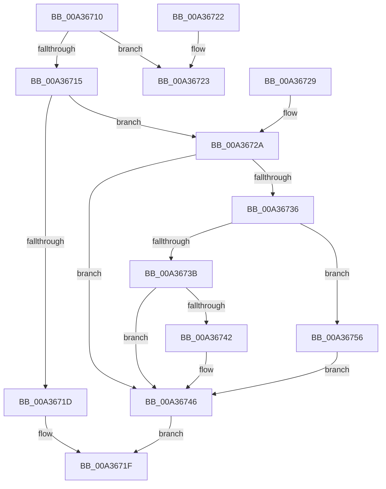

# RtlGetSaclSecurityDescriptor

- RVA: `0x00A36710`–`0x00A3675C` (길이 `76` bytes)
- VA: `0x0000000140A36710`
- 실행 섹션: `PAGE`
- PDB 이름 있음: `예`; PDB Function 태그: `아니요`
- unwind 정보 RVA: `0x000DB714`
- 디코드: `30`개 명령, `76/76` bytes 표시
- 미해석 바이트: `0` (있으면 어셈블리에 `.byte`로 보존)

> 이 문서는 커널 이미지의 기계어와 PDB 기호를 분석해 생성했습니다. 4번과 5번은 함수 원형과 자료형을 바이너리 사용 방식에서 추정한 C 해석이며 원본 소스 복구 결과는 아닙니다.

## 1. Dependencies

- 직접 호출 지점: **0**; 고유 호출 대상: **0**
- 직접 호출자로 확인된 함수: **7**
- RIP 상대 이미지 참조: **0**

### Outgoing calls
- 직접 디코드된 call 명령이 없습니다.

### Direct callers
- [AdtpBuildContextFromSecurityDescriptor](../../text/69/AdtpBuildContextFromSecurityDescriptor_function_0069D99C.md) at `0x0069D9C6`
- [RtlReplaceSidInSd](../78/RtlReplaceSidInSd_function_0078E6E0.md) at `0x0078E90C`
- [SepSDContainsAttributeACE](../7A/SepSDContainsAttributeACE_function_007A3794.md) at `0x007A37B4`
- [CmpCopySaclToVirtualKey](../7E/CmpCopySaclToVirtualKey_function_007ECA6C.md) at `0x007ECB17`
- [CmpExamineSaclForAuditEvent](../7E/CmpExamineSaclForAuditEvent_function_007ECDB0.md) at `0x007ECDEE`
- [IopGetSecurityDescriptorInformation](../9A/IopGetSecurityDescriptorInformation_function_009A2FA4.md) at `0x009A303E`
- [NtSetSecurityObject](../AD/NtSetSecurityObject_function_00ADE2B0.md) at `0x00ADE47D`

### Static image references
- 디코드된 RIP-relative 메모리 참조가 없습니다.

## 2. Other-region calls and transfers

- 다른 실행 섹션으로 향하는 call: **0**
- 별도 외부 분기/꼬리 이동을 확인하지 못했습니다.

## 3. Assembly (complete function range)

```asm
00A36710  80 39 01                        cmp byte ptr [rcx], 1
00A36713  75 0E                           jne 0x140a36723
00A36715  33 C0                           xor eax, eax
00A36717  F6 41 02 10                     test byte ptr [rcx + 2], 0x10
00A3671B  75 0D                           jne 0x140a3672a
00A3671D  88 02                           mov byte ptr [rdx], al
00A3671F  33 C0                           xor eax, eax
00A36721  C3                              ret
00A36722  CC                              int3
00A36723  B8 58 00 00 C0                  mov eax, 0xc0000058
00A36728  C3                              ret
00A36729  CC                              int3
00A3672A  C6 02 01                        mov byte ptr [rdx], 1
00A3672D  0F B7 51 02                     movzx edx, word ptr [rcx + 2]
00A36731  F6 C2 10                        test dl, 0x10
00A36734  74 10                           je 0x140a36746
00A36736  66 85 D2                        test dx, dx
00A36739  79 1B                           jns 0x140a36756
00A3673B  8B 51 0C                        mov edx, dword ptr [rcx + 0xc]
00A3673E  85 D2                           test edx, edx
00A36740  74 04                           je 0x140a36746
00A36742  48 8D 04 11                     lea rax, [rcx + rdx]
00A36746  49 89 00                        mov qword ptr [r8], rax
00A36749  8A 41 02                        mov al, byte ptr [rcx + 2]
00A3674C  C0 E8 05                        shr al, 5
00A3674F  24 01                           and al, 1
00A36751  41 88 01                        mov byte ptr [r9], al
00A36754  EB C9                           jmp 0x140a3671f
00A36756  48 8B 41 18                     mov rax, qword ptr [rcx + 0x18]
00A3675A  EB EA                           jmp 0x140a36746
```

## 4. C-style interpretation (structured pseudocode)

```c
__int64 __fastcall RtlGetSaclSecurityDescriptor(__int64 a1, __int64 a2, __int64 a3, __int64 a4)
{
    __int64 result;

    if ((*(unsigned __int8 *)(a1)) != 1) goto loc_00A36723;
    result = 0;
    if (((*(unsigned __int8 *)(a1 + 2)) & (16)) != 0) goto loc_00A3672A;
    *(unsigned __int8 *)(a2) = 0;
loc_00A3671F:
    result = 0;
    return result;
loc_00A36723:
    return (unsigned int)(0xC0000058ULL);
loc_00A3672A:
    *(unsigned __int8 *)(a2) = 1;
    if ((((unsigned __int8)(*(unsigned __int16 *)(a1 + 2))) & (16)) == 0) goto loc_00A36746;
    if (!sign_flag) goto loc_00A36756;
    result = (unsigned int)(0xC0000058ULL);
    if ((unsigned int)((unsigned int)(*(unsigned int *)(a1 + 12))) != 0) {
        result = a1 + (unsigned int)(*(unsigned int *)(a1 + 12)) * 1;
    }
    *(unsigned __int64 *)(a3) = result;
    result = (unsigned __int8)((*(unsigned __int8 *)(a1 + 2)) >> (5));
    result = (unsigned __int8)((result) & (1));
    *(unsigned __int8 *)(a4) = (unsigned __int8)(result);
    goto loc_00A3671F;
loc_00A36756:
    goto loc_00A36746;
}
```

## 5. (Beta) C Style

```c
int64_t RtlGetSaclSecurityDescriptor(void *Arg1, void *Arg2, void *Arg3, void *Arg4)
{
    uint8_t *arg1 = (uint8_t *)Arg1;
    uint8_t *arg2 = (uint8_t *)Arg2;
    uint8_t *arg3 = (uint8_t *)Arg3;
    uint8_t *arg4 = (uint8_t *)Arg4;

    int64_t result;

    if ((*(uint8_t *)(arg1)) != 1) goto loc_00A36723;
    result = 0;
    if (((*(uint8_t *)(arg1 + 0x2)) & (16)) != 0) goto loc_00A3672A;
    *(uint8_t *)(arg2) = 0;
loc_00A3671F:
    result = 0;
    return result;
loc_00A36723:
    return (uint32_t)(0xC0000058ULL);
loc_00A3672A:
    *(uint8_t *)(arg2) = 1;
    if ((((uint8_t)(*(uint16_t *)(arg1 + 0x2))) & (16)) == 0) goto loc_00A36746;
    if (!sign_flag) goto loc_00A36756;
    result = (uint32_t)(0xC0000058ULL);
    if ((uint32_t)((uint32_t)(*(uint32_t *)(arg1 + 0xC))) != 0) {
        result = Arg1 + (uint32_t)(*(uint32_t *)(arg1 + 0xC)) * 1;
    }
    *(uint64_t *)(arg3) = result;
    result = (uint8_t)((*(uint8_t *)(arg1 + 0x2)) >> (5));
    result = (uint8_t)((result) & (1));
    *(uint8_t *)(arg4) = (uint8_t)(result);
    goto loc_00A3671F;
loc_00A36756:
    goto loc_00A36746;
}
```

### 관측된 메모리 오프셋

구조체 형식이 확인되지 않은 접근은 인자 기준의 오프셋으로만 기록했습니다.

| 기준 인자 | 오프셋 표현 | 폭 (bit) | 접근 |
|---|---:|---:|---|
| `Arg1` | `+ 0x0` | `8` | `R` |
| `Arg1` | `+ 0x0 + rdx*1` | `64` | `R` |
| `Arg1` | `+ 0x2` | `8` | `R` |
| `Arg1` | `+ 0x2` | `16` | `R` |
| `Arg1` | `+ 0xC` | `32` | `R` |
| `Arg1` | `+ 0x18` | `64` | `R` |
| `Arg2` | `+ 0x0` | `8` | `W` |
| `Arg3` | `+ 0x0` | `64` | `W` |
| `Arg4` | `+ 0x0` | `8` | `W` |

## 6. Execution-region graph

[열기: 2D/3D 그래프와 함수 탐색 컨트롤 패널](../../../control-panel.html?section=page&rva=0x00A36710&view=graph)

- 2D 그래프는 위에서 아래로 흐르고, 3D 그래프는 빈 공간을 드래그해 회전합니다. Shift+드래그는 이동, 휠은 확대·축소, 함수 노드 선택은 대상 보고서 이동입니다.

### Static fallback


