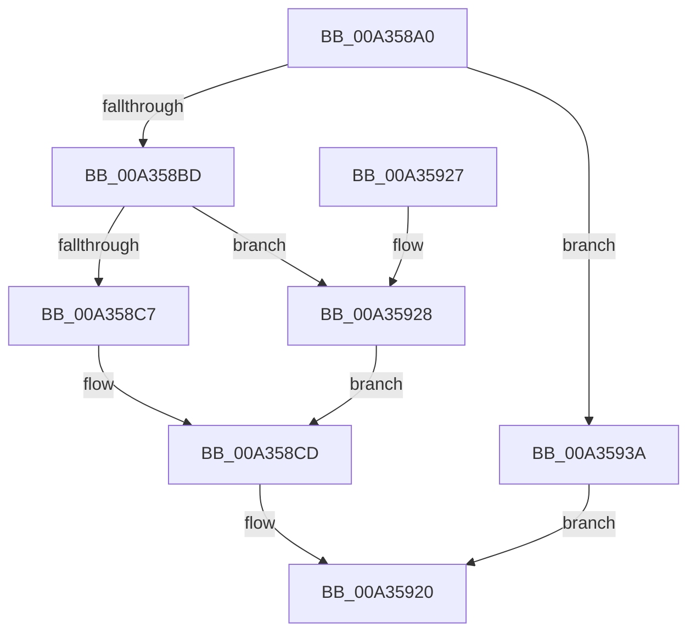

# RtlIsRangeAvailable

- RVA: `0x00A358A0`–`0x00A35947` (길이 `167` bytes)
- VA: `0x0000000140A358A0`
- 실행 섹션: `PAGE`
- PDB 이름 있음: `예`; PDB Function 태그: `아니요`
- unwind 정보 RVA: `0x000AD948`
- 디코드: `40`개 명령, `167/167` bytes 표시
- 미해석 바이트: `0` (있으면 어셈블리에 `.byte`로 보존)

> 이 문서는 커널 이미지의 기계어와 PDB 기호를 분석해 생성했습니다. 4번과 5번은 함수 원형과 자료형을 바이너리 사용 방식에서 추정한 C 해석이며 원본 소스 복구 결과는 아닙니다.

## 1. Dependencies

- 직접 호출 지점: **1**; 고유 호출 대상: **1**
- 직접 호출자로 확인된 함수: **0**
- RIP 상대 이미지 참조: **0**

### Outgoing calls
- `0x00A35911` → [RtlpIsRangeAvailable](RtlpIsRangeAvailable_function_00A35950.md) (function, `0x00A35950`)

### Direct callers
- 이 함수 시작 RVA로 연결되는 직접 call은 확인되지 않았습니다. 간접 호출은 완전히 역산할 수 없습니다.

### Static image references
- 디코드된 RIP-relative 메모리 참조가 없습니다.

## 2. Other-region calls and transfers

- 다른 실행 섹션으로 향하는 call: **0**
- 별도 외부 분기/꼬리 이동을 확인하지 못했습니다.

## 3. Assembly (complete function range)

```asm
00A358A0  48 83 EC 78                     sub rsp, 0x78
00A358A4  8B 41 18                        mov eax, dword ptr [rcx + 0x18]
00A358A7  83 64 24 6C 00                  and dword ptr [rsp + 0x6c], 0
00A358AC  89 44 24 68                     mov dword ptr [rsp + 0x68], eax
00A358B0  48 8B 01                        mov rax, qword ptr [rcx]
00A358B3  48 89 4C 24 50                  mov qword ptr [rsp + 0x50], rcx
00A358B8  48 3B C1                        cmp rax, rcx
00A358BB  74 7D                           je 0x140a3593a
00A358BD  48 8D 48 D8                     lea rcx, [rax - 0x28]
00A358C1  F6 41 22 01                     test byte ptr [rcx + 0x22], 1
00A358C5  75 61                           jne 0x140a35928
00A358C7  48 83 64 24 58 00               and qword ptr [rsp + 0x58], 0
00A358CD  48 8B 84 24 B0 00 00 00         mov rax, qword ptr [rsp + 0xb0]
00A358D5  48 89 44 24 40                  mov qword ptr [rsp + 0x40], rax
00A358DA  48 8B 84 24 A8 00 00 00         mov rax, qword ptr [rsp + 0xa8]
00A358E2  48 89 4C 24 60                  mov qword ptr [rsp + 0x60], rcx
00A358E7  41 8A C9                        mov cl, r9b
00A358EA  48 89 44 24 38                  mov qword ptr [rsp + 0x38], rax
00A358EF  80 E1 02                        and cl, 2
00A358F2  41 80 E1 01                     and r9b, 1
00A358F6  C6 44 24 30 01                  mov byte ptr [rsp + 0x30], 1
00A358FB  88 4C 24 28                     mov byte ptr [rsp + 0x28], cl
00A358FF  48 8D 4C 24 50                  lea rcx, [rsp + 0x50]
00A35904  44 88 4C 24 20                  mov byte ptr [rsp + 0x20], r9b
00A35909  44 8A 8C 24 A0 00 00 00         mov r9b, byte ptr [rsp + 0xa0]
00A35911  E8 3A 00 00 00                  call 0x140a35950
00A35916  48 8B 8C 24 B8 00 00 00         mov rcx, qword ptr [rsp + 0xb8]
00A3591E  88 01                           mov byte ptr [rcx], al
00A35920  33 C0                           xor eax, eax
00A35922  48 83 C4 78                     add rsp, 0x78
00A35926  C3                              ret
00A35927  CC                              int3
00A35928  48 8D 41 10                     lea rax, [rcx + 0x10]
00A3592C  48 8B 08                        mov rcx, qword ptr [rax]
00A3592F  48 83 E9 28                     sub rcx, 0x28
00A35933  48 89 44 24 58                  mov qword ptr [rsp + 0x58], rax
00A35938  EB 93                           jmp 0x140a358cd
00A3593A  48 8B 84 24 B8 00 00 00         mov rax, qword ptr [rsp + 0xb8]
00A35942  C6 00 01                        mov byte ptr [rax], 1
00A35945  EB D9                           jmp 0x140a35920
```

## 4. C-style interpretation (structured pseudocode)

```c
__int64 __fastcall RtlIsRangeAvailable(__int64 a1, __int64 a2, __int64 a3, unsigned __int8 a4, unsigned __int8 a5, __int64 a6, __int64 a7, __int64 a8)
{
    __int64 result;
    __int64 v_rsp;
    unsigned int v_stack_m10;
    unsigned __int64 v_stack_m18;
    unsigned __int64 v_stack_m20;
    unsigned __int64 v_stack_m28;
    unsigned __int64 v_stack_m38;
    unsigned __int64 v_stack_m40;
    unsigned __int8 v_stack_m48;
    unsigned __int8 v_stack_m50;
    unsigned __int8 v_stack_m58;
    unsigned int v_stack_mC;
    unsigned __int64 v_stack_p58;

    v_rsp = (v_rsp) - (120);
    v_stack_m10 = (unsigned int)((unsigned int)(*(unsigned int *)(a1 + 24)));
    v_stack_m28 = a1;
    if ((*(unsigned __int64 *)(a1)) == a1) goto loc_00A3593A;
    if (((*(unsigned __int8 *)(*(unsigned __int64 *)(a1) - 40 + 34)) & (1)) != 0) goto loc_00A35928;
loc_00A358CD:
    v_stack_m38 = a7;
    v_stack_m18 = *(unsigned __int64 *)(a1) - 40;
    v_stack_m40 = a6;
    a1 = (unsigned __int8)((a4) & (2));
    a4 = (unsigned __int8)((a4) & (1));
    v_stack_m48 = 1;
    v_stack_m50 = (unsigned __int8)(a1);
    v_stack_m58 = a4;
    result = RtlpIsRangeAvailable(v_stack_m28, a2, a3, a5);
    *(unsigned __int8 *)(a8) = (unsigned __int8)(result);
loc_00A35920:
    result = 0;
    v_rsp = (v_rsp) + (120);
    return result;
loc_00A35928:
    a1 = (*(unsigned __int64 *)(a8 + 16)) - (40);
    v_stack_p58 = a8 + 16;
    goto loc_00A358CD;
loc_00A3593A:
    *(unsigned __int8 *)(a8) = 1;
    goto loc_00A35920;
}
```

## 5. (Beta) C Style

```c
int64_t RtlIsRangeAvailable(void *Arg1, int64_t Arg2, int64_t Arg3, uint8_t Arg4, uint8_t Arg5, int64_t Arg6, int64_t Arg7, void *Arg8)
{
    uint8_t *arg1 = (uint8_t *)Arg1;
    uint8_t *arg8 = (uint8_t *)Arg8;

    int64_t result;
    int64_t local_rsp;
    uint32_t v_stack_m10;
    uint64_t v_stack_m18;
    uint64_t v_stack_m20;
    uint64_t v_stack_m28;
    uint64_t v_stack_m38;
    uint64_t v_stack_m40;
    uint8_t v_stack_m48;
    uint8_t v_stack_m50;
    uint8_t v_stack_m58;
    uint32_t v_stack_mC;
    uint64_t v_stack_p58;

    local_rsp = (local_rsp) - (120);
    v_stack_m10 = (uint32_t)((uint32_t)(*(uint32_t *)(arg1 + 0x18)));
    v_stack_m28 = Arg1;
    if ((*(uint64_t *)(arg1)) == Arg1) goto loc_00A3593A;
    if (((*(uint8_t *)(*(uint64_t *)(arg1) - 0x28 + 0x22)) & (1)) != 0) goto loc_00A35928;
loc_00A358CD:
    v_stack_m38 = Arg7;
    v_stack_m18 = *(uint64_t *)(arg1) - 40;
    v_stack_m40 = Arg6;
    Arg1 = (uint8_t)((Arg4) & (2));
    Arg4 = (uint8_t)((Arg4) & (1));
    v_stack_m48 = 1;
    v_stack_m50 = (uint8_t)(Arg1);
    v_stack_m58 = Arg4;
    result = RtlpIsRangeAvailable(v_stack_m28, Arg2, Arg3, Arg5);
    *(uint8_t *)(arg8) = (uint8_t)(result);
loc_00A35920:
    result = 0;
    local_rsp = (local_rsp) + (120);
    return result;
loc_00A35928:
    Arg1 = (*(uint64_t *)(arg8 + 0x10)) - (40);
    v_stack_p58 = Arg8 + 16;
    goto loc_00A358CD;
loc_00A3593A:
    *(uint8_t *)(arg8) = 1;
    goto loc_00A35920;
}
```

### 관측된 메모리 오프셋

구조체 형식이 확인되지 않은 접근은 인자 기준의 오프셋으로만 기록했습니다.

| 기준 인자 | 오프셋 표현 | 폭 (bit) | 접근 |
|---|---:|---:|---|
| `Arg1` | `+ 0x0` | `64` | `R` |
| `Arg1` | `+ 0x18` | `32` | `R` |
| `Arg8` | `+ 0x0` | `8` | `W` |

## 6. Execution-region graph

[열기: 2D/3D 그래프와 함수 탐색 컨트롤 패널](../../../control-panel.html?section=page&rva=0x00A358A0&view=graph)

- 2D 그래프는 위에서 아래로 흐르고, 3D 그래프는 빈 공간을 드래그해 회전합니다. Shift+드래그는 이동, 휠은 확대·축소, 함수 노드 선택은 대상 보고서 이동입니다.

### Static fallback


