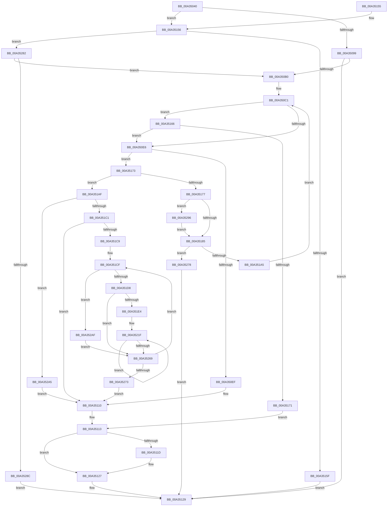

# RtlQueryModuleInformation

- RVA: `0x00A35040`–`0x00A352C3` (길이 `643` bytes)
- VA: `0x0000000140A35040`
- 실행 섹션: `PAGE`
- PDB 이름 있음: `예`; PDB Function 태그: `아니요`
- unwind 정보 RVA: `0x000AD698`
- 디코드: `163`개 명령, `643/643` bytes 표시
- 미해석 바이트: `0` (있으면 어셈블리에 `.byte`로 보존)

> 이 문서는 커널 이미지의 기계어와 PDB 기호를 분석해 생성했습니다. 4번과 5번은 함수 원형과 자료형을 바이너리 사용 방식에서 추정한 C 해석이며 원본 소스 복구 결과는 아닙니다.

## 1. Dependencies

- 직접 호출 지점: **6**; 고유 호출 대상: **5**
- 직접 호출자로 확인된 함수: **0**
- RIP 상대 이미지 참조: **1**

### Outgoing calls
- `0x00A35086` → [memset](../../text/6C/memset_function_006C6C40.md) (function, `0x006C6C40`)
- `0x00A350D2` → [ZwQuerySystemInformation](../../text/6A/ZwQuerySystemInformation_function_006AD790.md) (function, `0x006AD790`)
- `0x00A35122` → [ExFreePoolWithTag](../../poolcode/B8/ExFreePoolWithTag_function_00B82870.md) (function, `0x00B82870`)
- `0x00A35134` → [_security_check_cookie](../../text/6A/_security_check_cookie_function_006AC640.md) (function, `0x006AC640`)
- `0x00A35194` → [ExAllocatePool2](../../poolcode/B8/ExAllocatePool2_function_00B820F0.md) (function, `0x00B820F0`)
- `0x00A3529B` → [ExFreePoolWithTag](../../poolcode/B8/ExFreePoolWithTag_function_00B82870.md) (function, `0x00B82870`)

### Direct callers
- 이 함수 시작 RVA로 연결되는 직접 call은 확인되지 않았습니다. 간접 호출은 완전히 역산할 수 없습니다.

### Static image references
- `0x00A35059` → RVA `0x00E0A740` (`.data`; read)

## 2. Other-region calls and transfers

- 다른 실행 섹션으로 향하는 call: **6**
  - `0x00A35086` → [memset](../../text/6C/memset_function_006C6C40.md) (`PAGE` → `.text`)
  - `0x00A350D2` → [ZwQuerySystemInformation](../../text/6A/ZwQuerySystemInformation_function_006AD790.md) (`PAGE` → `.text`)
  - `0x00A35122` → [ExFreePoolWithTag](../../poolcode/B8/ExFreePoolWithTag_function_00B82870.md) (`PAGE` → `POOLCODE`)
  - `0x00A35134` → [_security_check_cookie](../../text/6A/_security_check_cookie_function_006AC640.md) (`PAGE` → `.text`)
  - `0x00A35194` → [ExAllocatePool2](../../poolcode/B8/ExAllocatePool2_function_00B820F0.md) (`PAGE` → `POOLCODE`)
  - `0x00A3529B` → [ExFreePoolWithTag](../../poolcode/B8/ExFreePoolWithTag_function_00B82870.md) (`PAGE` → `POOLCODE`)
- 별도 외부 분기/꼬리 이동을 확인하지 못했습니다.

## 3. Assembly (complete function range)

```asm
00A35040  48 89 5C 24 10                  mov qword ptr [rsp + 0x10], rbx
00A35045  48 89 6C 24 20                  mov qword ptr [rsp + 0x20], rbp
00A3504A  56                              push rsi
00A3504B  57                              push rdi
00A3504C  41 54                           push r12
00A3504E  41 56                           push r14
00A35050  41 57                           push r15
00A35052  48 81 EC 70 01 00 00            sub rsp, 0x170
00A35059  48 8B 05 E0 56 3D 00            mov rax, qword ptr [rip + 0x3d56e0]
00A35060  48 33 C4                        xor rax, rsp
00A35063  48 89 84 24 60 01 00 00         mov qword ptr [rsp + 0x160], rax
00A3506B  4D 8B F0                        mov r14, r8
00A3506E  8B EA                           mov ebp, edx
00A35070  4C 8B F9                        mov r15, rcx
00A35073  33 C0                           xor eax, eax
00A35075  33 D2                           xor edx, edx
00A35077  89 44 24 34                     mov dword ptr [rsp + 0x34], eax
00A3507B  41 B8 2C 01 00 00               mov r8d, 0x12c
00A35081  48 8D 4C 24 30                  lea rcx, [rsp + 0x30]
00A35086  E8 B5 1B C9 FF                  call 0x1406c6c40
00A3508B  33 FF                           xor edi, edi
00A3508D  81 FD 10 01 00 00               cmp ebp, 0x110
00A35093  0F 85 BD 00 00 00               jne 0x140a35156
00A35099  49 8B CE                        mov rcx, r14
00A3509C  83 E1 07                        and ecx, 7
00A3509F  8B C1                           mov eax, ecx
00A350A1  48 F7 D8                        neg rax
00A350A4  1B C0                           sbb eax, eax
00A350A6  25 F1 00 00 C0                  and eax, 0xc00000f1
00A350AB  48 85 C9                        test rcx, rcx
00A350AE  75 79                           jne 0x140a35129
00A350B0  48 8D 5C 24 30                  lea rbx, [rsp + 0x30]
00A350B5  41 B8 30 01 00 00               mov r8d, 0x130
00A350BB  41 BC 00 00 00 80               mov r12d, 0x80000000
00A350C1  4C 8D 4C 24 20                  lea r9, [rsp + 0x20]
00A350C6  89 7C 24 20                     mov dword ptr [rsp + 0x20], edi
00A350CA  48 8B D3                        mov rdx, rbx
00A350CD  B9 0B 00 00 00                  mov ecx, 0xb
00A350D2  E8 B9 86 C7 FF                  call 0x1406ad790
00A350D7  8B F0                           mov esi, eax
00A350D9  42 8D 0C 20                     lea ecx, [rax + r12]
00A350DD  41 85 CC                        test r12d, ecx
00A350E0  0F 84 80 00 00 00               je 0x140a35166
00A350E6  4D 85 F6                        test r14, r14
00A350E9  0F 85 84 00 00 00               jne 0x140a35173
00A350EF  8B 4C 24 20                     mov ecx, dword ptr [rsp + 0x20]
00A350F3  48 B8 8B 7C D6 0D A6 C8 67 DD   movabs rax, 0xdd67c8a60dd67c8b
00A350FD  83 C1 F8                        add ecx, -8
00A35100  8B F7                           mov esi, edi
00A35102  48 F7 E1                        mul rcx
00A35105  4C 8B C2                        mov r8, rdx
00A35108  49 C1 E8 08                     shr r8, 8
00A3510C  44 0F AF C5                     imul r8d, ebp
00A35110  45 89 07                        mov dword ptr [r15], r8d
00A35113  48 8D 44 24 30                  lea rax, [rsp + 0x30]
00A35118  48 3B D8                        cmp rbx, rax
00A3511B  74 0A                           je 0x140a35127
00A3511D  33 D2                           xor edx, edx
00A3511F  48 8B CB                        mov rcx, rbx
00A35122  E8 49 D7 14 00                  call 0x140b82870
00A35127  8B C6                           mov eax, esi
00A35129  48 8B 8C 24 60 01 00 00         mov rcx, qword ptr [rsp + 0x160]
00A35131  48 33 CC                        xor rcx, rsp
00A35134  E8 07 75 C7 FF                  call 0x1406ac640
00A35139  4C 8D 9C 24 70 01 00 00         lea r11, [rsp + 0x170]
00A35141  49 8B 5B 38                     mov rbx, qword ptr [r11 + 0x38]
00A35145  49 8B 6B 48                     mov rbp, qword ptr [r11 + 0x48]
00A35149  49 8B E3                        mov rsp, r11
00A3514C  41 5F                           pop r15
00A3514E  41 5E                           pop r14
00A35150  41 5C                           pop r12
00A35152  5F                              pop rdi
00A35153  5E                              pop rsi
00A35154  C3                              ret
00A35155  CC                              int3
00A35156  83 FD 08                        cmp ebp, 8
00A35159  0F 84 23 01 00 00               je 0x140a35282
00A3515F  B8 F0 00 00 C0                  mov eax, 0xc00000f0
00A35164  EB C3                           jmp 0x140a35129
00A35166  3D 04 00 00 C0                  cmp eax, 0xc0000004
00A3516B  0F 84 75 FF FF FF               je 0x140a350e6
00A35171  EB A0                           jmp 0x140a35113
00A35173  85 C0                           test eax, eax
00A35175  79 38                           jns 0x140a351af
00A35177  48 8D 44 24 30                  lea rax, [rsp + 0x30]
00A3517C  48 3B D8                        cmp rbx, rax
00A3517F  0F 85 11 01 00 00               jne 0x140a35296
00A35185  8B 54 24 20                     mov edx, dword ptr [rsp + 0x20]
00A35189  B9 01 01 00 00                  mov ecx, 0x101
00A3518E  41 B8 52 74 6C 54               mov r8d, 0x546c7452
00A35194  E8 57 CF 14 00                  call 0x140b820f0
00A35199  48 8B D8                        mov rbx, rax
00A3519C  48 85 C0                        test rax, rax
00A3519F  0F 84 D3 00 00 00               je 0x140a35278
00A351A5  44 8B 44 24 20                  mov r8d, dword ptr [rsp + 0x20]
00A351AA  E9 12 FF FF FF                  jmp 0x140a350c1
00A351AF  8B 03                           mov eax, dword ptr [rbx]
00A351B1  44 8B C0                        mov r8d, eax
00A351B4  44 0F AF C5                     imul r8d, ebp
00A351B8  45 39 07                        cmp dword ptr [r15], r8d
00A351BB  0F 82 E4 00 00 00               jb 0x140a352a5
00A351C1  85 C0                           test eax, eax
00A351C3  0F 84 47 FF FF FF               je 0x140a35110
00A351C9  41 B9 80 00 00 00               mov r9d, 0x80
00A351CF  83 FD 08                        cmp ebp, 8
00A351D2  0F 84 D7 00 00 00               je 0x140a352af
00A351D8  81 FD 10 01 00 00               cmp ebp, 0x110
00A351DE  0F 85 85 00 00 00               jne 0x140a35269
00A351E4  8B C7                           mov eax, edi
00A351E6  48 69 D0 10 01 00 00            imul rdx, rax, 0x110
00A351ED  48 69 C8 28 01 00 00            imul rcx, rax, 0x128
00A351F4  49 03 D6                        add rdx, r14
00A351F7  48 8B 44 19 18                  mov rax, qword ptr [rcx + rbx + 0x18]
00A351FC  48 89 02                        mov qword ptr [rdx], rax
00A351FF  8B 44 19 20                     mov eax, dword ptr [rcx + rbx + 0x20]
00A35203  89 42 08                        mov dword ptr [rdx + 8], eax
00A35206  0F B7 44 19 2E                  movzx eax, word ptr [rcx + rbx + 0x2e]
00A3520B  66 89 42 0C                     mov word ptr [rdx + 0xc], ax
00A3520F  48 8D 41 30                     lea rax, [rcx + 0x30]
00A35213  48 83 C2 0E                     add rdx, 0xe
00A35217  B9 02 00 00 00                  mov ecx, 2
00A3521C  48 03 C3                        add rax, rbx
00A3521F  0F 10 00                        movups xmm0, xmmword ptr [rax]
00A35222  0F 11 02                        movups xmmword ptr [rdx], xmm0
00A35225  0F 10 48 10                     movups xmm1, xmmword ptr [rax + 0x10]
00A35229  0F 11 4A 10                     movups xmmword ptr [rdx + 0x10], xmm1
00A3522D  0F 10 40 20                     movups xmm0, xmmword ptr [rax + 0x20]
00A35231  0F 11 42 20                     movups xmmword ptr [rdx + 0x20], xmm0
00A35235  0F 10 48 30                     movups xmm1, xmmword ptr [rax + 0x30]
00A35239  0F 11 4A 30                     movups xmmword ptr [rdx + 0x30], xmm1
00A3523D  0F 10 40 40                     movups xmm0, xmmword ptr [rax + 0x40]
00A35241  0F 11 42 40                     movups xmmword ptr [rdx + 0x40], xmm0
00A35245  0F 10 48 50                     movups xmm1, xmmword ptr [rax + 0x50]
00A35249  0F 11 4A 50                     movups xmmword ptr [rdx + 0x50], xmm1
00A3524D  0F 10 40 60                     movups xmm0, xmmword ptr [rax + 0x60]
00A35251  0F 11 42 60                     movups xmmword ptr [rdx + 0x60], xmm0
00A35255  49 03 D1                        add rdx, r9
00A35258  0F 10 48 70                     movups xmm1, xmmword ptr [rax + 0x70]
00A3525C  49 03 C1                        add rax, r9
00A3525F  0F 11 4A F0                     movups xmmword ptr [rdx - 0x10], xmm1
00A35263  48 83 E9 01                     sub rcx, 1
00A35267  75 B6                           jne 0x140a3521f
00A35269  FF C7                           inc edi
00A3526B  3B 3B                           cmp edi, dword ptr [rbx]
00A3526D  0F 82 5C FF FF FF               jb 0x140a351cf
00A35273  E9 98 FE FF FF                  jmp 0x140a35110
00A35278  B8 9A 00 00 C0                  mov eax, 0xc000009a
00A3527D  E9 A7 FE FF FF                  jmp 0x140a35129
00A35282  41 F6 C6 07                     test r14b, 7
00A35286  0F 84 24 FE FF FF               je 0x140a350b0
00A3528C  B8 F1 00 00 C0                  mov eax, 0xc00000f1
00A35291  E9 93 FE FF FF                  jmp 0x140a35129
00A35296  33 D2                           xor edx, edx
00A35298  48 8B CB                        mov rcx, rbx
00A3529B  E8 D0 D5 14 00                  call 0x140b82870
00A352A0  E9 E0 FE FF FF                  jmp 0x140a35185
00A352A5  BE 23 00 00 C0                  mov esi, 0xc0000023
00A352AA  E9 61 FE FF FF                  jmp 0x140a35110
00A352AF  8B D7                           mov edx, edi
00A352B1  48 69 C2 28 01 00 00            imul rax, rdx, 0x128
00A352B8  48 8B 4C 18 18                  mov rcx, qword ptr [rax + rbx + 0x18]
00A352BD  49 89 0C D6                     mov qword ptr [r14 + rdx*8], rcx
00A352C1  EB A6                           jmp 0x140a35269
```

## 4. C-style interpretation (structured pseudocode)

```c
__int64 __fastcall RtlQueryModuleInformation(__int64 a1, int a2, __int64 a3)
{
    __int64 result;
    __int64 v_rdi;
    __int64 v_rsp;
    unsigned __int64 v_stack_m140;
    unsigned int v_stack_m150;
    unsigned int v_stack_m164;
    unsigned __int64 v_stack_m168;
    unsigned __int64 v_stack_m178;
    unsigned __int64 v_stack_m28;
    unsigned __int64 v_stack_m38;
    unsigned __int64 v_stack_p10;
    unsigned __int64 v_stack_p20;

    v_stack_p10 = v_rbx;
    v_stack_p20 = v_rbp;
    v_rsp = (v_rsp) - (368);
    result = (*(unsigned __int64 *)(v_rip + 4019936)) ^ (v_rsp);
    v_stack_m38 = result;
    result = 0;
    a2 = 0;
    v_stack_m164 = 0;
    result = memset(v_stack_m168, a2, 300, a4);
    v_rdi = 0;
    if (((unsigned int)((unsigned int)(a2))) != 272) goto loc_00A35156;
    a1 = (unsigned int)((a3) & (7));
    result = -((unsigned int)((unsigned int)(a1)));
    result = (unsigned int)((result) & (0xC00000F1ULL));
    if (a1 != 0) goto loc_00A35129;
loc_00A350B0:
loc_00A350C1:
    v_stack_m178 = 0;
    result = ZwQuerySystemInformation(11, v_stack_m168, 304, v_stack_m178);
    if ((((unsigned int)((unsigned int)(0x80000000ULL))) & ((unsigned int)(result + (unsigned int)(0x80000000ULL) * 1))) == 0) goto loc_00A35166;
loc_00A350E6:
    if (a3 != 0) goto loc_00A35173;
    a1 = (unsigned int)(((unsigned int)(v_stack_m178)) + (-8));
    a3 = (v_stack_m168) >> (8);
    a3 = (unsigned int)((a3) * ((unsigned int)((unsigned int)(a2))));
loc_00A35110:
    *(unsigned int *)(a1) = (unsigned int)(a3);
loc_00A35113:
    result = v_stack_m168;
    if (v_stack_m168 != v_stack_m168) {
        a2 = 0;
        a1 = v_stack_m168;
        result = ExFreePoolWithTag(a1, a2, a3, v_stack_m178);
    }
loc_00A35129:
    a1 = (v_stack_m38) ^ (v_rsp);
    result = _security_check_cookie(a1, a2, a3, v_stack_m178);
    return result;
loc_00A35156:
    if (((unsigned int)(*(unsigned __int64 *)(v_stack_m28 + 72))) == 8) goto loc_00A35282;
    goto loc_00A35129;
loc_00A35166:
    if (((unsigned int)((unsigned int)(0xC00000F0ULL))) == 0xC0000004ULL) goto loc_00A350E6;
    goto loc_00A35113;
loc_00A35173:
    if (!sign_flag) goto loc_00A351AF;
    if ((*(unsigned __int64 *)(v_stack_m28 + 56)) != v_stack_m140) goto loc_00A35296;
loc_00A35185:
    result = ExAllocatePool2(257, (unsigned int)(v_stack_m150), (unsigned int)(0x546C7452ULL), v_stack_m178);
    if (result == 0) goto loc_00A35278;
    goto loc_00A350C1;
loc_00A351AF:
    a3 = (unsigned int)(((unsigned int)((unsigned int)((unsigned int)(*(unsigned int *)(result))))) * ((unsigned int)(*(unsigned __int64 *)(v_stack_m28 + 72))));
    if ((*(unsigned int *)(a1)) < ((unsigned int)(a3))) goto loc_00A352A5;
    if ((unsigned int)((unsigned int)(*(unsigned int *)(result))) == 0) goto loc_00A35110;
loc_00A351CF:
    if (((unsigned int)(*(unsigned __int64 *)(v_stack_m28 + 72))) == 8) goto loc_00A352AF;
    if (((unsigned int)(*(unsigned __int64 *)(v_stack_m28 + 72))) != 272) goto loc_00A35269;
    a2 = ((unsigned int)(v_stack_m150)) * (0);
    a1 = (257) * (0);
    a2 = (a2) + (a3);
    *(unsigned __int64 *)(a2) = *(unsigned __int64 *)(a1 + result * 1 + 24);
    *(unsigned int *)(a2 + 8) = (unsigned int)((unsigned int)(*(unsigned int *)(a1 + result * 1 + 32)));
    *(unsigned __int16 *)(a2 + 12) = (unsigned __int16)(*(unsigned __int16 *)(a1 + result * 1 + 46));
    a2 = (a2) + (14);
    result = (a1 + 48) + (result);
loc_00A3521F:
    *(unsigned __int64 *)(a2) = v_xmm0;
    *(unsigned __int64 *)(a2 + 16) = v_xmm1;
    *(unsigned __int64 *)(a2 + 32) = v_xmm0;
    *(unsigned __int64 *)(a2 + 48) = v_xmm1;
    *(unsigned __int64 *)(a2 + 64) = v_xmm0;
    *(unsigned __int64 *)(a2 + 80) = v_xmm1;
    *(unsigned __int64 *)(a2 + 96) = v_xmm0;
    a2 = (a2) + (128);
    result = (result) + (128);
    *(unsigned __int64 *)(a2 - 16) = v_xmm1;
    a1 = (2) - (1);
    if (condition_is_not_equal) goto loc_00A3521F;
loc_00A35269:
    v_rdi = (unsigned int)((v_rdi) + 1);
    if (((unsigned int)(v_rdi)) < (*(unsigned int *)(result))) goto loc_00A351CF;
    goto loc_00A35110;
loc_00A35278:
    goto loc_00A35129;
loc_00A35282:
    if ((((unsigned __int8)(a3)) & (7)) == 0) goto loc_00A350B0;
    goto loc_00A35129;
loc_00A35296:
    a2 = 0;
    result = ExFreePoolWithTag(result, a2, a3, 128);
    goto loc_00A35185;
loc_00A352A5:
    goto loc_00A35110;
loc_00A352AF:
    result = (result) * ((unsigned int)((unsigned int)(v_rdi)));
    *(unsigned __int64 *)(a3 + (unsigned int)((unsigned int)(v_rdi)) * 8) = *(unsigned __int64 *)(result + result * 1 + 24);
    goto loc_00A35269;
}
```

## 5. (Beta) C Style

```c
int64_t RtlQueryModuleInformation(void *Arg1, int32_t Arg2, int64_t Arg3)
{
    uint8_t *arg1 = (uint8_t *)Arg1;

    int64_t result;
    int64_t local_rdi;
    int64_t local_rsp;
    uint64_t v_stack_m140;
    uint32_t v_stack_m150;
    uint32_t v_stack_m164;
    uint64_t v_stack_m168;
    uint64_t v_stack_m178;
    uint64_t v_stack_m28;
    uint64_t v_stack_m38;
    uint64_t v_stack_p10;
    uint64_t v_stack_p20;

    v_stack_p10 = local_rbx;
    v_stack_p20 = local_rbp;
    local_rsp = (local_rsp) - (368);
    result = (*(uint64_t *)(v_rip + 0x3D56E0)) ^ (local_rsp);
    v_stack_m38 = result;
    result = 0;
    Arg2 = 0;
    v_stack_m164 = 0;
    result = memset(v_stack_m168, Arg2, 300, a4);
    local_rdi = 0;
    if (((uint32_t)((uint32_t)(Arg2))) != 272) goto loc_00A35156;
    Arg1 = (uint32_t)((Arg3) & (7));
    result = -((uint32_t)((uint32_t)(Arg1)));
    result = (uint32_t)((result) & (0xC00000F1ULL));
    if (Arg1 != NULL) goto loc_00A35129;
loc_00A350B0:
loc_00A350C1:
    v_stack_m178 = 0;
    result = ZwQuerySystemInformation(11, v_stack_m168, 304, v_stack_m178);
    if ((((uint32_t)((uint32_t)(0x80000000ULL))) & ((uint32_t)(result + (uint32_t)(0x80000000ULL) * 1))) == 0) goto loc_00A35166;
loc_00A350E6:
    if (Arg3 != 0) goto loc_00A35173;
    Arg1 = (uint32_t)(((uint32_t)(v_stack_m178)) + (-8));
    Arg3 = (v_stack_m168) >> (8);
    Arg3 = (uint32_t)((Arg3) * ((uint32_t)((uint32_t)(Arg2))));
loc_00A35110:
    *(uint32_t *)(arg1) = (uint32_t)(Arg3);
loc_00A35113:
    result = v_stack_m168;
    if (v_stack_m168 != v_stack_m168) {
        Arg2 = 0;
        Arg1 = v_stack_m168;
        result = ExFreePoolWithTag(Arg1, Arg2, Arg3, v_stack_m178);
    }
loc_00A35129:
    Arg1 = (v_stack_m38) ^ (local_rsp);
    result = _security_check_cookie(Arg1, Arg2, Arg3, v_stack_m178);
    return result;
loc_00A35156:
    if (((uint32_t)(*(uint64_t *)(v_stack_m28 + 0x48))) == 8) goto loc_00A35282;
    goto loc_00A35129;
loc_00A35166:
    if (((uint32_t)((uint32_t)(0xC00000F0ULL))) == 0xC0000004ULL) goto loc_00A350E6;
    goto loc_00A35113;
loc_00A35173:
    if (!sign_flag) goto loc_00A351AF;
    if ((*(uint64_t *)(v_stack_m28 + 0x38)) != v_stack_m140) goto loc_00A35296;
loc_00A35185:
    result = ExAllocatePool2(257, (uint32_t)(v_stack_m150), (uint32_t)(0x546C7452ULL), v_stack_m178);
    if (result == 0) goto loc_00A35278;
    goto loc_00A350C1;
loc_00A351AF:
    Arg3 = (uint32_t)(((uint32_t)((uint32_t)((uint32_t)(*(uint32_t *)(result))))) * ((uint32_t)(*(uint64_t *)(v_stack_m28 + 0x48))));
    if ((*(uint32_t *)(arg1)) < ((uint32_t)(Arg3))) goto loc_00A352A5;
    if ((uint32_t)((uint32_t)(*(uint32_t *)(result))) == 0) goto loc_00A35110;
loc_00A351CF:
    if (((uint32_t)(*(uint64_t *)(v_stack_m28 + 0x48))) == 8) goto loc_00A352AF;
    if (((uint32_t)(*(uint64_t *)(v_stack_m28 + 0x48))) != 272) goto loc_00A35269;
    Arg2 = ((uint32_t)(v_stack_m150)) * (0);
    Arg1 = (257) * (0);
    Arg2 = (Arg2) + (Arg3);
    *(uint64_t *)(Arg2) = *(uint64_t *)(arg1 + result * 1 + 0x18);
    *(uint32_t *)(Arg2 + 0x8) = (uint32_t)((uint32_t)(*(uint32_t *)(arg1 + result * 1 + 0x20)));
    *(uint16_t *)(Arg2 + 0xC) = (uint16_t)(*(uint16_t *)(arg1 + result * 1 + 0x2E));
    Arg2 = (Arg2) + (14);
    result = (Arg1 + 48) + (result);
loc_00A3521F:
    *(uint64_t *)(Arg2) = v_xmm0;
    *(uint64_t *)(Arg2 + 0x10) = v_xmm1;
    *(uint64_t *)(Arg2 + 0x20) = v_xmm0;
    *(uint64_t *)(Arg2 + 0x30) = v_xmm1;
    *(uint64_t *)(Arg2 + 0x40) = v_xmm0;
    *(uint64_t *)(Arg2 + 0x50) = v_xmm1;
    *(uint64_t *)(Arg2 + 0x60) = v_xmm0;
    Arg2 = (Arg2) + (128);
    result = (result) + (128);
    *(uint64_t *)(Arg2 - 0x10) = v_xmm1;
    Arg1 = (2) - (1);
    if (condition_is_not_equal) goto loc_00A3521F;
loc_00A35269:
    local_rdi = (uint32_t)((local_rdi) + 1);
    if (((uint32_t)(local_rdi)) < (*(uint32_t *)(result))) goto loc_00A351CF;
    goto loc_00A35110;
loc_00A35278:
    goto loc_00A35129;
loc_00A35282:
    if ((((uint8_t)(Arg3)) & (7)) == 0) goto loc_00A350B0;
    goto loc_00A35129;
loc_00A35296:
    Arg2 = 0;
    result = ExFreePoolWithTag(result, Arg2, Arg3, 128);
    goto loc_00A35185;
loc_00A352A5:
    goto loc_00A35110;
loc_00A352AF:
    result = (result) * ((uint32_t)((uint32_t)(local_rdi)));
    *(uint64_t *)(Arg3 + (uint32_t)((uint32_t)(local_rdi)) * 8) = *(uint64_t *)(result + result * 1 + 0x18);
    goto loc_00A35269;
}
```

### 관측된 메모리 오프셋

구조체 형식이 확인되지 않은 접근은 인자 기준의 오프셋으로만 기록했습니다.

| 기준 인자 | 오프셋 표현 | 폭 (bit) | 접근 |
|---|---:|---:|---|
| `Arg1` | `+ 0x0` | `32` | `R` |
| `Arg1` | `+ 0x0` | `32` | `W` |

## 6. Execution-region graph

[열기: 2D/3D 그래프와 함수 탐색 컨트롤 패널](../../../control-panel.html?section=page&rva=0x00A35040&view=graph)

- 2D 그래프는 위에서 아래로 흐르고, 3D 그래프는 빈 공간을 드래그해 회전합니다. Shift+드래그는 이동, 휠은 확대·축소, 함수 노드 선택은 대상 보고서 이동입니다.

### Static fallback


