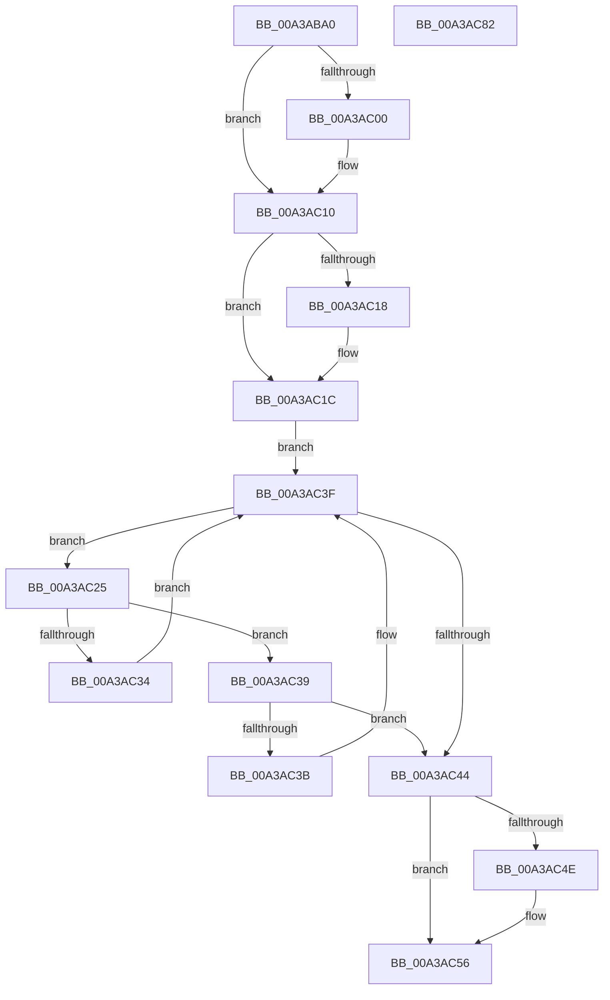

# RtlpFindDynamicEHContinuationTarget

- RVA: `0x00A3ABA0`–`0x00A3AC83` (길이 `227` bytes)
- VA: `0x0000000140A3ABA0`
- 실행 섹션: `PAGE`
- PDB 이름 있음: `예`; PDB Function 태그: `아니요`
- unwind 정보 RVA: `0x00095AD0`
- 디코드: `64`개 명령, `227/227` bytes 표시
- 미해석 바이트: `0` (있으면 어셈블리에 `.byte`로 보존)

> 이 문서는 커널 이미지의 기계어와 PDB 기호를 분석해 생성했습니다. 4번과 5번은 함수 원형과 자료형을 바이너리 사용 방식에서 추정한 C 해석이며 원본 소스 복구 결과는 아닙니다.

## 1. Dependencies

- 직접 호출 지점: **6**; 고유 호출 대상: **6**
- 직접 호출자로 확인된 함수: **1**
- RIP 상대 이미지 참조: **0**

### Outgoing calls
- `0x00A3ABEB` → [KeAbPreAcquire](../../text/21/KeAbPreAcquire_function_00210230.md) (function, `0x00210230`)
- `0x00A3AC0B` → [ExfAcquirePushLockSharedEx](../../text/21/ExfAcquirePushLockSharedEx_function_0021044C.md) (function, `0x0021044C`)
- `0x00A3AC2B` → [RtlpDynamicEHContinuationTargetsTreeCompare](RtlpDynamicEHContinuationTargetsTreeCompare_function_00A3AC8C.md) (function, `0x00A3AC8C`)
- `0x00A3AC51` → [ExfReleasePushLockShared](../../text/26/ExfReleasePushLockShared_function_00263440.md) (function, `0x00263440`)
- `0x00A3AC59` → [KeAbPostRelease](../../text/2E/KeAbPostRelease_function_002E1600.md) (function, `0x002E1600`)
- `0x00A3AC5E` → [KeLeaveCriticalRegion](../../text/25/KeLeaveCriticalRegion_function_0025D8B0.md) (function, `0x0025D8B0`)

### Direct callers
- [RtlVerifyUserUnwindTarget](../A1/RtlVerifyUserUnwindTarget_function_00A1FDB8.md) at `0x00A1FFA3`

### Static image references
- 디코드된 RIP-relative 메모리 참조가 없습니다.

## 2. Other-region calls and transfers

- 다른 실행 섹션으로 향하는 call: **5**
  - `0x00A3ABEB` → [KeAbPreAcquire](../../text/21/KeAbPreAcquire_function_00210230.md) (`PAGE` → `.text`)
  - `0x00A3AC0B` → [ExfAcquirePushLockSharedEx](../../text/21/ExfAcquirePushLockSharedEx_function_0021044C.md) (`PAGE` → `.text`)
  - `0x00A3AC51` → [ExfReleasePushLockShared](../../text/26/ExfReleasePushLockShared_function_00263440.md) (`PAGE` → `.text`)
  - `0x00A3AC59` → [KeAbPostRelease](../../text/2E/KeAbPostRelease_function_002E1600.md) (`PAGE` → `.text`)
  - `0x00A3AC5E` → [KeLeaveCriticalRegion](../../text/25/KeLeaveCriticalRegion_function_0025D8B0.md) (`PAGE` → `.text`)
- 별도 외부 분기/꼬리 이동을 확인하지 못했습니다.

## 3. Assembly (complete function range)

```asm
00A3ABA0  48 89 5C 24 08                  mov qword ptr [rsp + 8], rbx
00A3ABA5  48 89 6C 24 18                  mov qword ptr [rsp + 0x18], rbp
00A3ABAA  48 89 74 24 20                  mov qword ptr [rsp + 0x20], rsi
00A3ABAF  57                              push rdi
00A3ABB0  41 56                           push r14
00A3ABB2  41 57                           push r15
00A3ABB4  48 83 EC 20                     sub rsp, 0x20
00A3ABB8  65 48 8B 04 25 88 01 00 00      mov rax, qword ptr gs:[0x188]
00A3ABC1  48 8B E9                        mov rbp, rcx
00A3ABC4  45 33 C0                        xor r8d, r8d
00A3ABC7  33 D2                           xor edx, edx
00A3ABC9  48 8B B0 B8 00 00 00            mov rsi, qword ptr [rax + 0xb8]
00A3ABD0  65 48 8B 04 25 88 01 00 00      mov rax, qword ptr gs:[0x188]
00A3ABD9  48 8D BE 88 07 00 00            lea rdi, [rsi + 0x788]
00A3ABE0  66 FF 88 E4 01 00 00            dec word ptr [rax + 0x1e4]
00A3ABE7  48 8B CF                        mov rcx, rdi
00A3ABEA  90                              nop
00A3ABEB  E8 40 56 7D FF                  call 0x140210230
00A3ABF0  48 8B D8                        mov rbx, rax
00A3ABF3  33 C0                           xor eax, eax
00A3ABF5  44 8D 78 11                     lea r15d, [rax + 0x11]
00A3ABF9  F0 4C 0F B1 3F                  lock cmpxchg qword ptr [rdi], r15
00A3ABFE  74 10                           je 0x140a3ac10
00A3AC00  4C 8B CF                        mov r9, rdi
00A3AC03  4C 8B C3                        mov r8, rbx
00A3AC06  33 D2                           xor edx, edx
00A3AC08  48 8B CF                        mov rcx, rdi
00A3AC0B  E8 3C 58 7D FF                  call 0x14021044c
00A3AC10  45 33 F6                        xor r14d, r14d
00A3AC13  48 85 DB                        test rbx, rbx
00A3AC16  74 04                           je 0x140a3ac1c
00A3AC18  C6 43 0A 01                     mov byte ptr [rbx + 0xa], 1
00A3AC1C  48 8B 9E 80 07 00 00            mov rbx, qword ptr [rsi + 0x780]
00A3AC23  EB 1A                           jmp 0x140a3ac3f
00A3AC25  48 8B D3                        mov rdx, rbx
00A3AC28  48 8B CD                        mov rcx, rbp
00A3AC2B  E8 5C 00 00 00                  call 0x140a3ac8c
00A3AC30  85 C0                           test eax, eax
00A3AC32  79 05                           jns 0x140a3ac39
00A3AC34  48 8B 1B                        mov rbx, qword ptr [rbx]
00A3AC37  EB 06                           jmp 0x140a3ac3f
00A3AC39  7E 09                           jle 0x140a3ac44
00A3AC3B  48 8B 5B 08                     mov rbx, qword ptr [rbx + 8]
00A3AC3F  48 85 DB                        test rbx, rbx
00A3AC42  75 E1                           jne 0x140a3ac25
00A3AC44  49 8B C7                        mov rax, r15
00A3AC47  F0 4C 0F B1 37                  lock cmpxchg qword ptr [rdi], r14
00A3AC4C  74 08                           je 0x140a3ac56
00A3AC4E  48 8B CF                        mov rcx, rdi
00A3AC51  E8 EA 87 82 FF                  call 0x140263440
00A3AC56  48 8B CF                        mov rcx, rdi
00A3AC59  E8 A2 69 8A FF                  call 0x1402e1600
00A3AC5E  E8 4D 2C 82 FF                  call 0x14025d8b0
00A3AC63  48 8B 6C 24 50                  mov rbp, qword ptr [rsp + 0x50]
00A3AC68  48 85 DB                        test rbx, rbx
00A3AC6B  48 8B 5C 24 40                  mov rbx, qword ptr [rsp + 0x40]
00A3AC70  48 8B 74 24 58                  mov rsi, qword ptr [rsp + 0x58]
00A3AC75  0F 95 C0                        setne al
00A3AC78  48 83 C4 20                     add rsp, 0x20
00A3AC7C  41 5F                           pop r15
00A3AC7E  41 5E                           pop r14
00A3AC80  5F                              pop rdi
00A3AC81  C3                              ret
00A3AC82  CC                              int3
```

## 4. C-style interpretation (structured pseudocode)

```c
__int64 __fastcall RtlpFindDynamicEHContinuationTarget(__int64 a1, int a2, int a3)
{
    __int64 result;
    __int64 v_r14;
    __int64 v_rsp;
    unsigned __int64 v_stack_p18;
    unsigned __int64 v_stack_p20;
    unsigned __int64 v_stack_p8;

    v_stack_p8 = v_rbx;
    v_stack_p18 = v_rbp;
    v_stack_p20 = v_rsi;
    v_rsp = (v_rsp) - (32);
    a3 = 0;
    a2 = 0;
    result = KeAbPreAcquire(*(unsigned __int64 *)(*(unsigned __int64 *)(gs_base + (0 + 392)) + 184) + 1928, a2, a3, a4);
    result = 0;
    if (!(condition_is_equal)) {
        a4 = *(unsigned __int64 *)(*(unsigned __int64 *)(gs_base + (0 + 392)) + 184) + 1928;
        a3 = 0;
        a2 = 0;
        a1 = *(unsigned __int64 *)(*(unsigned __int64 *)(gs_base + (0 + 392)) + 184) + 1928;
        result = ExfAcquirePushLockSharedEx(a1, a2, a3, a4);
    }
    v_r14 = 0;
    if (result != 0) {
        *(unsigned __int8 *)(result + 10) = 1;
    }
    goto loc_00A3AC3F;
loc_00A3AC25:
    result = RtlpDynamicEHContinuationTargetsTreeCompare(a1, *(unsigned __int64 *)(*(unsigned __int64 *)(*(unsigned __int64 *)(gs_base + (0 + 392)) + 184) + 1920), a3, a4);
    if (!sign_flag) goto loc_00A3AC39;
    goto loc_00A3AC3F;
loc_00A3AC39:
    if (condition_is_less_or_equal) goto loc_00A3AC44;
loc_00A3AC3F:
    if (*(unsigned __int64 *)(*(unsigned __int64 *)(*(unsigned __int64 *)(*(unsigned __int64 *)(*(unsigned __int64 *)(gs_base + (0 + 392)) + 184) + 1920)) + 8) != 0) goto loc_00A3AC25;
loc_00A3AC44:
    result = result + 17;
    if (*(unsigned __int64 *)(*(unsigned __int64 *)(*(unsigned __int64 *)(*(unsigned __int64 *)(*(unsigned __int64 *)(gs_base + (0 + 392)) + 184) + 1920)) + 8) != 0) {
        a1 = *(unsigned __int64 *)(*(unsigned __int64 *)(gs_base + (0 + 392)) + 184) + 1928;
        result = ExfReleasePushLockShared(a1, *(unsigned __int64 *)(*(unsigned __int64 *)(*(unsigned __int64 *)(gs_base + (0 + 392)) + 184) + 1920), a3, a4);
    }
    result = KeAbPostRelease(*(unsigned __int64 *)(*(unsigned __int64 *)(gs_base + (0 + 392)) + 184) + 1928, *(unsigned __int64 *)(*(unsigned __int64 *)(*(unsigned __int64 *)(gs_base + (0 + 392)) + 184) + 1920), a3, a4);
    result = KeLeaveCriticalRegion(*(unsigned __int64 *)(*(unsigned __int64 *)(gs_base + (0 + 392)) + 184) + 1928, *(unsigned __int64 *)(*(unsigned __int64 *)(*(unsigned __int64 *)(gs_base + (0 + 392)) + 184) + 1920), a3, a4);
    result = (*(unsigned __int64 *)(*(unsigned __int64 *)(*(unsigned __int64 *)(*(unsigned __int64 *)(*(unsigned __int64 *)(gs_base + (0 + 392)) + 184) + 1920)) + 8) != 0) ? 1 : 0;
    v_rsp = (v_rsp) + (32);
    return result;
}
```

## 5. (Beta) C Style

```c
int64_t RtlpFindDynamicEHContinuationTarget(int64_t Arg1, int32_t Arg2, int32_t Arg3)
{
    int64_t result;
    int64_t local_r14;
    int64_t local_rsp;
    uint64_t v_stack_p18;
    uint64_t v_stack_p20;
    uint64_t v_stack_p8;

    v_stack_p8 = local_rbx;
    v_stack_p18 = local_rbp;
    v_stack_p20 = local_rsi;
    local_rsp = (local_rsp) - (32);
    Arg3 = 0;
    Arg2 = 0;
    result = KeAbPreAcquire(*(uint64_t *)(*(uint64_t *)(gs_base + (0 + 0x188)) + 0xB8) + 1928, Arg2, Arg3, a4);
    result = 0;
    if (!(condition_is_equal)) {
        a4 = *(uint64_t *)(*(uint64_t *)(gs_base + (0 + 0x188)) + 0xB8) + 1928;
        Arg3 = 0;
        Arg2 = 0;
        Arg1 = *(uint64_t *)(*(uint64_t *)(gs_base + (0 + 0x188)) + 0xB8) + 1928;
        result = ExfAcquirePushLockSharedEx(Arg1, Arg2, Arg3, a4);
    }
    local_r14 = 0;
    if (result != 0) {
        *(uint8_t *)(result + 0xA) = 1;
    }
    goto loc_00A3AC3F;
loc_00A3AC25:
    result = RtlpDynamicEHContinuationTargetsTreeCompare(Arg1, *(uint64_t *)(*(uint64_t *)(*(uint64_t *)(gs_base + (0 + 0x188)) + 0xB8) + 0x780), Arg3, a4);
    if (!sign_flag) goto loc_00A3AC39;
    goto loc_00A3AC3F;
loc_00A3AC39:
    if (condition_is_less_or_equal) goto loc_00A3AC44;
loc_00A3AC3F:
    if (*(uint64_t *)(*(uint64_t *)(*(uint64_t *)(*(uint64_t *)(*(uint64_t *)(gs_base + (0 + 0x188)) + 0xB8) + 0x780)) + 0x8) != 0) goto loc_00A3AC25;
loc_00A3AC44:
    result = result + 17;
    if (*(uint64_t *)(*(uint64_t *)(*(uint64_t *)(*(uint64_t *)(*(uint64_t *)(gs_base + (0 + 0x188)) + 0xB8) + 0x780)) + 0x8) != 0) {
        Arg1 = *(uint64_t *)(*(uint64_t *)(gs_base + (0 + 0x188)) + 0xB8) + 1928;
        result = ExfReleasePushLockShared(Arg1, *(uint64_t *)(*(uint64_t *)(*(uint64_t *)(gs_base + (0 + 0x188)) + 0xB8) + 0x780), Arg3, a4);
    }
    result = KeAbPostRelease(*(uint64_t *)(*(uint64_t *)(gs_base + (0 + 0x188)) + 0xB8) + 1928, *(uint64_t *)(*(uint64_t *)(*(uint64_t *)(gs_base + (0 + 0x188)) + 0xB8) + 0x780), Arg3, a4);
    result = KeLeaveCriticalRegion(*(uint64_t *)(*(uint64_t *)(gs_base + (0 + 0x188)) + 0xB8) + 1928, *(uint64_t *)(*(uint64_t *)(*(uint64_t *)(gs_base + (0 + 0x188)) + 0xB8) + 0x780), Arg3, a4);
    result = (*(uint64_t *)(*(uint64_t *)(*(uint64_t *)(*(uint64_t *)(*(uint64_t *)(gs_base + (0 + 0x188)) + 0xB8) + 0x780)) + 0x8) != 0) ? 1 : 0;
    local_rsp = (local_rsp) + (32);
    return result;
}
```

## 6. Execution-region graph

[열기: 2D/3D 그래프와 함수 탐색 컨트롤 패널](../../../control-panel.html?section=page&rva=0x00A3ABA0&view=graph)

- 2D 그래프는 위에서 아래로 흐르고, 3D 그래프는 빈 공간을 드래그해 회전합니다. Shift+드래그는 이동, 휠은 확대·축소, 함수 노드 선택은 대상 보고서 이동입니다.

### Static fallback


