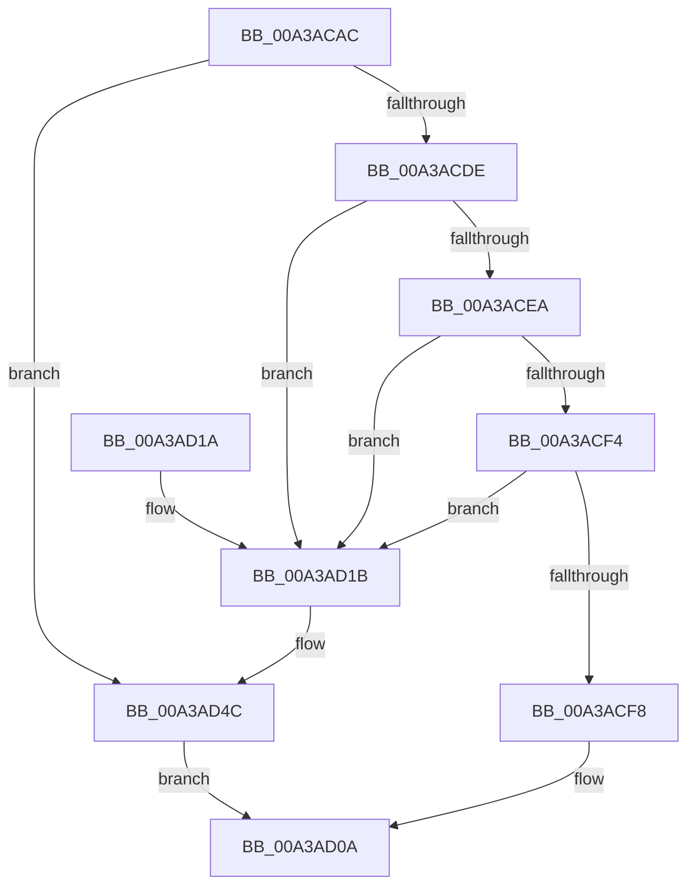

# RtlpInsertStringAtom

- RVA: `0x00A3ACAC`–`0x00A3AD50` (길이 `164` bytes)
- VA: `0x0000000140A3ACAC`
- 실행 섹션: `PAGE`
- PDB 이름 있음: `예`; PDB Function 태그: `아니요`
- unwind 정보 RVA: `0x000AE1DC`
- 디코드: `47`개 명령, `164/164` bytes 표시
- 미해석 바이트: `0` (있으면 어셈블리에 `.byte`로 보존)

> 이 문서는 커널 이미지의 기계어와 PDB 기호를 분석해 생성했습니다. 4번과 5번은 함수 원형과 자료형을 바이너리 사용 방식에서 추정한 C 해석이며 원본 소스 복구 결과는 아닙니다.

## 1. Dependencies

- 직접 호출 지점: **4**; 고유 호출 대상: **4**
- 직접 호출자로 확인된 함수: **1**
- RIP 상대 이미지 참조: **0**

### Outgoing calls
- `0x00A3ACD1` → [ExCreateHandleEx](../86/ExCreateHandleEx_function_0086ACB0.md) (function, `0x0086ACB0`)
- `0x00A3AD33` → [ExMapHandleToPointer](../86/ExMapHandleToPointer_function_00868B60.md) (function, `0x00868B60`)
- `0x00A3AD42` → [ExDestroyHandle](../88/ExDestroyHandle_function_00889430.md) (function, `0x00889430`)
- `0x00A3AD47` → [KeLeaveCriticalRegion](../../text/25/KeLeaveCriticalRegion_function_0025D8B0.md) (function, `0x0025D8B0`)

### Direct callers
- [RtlAddAtomToAtomTableEx](../../text/43/RtlAddAtomToAtomTableEx_function_00438550.md) at `0x004386B4`

### Static image references
- 디코드된 RIP-relative 메모리 참조가 없습니다.

## 2. Other-region calls and transfers

- 다른 실행 섹션으로 향하는 call: **1**
  - `0x00A3AD47` → [KeLeaveCriticalRegion](../../text/25/KeLeaveCriticalRegion_function_0025D8B0.md) (`PAGE` → `.text`)
- 별도 외부 분기/꼬리 이동을 확인하지 못했습니다.

## 3. Assembly (complete function range)

```asm
00A3ACAC  48 89 5C 24 08                  mov qword ptr [rsp + 8], rbx
00A3ACB1  48 89 74 24 10                  mov qword ptr [rsp + 0x10], rsi
00A3ACB6  57                              push rdi
00A3ACB7  48 83 EC 30                     sub rsp, 0x30
00A3ACBB  48 83 64 24 20 00               and qword ptr [rsp + 0x20], 0
00A3ACC1  48 8B F1                        mov rsi, rcx
00A3ACC4  48 8B 49 10                     mov rcx, qword ptr [rcx + 0x10]
00A3ACC8  45 33 C9                        xor r9d, r9d
00A3ACCB  45 33 C0                        xor r8d, r8d
00A3ACCE  48 8B FA                        mov rdi, rdx
00A3ACD1  E8 DA FF E2 FF                  call 0x14086acb0
00A3ACD6  48 8B D8                        mov rbx, rax
00A3ACD9  48 85 C0                        test rax, rax
00A3ACDC  74 6E                           je 0x140a3ad4c
00A3ACDE  C1 E8 02                        shr eax, 2
00A3ACE1  BA FF FF 00 00                  mov edx, 0xffff
00A3ACE6  3B C2                           cmp eax, edx
00A3ACE8  77 31                           ja 0x140a3ad1b
00A3ACEA  8D 88 00 C0 00 00               lea ecx, [rax + 0xc000]
00A3ACF0  3B C8                           cmp ecx, eax
00A3ACF2  72 27                           jb 0x140a3ad1b
00A3ACF4  3B CA                           cmp ecx, edx
00A3ACF6  77 23                           ja 0x140a3ad1b
00A3ACF8  66 89 47 08                     mov word ptr [rdi + 8], ax
00A3ACFC  B9 00 40 00 00                  mov ecx, 0x4000
00A3AD01  66 2B C1                        sub ax, cx
00A3AD04  66 89 47 0A                     mov word ptr [rdi + 0xa], ax
00A3AD08  B0 01                           mov al, 1
00A3AD0A  48 8B 5C 24 40                  mov rbx, qword ptr [rsp + 0x40]
00A3AD0F  48 8B 74 24 48                  mov rsi, qword ptr [rsp + 0x48]
00A3AD14  48 83 C4 30                     add rsp, 0x30
00A3AD18  5F                              pop rdi
00A3AD19  C3                              ret
00A3AD1A  CC                              int3
00A3AD1B  65 48 8B 04 25 88 01 00 00      mov rax, qword ptr gs:[0x188]
00A3AD24  48 8B D3                        mov rdx, rbx
00A3AD27  66 FF 88 E4 01 00 00            dec word ptr [rax + 0x1e4]
00A3AD2E  90                              nop
00A3AD2F  48 8B 4E 10                     mov rcx, qword ptr [rsi + 0x10]
00A3AD33  E8 28 DE E2 FF                  call 0x140868b60
00A3AD38  48 8B 4E 10                     mov rcx, qword ptr [rsi + 0x10]
00A3AD3C  4C 8B C0                        mov r8, rax
00A3AD3F  48 8B D3                        mov rdx, rbx
00A3AD42  E8 E9 E6 E4 FF                  call 0x140889430
00A3AD47  E8 64 2B 82 FF                  call 0x14025d8b0
00A3AD4C  32 C0                           xor al, al
00A3AD4E  EB BA                           jmp 0x140a3ad0a
```

## 4. C-style interpretation (structured pseudocode)

```c
__int64 __fastcall RtlpInsertStringAtom(__int64 a1, __int64 a2, int a3, int a4)
{
    __int64 result;
    __int64 v_rsp;
    unsigned __int64 v_stack_m18;
    unsigned __int64 v_stack_p10;
    unsigned __int64 v_stack_p8;

    v_stack_p8 = v_rbx;
    v_stack_p10 = v_rsi;
    v_rsp = (v_rsp) - (48);
    a4 = 0;
    a3 = 0;
    result = ExCreateHandleEx(*(unsigned __int64 *)(a1 + 16), a2, a3, a4);
    if (result == 0) goto loc_00A3AD4C;
    result = (unsigned int)((result) >> (2));
    if (((unsigned int)(result)) > ((unsigned int)((unsigned int)(0xFFFFULL)))) goto loc_00A3AD1B;
    if (((unsigned int)(result + 49152)) < ((unsigned int)(result))) goto loc_00A3AD1B;
    if (((unsigned int)(result + 49152)) > ((unsigned int)((unsigned int)(0xFFFFULL)))) goto loc_00A3AD1B;
    *(unsigned __int16 *)(a2 + 8) = (unsigned __int16)(result);
    result = (unsigned __int16)((result) - ((unsigned __int16)((unsigned int)(0x4000ULL))));
    *(unsigned __int16 *)(a2 + 10) = (unsigned __int16)(result);
loc_00A3AD0A:
    v_rsp = (v_rsp) + (48);
    return 1;
loc_00A3AD1B:
    result = ExMapHandleToPointer(*(unsigned __int64 *)(v_stack_p10 + 16), v_stack_p8, a3, a4);
    result = ExDestroyHandle(*(unsigned __int64 *)(v_stack_p10 + 16), v_stack_p8, result, a4);
    result = KeLeaveCriticalRegion(*(unsigned __int64 *)(v_stack_p10 + 16), v_stack_p8, result, a4);
loc_00A3AD4C:
    result = 0;
    goto loc_00A3AD0A;
}
```

## 5. (Beta) C Style

```c
int64_t RtlpInsertStringAtom(void *Arg1, void *Arg2, int32_t Arg3, int32_t Arg4)
{
    uint8_t *arg1 = (uint8_t *)Arg1;
    uint8_t *arg2 = (uint8_t *)Arg2;

    int64_t result;
    int64_t local_rsp;
    uint64_t v_stack_m18;
    uint64_t v_stack_p10;
    uint64_t v_stack_p8;

    v_stack_p8 = local_rbx;
    v_stack_p10 = local_rsi;
    local_rsp = (local_rsp) - (48);
    Arg4 = 0;
    Arg3 = 0;
    result = ExCreateHandleEx(*(uint64_t *)(arg1 + 0x10), Arg2, Arg3, Arg4);
    if (result == 0) goto loc_00A3AD4C;
    result = (uint32_t)((result) >> (2));
    if (((uint32_t)(result)) > ((uint32_t)((uint32_t)(0xFFFFULL)))) goto loc_00A3AD1B;
    if (((uint32_t)(result + 49152)) < ((uint32_t)(result))) goto loc_00A3AD1B;
    if (((uint32_t)(result + 49152)) > ((uint32_t)((uint32_t)(0xFFFFULL)))) goto loc_00A3AD1B;
    *(uint16_t *)(arg2 + 0x8) = (uint16_t)(result);
    result = (uint16_t)((result) - ((uint16_t)((uint32_t)(0x4000ULL))));
    *(uint16_t *)(arg2 + 0xA) = (uint16_t)(result);
loc_00A3AD0A:
    local_rsp = (local_rsp) + (48);
    return 1;
loc_00A3AD1B:
    result = ExMapHandleToPointer(*(uint64_t *)(v_stack_p10 + 0x10), v_stack_p8, Arg3, Arg4);
    result = ExDestroyHandle(*(uint64_t *)(v_stack_p10 + 0x10), v_stack_p8, result, Arg4);
    result = KeLeaveCriticalRegion(*(uint64_t *)(v_stack_p10 + 0x10), v_stack_p8, result, Arg4);
loc_00A3AD4C:
    result = 0;
    goto loc_00A3AD0A;
}
```

### 관측된 메모리 오프셋

구조체 형식이 확인되지 않은 접근은 인자 기준의 오프셋으로만 기록했습니다.

| 기준 인자 | 오프셋 표현 | 폭 (bit) | 접근 |
|---|---:|---:|---|
| `Arg1` | `+ 0x10` | `64` | `R` |
| `Arg2` | `+ 0x8` | `16` | `W` |
| `Arg2` | `+ 0xA` | `16` | `W` |

## 6. Execution-region graph

[열기: 2D/3D 그래프와 함수 탐색 컨트롤 패널](../../../control-panel.html?section=page&rva=0x00A3ACAC&view=graph)

- 2D 그래프는 위에서 아래로 흐르고, 3D 그래프는 빈 공간을 드래그해 회전합니다. Shift+드래그는 이동, 휠은 확대·축소, 함수 노드 선택은 대상 보고서 이동입니다.

### Static fallback


