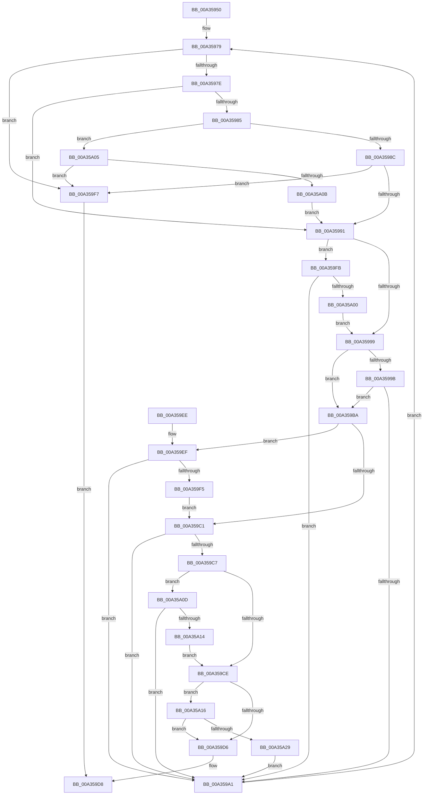

# RtlpIsRangeAvailable

- RVA: `0x00A35950`–`0x00A35A2E` (길이 `222` bytes)
- VA: `0x0000000140A35950`
- 실행 섹션: `PAGE`
- PDB 이름 있음: `예`; PDB Function 태그: `아니요`
- unwind 정보 RVA: `0x000AD954`
- 디코드: `69`개 명령, `222/222` bytes 표시
- 미해석 바이트: `0` (있으면 어셈블리에 `.byte`로 보존)

> 이 문서는 커널 이미지의 기계어와 PDB 기호를 분석해 생성했습니다. 4번과 5번은 함수 원형과 자료형을 바이너리 사용 방식에서 추정한 C 해석이며 원본 소스 복구 결과는 아닙니다.

## 1. Dependencies

- 직접 호출 지점: **2**; 고유 호출 대상: **2**
- 직접 호출자로 확인된 함수: **2**
- RIP 상대 이미지 참조: **0**

### Outgoing calls
- `0x00A359AE` → [RtlGetNextRange](RtlGetNextRange_function_00A35A40.md) (function, `0x00A35A40`)
- `0x00A35A20` → [guard_dispatch_icall](../../text/6B/guard_dispatch_icall_function_006BAAD0.md) (function, `0x006BAAD0`)

### Direct callers
- [RtlFindRange](RtlFindRange_function_00A35720.md) at `0x00A35828`
- [RtlIsRangeAvailable](RtlIsRangeAvailable_function_00A358A0.md) at `0x00A35911`

### Static image references
- 디코드된 RIP-relative 메모리 참조가 없습니다.

## 2. Other-region calls and transfers

- 다른 실행 섹션으로 향하는 call: **1**
  - `0x00A35A20` → [guard_dispatch_icall](../../text/6B/guard_dispatch_icall_function_006BAAD0.md) (`PAGE` → `.text`)
- 별도 외부 분기/꼬리 이동을 확인하지 못했습니다.

## 3. Assembly (complete function range)

```asm
00A35950  48 8B C4                        mov rax, rsp
00A35953  48 89 58 10                     mov qword ptr [rax + 0x10], rbx
00A35957  48 89 70 18                     mov qword ptr [rax + 0x18], rsi
00A3595B  48 89 78 20                     mov qword ptr [rax + 0x20], rdi
00A3595F  41 57                           push r15
00A35961  48 83 EC 20                     sub rsp, 0x20
00A35965  48 8B DA                        mov rbx, rdx
00A35968  45 8A F9                        mov r15b, r9b
00A3596B  48 8B 51 10                     mov rdx, qword ptr [rcx + 0x10]
00A3596F  49 8B F0                        mov rsi, r8
00A35972  48 89 50 08                     mov qword ptr [rax + 8], rdx
00A35976  48 8B F9                        mov rdi, rcx
00A35979  48 85 D2                        test rdx, rdx
00A3597C  74 79                           je 0x140a359f7
00A3597E  48 83 7F 08 00                  cmp qword ptr [rdi + 8], 0
00A35983  75 0C                           jne 0x140a35991
00A35985  80 7C 24 60 00                  cmp byte ptr [rsp + 0x60], 0
00A3598A  74 79                           je 0x140a35a05
00A3598C  48 3B 32                        cmp rsi, qword ptr [rdx]
00A3598F  72 66                           jb 0x140a359f7
00A35991  48 8B 02                        mov rax, qword ptr [rdx]
00A35994  48 3B C3                        cmp rax, rbx
00A35997  77 62                           ja 0x140a359fb
00A35999  73 1F                           jae 0x140a359ba
00A3599B  48 39 5A 08                     cmp qword ptr [rdx + 8], rbx
00A3599F  73 19                           jae 0x140a359ba
00A359A1  44 8A 44 24 60                  mov r8b, byte ptr [rsp + 0x60]
00A359A6  48 8D 54 24 30                  lea rdx, [rsp + 0x30]
00A359AB  48 8B CF                        mov rcx, rdi
00A359AE  E8 8D 00 00 00                  call 0x140a35a40
00A359B3  48 8B 54 24 30                  mov rdx, qword ptr [rsp + 0x30]
00A359B8  EB BF                           jmp 0x140a35979
00A359BA  80 7C 24 50 00                  cmp byte ptr [rsp + 0x50], 0
00A359BF  75 2E                           jne 0x140a359ef
00A359C1  44 84 7A 20                     test byte ptr [rdx + 0x20], r15b
00A359C5  75 DA                           jne 0x140a359a1
00A359C7  80 7C 24 58 00                  cmp byte ptr [rsp + 0x58], 0
00A359CC  75 3F                           jne 0x140a35a0d
00A359CE  48 83 7C 24 70 00               cmp qword ptr [rsp + 0x70], 0
00A359D4  75 40                           jne 0x140a35a16
00A359D6  32 C0                           xor al, al
00A359D8  48 8B 5C 24 38                  mov rbx, qword ptr [rsp + 0x38]
00A359DD  48 8B 74 24 40                  mov rsi, qword ptr [rsp + 0x40]
00A359E2  48 8B 7C 24 48                  mov rdi, qword ptr [rsp + 0x48]
00A359E7  48 83 C4 20                     add rsp, 0x20
00A359EB  41 5F                           pop r15
00A359ED  C3                              ret
00A359EE  CC                              int3
00A359EF  F6 42 21 01                     test byte ptr [rdx + 0x21], 1
00A359F3  75 AC                           jne 0x140a359a1
00A359F5  EB CA                           jmp 0x140a359c1
00A359F7  B0 01                           mov al, 1
00A359F9  EB DD                           jmp 0x140a359d8
00A359FB  48 3B F0                        cmp rsi, rax
00A359FE  72 A1                           jb 0x140a359a1
00A35A00  48 3B C3                        cmp rax, rbx
00A35A03  EB 94                           jmp 0x140a35999
00A35A05  48 3B 5A 08                     cmp rbx, qword ptr [rdx + 8]
00A35A09  77 EC                           ja 0x140a359f7
00A35A0B  EB 84                           jmp 0x140a35991
00A35A0D  48 83 7A 18 00                  cmp qword ptr [rdx + 0x18], 0
00A35A12  74 8D                           je 0x140a359a1
00A35A14  EB B8                           jmp 0x140a359ce
00A35A16  48 8B 4C 24 68                  mov rcx, qword ptr [rsp + 0x68]
00A35A1B  48 8B 44 24 70                  mov rax, qword ptr [rsp + 0x70]
00A35A20  E8 AB 50 C8 FF                  call 0x1406baad0
00A35A25  84 C0                           test al, al
00A35A27  74 AD                           je 0x140a359d6
00A35A29  E9 73 FF FF FF                  jmp 0x140a359a1
```

## 4. C-style interpretation (structured pseudocode)

```c
__int64 __fastcall RtlpIsRangeAvailable(__int64 a1, __int64 a2, __int64 a3, unsigned __int8 a4, unsigned __int8 a5, unsigned __int8 a6, unsigned __int8 a7, __int64 a8, __int64 a9)
{
    __int64 result;
    __int64 v_rsp;
    unsigned __int64 v_stack_p10;
    unsigned __int64 v_stack_p18;
    unsigned __int64 v_stack_p20;
    unsigned __int64 v_stack_p8;

    *(unsigned __int64 *)(v_rsp + 16) = v_rbx;
    *(unsigned __int64 *)(v_rsp + 24) = v_rsi;
    *(unsigned __int64 *)(v_rsp + 32) = v_rdi;
    v_rsp = (v_rsp) - (32);
    *(unsigned __int64 *)(v_rsp + 8) = *(unsigned __int64 *)(a1 + 16);
loc_00A35979:
    if (*(unsigned __int64 *)(a1 + 16) == 0) goto loc_00A359F7;
    if ((*(unsigned __int64 *)(a1 + 8)) != 0) goto loc_00A35991;
    if (a7 == 0) goto loc_00A35A05;
    if (a3 < (*(unsigned __int64 *)(*(unsigned __int64 *)(a1 + 16)))) goto loc_00A359F7;
loc_00A35991:
    if ((*(unsigned __int64 *)(*(unsigned __int64 *)(a1 + 16))) > a2) goto loc_00A359FB;
loc_00A35999:
    if ((*(unsigned __int64 *)(*(unsigned __int64 *)(a1 + 16))) >= a2) goto loc_00A359BA;
    if ((*(unsigned __int64 *)(*(unsigned __int64 *)(a1 + 16) + 8)) >= a2) goto loc_00A359BA;
loc_00A359A1:
    result = RtlGetNextRange(a1, v_stack_p8, a7, a4);
    goto loc_00A35979;
loc_00A359BA:
    if (a5 != 0) goto loc_00A359EF;
loc_00A359C1:
    if (((*(unsigned __int8 *)(v_stack_p8 + 32)) & (a4)) != 0) goto loc_00A359A1;
    if (a6 != 0) goto loc_00A35A0D;
loc_00A359CE:
    if (a9 != 0) goto loc_00A35A16;
loc_00A359D6:
    result = 0;
loc_00A359D8:
    v_rsp = (v_rsp) + (32);
    return result;
loc_00A359EF:
    if (((*(unsigned __int8 *)(v_stack_p8 + 33)) & (1)) != 0) goto loc_00A359A1;
    goto loc_00A359C1;
loc_00A359F7:
    goto loc_00A359D8;
loc_00A359FB:
    if (v_stack_p18 < 1) goto loc_00A359A1;
    goto loc_00A35999;
loc_00A35A05:
    if (v_stack_p10 > (*(unsigned __int64 *)(v_stack_p8 + 8))) goto loc_00A359F7;
    goto loc_00A35991;
loc_00A35A0D:
    if ((*(unsigned __int64 *)(v_stack_p8 + 24)) == 0) goto loc_00A359A1;
    goto loc_00A359CE;
loc_00A35A16:
    result = guard_dispatch_icall(a8, v_stack_p8, a7, a4);
    if ((unsigned __int8)(result) == 0) goto loc_00A359D6;
    goto loc_00A359A1;
}
```

## 5. (Beta) C Style

```c
int64_t RtlpIsRangeAvailable(void *Arg1, int64_t Arg2, int64_t Arg3, uint8_t Arg4, uint8_t Arg5, uint8_t Arg6, uint8_t Arg7, int64_t Arg8, int64_t Arg9)
{
    uint8_t *arg1 = (uint8_t *)Arg1;

    int64_t result;
    int64_t local_rsp;
    uint64_t v_stack_p10;
    uint64_t v_stack_p18;
    uint64_t v_stack_p20;
    uint64_t v_stack_p8;

    *(uint64_t *)(local_rsp + 0x10) = local_rbx;
    *(uint64_t *)(local_rsp + 0x18) = local_rsi;
    *(uint64_t *)(local_rsp + 0x20) = local_rdi;
    local_rsp = (local_rsp) - (32);
    *(uint64_t *)(local_rsp + 0x8) = *(uint64_t *)(arg1 + 0x10);
loc_00A35979:
    if (*(uint64_t *)(arg1 + 0x10) == 0) goto loc_00A359F7;
    if ((*(uint64_t *)(arg1 + 0x8)) != 0) goto loc_00A35991;
    if (Arg7 == 0) goto loc_00A35A05;
    if (Arg3 < (*(uint64_t *)(*(uint64_t *)(arg1 + 0x10)))) goto loc_00A359F7;
loc_00A35991:
    if ((*(uint64_t *)(*(uint64_t *)(arg1 + 0x10))) > Arg2) goto loc_00A359FB;
loc_00A35999:
    if ((*(uint64_t *)(*(uint64_t *)(arg1 + 0x10))) >= Arg2) goto loc_00A359BA;
    if ((*(uint64_t *)(*(uint64_t *)(arg1 + 0x10) + 0x8)) >= Arg2) goto loc_00A359BA;
loc_00A359A1:
    result = RtlGetNextRange(Arg1, v_stack_p8, Arg7, Arg4);
    goto loc_00A35979;
loc_00A359BA:
    if (Arg5 != 0) goto loc_00A359EF;
loc_00A359C1:
    if (((*(uint8_t *)(v_stack_p8 + 0x20)) & (Arg4)) != 0) goto loc_00A359A1;
    if (Arg6 != 0) goto loc_00A35A0D;
loc_00A359CE:
    if (Arg9 != 0) goto loc_00A35A16;
loc_00A359D6:
    result = 0;
loc_00A359D8:
    local_rsp = (local_rsp) + (32);
    return result;
loc_00A359EF:
    if (((*(uint8_t *)(v_stack_p8 + 0x21)) & (1)) != 0) goto loc_00A359A1;
    goto loc_00A359C1;
loc_00A359F7:
    goto loc_00A359D8;
loc_00A359FB:
    if (v_stack_p18 < 1) goto loc_00A359A1;
    goto loc_00A35999;
loc_00A35A05:
    if (v_stack_p10 > (*(uint64_t *)(v_stack_p8 + 0x8))) goto loc_00A359F7;
    goto loc_00A35991;
loc_00A35A0D:
    if ((*(uint64_t *)(v_stack_p8 + 0x18)) == 0) goto loc_00A359A1;
    goto loc_00A359CE;
loc_00A35A16:
    result = guard_dispatch_icall(Arg8, v_stack_p8, Arg7, Arg4);
    if ((uint8_t)(result) == 0) goto loc_00A359D6;
    goto loc_00A359A1;
}
```

### 관측된 메모리 오프셋

구조체 형식이 확인되지 않은 접근은 인자 기준의 오프셋으로만 기록했습니다.

| 기준 인자 | 오프셋 표현 | 폭 (bit) | 접근 |
|---|---:|---:|---|
| `Arg1` | `+ 0x8` | `64` | `R` |
| `Arg1` | `+ 0x10` | `64` | `R` |

## 6. Execution-region graph

[열기: 2D/3D 그래프와 함수 탐색 컨트롤 패널](../../../control-panel.html?section=page&rva=0x00A35950&view=graph)

- 2D 그래프는 위에서 아래로 흐르고, 3D 그래프는 빈 공간을 드래그해 회전합니다. Shift+드래그는 이동, 휠은 확대·축소, 함수 노드 선택은 대상 보고서 이동입니다.

### Static fallback


