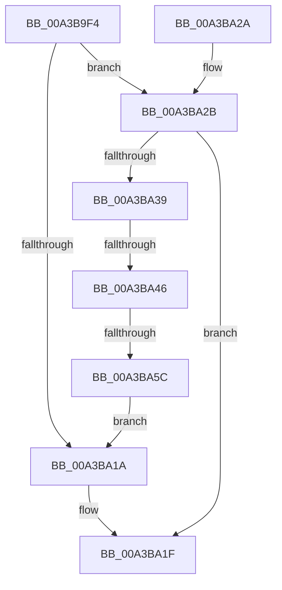

# RtlpOpenBaseImageFileOptionsKey

- RVA: `0x00A3B9F4`–`0x00A3BA6F` (길이 `123` bytes)
- VA: `0x0000000140A3B9F4`
- 실행 섹션: `PAGE`
- PDB 이름 있음: `예`; PDB Function 태그: `예`
- unwind 정보 RVA: `0x000AE3A8`
- 디코드: `31`개 명령, `123/123` bytes 표시
- 미해석 바이트: `0` (있으면 어셈블리에 `.byte`로 보존)

> 이 문서는 커널 이미지의 기계어와 PDB 기호를 분석해 생성했습니다. 4번과 5번은 함수 원형과 자료형을 바이너리 사용 방식에서 추정한 C 해석이며 원본 소스 복구 결과는 아닙니다.

## 1. Dependencies

- 직접 호출 지점: **3**; 고유 호출 대상: **3**
- 직접 호출자로 확인된 함수: **2**
- RIP 상대 이미지 참조: **1**

### Outgoing calls
- `0x00A3BA01` → [PsGetCurrentServerSiloGlobals](../../text/2F/PsGetCurrentServerSiloGlobals_function_002FE1F0.md) (function, `0x002FE1F0`)
- `0x00A3BA30` → [RtlpOpenBaseImageFileOptionsKeyEx](../70/RtlpOpenBaseImageFileOptionsKeyEx_function_0070244C.md) (function, `0x0070244C`)
- `0x00A3BA61` → [ZwClose](../../text/6A/ZwClose_function_006AD2B0.md) (function, `0x006AD2B0`)

### Direct callers
- [RtlQueryImageFileExecutionOptions](../78/RtlQueryImageFileExecutionOptions_function_0078B090.md) at `0x0078B0B3`
- [RtlpOpenImageFileOptionsKeyEx](RtlpOpenImageFileOptionsKeyEx_function_00A3B8A8.md) at `0x00A3B929`

### Static image references
- `0x00A3BA39` → RVA `0x00E67AF8` (`.data`; read)

## 2. Other-region calls and transfers

- 다른 실행 섹션으로 향하는 call: **2**
  - `0x00A3BA01` → [PsGetCurrentServerSiloGlobals](../../text/2F/PsGetCurrentServerSiloGlobals_function_002FE1F0.md) (`PAGE` → `.text`)
  - `0x00A3BA61` → [ZwClose](../../text/6A/ZwClose_function_006AD2B0.md) (`PAGE` → `.text`)
- call이 아닌 외부 분기/꼬리 이동: **2**
  - `0x00A3BA40` → [sub_00B3A364](../B3/Unknown_function_00B3A364.md) (`tail-transfer`)
  - `0x00A3BA56` → [sub_00B3A364](../B3/Unknown_function_00B3A364.md) (`tail-transfer`)

## 3. Assembly (complete function range)

```asm
00A3B9F4  48 89 5C 24 08                  mov qword ptr [rsp + 8], rbx
00A3B9F9  57                              push rdi
00A3B9FA  48 83 EC 20                     sub rsp, 0x20
00A3B9FE  48 8B F9                        mov rdi, rcx
00A3BA01  E8 EA 27 8C FF                  call 0x1402fe1f0
00A3BA06  48 8B D8                        mov rbx, rax
00A3BA09  48 8B 90 C0 04 00 00            mov rdx, qword ptr [rax + 0x4c0]
00A3BA10  48 89 54 24 38                  mov qword ptr [rsp + 0x38], rdx
00A3BA15  48 85 D2                        test rdx, rdx
00A3BA18  74 11                           je 0x140a3ba2b
00A3BA1A  48 89 17                        mov qword ptr [rdi], rdx
00A3BA1D  33 C0                           xor eax, eax
00A3BA1F  48 8B 5C 24 30                  mov rbx, qword ptr [rsp + 0x30]
00A3BA24  48 83 C4 20                     add rsp, 0x20
00A3BA28  5F                              pop rdi
00A3BA29  C3                              ret
00A3BA2A  CC                              int3
00A3BA2B  48 8D 4C 24 38                  lea rcx, [rsp + 0x38]
00A3BA30  E8 17 6A CC FF                  call 0x14070244c
00A3BA35  85 C0                           test eax, eax
00A3BA37  78 E6                           js 0x140a3ba1f
00A3BA39  83 3D B8 C0 42 00 00            cmp dword ptr [rip + 0x42c0b8], 0
00A3BA40  0F 85 1E E9 0F 00               jne 0x140b3a364
00A3BA46  48 8B 4C 24 38                  mov rcx, qword ptr [rsp + 0x38]
00A3BA4B  33 C0                           xor eax, eax
00A3BA4D  F0 48 0F B1 8B C0 04 00 00      lock cmpxchg qword ptr [rbx + 0x4c0], rcx
00A3BA56  0F 84 08 E9 0F 00               je 0x140b3a364
00A3BA5C  48 8B 4C 24 38                  mov rcx, qword ptr [rsp + 0x38]
00A3BA61  E8 4A 18 C7 FF                  call 0x1406ad2b0
00A3BA66  48 8B 93 C0 04 00 00            mov rdx, qword ptr [rbx + 0x4c0]
00A3BA6D  EB AB                           jmp 0x140a3ba1a
```

## 4. C-style interpretation (structured pseudocode)

```c
__int64 __fastcall RtlpOpenBaseImageFileOptionsKey(__int64 a1)
{
    __int64 result;
    __int64 v_rsp;
    unsigned __int64 v_stack_p10;
    unsigned __int64 v_stack_p38;
    unsigned __int64 v_stack_p8;

    v_stack_p8 = v_rbx;
    v_rsp = (v_rsp) - (32);
    result = PsGetCurrentServerSiloGlobals(a1, a2, a3, a4);
    v_stack_p10 = *(unsigned __int64 *)(result + 1216);
    if (*(unsigned __int64 *)(result + 1216) == 0) goto loc_00A3BA2B;
loc_00A3BA1A:
    *(unsigned __int64 *)(a1) = *(unsigned __int64 *)(result + 1216);
    result = 0;
loc_00A3BA1F:
    v_rsp = (v_rsp) + (32);
    return result;
loc_00A3BA2B:
    result = RtlpOpenBaseImageFileOptionsKeyEx(v_stack_p38, *(unsigned __int64 *)(result + 1216), a3, a4);
    if (sign_flag) goto loc_00A3BA1F;
    result = 0;
    result = ZwClose(v_stack_p38, *(unsigned __int64 *)(result + 1216), a3, a4);
    goto loc_00A3BA1A;
}
```

## 5. (Beta) C Style

```c
int64_t RtlpOpenBaseImageFileOptionsKey(void *Arg1)
{
    uint8_t *arg1 = (uint8_t *)Arg1;

    int64_t result;
    int64_t local_rsp;
    uint64_t v_stack_p10;
    uint64_t v_stack_p38;
    uint64_t v_stack_p8;

    v_stack_p8 = local_rbx;
    local_rsp = (local_rsp) - (32);
    result = PsGetCurrentServerSiloGlobals(Arg1, a2, a3, a4);
    v_stack_p10 = *(uint64_t *)(result + 0x4C0);
    if (*(uint64_t *)(result + 0x4C0) == 0) goto loc_00A3BA2B;
loc_00A3BA1A:
    *(uint64_t *)(arg1) = *(uint64_t *)(result + 0x4C0);
    result = 0;
loc_00A3BA1F:
    local_rsp = (local_rsp) + (32);
    return result;
loc_00A3BA2B:
    result = RtlpOpenBaseImageFileOptionsKeyEx(v_stack_p38, *(uint64_t *)(result + 0x4C0), a3, a4);
    if (sign_flag) goto loc_00A3BA1F;
    result = 0;
    result = ZwClose(v_stack_p38, *(uint64_t *)(result + 0x4C0), a3, a4);
    goto loc_00A3BA1A;
}
```

### 관측된 메모리 오프셋

구조체 형식이 확인되지 않은 접근은 인자 기준의 오프셋으로만 기록했습니다.

| 기준 인자 | 오프셋 표현 | 폭 (bit) | 접근 |
|---|---:|---:|---|
| `Arg1` | `+ 0x0` | `64` | `W` |

## 6. Execution-region graph

[열기: 2D/3D 그래프와 함수 탐색 컨트롤 패널](../../../control-panel.html?section=page&rva=0x00A3B9F4&view=graph)

- 2D 그래프는 위에서 아래로 흐르고, 3D 그래프는 빈 공간을 드래그해 회전합니다. Shift+드래그는 이동, 휠은 확대·축소, 함수 노드 선택은 대상 보고서 이동입니다.

### Static fallback


