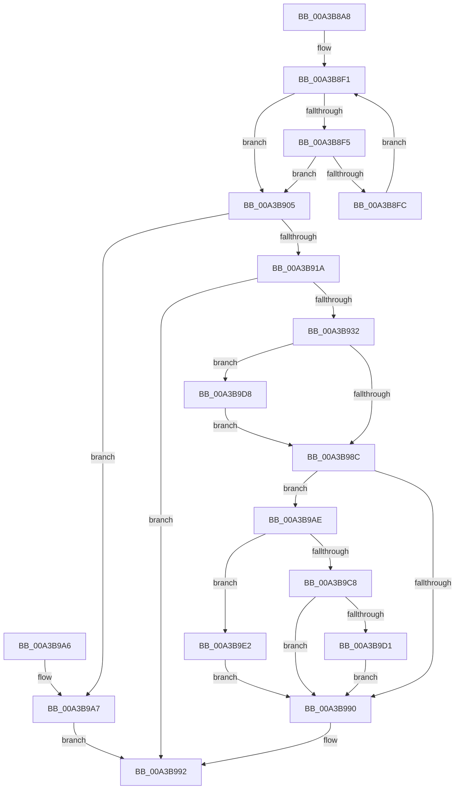

# RtlpOpenImageFileOptionsKeyEx

- RVA: `0x00A3B8A8`–`0x00A3B9EB` (길이 `323` bytes)
- VA: `0x0000000140A3B8A8`
- 실행 섹션: `PAGE`
- PDB 이름 있음: `예`; PDB Function 태그: `아니요`
- unwind 정보 RVA: `0x000AE390`
- 디코드: `97`개 명령, `323/323` bytes 표시
- 미해석 바이트: `0` (있으면 어셈블리에 `.byte`로 보존)

> 이 문서는 커널 이미지의 기계어와 PDB 기호를 분석해 생성했습니다. 4번과 5번은 함수 원형과 자료형을 바이너리 사용 방식에서 추정한 C 해석이며 원본 소스 복구 결과는 아닙니다.

## 1. Dependencies

- 직접 호출 지점: **5**; 고유 호출 대상: **4**
- 직접 호출자로 확인된 함수: **3**
- RIP 상대 이미지 참조: **1**

### Outgoing calls
- `0x00A3B929` → [RtlpOpenBaseImageFileOptionsKey](RtlpOpenBaseImageFileOptionsKey_function_00A3B9F4.md) (function, `0x00A3B9F4`)
- `0x00A3B980` → [ZwOpenKey](../../text/6A/ZwOpenKey_function_006AD310.md) (function, `0x006AD310`)
- `0x00A3B9BD` → [RtlpProcessIFEOKeyFilter](RtlpProcessIFEOKeyFilter_function_00A3BA78.md) (function, `0x00A3BA78`)
- `0x00A3B9D1` → [ZwClose](../../text/6A/ZwClose_function_006AD2B0.md) (function, `0x006AD2B0`)
- `0x00A3B9DB` → [ZwClose](../../text/6A/ZwClose_function_006AD2B0.md) (function, `0x006AD2B0`)

### Direct callers
- [SepCheckAndSetAuditModeForProcess](../A1/SepCheckAndSetAuditModeForProcess_function_00A134FC.md) at `0x00A1353D`
- [PspAllocateProcess](../A1/PspAllocateProcess_function_00A13B3C.md) at `0x00A145A3`
- [RtlOpenImageFileOptionsKey](RtlOpenImageFileOptionsKey_function_00A3B890.md) at `0x00A3B897`

### Static image references
- `0x00A3B91A` → RVA `0x00E67AF8` (`.data`; read)

## 2. Other-region calls and transfers

- 다른 실행 섹션으로 향하는 call: **3**
  - `0x00A3B980` → [ZwOpenKey](../../text/6A/ZwOpenKey_function_006AD310.md) (`PAGE` → `.text`)
  - `0x00A3B9D1` → [ZwClose](../../text/6A/ZwClose_function_006AD2B0.md) (`PAGE` → `.text`)
  - `0x00A3B9DB` → [ZwClose](../../text/6A/ZwClose_function_006AD2B0.md) (`PAGE` → `.text`)
- 별도 외부 분기/꼬리 이동을 확인하지 못했습니다.

## 3. Assembly (complete function range)

```asm
00A3B8A8  48 89 5C 24 10                  mov qword ptr [rsp + 0x10], rbx
00A3B8AD  55                              push rbp
00A3B8AE  56                              push rsi
00A3B8AF  57                              push rdi
00A3B8B0  41 56                           push r14
00A3B8B2  41 57                           push r15
00A3B8B4  48 8B EC                        mov rbp, rsp
00A3B8B7  48 83 EC 60                     sub rsp, 0x60
00A3B8BB  48 83 65 30 00                  and qword ptr [rbp + 0x30], 0
00A3B8C0  33 C0                           xor eax, eax
00A3B8C2  49 21 01                        and qword ptr [r9], rax
00A3B8C5  0F 57 C0                        xorps xmm0, xmm0
00A3B8C8  0F B7 11                        movzx edx, word ptr [rcx]
00A3B8CB  48 8B F1                        mov rsi, rcx
00A3B8CE  48 83 65 48 00                  and qword ptr [rbp + 0x48], 0
00A3B8D3  8B CA                           mov ecx, edx
00A3B8D5  48 89 45 F0                     mov qword ptr [rbp - 0x10], rax
00A3B8D9  4D 8B F1                        mov r14, r9
00A3B8DC  89 45 F8                        mov dword ptr [rbp - 8], eax
00A3B8DF  8B C2                           mov eax, edx
00A3B8E1  48 03 4E 08                     add rcx, qword ptr [rsi + 8]
00A3B8E5  0F 11 45 C0                     movups xmmword ptr [rbp - 0x40], xmm0
00A3B8E9  0F 11 45 D0                     movups xmmword ptr [rbp - 0x30], xmm0
00A3B8ED  0F 11 45 E0                     movups xmmword ptr [rbp - 0x20], xmm0
00A3B8F1  85 C0                           test eax, eax
00A3B8F3  74 10                           je 0x140a3b905
00A3B8F5  66 83 79 FE 5C                  cmp word ptr [rcx - 2], 0x5c
00A3B8FA  74 09                           je 0x140a3b905
00A3B8FC  48 83 C1 FE                     add rcx, -2
00A3B900  83 C0 FE                        add eax, -2
00A3B903  EB EC                           jmp 0x140a3b8f1
00A3B905  2B D0                           sub edx, eax
00A3B907  48 89 4D C8                     mov qword ptr [rbp - 0x38], rcx
00A3B90B  0F B7 C2                        movzx eax, dx
00A3B90E  66 89 45 C0                     mov word ptr [rbp - 0x40], ax
00A3B912  3B C2                           cmp eax, edx
00A3B914  0F 85 8D 00 00 00               jne 0x140a3b9a7
00A3B91A  83 3D D7 C1 42 00 00            cmp dword ptr [rip + 0x42c1d7], 0
00A3B921  48 8D 4D 30                     lea rcx, [rbp + 0x30]
00A3B925  41 0F 95 C7                     setne r15b
00A3B929  E8 C6 00 00 00                  call 0x140a3b9f4
00A3B92E  85 C0                           test eax, eax
00A3B930  78 60                           js 0x140a3b992
00A3B932  65 48 8B 04 25 88 01 00 00      mov rax, qword ptr gs:[0x188]
00A3B93B  4C 8D 45 D0                     lea r8, [rbp - 0x30]
00A3B93F  48 8B 7D 30                     mov rdi, qword ptr [rbp + 0x30]
00A3B943  BA 40 02 00 00                  mov edx, 0x240
00A3B948  0F 57 C0                        xorps xmm0, xmm0
00A3B94B  8A 88 32 02 00 00               mov cl, byte ptr [rax + 0x232]
00A3B951  B8 40 06 00 00                  mov eax, 0x640
00A3B956  80 F9 01                        cmp cl, 1
00A3B959  C7 45 D0 30 00 00 00            mov dword ptr [rbp - 0x30], 0x30
00A3B960  48 8D 4D 48                     lea rcx, [rbp + 0x48]
00A3B964  48 89 7D D8                     mov qword ptr [rbp - 0x28], rdi
00A3B968  0F 45 C2                        cmovne eax, edx
00A3B96B  BA 09 00 00 00                  mov edx, 9
00A3B970  89 45 E8                        mov dword ptr [rbp - 0x18], eax
00A3B973  48 8D 45 C0                     lea rax, [rbp - 0x40]
00A3B977  48 89 45 E0                     mov qword ptr [rbp - 0x20], rax
00A3B97B  F3 0F 7F 45 F0                  movdqu xmmword ptr [rbp - 0x10], xmm0
00A3B980  E8 8B 19 C7 FF                  call 0x1406ad310
00A3B985  8B D8                           mov ebx, eax
00A3B987  45 84 FF                        test r15b, r15b
00A3B98A  75 4C                           jne 0x140a3b9d8
00A3B98C  85 DB                           test ebx, ebx
00A3B98E  79 1E                           jns 0x140a3b9ae
00A3B990  8B C3                           mov eax, ebx
00A3B992  48 8B 9C 24 98 00 00 00         mov rbx, qword ptr [rsp + 0x98]
00A3B99A  48 83 C4 60                     add rsp, 0x60
00A3B99E  41 5F                           pop r15
00A3B9A0  41 5E                           pop r14
00A3B9A2  5F                              pop rdi
00A3B9A3  5E                              pop rsi
00A3B9A4  5D                              pop rbp
00A3B9A5  C3                              ret
00A3B9A6  CC                              int3
00A3B9A7  B8 23 00 00 C0                  mov eax, 0xc0000023
00A3B9AC  EB E4                           jmp 0x140a3b992
00A3B9AE  48 8B 45 48                     mov rax, qword ptr [rbp + 0x48]
00A3B9B2  48 8D 4D 30                     lea rcx, [rbp + 0x30]
00A3B9B6  4C 8B C6                        mov r8, rsi
00A3B9B9  48 89 45 30                     mov qword ptr [rbp + 0x30], rax
00A3B9BD  E8 B6 00 00 00                  call 0x140a3ba78
00A3B9C2  8B D8                           mov ebx, eax
00A3B9C4  85 C0                           test eax, eax
00A3B9C6  79 1A                           jns 0x140a3b9e2
00A3B9C8  48 8B 4D 30                     mov rcx, qword ptr [rbp + 0x30]
00A3B9CC  48 85 C9                        test rcx, rcx
00A3B9CF  74 BF                           je 0x140a3b990
00A3B9D1  E8 DA 18 C7 FF                  call 0x1406ad2b0
00A3B9D6  EB B8                           jmp 0x140a3b990
00A3B9D8  48 8B CF                        mov rcx, rdi
00A3B9DB  E8 D0 18 C7 FF                  call 0x1406ad2b0
00A3B9E0  EB AA                           jmp 0x140a3b98c
00A3B9E2  48 8B 45 30                     mov rax, qword ptr [rbp + 0x30]
00A3B9E6  49 89 06                        mov qword ptr [r14], rax
00A3B9E9  EB A5                           jmp 0x140a3b990
```

## 4. C-style interpretation (structured pseudocode)

```c
__int64 __fastcall RtlpOpenImageFileOptionsKeyEx(__int64 a1, __int64 a2, __int64 a3, __int64 a4)
{
    __int64 result;
    __int64 v_r15;
    __int64 v_rsp;
    unsigned int v_stack_m30;
    unsigned __int64 v_stack_m38;
    unsigned int v_stack_m40;
    unsigned __int64 v_stack_m48;
    unsigned __int64 v_stack_m50;
    unsigned __int64 v_stack_m58;
    unsigned __int64 v_stack_m60;
    unsigned __int64 v_stack_m68;
    unsigned __int64 v_stack_p10;
    unsigned __int64 v_stack_p20;
    unsigned __int64 v_stack_p8;

    v_stack_p10 = v_rbx;
    v_rsp = (v_rsp) - (96);
    result = 0;
    v_stack_m38 = 0;
    v_stack_m30 = 0;
    a1 = ((unsigned int)((unsigned int)(*(unsigned __int16 *)(a1)))) + (*(unsigned __int64 *)(a1 + 8));
    v_stack_m68 = v_xmm0;
    v_stack_m58 = v_xmm0;
    v_stack_m48 = v_xmm0;
loc_00A3B8F1:
    if ((unsigned int)((unsigned int)((unsigned int)(*(unsigned __int16 *)(a1)))) == 0) goto loc_00A3B905;
    if ((*(unsigned __int16 *)(a1 - 2)) == 92) goto loc_00A3B905;
    a1 = (a1) + (-2);
    result = (unsigned int)(((unsigned int)((unsigned int)(*(unsigned __int16 *)(a1)))) + (-2));
    goto loc_00A3B8F1;
loc_00A3B905:
    a2 = (unsigned int)((*(unsigned __int16 *)(a1)) - ((unsigned int)(result)));
    v_stack_m60 = a1;
    v_stack_m68 = (unsigned __int16)((unsigned __int16)(a2));
    if (((unsigned int)((unsigned __int16)(a2))) != ((unsigned int)(a2))) goto loc_00A3B9A7;
    v_r15 = ((*(unsigned int *)(v_rip + 4374999)) != 0) ? 1 : 0;
    result = RtlpOpenBaseImageFileOptionsKey(v_stack_p8, a2, a3, a4);
    if (sign_flag) goto loc_00A3B992;
    v_stack_m58 = 48;
    v_stack_m50 = v_stack_p8;
    result = (unsigned int)(0x640ULL);
    if (((unsigned __int8)(*(unsigned __int8 *)(*(unsigned __int64 *)(gs_base + (0 + 392)) + 562))) != 1) { result = 576; }
    v_stack_m40 = (unsigned int)(result);
    v_stack_m48 = v_stack_m68;
    v_stack_m38 = v_xmm0;
    result = ZwOpenKey(v_stack_p20, 9, v_stack_m58, a4);
    if ((unsigned __int8)(v_r15) != 0) goto loc_00A3B9D8;
loc_00A3B98C:
    if (!sign_flag) goto loc_00A3B9AE;
loc_00A3B990:
loc_00A3B992:
    v_rsp = (v_rsp) + (96);
    return (unsigned int)((unsigned int)((unsigned int)((unsigned int)(result))));
loc_00A3B9A7:
    goto loc_00A3B992;
loc_00A3B9AE:
    v_stack_p8 = v_stack_p20;
    result = RtlpProcessIFEOKeyFilter(v_stack_p8, 9, a1, a4);
    if (!sign_flag) goto loc_00A3B9E2;
    if (v_stack_p8 == 0) goto loc_00A3B990;
    result = ZwClose(v_stack_p8, 9, a1, a4);
    goto loc_00A3B990;
loc_00A3B9D8:
    result = ZwClose(v_stack_p8, 9, a1, a4);
    goto loc_00A3B98C;
loc_00A3B9E2:
    *(unsigned __int64 *)(a4) = v_stack_p8;
    goto loc_00A3B990;
}
```

## 5. (Beta) C Style

```c
int64_t RtlpOpenImageFileOptionsKeyEx(void *Arg1, int64_t Arg2, int64_t Arg3, void *Arg4)
{
    uint8_t *arg1 = (uint8_t *)Arg1;
    uint8_t *arg4 = (uint8_t *)Arg4;

    int64_t result;
    int64_t local_r15;
    int64_t local_rsp;
    uint32_t v_stack_m30;
    uint64_t v_stack_m38;
    uint32_t v_stack_m40;
    uint64_t v_stack_m48;
    uint64_t v_stack_m50;
    uint64_t v_stack_m58;
    uint64_t v_stack_m60;
    uint64_t v_stack_m68;
    uint64_t v_stack_p10;
    uint64_t v_stack_p20;
    uint64_t v_stack_p8;

    v_stack_p10 = local_rbx;
    local_rsp = (local_rsp) - (96);
    result = 0;
    v_stack_m38 = 0;
    v_stack_m30 = 0;
    Arg1 = ((uint32_t)((uint32_t)(*(uint16_t *)(arg1)))) + (*(uint64_t *)(arg1 + 0x8));
    v_stack_m68 = v_xmm0;
    v_stack_m58 = v_xmm0;
    v_stack_m48 = v_xmm0;
loc_00A3B8F1:
    if ((uint32_t)((uint32_t)((uint32_t)(*(uint16_t *)(arg1)))) == 0) goto loc_00A3B905;
    if ((*(uint16_t *)(arg1 - 0x2)) == 92) goto loc_00A3B905;
    Arg1 = (Arg1) + (-2);
    result = (uint32_t)(((uint32_t)((uint32_t)(*(uint16_t *)(arg1)))) + (-2));
    goto loc_00A3B8F1;
loc_00A3B905:
    Arg2 = (uint32_t)((*(uint16_t *)(arg1)) - ((uint32_t)(result)));
    v_stack_m60 = Arg1;
    v_stack_m68 = (uint16_t)((uint16_t)(Arg2));
    if (((uint32_t)((uint16_t)(Arg2))) != ((uint32_t)(Arg2))) goto loc_00A3B9A7;
    local_r15 = ((*(uint32_t *)(v_rip + 0x42C1D7)) != 0) ? 1 : 0;
    result = RtlpOpenBaseImageFileOptionsKey(v_stack_p8, Arg2, Arg3, Arg4);
    if (sign_flag) goto loc_00A3B992;
    v_stack_m58 = 48;
    v_stack_m50 = v_stack_p8;
    result = (uint32_t)(0x640ULL);
    if (((uint8_t)(*(uint8_t *)(*(uint64_t *)(gs_base + (0 + 0x188)) + 0x232))) != 1) { result = 576; }
    v_stack_m40 = (uint32_t)(result);
    v_stack_m48 = v_stack_m68;
    v_stack_m38 = v_xmm0;
    result = ZwOpenKey(v_stack_p20, 9, v_stack_m58, Arg4);
    if ((uint8_t)(local_r15) != 0) goto loc_00A3B9D8;
loc_00A3B98C:
    if (!sign_flag) goto loc_00A3B9AE;
loc_00A3B990:
loc_00A3B992:
    local_rsp = (local_rsp) + (96);
    return (uint32_t)((uint32_t)((uint32_t)((uint32_t)(result))));
loc_00A3B9A7:
    goto loc_00A3B992;
loc_00A3B9AE:
    v_stack_p8 = v_stack_p20;
    result = RtlpProcessIFEOKeyFilter(v_stack_p8, 9, Arg1, Arg4);
    if (!sign_flag) goto loc_00A3B9E2;
    if (v_stack_p8 == 0) goto loc_00A3B990;
    result = ZwClose(v_stack_p8, 9, Arg1, Arg4);
    goto loc_00A3B990;
loc_00A3B9D8:
    result = ZwClose(v_stack_p8, 9, Arg1, Arg4);
    goto loc_00A3B98C;
loc_00A3B9E2:
    *(uint64_t *)(arg4) = v_stack_p8;
    goto loc_00A3B990;
}
```

### 관측된 메모리 오프셋

구조체 형식이 확인되지 않은 접근은 인자 기준의 오프셋으로만 기록했습니다.

| 기준 인자 | 오프셋 표현 | 폭 (bit) | 접근 |
|---|---:|---:|---|
| `Arg1` | `+ 0x0` | `16` | `R` |
| `Arg1` | `+ 0x8` | `64` | `R` |
| `Arg4` | `+ 0x0` | `64` | `R/W` |
| `Arg4` | `+ 0x0` | `64` | `W` |

## 6. Execution-region graph

[열기: 2D/3D 그래프와 함수 탐색 컨트롤 패널](../../../control-panel.html?section=page&rva=0x00A3B8A8&view=graph)

- 2D 그래프는 위에서 아래로 흐르고, 3D 그래프는 빈 공간을 드래그해 회전합니다. Shift+드래그는 이동, 휠은 확대·축소, 함수 노드 선택은 대상 보고서 이동입니다.

### Static fallback


