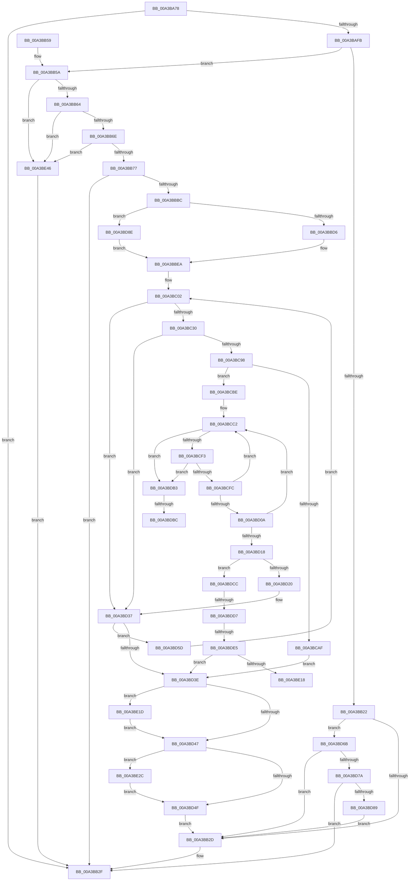

# RtlpProcessIFEOKeyFilter

- RVA: `0x00A3BA78`–`0x00A3BE4D` (길이 `981` bytes)
- VA: `0x0000000140A3BA78`
- 실행 섹션: `PAGE`
- PDB 이름 있음: `예`; PDB Function 태그: `예`
- unwind 정보 RVA: `0x000AE3C8`
- 디코드: `235`개 명령, `981/981` bytes 표시
- 미해석 바이트: `0` (있으면 어셈블리에 `.byte`로 보존)

> 이 문서는 커널 이미지의 기계어와 PDB 기호를 분석해 생성했습니다. 4번과 5번은 함수 원형과 자료형을 바이너리 사용 방식에서 추정한 C 해석이며 원본 소스 복구 결과는 아닙니다.

## 1. Dependencies

- 직접 호출 지점: **15**; 고유 호출 대상: **9**
- 직접 호출자로 확인된 함수: **1**
- RIP 상대 이미지 참조: **4**

### Outgoing calls
- `0x00A3BAF2` → [RtlInitUnicodeStringEx](../../text/46/RtlInitUnicodeStringEx_function_00463960.md) (function, `0x00463960`)
- `0x00A3BB19` → [ZwQueryValueKey](../../text/6A/ZwQueryValueKey_function_006AD3B0.md) (function, `0x006AD3B0`)
- `0x00A3BB39` → [_security_check_cookie](../../text/6A/_security_check_cookie_function_006AC640.md) (function, `0x006AC640`)
- `0x00A3BBAF` → [RtlInitUnicodeStringEx](../../text/46/RtlInitUnicodeStringEx_function_00463960.md) (function, `0x00463960`)
- `0x00A3BBC9` → [RtlPrefixUnicodeString](../8F/RtlPrefixUnicodeString_function_008F4F70.md) (function, `0x008F4F70`)
- `0x00A3BC21` → [ZwEnumerateKey](../../text/6A/ZwEnumerateKey_function_006AD710.md) (function, `0x006AD710`)
- `0x00A3BC89` → [ZwOpenKey](../../text/6A/ZwOpenKey_function_006AD310.md) (function, `0x006AD310`)
- `0x00A3BCA4` → [RtlInitUnicodeStringEx](../../text/46/RtlInitUnicodeStringEx_function_00463960.md) (function, `0x00463960`)
- `0x00A3BCB4` → [ZwClose](../../text/6A/ZwClose_function_006AD2B0.md) (function, `0x006AD2B0`)
- `0x00A3BCE3` → [ZwQueryValueKey](../../text/6A/ZwQueryValueKey_function_006AD3B0.md) (function, `0x006AD3B0`)
- `0x00A3BD25` → [ZwClose](../../text/6A/ZwClose_function_006AD2B0.md) (function, `0x006AD2B0`)
- `0x00A3BDC1` → [ExFreePoolWithTag](../../poolcode/B8/ExFreePoolWithTag_function_00B82870.md) (function, `0x00B82870`)
- `0x00A3BE0B` → [RtlCompareUnicodeStrings](../97/RtlCompareUnicodeStrings_function_009727E0.md) (function, `0x009727E0`)
- `0x00A3BE22` → [ExFreePoolWithTag](../../poolcode/B8/ExFreePoolWithTag_function_00B82870.md) (function, `0x00B82870`)
- `0x00A3BE34` → [ZwClose](../../text/6A/ZwClose_function_006AD2B0.md) (function, `0x006AD2B0`)

### Direct callers
- [RtlpOpenImageFileOptionsKeyEx](RtlpOpenImageFileOptionsKeyEx_function_00A3B8A8.md) at `0x00A3B9BD`

### Static image references
- `0x00A3BA97` → RVA `0x00E0A740` (`.data`; read)
- `0x00A3BAB2` → RVA `0x00B05360` (` ?? ::NNGAKEGL::`string'`; read)
- `0x00A3BB9F` → RVA `0x00B013A0` (` ?? ::NNGAKEGL::`string'`; read)
- `0x00A3BC98` → RVA `0x00B05440` (` ?? ::NNGAKEGL::`string'`; read)

## 2. Other-region calls and transfers

- 다른 실행 섹션으로 향하는 call: **13**
  - `0x00A3BAF2` → [RtlInitUnicodeStringEx](../../text/46/RtlInitUnicodeStringEx_function_00463960.md) (`PAGE` → `.text`)
  - `0x00A3BB19` → [ZwQueryValueKey](../../text/6A/ZwQueryValueKey_function_006AD3B0.md) (`PAGE` → `.text`)
  - `0x00A3BB39` → [_security_check_cookie](../../text/6A/_security_check_cookie_function_006AC640.md) (`PAGE` → `.text`)
  - `0x00A3BBAF` → [RtlInitUnicodeStringEx](../../text/46/RtlInitUnicodeStringEx_function_00463960.md) (`PAGE` → `.text`)
  - `0x00A3BC21` → [ZwEnumerateKey](../../text/6A/ZwEnumerateKey_function_006AD710.md) (`PAGE` → `.text`)
  - `0x00A3BC89` → [ZwOpenKey](../../text/6A/ZwOpenKey_function_006AD310.md) (`PAGE` → `.text`)
  - `0x00A3BCA4` → [RtlInitUnicodeStringEx](../../text/46/RtlInitUnicodeStringEx_function_00463960.md) (`PAGE` → `.text`)
  - `0x00A3BCB4` → [ZwClose](../../text/6A/ZwClose_function_006AD2B0.md) (`PAGE` → `.text`)
  - `0x00A3BCE3` → [ZwQueryValueKey](../../text/6A/ZwQueryValueKey_function_006AD3B0.md) (`PAGE` → `.text`)
  - `0x00A3BD25` → [ZwClose](../../text/6A/ZwClose_function_006AD2B0.md) (`PAGE` → `.text`)
  - `0x00A3BDC1` → [ExFreePoolWithTag](../../poolcode/B8/ExFreePoolWithTag_function_00B82870.md) (`PAGE` → `POOLCODE`)
  - `0x00A3BE22` → [ExFreePoolWithTag](../../poolcode/B8/ExFreePoolWithTag_function_00B82870.md) (`PAGE` → `POOLCODE`)
  - `0x00A3BE34` → [ZwClose](../../text/6A/ZwClose_function_006AD2B0.md) (`PAGE` → `.text`)
- call이 아닌 외부 분기/꼬리 이동: **5**
  - `0x00A3BDB6` → [sub_00B3A36E](../B3/Unknown_function_00B3A36E.md) (`tail-transfer`)
  - `0x00A3BDC7` → [sub_00B3A36E](../B3/Unknown_function_00B3A36E.md) (`tail-transfer`)
  - `0x00A3BDD1` → [sub_00B3A36E + 0x3B](../B3/Unknown_function_00B3A36E.md) (`tail-transfer`)
  - `0x00A3BDDF` → [sub_00B3A36E + 0x3B](../B3/Unknown_function_00B3A36E.md) (`tail-transfer`)
  - `0x00A3BE18` → [sub_00B3A36E + 0x3B](../B3/Unknown_function_00B3A36E.md) (`tail-transfer`)

## 3. Assembly (complete function range)

```asm
00A3BA78  48 89 5C 24 10                  mov qword ptr [rsp + 0x10], rbx
00A3BA7D  55                              push rbp
00A3BA7E  56                              push rsi
00A3BA7F  57                              push rdi
00A3BA80  41 54                           push r12
00A3BA82  41 55                           push r13
00A3BA84  41 56                           push r14
00A3BA86  41 57                           push r15
00A3BA88  48 8D AC 24 20 FE FF FF         lea rbp, [rsp - 0x1e0]
00A3BA90  48 81 EC E0 02 00 00            sub rsp, 0x2e0
00A3BA97  48 8B 05 A2 EC 3C 00            mov rax, qword ptr [rip + 0x3ceca2]
00A3BA9E  48 33 C4                        xor rax, rsp
00A3BAA1  48 89 85 D0 01 00 00            mov qword ptr [rbp + 0x1d0], rax
00A3BAA8  0F 57 C0                        xorps xmm0, xmm0
00A3BAAB  48 89 4C 24 70                  mov qword ptr [rsp + 0x70], rcx
00A3BAB0  33 DB                           xor ebx, ebx
00A3BAB2  48 8D 15 A7 98 0C 00            lea rdx, [rip + 0xc98a7]
00A3BAB9  33 C0                           xor eax, eax
00A3BABB  89 5C 24 34                     mov dword ptr [rsp + 0x34], ebx
00A3BABF  4C 8B F9                        mov r15, rcx
00A3BAC2  48 89 5C 24 50                  mov qword ptr [rsp + 0x50], rbx
00A3BAC7  BF 20 02 00 00                  mov edi, 0x220
00A3BACC  48 89 45 A0                     mov qword ptr [rbp - 0x60], rax
00A3BAD0  48 8D 4C 24 58                  lea rcx, [rsp + 0x58]
00A3BAD5  89 45 A8                        mov dword ptr [rbp - 0x58], eax
00A3BAD8  0F 11 44 24 58                  movups xmmword ptr [rsp + 0x58], xmm0
00A3BADD  8B F3                           mov esi, ebx
00A3BADF  89 7C 24 38                     mov dword ptr [rsp + 0x38], edi
00A3BAE3  0F 11 45 80                     movups xmmword ptr [rbp - 0x80], xmm0
00A3BAE7  4D 8B E0                        mov r12, r8
00A3BAEA  4C 8D 75 B0                     lea r14, [rbp - 0x50]
00A3BAEE  0F 11 45 90                     movups xmmword ptr [rbp - 0x70], xmm0
00A3BAF2  E8 69 7E A2 FF                  call 0x140463960
00A3BAF7  85 C0                           test eax, eax
00A3BAF9  78 34                           js 0x140a3bb2f
00A3BAFB  49 8B 0F                        mov rcx, qword ptr [r15]
00A3BAFE  48 8D 44 24 34                  lea rax, [rsp + 0x34]
00A3BB03  48 89 44 24 28                  mov qword ptr [rsp + 0x28], rax
00A3BB08  4C 8D 4D B0                     lea r9, [rbp - 0x50]
00A3BB0C  44 8D 43 02                     lea r8d, [rbx + 2]
00A3BB10  89 7C 24 20                     mov dword ptr [rsp + 0x20], edi
00A3BB14  48 8D 54 24 58                  lea rdx, [rsp + 0x58]
00A3BB19  E8 92 18 C7 FF                  call 0x1406ad3b0
00A3BB1E  85 C0                           test eax, eax
00A3BB20  79 38                           jns 0x140a3bb5a
00A3BB22  3D 34 00 00 C0                  cmp eax, 0xc0000034
00A3BB27  0F 85 3E 02 00 00               jne 0x140a3bd6b
00A3BB2D  8B C3                           mov eax, ebx
00A3BB2F  48 8B 8D D0 01 00 00            mov rcx, qword ptr [rbp + 0x1d0]
00A3BB36  48 33 CC                        xor rcx, rsp
00A3BB39  E8 02 0B C7 FF                  call 0x1406ac640
00A3BB3E  48 8B 9C 24 28 03 00 00         mov rbx, qword ptr [rsp + 0x328]
00A3BB46  48 81 C4 E0 02 00 00            add rsp, 0x2e0
00A3BB4D  41 5F                           pop r15
00A3BB4F  41 5E                           pop r14
00A3BB51  41 5D                           pop r13
00A3BB53  41 5C                           pop r12
00A3BB55  5F                              pop rdi
00A3BB56  5E                              pop rsi
00A3BB57  5D                              pop rbp
00A3BB58  C3                              ret
00A3BB59  CC                              int3
00A3BB5A  83 7D B4 04                     cmp dword ptr [rbp - 0x4c], 4
00A3BB5E  0F 85 E2 02 00 00               jne 0x140a3be46
00A3BB64  83 7D B8 04                     cmp dword ptr [rbp - 0x48], 4
00A3BB68  0F 85 D8 02 00 00               jne 0x140a3be46
00A3BB6E  39 5D BC                        cmp dword ptr [rbp - 0x44], ebx
00A3BB71  0F 84 CF 02 00 00               je 0x140a3be46
00A3BB77  65 48 8B 04 25 88 01 00 00      mov rax, qword ptr gs:[0x188]
00A3BB80  B9 40 06 00 00                  mov ecx, 0x640
00A3BB85  41 0F 10 04 24                  movups xmm0, xmmword ptr [r12]
00A3BB8A  BA 40 02 00 00                  mov edx, 0x240
00A3BB8F  80 B8 32 02 00 00 01            cmp byte ptr [rax + 0x232], 1
00A3BB96  F3 0F 7F 44 24 40               movdqu xmmword ptr [rsp + 0x40], xmm0
00A3BB9C  0F 45 CA                        cmovne ecx, edx
00A3BB9F  48 8D 15 FA 57 0C 00            lea rdx, [rip + 0xc57fa]
00A3BBA6  89 4C 24 68                     mov dword ptr [rsp + 0x68], ecx
00A3BBAA  48 8D 4C 24 58                  lea rcx, [rsp + 0x58]
00A3BBAF  E8 AC 7D A2 FF                  call 0x140463960
00A3BBB4  85 C0                           test eax, eax
00A3BBB6  0F 88 73 FF FF FF               js 0x140a3bb2f
00A3BBBC  41 B0 01                        mov r8b, 1
00A3BBBF  48 8D 54 24 40                  lea rdx, [rsp + 0x40]
00A3BBC4  48 8D 4C 24 58                  lea rcx, [rsp + 0x58]
00A3BBC9  E8 A2 93 EB FF                  call 0x1408f4f70
00A3BBCE  84 C0                           test al, al
00A3BBD0  0F 85 B8 01 00 00               jne 0x140a3bd8e
00A3BBD6  48 8B 44 24 48                  mov rax, qword ptr [rsp + 0x48]
00A3BBDB  48 89 44 24 78                  mov qword ptr [rsp + 0x78], rax
00A3BBE0  0F B7 44 24 40                  movzx eax, word ptr [rsp + 0x40]
00A3BBE5  66 89 44 24 30                  mov word ptr [rsp + 0x30], ax
00A3BBEA  48 8D 45 B0                     lea rax, [rbp - 0x50]
00A3BBEE  44 8B EB                        mov r13d, ebx
00A3BBF1  48 89 44 24 40                  mov qword ptr [rsp + 0x40], rax
00A3BBF6  41 BF 23 00 00 C0               mov r15d, 0xc0000023
00A3BBFC  41 BC 05 00 00 80               mov r12d, 0x80000005
00A3BC02  4C 8B C8                        mov r9, rax
00A3BC05  48 8D 4C 24 34                  lea rcx, [rsp + 0x34]
00A3BC0A  48 8B 44 24 70                  mov rax, qword ptr [rsp + 0x70]
00A3BC0F  45 33 C0                        xor r8d, r8d
00A3BC12  48 89 4C 24 28                  mov qword ptr [rsp + 0x28], rcx
00A3BC17  41 8B D5                        mov edx, r13d
00A3BC1A  89 7C 24 20                     mov dword ptr [rsp + 0x20], edi
00A3BC1E  48 8B 08                        mov rcx, qword ptr [rax]
00A3BC21  E8 EA 1A C7 FF                  call 0x1406ad710
00A3BC26  8B F8                           mov edi, eax
00A3BC28  85 C0                           test eax, eax
00A3BC2A  0F 88 07 01 00 00               js 0x140a3bd37
00A3BC30  48 8B 4C 24 40                  mov rcx, qword ptr [rsp + 0x40]
00A3BC35  4C 8D 45 80                     lea r8, [rbp - 0x80]
00A3BC39  0F 57 C0                        xorps xmm0, xmm0
00A3BC3C  BA 09 00 00 00                  mov edx, 9
00A3BC41  0F B7 41 0C                     movzx eax, word ptr [rcx + 0xc]
00A3BC45  66 89 44 24 58                  mov word ptr [rsp + 0x58], ax
00A3BC4A  0F B7 41 0C                     movzx eax, word ptr [rcx + 0xc]
00A3BC4E  66 89 44 24 5A                  mov word ptr [rsp + 0x5a], ax
00A3BC53  48 8D 41 10                     lea rax, [rcx + 0x10]
00A3BC57  48 89 44 24 60                  mov qword ptr [rsp + 0x60], rax
00A3BC5C  48 8D 4C 24 50                  lea rcx, [rsp + 0x50]
00A3BC61  48 8B 44 24 70                  mov rax, qword ptr [rsp + 0x70]
00A3BC66  C7 45 80 30 00 00 00            mov dword ptr [rbp - 0x80], 0x30
00A3BC6D  F3 0F 7F 45 A0                  movdqu xmmword ptr [rbp - 0x60], xmm0
00A3BC72  48 8B 00                        mov rax, qword ptr [rax]
00A3BC75  48 89 45 88                     mov qword ptr [rbp - 0x78], rax
00A3BC79  8B 44 24 68                     mov eax, dword ptr [rsp + 0x68]
00A3BC7D  89 45 98                        mov dword ptr [rbp - 0x68], eax
00A3BC80  48 8D 44 24 58                  lea rax, [rsp + 0x58]
00A3BC85  48 89 45 90                     mov qword ptr [rbp - 0x70], rax
00A3BC89  E8 82 16 C7 FF                  call 0x1406ad310
00A3BC8E  8B F8                           mov edi, eax
00A3BC90  85 C0                           test eax, eax
00A3BC92  0F 88 9F 00 00 00               js 0x140a3bd37
00A3BC98  48 8D 15 A1 97 0C 00            lea rdx, [rip + 0xc97a1]
00A3BC9F  48 8D 4C 24 58                  lea rcx, [rsp + 0x58]
00A3BCA4  E8 B7 7C A2 FF                  call 0x140463960
00A3BCA9  8B F8                           mov edi, eax
00A3BCAB  85 C0                           test eax, eax
00A3BCAD  79 0F                           jns 0x140a3bcbe
00A3BCAF  48 8B 4C 24 50                  mov rcx, qword ptr [rsp + 0x50]
00A3BCB4  E8 F7 15 C7 FF                  call 0x1406ad2b0
00A3BCB9  E9 80 00 00 00                  jmp 0x140a3bd3e
00A3BCBE  8B 4C 24 38                     mov ecx, dword ptr [rsp + 0x38]
00A3BCC2  48 8D 44 24 34                  lea rax, [rsp + 0x34]
00A3BCC7  4D 8B CE                        mov r9, r14
00A3BCCA  48 89 44 24 28                  mov qword ptr [rsp + 0x28], rax
00A3BCCF  48 8D 54 24 58                  lea rdx, [rsp + 0x58]
00A3BCD4  89 4C 24 20                     mov dword ptr [rsp + 0x20], ecx
00A3BCD8  41 B8 02 00 00 00               mov r8d, 2
00A3BCDE  48 8B 4C 24 50                  mov rcx, qword ptr [rsp + 0x50]
00A3BCE3  E8 C8 16 C7 FF                  call 0x1406ad3b0
00A3BCE8  8B F8                           mov edi, eax
00A3BCEA  41 3B C4                        cmp eax, r12d
00A3BCED  0F 84 C0 00 00 00               je 0x140a3bdb3
00A3BCF3  41 3B C7                        cmp eax, r15d
00A3BCF6  0F 84 B7 00 00 00               je 0x140a3bdb3
00A3BCFC  48 8B 44 24 40                  mov rax, qword ptr [rsp + 0x40]
00A3BD01  8B 4C 24 38                     mov ecx, dword ptr [rsp + 0x38]
00A3BD05  41 3B FC                        cmp edi, r12d
00A3BD08  74 B8                           je 0x140a3bcc2
00A3BD0A  48 89 44 24 40                  mov qword ptr [rsp + 0x40], rax
00A3BD0F  89 4C 24 38                     mov dword ptr [rsp + 0x38], ecx
00A3BD13  41 3B FF                        cmp edi, r15d
00A3BD16  74 AA                           je 0x140a3bcc2
00A3BD18  85 FF                           test edi, edi
00A3BD1A  0F 89 AC 00 00 00               jns 0x140a3bdcc
00A3BD20  48 8B 4C 24 50                  mov rcx, qword ptr [rsp + 0x50]
00A3BD25  E8 86 15 C7 FF                  call 0x1406ad2b0
00A3BD2A  81 FF 34 00 00 C0               cmp edi, 0xc0000034
00A3BD30  8B C3                           mov eax, ebx
00A3BD32  0F 45 C7                        cmovne eax, edi
00A3BD35  8B F8                           mov edi, eax
00A3BD37  41 FF C5                        inc r13d
00A3BD3A  85 FF                           test edi, edi
00A3BD3C  79 1F                           jns 0x140a3bd5d
00A3BD3E  48 85 F6                        test rsi, rsi
00A3BD41  0F 85 D6 00 00 00               jne 0x140a3be1d
00A3BD47  85 FF                           test edi, edi
00A3BD49  0F 89 DD 00 00 00               jns 0x140a3be2c
00A3BD4F  81 FF 1A 00 00 80               cmp edi, 0x8000001a
00A3BD55  0F 45 DF                        cmovne ebx, edi
00A3BD58  E9 D0 FD FF FF                  jmp 0x140a3bb2d
00A3BD5D  48 8B 44 24 40                  mov rax, qword ptr [rsp + 0x40]
00A3BD62  8B 7C 24 38                     mov edi, dword ptr [rsp + 0x38]
00A3BD66  E9 97 FE FF FF                  jmp 0x140a3bc02
00A3BD6B  41 BF 23 00 00 C0               mov r15d, 0xc0000023
00A3BD71  41 3B C7                        cmp eax, r15d
00A3BD74  0F 84 B3 FD FF FF               je 0x140a3bb2d
00A3BD7A  41 BC 05 00 00 80               mov r12d, 0x80000005
00A3BD80  41 3B C4                        cmp eax, r12d
00A3BD83  0F 85 A6 FD FF FF               jne 0x140a3bb2f
00A3BD89  E9 9F FD FF FF                  jmp 0x140a3bb2d
00A3BD8E  0F B7 4C 24 40                  movzx ecx, word ptr [rsp + 0x40]
00A3BD93  B8 F8 FF 00 00                  mov eax, 0xfff8
00A3BD98  66 03 C8                        add cx, ax
00A3BD9B  66 89 4C 24 30                  mov word ptr [rsp + 0x30], cx
00A3BDA0  48 8B 4C 24 48                  mov rcx, qword ptr [rsp + 0x48]
00A3BDA5  48 83 C1 08                     add rcx, 8
00A3BDA9  48 89 4C 24 78                  mov qword ptr [rsp + 0x78], rcx
00A3BDAE  E9 37 FE FF FF                  jmp 0x140a3bbea
00A3BDB3  48 85 F6                        test rsi, rsi
00A3BDB6  0F 84 B2 E5 0F 00               je 0x140b3a36e
00A3BDBC  33 D2                           xor edx, edx
00A3BDBE  48 8B CE                        mov rcx, rsi
00A3BDC1  E8 AA 6A 14 00                  call 0x140b82870
00A3BDC6  90                              nop
00A3BDC7  E9 A2 E5 0F 00                  jmp 0x140b3a36e
00A3BDCC  41 83 7E 04 01                  cmp dword ptr [r14 + 4], 1
00A3BDD1  0F 85 D2 E5 0F 00               jne 0x140b3a3a9
00A3BDD7  41 81 7E 08 FE FF 00 00         cmp dword ptr [r14 + 8], 0xfffe
00A3BDDF  0F 87 C4 E5 0F 00               ja 0x140b3a3a9
00A3BDE5  41 0F B7 46 08                  movzx eax, word ptr [r14 + 8]
00A3BDEA  4D 8D 46 0C                     lea r8, [r14 + 0xc]
00A3BDEE  0F B7 54 24 30                  movzx edx, word ptr [rsp + 0x30]
00A3BDF3  66 83 E8 02                     sub ax, 2
00A3BDF7  48 8B 4C 24 78                  mov rcx, qword ptr [rsp + 0x78]
00A3BDFC  44 0F B7 C8                     movzx r9d, ax
00A3BE00  49 D1 E9                        shr r9, 1
00A3BE03  48 D1 EA                        shr rdx, 1
00A3BE06  C6 44 24 20 01                  mov byte ptr [rsp + 0x20], 1
00A3BE0B  E8 D0 69 F3 FF                  call 0x1409727e0
00A3BE10  85 C0                           test eax, eax
00A3BE12  0F 84 26 FF FF FF               je 0x140a3bd3e
00A3BE18  E9 8C E5 0F 00                  jmp 0x140b3a3a9
00A3BE1D  33 D2                           xor edx, edx
00A3BE1F  48 8B CE                        mov rcx, rsi
00A3BE22  E8 49 6A 14 00                  call 0x140b82870
00A3BE27  E9 1B FF FF FF                  jmp 0x140a3bd47
00A3BE2C  48 8B 74 24 70                  mov rsi, qword ptr [rsp + 0x70]
00A3BE31  48 8B 0E                        mov rcx, qword ptr [rsi]
00A3BE34  E8 77 14 C7 FF                  call 0x1406ad2b0
00A3BE39  48 8B 4C 24 50                  mov rcx, qword ptr [rsp + 0x50]
00A3BE3E  48 89 0E                        mov qword ptr [rsi], rcx
00A3BE41  E9 09 FF FF FF                  jmp 0x140a3bd4f
00A3BE46  33 C0                           xor eax, eax
00A3BE48  E9 E2 FC FF FF                  jmp 0x140a3bb2f
```

## 4. C-style interpretation (structured pseudocode)

```c
__int64 __fastcall RtlpProcessIFEOKeyFilter(__int64 a1, __int64 a2, __int64 a3)
{
    __int64 result;
    __int64 v_r13;
    __int64 v_rbx;
    __int64 v_rsp;
    unsigned __int64 v_stack_m218;
    unsigned int v_stack_m25C;
    unsigned int v_stack_m260;
    unsigned int v_stack_m264;
    unsigned __int64 v_stack_m268;
    unsigned int v_stack_m270;
    unsigned __int64 v_stack_m278;
    unsigned int v_stack_m280;
    unsigned __int64 v_stack_m288;
    unsigned __int64 v_stack_m290;
    unsigned __int64 v_stack_m298;
    unsigned __int64 v_stack_m2A8;
    unsigned __int64 v_stack_m2C0;
    unsigned __int64 v_stack_m2C8;
    unsigned int v_stack_m2E0;
    unsigned int v_stack_m2E4;
    unsigned __int64 v_stack_m2F0;
    unsigned int v_stack_m2F8;
    unsigned __int64 v_stack_m48;
    unsigned __int64 v_stack_p10;
    unsigned int v_stack_p20;
    unsigned __int64 v_stack_p28;
    unsigned __int16 v_stack_p30;
    unsigned __int64 v_stack_p34;
    unsigned int v_stack_p38;
    unsigned __int64 v_stack_p40;
    unsigned __int64 v_stack_p48;
    unsigned __int64 v_stack_p50;
    unsigned __int64 v_stack_p58;
    unsigned __int16 v_stack_p5A;
    unsigned __int64 v_stack_p60;
    unsigned int v_stack_p68;
    unsigned __int64 v_stack_p70;
    unsigned __int64 v_stack_p78;

    v_stack_p10 = v_rbx;
    v_rsp = (v_rsp) - (736);
    result = (*(unsigned __int64 *)(v_rip + 3992738)) ^ (v_rsp);
    v_stack_m48 = result;
    v_stack_m2A8 = a1;
    v_rbx = 0;
    result = 0;
    v_stack_m2E4 = 0;
    v_stack_m2C8 = 0;
    v_stack_m278 = 0;
    v_stack_m270 = 0;
    v_stack_m2C0 = v_xmm0;
    v_stack_m2E0 = 544;
    v_stack_m298 = v_xmm0;
    v_stack_m288 = v_xmm0;
    result = RtlInitUnicodeStringEx(v_stack_m2C0, v_rip + 825511, a3, a4);
    if (sign_flag) goto loc_00A3BB2F;
    v_stack_m2F0 = v_stack_m2E4;
    v_stack_m2F8 = 544;
    result = ZwQueryValueKey(*(unsigned __int64 *)(a1), v_stack_m2C0, v_rbx + 2, v_stack_m268);
    if (!sign_flag) goto loc_00A3BB5A;
    if (((unsigned int)(result)) != 0xC0000034ULL) goto loc_00A3BD6B;
loc_00A3BB2D:
loc_00A3BB2F:
    a1 = (v_stack_m48) ^ (v_rsp);
    result = _security_check_cookie(a1, v_stack_m2C0, v_rbx + 2, v_stack_m268);
    v_rsp = (v_rsp) + (736);
    return result;
loc_00A3BB5A:
    if (v_stack_m264 != 4) goto loc_00A3BE46;
    if (v_stack_m260 != 4) goto loc_00A3BE46;
    if (v_stack_m25C == ((unsigned int)(v_stack_p10))) goto loc_00A3BE46;
    v_stack_p40 = v_xmm0;
    a1 = (unsigned int)(0x640ULL);
    if ((*(unsigned __int8 *)(*(unsigned __int64 *)(gs_base + (0 + 392)) + 562)) != 1) { a1 = 576; }
    v_stack_p68 = (unsigned int)(a1);
    result = RtlInitUnicodeStringEx(v_stack_p58, v_rip + 808954, v_rbx + 2, v_stack_m268);
    if (sign_flag) goto loc_00A3BB2F;
    result = RtlPrefixUnicodeString(v_stack_p58, v_stack_p40, 1, v_stack_m268);
    if ((unsigned __int8)(result) != 0) goto loc_00A3BD8E;
    v_stack_p78 = v_stack_p48;
    v_stack_p30 = (unsigned __int16)(v_stack_p40);
loc_00A3BBEA:
    v_stack_p40 = v_stack_m268;
loc_00A3BC02:
    a3 = 0;
    v_stack_p28 = v_stack_p34;
    v_stack_p20 = 544;
    result = ZwEnumerateKey(*(unsigned __int64 *)(v_stack_p70), (unsigned int)((unsigned int)((unsigned int)((unsigned int)(v_stack_p10)))), a3, v_stack_m268);
    if (sign_flag) goto loc_00A3BD37;
    v_stack_p58 = (unsigned __int16)(*(unsigned __int16 *)(v_stack_p40 + 12));
    v_stack_p5A = (unsigned __int16)(*(unsigned __int16 *)(v_stack_p40 + 12));
    v_stack_p60 = v_stack_p40 + 16;
    v_stack_m298 = 48;
    v_stack_m278 = v_xmm0;
    v_stack_m290 = *(unsigned __int64 *)(v_stack_p70);
    v_stack_m280 = (unsigned int)((unsigned int)(v_stack_p68));
    v_stack_m288 = v_stack_p58;
    result = ZwOpenKey(v_stack_p50, 9, v_stack_m298, v_stack_m268);
    if (sign_flag) goto loc_00A3BD37;
    result = RtlInitUnicodeStringEx(v_stack_p58, v_rip + 825249, v_stack_m298, v_stack_m268);
    if (!sign_flag) goto loc_00A3BCBE;
    result = ZwClose(v_stack_p50, v_rip + 825249, v_stack_m298, v_stack_m268);
    goto loc_00A3BD3E;
loc_00A3BCBE:
loc_00A3BCC2:
    v_stack_p28 = v_stack_p34;
    v_stack_p20 = (unsigned int)((unsigned int)(v_stack_p38));
    result = ZwQueryValueKey(v_stack_p50, v_stack_p58, 2, v_stack_m268);
    if (((unsigned int)(result)) == ((unsigned int)((unsigned int)(0x80000005ULL)))) goto loc_00A3BDB3;
    if (((unsigned int)(result)) == ((unsigned int)((unsigned int)(0xC0000023ULL)))) goto loc_00A3BDB3;
    if (((unsigned int)((unsigned int)((unsigned int)(result)))) == ((unsigned int)((unsigned int)(0x80000005ULL)))) goto loc_00A3BCC2;
    v_stack_p40 = v_stack_p40;
    v_stack_p38 = (unsigned int)((unsigned int)(v_stack_p38));
    if (((unsigned int)((unsigned int)((unsigned int)(result)))) == ((unsigned int)((unsigned int)(0xC0000023ULL)))) goto loc_00A3BCC2;
    if (!sign_flag) goto loc_00A3BDCC;
    result = ZwClose(v_stack_p50, v_stack_p58, 2, v_stack_m268);
    result = (unsigned int)((unsigned int)(v_stack_p10));
    if (((unsigned int)((unsigned int)((unsigned int)(result)))) != 0xC0000034ULL) { result = (unsigned int)((unsigned int)((unsigned int)(result))); }
loc_00A3BD37:
    v_r13 = (unsigned int)(((unsigned int)((unsigned int)(v_stack_p10))) + 1);
    if (!sign_flag) goto loc_00A3BD5D;
loc_00A3BD3E:
    if (0 != 0) goto loc_00A3BE1D;
loc_00A3BD47:
    if (!sign_flag) goto loc_00A3BE2C;
loc_00A3BD4F:
    v_rbx = v_stack_p10;
    if (((unsigned int)((unsigned int)((unsigned int)(result)))) != 0x8000001AULL) { v_rbx = (unsigned int)((unsigned int)((unsigned int)(result))); }
    goto loc_00A3BB2D;
loc_00A3BD5D:
    goto loc_00A3BC02;
loc_00A3BD6B:
    if (((unsigned int)(v_stack_p40)) == ((unsigned int)((unsigned int)(0xC0000023ULL)))) goto loc_00A3BB2D;
    if (((unsigned int)(v_stack_p40)) != ((unsigned int)((unsigned int)(0x80000005ULL)))) goto loc_00A3BB2F;
    goto loc_00A3BB2D;
loc_00A3BD8E:
    a1 = (unsigned __int16)((v_stack_p40) + ((unsigned __int16)((unsigned int)(0xFFF8ULL))));
    v_stack_p30 = (unsigned __int16)(a1);
    a1 = (v_stack_p48) + (8);
    v_stack_p78 = a1;
    goto loc_00A3BBEA;
loc_00A3BDB3:
    a2 = 0;
    result = ExFreePoolWithTag(0, a2, 2, v_stack_m268);
loc_00A3BDCC:
    result = (unsigned __int16)((*(unsigned __int16 *)(v_stack_m268 + 8)) - (2));
    a4 = ((unsigned __int16)(result)) >> (1);
    a2 = (v_stack_p30) >> (1);
    v_stack_p20 = 1;
    result = RtlCompareUnicodeStrings(v_stack_p78, a2, v_stack_m268 + 12, a4);
    if ((unsigned int)(result) == 0) goto loc_00A3BD3E;
loc_00A3BE1D:
    a2 = 0;
    result = ExFreePoolWithTag(0, a2, v_stack_m268 + 12, a4);
    goto loc_00A3BD47;
loc_00A3BE2C:
    result = ZwClose(*(unsigned __int64 *)(v_stack_p70), a2, v_stack_m268 + 12, a4);
    *(unsigned __int64 *)(v_stack_p70) = v_stack_p50;
    goto loc_00A3BD4F;
loc_00A3BE46:
    result = 0;
    goto loc_00A3BB2F;
}
```

## 5. (Beta) C Style

```c
int64_t RtlpProcessIFEOKeyFilter(void *Arg1, int64_t Arg2, void *Arg3)
{
    uint8_t *arg1 = (uint8_t *)Arg1;
    uint8_t *arg3 = (uint8_t *)Arg3;

    int64_t result;
    int64_t local_r13;
    int64_t local_rbx;
    int64_t local_rsp;
    uint64_t v_stack_m218;
    uint32_t v_stack_m25C;
    uint32_t v_stack_m260;
    uint32_t v_stack_m264;
    uint64_t v_stack_m268;
    uint32_t v_stack_m270;
    uint64_t v_stack_m278;
    uint32_t v_stack_m280;
    uint64_t v_stack_m288;
    uint64_t v_stack_m290;
    uint64_t v_stack_m298;
    uint64_t v_stack_m2A8;
    uint64_t v_stack_m2C0;
    uint64_t v_stack_m2C8;
    uint32_t v_stack_m2E0;
    uint32_t v_stack_m2E4;
    uint64_t v_stack_m2F0;
    uint32_t v_stack_m2F8;
    uint64_t v_stack_m48;
    uint64_t v_stack_p10;
    uint32_t v_stack_p20;
    uint64_t v_stack_p28;
    uint16_t v_stack_p30;
    uint64_t v_stack_p34;
    uint32_t v_stack_p38;
    uint64_t v_stack_p40;
    uint64_t v_stack_p48;
    uint64_t v_stack_p50;
    uint64_t v_stack_p58;
    uint16_t v_stack_p5A;
    uint64_t v_stack_p60;
    uint32_t v_stack_p68;
    uint64_t v_stack_p70;
    uint64_t v_stack_p78;

    v_stack_p10 = local_rbx;
    local_rsp = (local_rsp) - (736);
    result = (*(uint64_t *)(v_rip + 0x3CECA2)) ^ (local_rsp);
    v_stack_m48 = result;
    v_stack_m2A8 = Arg1;
    local_rbx = 0;
    result = 0;
    v_stack_m2E4 = 0;
    v_stack_m2C8 = 0;
    v_stack_m278 = 0;
    v_stack_m270 = 0;
    v_stack_m2C0 = v_xmm0;
    v_stack_m2E0 = 544;
    v_stack_m298 = v_xmm0;
    v_stack_m288 = v_xmm0;
    result = RtlInitUnicodeStringEx(v_stack_m2C0, v_rip + 825511, Arg3, a4);
    if (sign_flag) goto loc_00A3BB2F;
    v_stack_m2F0 = v_stack_m2E4;
    v_stack_m2F8 = 544;
    result = ZwQueryValueKey(*(uint64_t *)(arg1), v_stack_m2C0, local_rbx + 2, v_stack_m268);
    if (!sign_flag) goto loc_00A3BB5A;
    if (((uint32_t)(result)) != 0xC0000034ULL) goto loc_00A3BD6B;
loc_00A3BB2D:
loc_00A3BB2F:
    Arg1 = (v_stack_m48) ^ (local_rsp);
    result = _security_check_cookie(Arg1, v_stack_m2C0, local_rbx + 2, v_stack_m268);
    local_rsp = (local_rsp) + (736);
    return result;
loc_00A3BB5A:
    if (v_stack_m264 != 4) goto loc_00A3BE46;
    if (v_stack_m260 != 4) goto loc_00A3BE46;
    if (v_stack_m25C == ((uint32_t)(v_stack_p10))) goto loc_00A3BE46;
    v_stack_p40 = v_xmm0;
    Arg1 = (uint32_t)(0x640ULL);
    if ((*(uint8_t *)(*(uint64_t *)(gs_base + (0 + 0x188)) + 0x232)) != 1) { Arg1 = 576; }
    v_stack_p68 = (uint32_t)(Arg1);
    result = RtlInitUnicodeStringEx(v_stack_p58, v_rip + 808954, local_rbx + 2, v_stack_m268);
    if (sign_flag) goto loc_00A3BB2F;
    result = RtlPrefixUnicodeString(v_stack_p58, v_stack_p40, 1, v_stack_m268);
    if ((uint8_t)(result) != 0) goto loc_00A3BD8E;
    v_stack_p78 = v_stack_p48;
    v_stack_p30 = (uint16_t)(v_stack_p40);
loc_00A3BBEA:
    v_stack_p40 = v_stack_m268;
loc_00A3BC02:
    Arg3 = 0;
    v_stack_p28 = v_stack_p34;
    v_stack_p20 = 544;
    result = ZwEnumerateKey(*(uint64_t *)(v_stack_p70), (uint32_t)((uint32_t)((uint32_t)((uint32_t)(v_stack_p10)))), Arg3, v_stack_m268);
    if (sign_flag) goto loc_00A3BD37;
    v_stack_p58 = (uint16_t)(*(uint16_t *)(v_stack_p40 + 0xC));
    v_stack_p5A = (uint16_t)(*(uint16_t *)(v_stack_p40 + 0xC));
    v_stack_p60 = v_stack_p40 + 16;
    v_stack_m298 = 48;
    v_stack_m278 = v_xmm0;
    v_stack_m290 = *(uint64_t *)(v_stack_p70);
    v_stack_m280 = (uint32_t)((uint32_t)(v_stack_p68));
    v_stack_m288 = v_stack_p58;
    result = ZwOpenKey(v_stack_p50, 9, v_stack_m298, v_stack_m268);
    if (sign_flag) goto loc_00A3BD37;
    result = RtlInitUnicodeStringEx(v_stack_p58, v_rip + 825249, v_stack_m298, v_stack_m268);
    if (!sign_flag) goto loc_00A3BCBE;
    result = ZwClose(v_stack_p50, v_rip + 825249, v_stack_m298, v_stack_m268);
    goto loc_00A3BD3E;
loc_00A3BCBE:
loc_00A3BCC2:
    v_stack_p28 = v_stack_p34;
    v_stack_p20 = (uint32_t)((uint32_t)(v_stack_p38));
    result = ZwQueryValueKey(v_stack_p50, v_stack_p58, 2, v_stack_m268);
    if (((uint32_t)(result)) == ((uint32_t)((uint32_t)(0x80000005ULL)))) goto loc_00A3BDB3;
    if (((uint32_t)(result)) == ((uint32_t)((uint32_t)(0xC0000023ULL)))) goto loc_00A3BDB3;
    if (((uint32_t)((uint32_t)((uint32_t)(result)))) == ((uint32_t)((uint32_t)(0x80000005ULL)))) goto loc_00A3BCC2;
    v_stack_p40 = v_stack_p40;
    v_stack_p38 = (uint32_t)((uint32_t)(v_stack_p38));
    if (((uint32_t)((uint32_t)((uint32_t)(result)))) == ((uint32_t)((uint32_t)(0xC0000023ULL)))) goto loc_00A3BCC2;
    if (!sign_flag) goto loc_00A3BDCC;
    result = ZwClose(v_stack_p50, v_stack_p58, 2, v_stack_m268);
    result = (uint32_t)((uint32_t)(v_stack_p10));
    if (((uint32_t)((uint32_t)((uint32_t)(result)))) != 0xC0000034ULL) { result = (uint32_t)((uint32_t)((uint32_t)(result))); }
loc_00A3BD37:
    local_r13 = (uint32_t)(((uint32_t)((uint32_t)(v_stack_p10))) + 1);
    if (!sign_flag) goto loc_00A3BD5D;
loc_00A3BD3E:
    if (0 != 0) goto loc_00A3BE1D;
loc_00A3BD47:
    if (!sign_flag) goto loc_00A3BE2C;
loc_00A3BD4F:
    local_rbx = v_stack_p10;
    if (((uint32_t)((uint32_t)((uint32_t)(result)))) != 0x8000001AULL) { local_rbx = (uint32_t)((uint32_t)((uint32_t)(result))); }
    goto loc_00A3BB2D;
loc_00A3BD5D:
    goto loc_00A3BC02;
loc_00A3BD6B:
    if (((uint32_t)(v_stack_p40)) == ((uint32_t)((uint32_t)(0xC0000023ULL)))) goto loc_00A3BB2D;
    if (((uint32_t)(v_stack_p40)) != ((uint32_t)((uint32_t)(0x80000005ULL)))) goto loc_00A3BB2F;
    goto loc_00A3BB2D;
loc_00A3BD8E:
    Arg1 = (uint16_t)((v_stack_p40) + ((uint16_t)((uint32_t)(0xFFF8ULL))));
    v_stack_p30 = (uint16_t)(Arg1);
    Arg1 = (v_stack_p48) + (8);
    v_stack_p78 = Arg1;
    goto loc_00A3BBEA;
loc_00A3BDB3:
    Arg2 = 0;
    result = ExFreePoolWithTag(0, Arg2, 2, v_stack_m268);
loc_00A3BDCC:
    result = (uint16_t)((*(uint16_t *)(v_stack_m268 + 0x8)) - (2));
    a4 = ((uint16_t)(result)) >> (1);
    Arg2 = (v_stack_p30) >> (1);
    v_stack_p20 = 1;
    result = RtlCompareUnicodeStrings(v_stack_p78, Arg2, v_stack_m268 + 12, a4);
    if ((uint32_t)(result) == 0) goto loc_00A3BD3E;
loc_00A3BE1D:
    Arg2 = 0;
    result = ExFreePoolWithTag(0, Arg2, v_stack_m268 + 12, a4);
    goto loc_00A3BD47;
loc_00A3BE2C:
    result = ZwClose(*(uint64_t *)(v_stack_p70), Arg2, v_stack_m268 + 12, a4);
    *(uint64_t *)(v_stack_p70) = v_stack_p50;
    goto loc_00A3BD4F;
loc_00A3BE46:
    result = 0;
    goto loc_00A3BB2F;
}
```

### 관측된 메모리 오프셋

구조체 형식이 확인되지 않은 접근은 인자 기준의 오프셋으로만 기록했습니다.

| 기준 인자 | 오프셋 표현 | 폭 (bit) | 접근 |
|---|---:|---:|---|
| `Arg1` | `+ 0x0` | `64` | `R` |
| `Arg3` | `+ 0x0` | `128` | `R` |

## 6. Execution-region graph

[열기: 2D/3D 그래프와 함수 탐색 컨트롤 패널](../../../control-panel.html?section=page&rva=0x00A3BA78&view=graph)

- 2D 그래프는 위에서 아래로 흐르고, 3D 그래프는 빈 공간을 드래그해 회전합니다. Shift+드래그는 이동, 휠은 확대·축소, 함수 노드 선택은 대상 보고서 이동입니다.

### Static fallback


