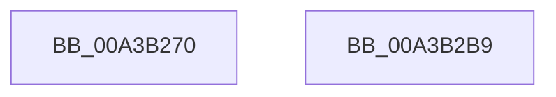

# SeAssignSecurityEx

- RVA: `0x00A3B270`–`0x00A3B2BA` (길이 `74` bytes)
- VA: `0x0000000140A3B270`
- 실행 섹션: `PAGE`
- PDB 이름 있음: `예`; PDB Function 태그: `아니요`
- unwind 정보 RVA: `0x0007A034`
- 디코드: `16`개 명령, `74/74` bytes 표시
- 미해석 바이트: `0` (있으면 어셈블리에 `.byte`로 보존)

> 이 문서는 커널 이미지의 기계어와 PDB 기호를 분석해 생성했습니다. 4번과 5번은 함수 원형과 자료형을 바이너리 사용 방식에서 추정한 C 해석이며 원본 소스 복구 결과는 아닙니다.

## 1. Dependencies

- 직접 호출 지점: **1**; 고유 호출 대상: **1**
- 직접 호출자로 확인된 함수: **0**
- RIP 상대 이미지 참조: **0**

### Outgoing calls
- `0x00A3B2AF` → [SeAssignSecurityEx2](../../text/4E/SeAssignSecurityEx2_function_004E9AA0.md) (function, `0x004E9AA0`)

### Direct callers
- 이 함수 시작 RVA로 연결되는 직접 call은 확인되지 않았습니다. 간접 호출은 완전히 역산할 수 없습니다.

### Static image references
- 디코드된 RIP-relative 메모리 참조가 없습니다.

## 2. Other-region calls and transfers

- 다른 실행 섹션으로 향하는 call: **1**
  - `0x00A3B2AF` → [SeAssignSecurityEx2](../../text/4E/SeAssignSecurityEx2_function_004E9AA0.md) (`PAGE` → `.text`)
- 별도 외부 분기/꼬리 이동을 확인하지 못했습니다.

## 3. Assembly (complete function range)

```asm
00A3B270  4C 8B DC                        mov r11, rsp
00A3B273  48 83 EC 68                     sub rsp, 0x68
00A3B277  49 83 63 E8 00                  and qword ptr [r11 - 0x18], 0
00A3B27C  48 8B 84 24 A8 00 00 00         mov rax, qword ptr [rsp + 0xa8]
00A3B284  49 89 43 D8                     mov qword ptr [r11 - 0x28], rax
00A3B288  48 8B 84 24 A0 00 00 00         mov rax, qword ptr [rsp + 0xa0]
00A3B290  49 89 43 D0                     mov qword ptr [r11 - 0x30], rax
00A3B294  49 83 63 C8 00                  and qword ptr [r11 - 0x38], 0
00A3B299  8B 84 24 98 00 00 00            mov eax, dword ptr [rsp + 0x98]
00A3B2A0  89 44 24 28                     mov dword ptr [rsp + 0x28], eax
00A3B2A4  8A 84 24 90 00 00 00            mov al, byte ptr [rsp + 0x90]
00A3B2AB  88 44 24 20                     mov byte ptr [rsp + 0x20], al
00A3B2AF  E8 EC E7 AA FF                  call 0x1404e9aa0
00A3B2B4  48 83 C4 68                     add rsp, 0x68
00A3B2B8  C3                              ret
00A3B2B9  CC                              int3
```

## 4. C-style interpretation (structured pseudocode)

```c
__int64 __fastcall SeAssignSecurityEx(__int64 a1, __int64 a2, __int64 a3, __int64 a4, unsigned __int8 a5, unsigned int a6, __int64 a7, __int64 a8)
{
    __int64 result;
    __int64 v_rsp;
    unsigned int v_stack_m40;
    unsigned __int8 v_stack_m48;

    v_rsp = (v_rsp) - (104);
    *(unsigned __int64 *)(v_rsp - 40) = a8;
    *(unsigned __int64 *)(v_rsp - 48) = a7;
    v_stack_m40 = (unsigned int)((unsigned int)(a6));
    v_stack_m48 = a5;
    result = SeAssignSecurityEx2(a1, a2, a3, a4);
    v_rsp = (v_rsp) + (104);
    return result;
}
```

## 5. (Beta) C Style

```c
int64_t SeAssignSecurityEx(int64_t Arg1, int64_t Arg2, int64_t Arg3, int64_t Arg4, uint8_t Arg5, uint32_t Arg6, int64_t Arg7, int64_t Arg8)
{
    int64_t result;
    int64_t local_rsp;
    uint32_t v_stack_m40;
    uint8_t v_stack_m48;

    local_rsp = (local_rsp) - (104);
    *(uint64_t *)(local_rsp - 0x28) = Arg8;
    *(uint64_t *)(local_rsp - 0x30) = Arg7;
    v_stack_m40 = (uint32_t)((uint32_t)(Arg6));
    v_stack_m48 = Arg5;
    result = SeAssignSecurityEx2(Arg1, Arg2, Arg3, Arg4);
    local_rsp = (local_rsp) + (104);
    return result;
}
```

## 6. Execution-region graph

[열기: 2D/3D 그래프와 함수 탐색 컨트롤 패널](../../../control-panel.html?section=page&rva=0x00A3B270&view=graph)

- 2D 그래프는 위에서 아래로 흐르고, 3D 그래프는 빈 공간을 드래그해 회전합니다. Shift+드래그는 이동, 휠은 확대·축소, 함수 노드 선택은 대상 보고서 이동입니다.

### Static fallback


