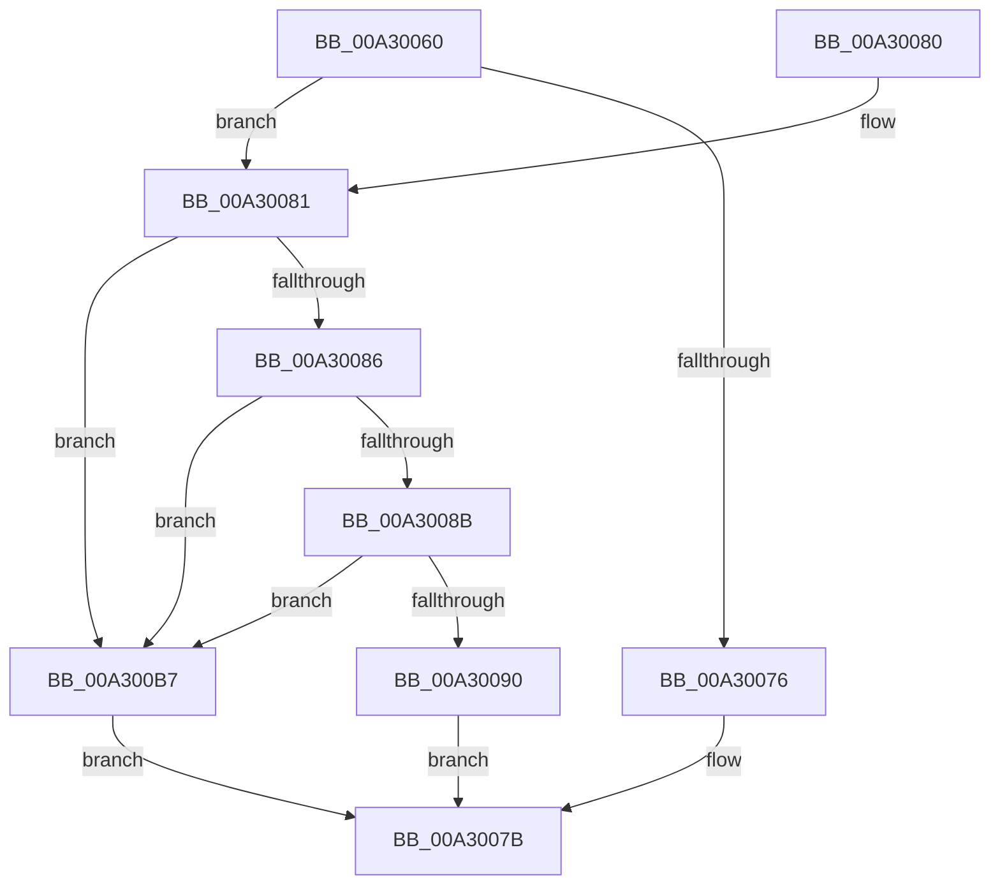

# SeGetCachedSigningLevel

- RVA: `0x00A30060`–`0x00A300BE` (길이 `94` bytes)
- VA: `0x0000000140A30060`
- 실행 섹션: `PAGE`
- PDB 이름 있음: `예`; PDB Function 태그: `아니요`
- unwind 정보 RVA: `0x000ACD4C`
- 디코드: `28`개 명령, `94/94` bytes 표시
- 미해석 바이트: `0` (있으면 어셈블리에 `.byte`로 보존)

> 이 문서는 커널 이미지의 기계어와 PDB 기호를 분석해 생성했습니다. 4번과 5번은 함수 원형과 자료형을 바이너리 사용 방식에서 추정한 C 해석이며 원본 소스 복구 결과는 아닙니다.

## 1. Dependencies

- 직접 호출 지점: **1**; 고유 호출 대상: **1**
- 직접 호출자로 확인된 함수: **0**
- RIP 상대 이미지 참조: **1**

### Outgoing calls
- `0x00A300B0` → [guard_dispatch_icall](../../text/6B/guard_dispatch_icall_function_006BAAD0.md) (function, `0x006BAAD0`)

### Direct callers
- 이 함수 시작 RVA로 연결되는 직접 call은 확인되지 않았습니다. 간접 호출은 완전히 역산할 수 없습니다.

### Static image references
- `0x00A30064` → RVA `0x00F04E50` (`.data`; read)

## 2. Other-region calls and transfers

- 다른 실행 섹션으로 향하는 call: **1**
  - `0x00A300B0` → [guard_dispatch_icall](../../text/6B/guard_dispatch_icall_function_006BAAD0.md) (`PAGE` → `.text`)
- 별도 외부 분기/꼬리 이동을 확인하지 못했습니다.

## 3. Assembly (complete function range)

```asm
00A30060  48 83 EC 48                     sub rsp, 0x48
00A30064  4C 8B 1D E5 4D 4D 00            mov r11, qword ptr [rip + 0x4d4de5]
00A3006B  49 8B C0                        mov rax, r8
00A3006E  4C 8B D1                        mov r10, rcx
00A30071  4D 85 DB                        test r11, r11
00A30074  75 0B                           jne 0x140a30081
00A30076  B8 01 00 00 C0                  mov eax, 0xc0000001
00A3007B  48 83 C4 48                     add rsp, 0x48
00A3007F  C3                              ret
00A30080  CC                              int3
00A30081  4D 85 D2                        test r10, r10
00A30084  74 31                           je 0x140a300b7
00A30086  48 85 D2                        test rdx, rdx
00A30089  74 2C                           je 0x140a300b7
00A3008B  48 85 C0                        test rax, rax
00A3008E  74 27                           je 0x140a300b7
00A30090  48 8B 4C 24 78                  mov rcx, qword ptr [rsp + 0x78]
00A30095  4C 8B C2                        mov r8, rdx
00A30098  48 89 4C 24 28                  mov qword ptr [rsp + 0x28], rcx
00A3009D  48 8B D0                        mov rdx, rax
00A300A0  48 8B 4C 24 70                  mov rcx, qword ptr [rsp + 0x70]
00A300A5  49 8B C3                        mov rax, r11
00A300A8  48 89 4C 24 20                  mov qword ptr [rsp + 0x20], rcx
00A300AD  49 8B CA                        mov rcx, r10
00A300B0  E8 1B AA C8 FF                  call 0x1406baad0
00A300B5  EB C4                           jmp 0x140a3007b
00A300B7  B8 0D 00 00 C0                  mov eax, 0xc000000d
00A300BC  EB BD                           jmp 0x140a3007b
```

## 4. C-style interpretation (structured pseudocode)

```c
__int64 __fastcall SeGetCachedSigningLevel(__int64 a1, __int64 a2, __int64 a3, __int64 a4, __int64 a5, __int64 a6)
{
    __int64 result;
    __int64 v_rsp;
    unsigned __int64 v_stack_p20;
    unsigned __int64 v_stack_p28;

    v_rsp = (v_rsp) - (72);
    if (*(unsigned __int64 *)(v_rip + 5066213) != 0) goto loc_00A30081;
loc_00A3007B:
    v_rsp = (v_rsp) + (72);
    return (unsigned int)(0xC0000001ULL);
loc_00A30081:
    if (a1 == 0) goto loc_00A300B7;
    if (a2 == 0) goto loc_00A300B7;
    if ((unsigned int)(0xC0000001ULL) == 0) goto loc_00A300B7;
    v_stack_p28 = a6;
    v_stack_p20 = a5;
    result = guard_dispatch_icall(a1, (unsigned int)(0xC0000001ULL), a2, a4);
    goto loc_00A3007B;
loc_00A300B7:
    goto loc_00A3007B;
}
```

## 5. (Beta) C Style

```c
int64_t SeGetCachedSigningLevel(int64_t Arg1, int64_t Arg2, int64_t Arg3, int64_t Arg4, int64_t Arg5, int64_t Arg6)
{
    int64_t result;
    int64_t local_rsp;
    uint64_t v_stack_p20;
    uint64_t v_stack_p28;

    local_rsp = (local_rsp) - (72);
    if (*(uint64_t *)(v_rip + 0x4D4DE5) != 0) goto loc_00A30081;
loc_00A3007B:
    local_rsp = (local_rsp) + (72);
    return (uint32_t)(0xC0000001ULL);
loc_00A30081:
    if (Arg1 == 0) goto loc_00A300B7;
    if (Arg2 == 0) goto loc_00A300B7;
    if ((uint32_t)(0xC0000001ULL) == 0) goto loc_00A300B7;
    v_stack_p28 = Arg6;
    v_stack_p20 = Arg5;
    result = guard_dispatch_icall(Arg1, (uint32_t)(0xC0000001ULL), Arg2, Arg4);
    goto loc_00A3007B;
loc_00A300B7:
    goto loc_00A3007B;
}
```

## 6. Execution-region graph

[열기: 2D/3D 그래프와 함수 탐색 컨트롤 패널](../../../control-panel.html?section=page&rva=0x00A30060&view=graph)

- 2D 그래프는 위에서 아래로 흐르고, 3D 그래프는 빈 공간을 드래그해 회전합니다. Shift+드래그는 이동, 휠은 확대·축소, 함수 노드 선택은 대상 보고서 이동입니다.

### Static fallback


