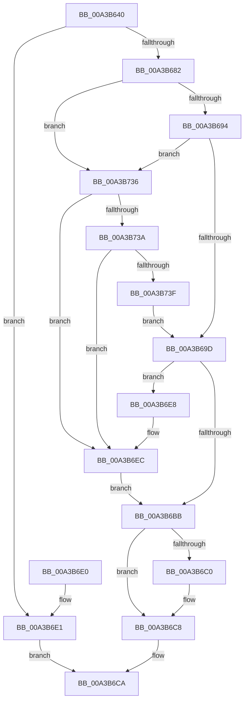

# SeGetLinkedToken

- RVA: `0x00A3B640`–`0x00A3B744` (길이 `260` bytes)
- VA: `0x0000000140A3B640`
- 실행 섹션: `PAGE`
- PDB 이름 있음: `예`; PDB Function 태그: `아니요`
- unwind 정보 RVA: `0x000AE36C`
- 디코드: `72`개 명령, `260/260` bytes 표시
- 미해석 바이트: `0` (있으면 어셈블리에 `.byte`로 보존)

> 이 문서는 커널 이미지의 기계어와 PDB 기호를 분석해 생성했습니다. 4번과 5번은 함수 원형과 자료형을 바이너리 사용 방식에서 추정한 C 해석이며 원본 소스 복구 결과는 아닙니다.

## 1. Dependencies

- 직접 호출 지점: **3**; 고유 호출 대상: **3**
- 직접 호출자로 확인된 함수: **0**
- RIP 상대 이미지 참조: **0**

### Outgoing calls
- `0x00A3B6AC` → [SepReferenceLogonSessionSilo](SepReferenceLogonSessionSilo_function_00A3B784.md) (function, `0x00A3B784`)
- `0x00A3B6C3` → [SepDeReferenceLogonSessionDirect](../../text/44/SepDeReferenceLogonSessionDirect_function_0044EDCC.md) (function, `0x0044EDCC`)
- `0x00A3B72D` → [SepDuplicateToken](../8B/SepDuplicateToken_function_008B87EC.md) (function, `0x008B87EC`)

### Direct callers
- 이 함수 시작 RVA로 연결되는 직접 call은 확인되지 않았습니다. 간접 호출은 완전히 역산할 수 없습니다.

### Static image references
- 디코드된 RIP-relative 메모리 참조가 없습니다.

## 2. Other-region calls and transfers

- 다른 실행 섹션으로 향하는 call: **1**
  - `0x00A3B6C3` → [SepDeReferenceLogonSessionDirect](../../text/44/SepDeReferenceLogonSessionDirect_function_0044EDCC.md) (`PAGE` → `.text`)
- 별도 외부 분기/꼬리 이동을 확인하지 못했습니다.

## 3. Assembly (complete function range)

```asm
00A3B640  48 89 5C 24 08                  mov qword ptr [rsp + 8], rbx
00A3B645  48 89 74 24 10                  mov qword ptr [rsp + 0x10], rsi
00A3B64A  48 89 7C 24 20                  mov qword ptr [rsp + 0x20], rdi
00A3B64F  55                              push rbp
00A3B650  48 8B EC                        mov rbp, rsp
00A3B653  48 83 EC 70                     sub rsp, 0x70
00A3B657  33 C0                           xor eax, eax
00A3B659  33 DB                           xor ebx, ebx
00A3B65B  49 21 00                        and qword ptr [r8], rax
00A3B65E  0F 57 C0                        xorps xmm0, xmm0
00A3B661  48 89 45 F0                     mov qword ptr [rbp - 0x10], rax
00A3B665  49 8B F0                        mov rsi, r8
00A3B668  89 45 F8                        mov dword ptr [rbp - 8], eax
00A3B66B  4C 8B D2                        mov r10, rdx
00A3B66E  8D 41 FE                        lea eax, [rcx - 2]
00A3B671  48 89 5D 20                     mov qword ptr [rbp + 0x20], rbx
00A3B675  0F 11 45 D0                     movups xmmword ptr [rbp - 0x30], xmm0
00A3B679  0F 11 45 E0                     movups xmmword ptr [rbp - 0x20], xmm0
00A3B67D  83 F8 01                        cmp eax, 1
00A3B680  77 5F                           ja 0x140a3b6e1
00A3B682  48 8B 92 D8 00 00 00            mov rdx, qword ptr [rdx + 0xd8]
00A3B689  8B 42 28                        mov eax, dword ptr [rdx + 0x28]
00A3B68C  A8 04                           test al, 4
00A3B68E  0F 84 A2 00 00 00               je 0x140a3b736
00A3B694  83 F9 02                        cmp ecx, 2
00A3B697  0F 85 99 00 00 00               jne 0x140a3b736
00A3B69D  48 8D 4A 10                     lea rcx, [rdx + 0x10]
00A3B6A1  48 8B 92 A8 00 00 00            mov rdx, qword ptr [rdx + 0xa8]
00A3B6A8  4C 8D 45 20                     lea r8, [rbp + 0x20]
00A3B6AC  E8 D3 00 00 00                  call 0x140a3b784
00A3B6B1  48 8B 5D 20                     mov rbx, qword ptr [rbp + 0x20]
00A3B6B5  8B F8                           mov edi, eax
00A3B6B7  85 C0                           test eax, eax
00A3B6B9  79 2D                           jns 0x140a3b6e8
00A3B6BB  48 85 DB                        test rbx, rbx
00A3B6BE  74 08                           je 0x140a3b6c8
00A3B6C0  48 8B CB                        mov rcx, rbx
00A3B6C3  E8 04 37 A1 FF                  call 0x14044edcc
00A3B6C8  8B C7                           mov eax, edi
00A3B6CA  4C 8D 5C 24 70                  lea r11, [rsp + 0x70]
00A3B6CF  49 8B 5B 10                     mov rbx, qword ptr [r11 + 0x10]
00A3B6D3  49 8B 73 18                     mov rsi, qword ptr [r11 + 0x18]
00A3B6D7  49 8B 7B 28                     mov rdi, qword ptr [r11 + 0x28]
00A3B6DB  49 8B E3                        mov rsp, r11
00A3B6DE  5D                              pop rbp
00A3B6DF  C3                              ret
00A3B6E0  CC                              int3
00A3B6E1  B8 0D 00 00 C0                  mov eax, 0xc000000d
00A3B6E6  EB E2                           jmp 0x140a3b6ca
00A3B6E8  4C 8B 53 38                     mov r10, qword ptr [rbx + 0x38]
00A3B6EC  48 83 65 D8 00                  and qword ptr [rbp - 0x28], 0
00A3B6F1  48 8D 55 D0                     lea rdx, [rbp - 0x30]
00A3B6F5  83 65 E8 00                     and dword ptr [rbp - 0x18], 0
00A3B6F9  0F 57 C0                        xorps xmm0, xmm0
00A3B6FC  48 83 65 E0 00                  and qword ptr [rbp - 0x20], 0
00A3B701  41 B9 01 00 00 00               mov r9d, 1
00A3B707  48 89 74 24 38                  mov qword ptr [rsp + 0x38], rsi
00A3B70C  45 33 C0                        xor r8d, r8d
00A3B70F  C6 44 24 30 00                  mov byte ptr [rsp + 0x30], 0
00A3B714  49 8B CA                        mov rcx, r10
00A3B717  C6 44 24 28 00                  mov byte ptr [rsp + 0x28], 0
00A3B71C  83 64 24 20 00                  and dword ptr [rsp + 0x20], 0
00A3B721  C7 45 D0 30 00 00 00            mov dword ptr [rbp - 0x30], 0x30
00A3B728  F3 0F 7F 45 F0                  movdqu xmmword ptr [rbp - 0x10], xmm0
00A3B72D  E8 BA D0 E7 FF                  call 0x1408b87ec
00A3B732  8B F8                           mov edi, eax
00A3B734  EB 85                           jmp 0x140a3b6bb
00A3B736  A8 02                           test al, 2
00A3B738  74 B2                           je 0x140a3b6ec
00A3B73A  83 F9 03                        cmp ecx, 3
00A3B73D  75 AD                           jne 0x140a3b6ec
00A3B73F  E9 59 FF FF FF                  jmp 0x140a3b69d
```

## 4. C-style interpretation (structured pseudocode)

```c
__int64 __fastcall SeGetLinkedToken(__int64 a1, __int64 a2, __int64 a3)
{
    __int64 result;
    __int64 v_rbx;
    __int64 v_rsp;
    unsigned int v_stack_m10;
    unsigned __int64 v_stack_m18;
    unsigned int v_stack_m20;
    unsigned __int64 v_stack_m28;
    unsigned __int64 v_stack_m30;
    unsigned __int64 v_stack_m38;
    unsigned __int8 v_stack_m40;
    unsigned __int8 v_stack_m48;
    unsigned int v_stack_m50;
    unsigned __int64 v_stack_m8;
    unsigned __int64 v_stack_p10;
    unsigned __int64 v_stack_p18;
    unsigned __int64 v_stack_p20;
    unsigned __int64 v_stack_p8;

    v_stack_p8 = v_rbx;
    v_stack_p10 = v_rsi;
    v_stack_p20 = v_rdi;
    v_rsp = (v_rsp) - (112);
    result = 0;
    v_rbx = 0;
    v_stack_m18 = 0;
    v_stack_m10 = 0;
    v_stack_p18 = 0;
    v_stack_m38 = v_xmm0;
    v_stack_m28 = v_xmm0;
    if (((unsigned int)(a1 - 2)) > 1) goto loc_00A3B6E1;
    if ((((unsigned __int8)((unsigned int)(*(unsigned int *)(*(unsigned __int64 *)(a2 + 216) + 40)))) & (4)) == 0) goto loc_00A3B736;
    if (((unsigned int)(a1)) != 2) goto loc_00A3B736;
loc_00A3B69D:
    result = SepReferenceLogonSessionSilo(*(unsigned __int64 *)(a2 + 216) + 16, *(unsigned __int64 *)(*(unsigned __int64 *)(a2 + 216) + 168), v_stack_p18, a4);
    if (!sign_flag) goto loc_00A3B6E8;
loc_00A3B6BB:
    if (v_stack_p18 != 0) {
        a1 = v_stack_p18;
        result = SepDeReferenceLogonSessionDirect(a1, *(unsigned __int64 *)(*(unsigned __int64 *)(a2 + 216) + 168), v_stack_p18, a4);
    }
loc_00A3B6CA:
    return (unsigned int)((unsigned int)((unsigned int)((unsigned int)(result))));
loc_00A3B6E1:
    goto loc_00A3B6CA;
loc_00A3B6E8:
loc_00A3B6EC:
    v_stack_m38 = *(unsigned __int64 *)(v_stack_m8 + 24);
    a3 = 0;
    v_stack_m40 = 0;
    v_stack_m48 = 0;
    v_stack_m38 = 48;
    v_stack_m18 = v_xmm0;
    result = SepDuplicateToken(*(unsigned __int64 *)(*(unsigned __int64 *)(v_stack_m8 + 16) + 56), v_stack_m38, a3, 1);
    goto loc_00A3B6BB;
loc_00A3B736:
    if ((((unsigned __int8)(result)) & (2)) == 0) goto loc_00A3B6EC;
    if (((unsigned int)(*(unsigned __int64 *)(*(unsigned __int64 *)(v_stack_m8 + 16) + 56))) != 3) goto loc_00A3B6EC;
    goto loc_00A3B69D;
}
```

## 5. (Beta) C Style

```c
int64_t SeGetLinkedToken(void *Arg1, void *Arg2, void *Arg3)
{
    uint8_t *arg1 = (uint8_t *)Arg1;
    uint8_t *arg2 = (uint8_t *)Arg2;
    uint8_t *arg3 = (uint8_t *)Arg3;

    int64_t result;
    int64_t local_rbx;
    int64_t local_rsp;
    uint32_t v_stack_m10;
    uint64_t v_stack_m18;
    uint32_t v_stack_m20;
    uint64_t v_stack_m28;
    uint64_t v_stack_m30;
    uint64_t v_stack_m38;
    uint8_t v_stack_m40;
    uint8_t v_stack_m48;
    uint32_t v_stack_m50;
    uint64_t v_stack_m8;
    uint64_t v_stack_p10;
    uint64_t v_stack_p18;
    uint64_t v_stack_p20;
    uint64_t v_stack_p8;

    v_stack_p8 = local_rbx;
    v_stack_p10 = local_rsi;
    v_stack_p20 = local_rdi;
    local_rsp = (local_rsp) - (112);
    result = 0;
    local_rbx = 0;
    v_stack_m18 = 0;
    v_stack_m10 = 0;
    v_stack_p18 = 0;
    v_stack_m38 = v_xmm0;
    v_stack_m28 = v_xmm0;
    if (((uint32_t)(Arg1 - 2)) > 1) goto loc_00A3B6E1;
    if ((((uint8_t)((uint32_t)(*(uint32_t *)(*(uint64_t *)(arg2 + 0xD8) + 0x28)))) & (4)) == 0) goto loc_00A3B736;
    if (((uint32_t)(Arg1)) != 2) goto loc_00A3B736;
loc_00A3B69D:
    result = SepReferenceLogonSessionSilo(*(uint64_t *)(arg2 + 0xD8) + 16, *(uint64_t *)(*(uint64_t *)(arg2 + 0xD8) + 0xA8), v_stack_p18, a4);
    if (!sign_flag) goto loc_00A3B6E8;
loc_00A3B6BB:
    if (v_stack_p18 != 0) {
        Arg1 = v_stack_p18;
        result = SepDeReferenceLogonSessionDirect(Arg1, *(uint64_t *)(*(uint64_t *)(arg2 + 0xD8) + 0xA8), v_stack_p18, a4);
    }
loc_00A3B6CA:
    return (uint32_t)((uint32_t)((uint32_t)((uint32_t)(result))));
loc_00A3B6E1:
    goto loc_00A3B6CA;
loc_00A3B6E8:
loc_00A3B6EC:
    v_stack_m38 = *(uint64_t *)(v_stack_m8 + 0x18);
    Arg3 = 0;
    v_stack_m40 = 0;
    v_stack_m48 = 0;
    v_stack_m38 = 48;
    v_stack_m18 = v_xmm0;
    result = SepDuplicateToken(*(uint64_t *)(*(uint64_t *)(v_stack_m8 + 0x10) + 0x38), v_stack_m38, Arg3, 1);
    goto loc_00A3B6BB;
loc_00A3B736:
    if ((((uint8_t)(result)) & (2)) == 0) goto loc_00A3B6EC;
    if (((uint32_t)(*(uint64_t *)(*(uint64_t *)(v_stack_m8 + 0x10) + 0x38))) != 3) goto loc_00A3B6EC;
    goto loc_00A3B69D;
}
```

### 관측된 메모리 오프셋

구조체 형식이 확인되지 않은 접근은 인자 기준의 오프셋으로만 기록했습니다.

| 기준 인자 | 오프셋 표현 | 폭 (bit) | 접근 |
|---|---:|---:|---|
| `Arg1` | `- 0x2` | `32` | `R` |
| `Arg2` | `+ 0xD8` | `64` | `R` |
| `Arg3` | `+ 0x0` | `64` | `R/W` |

## 6. Execution-region graph

[열기: 2D/3D 그래프와 함수 탐색 컨트롤 패널](../../../control-panel.html?section=page&rva=0x00A3B640&view=graph)

- 2D 그래프는 위에서 아래로 흐르고, 3D 그래프는 빈 공간을 드래그해 회전합니다. Shift+드래그는 이동, 휠은 확대·축소, 함수 노드 선택은 대상 보고서 이동입니다.

### Static fallback


