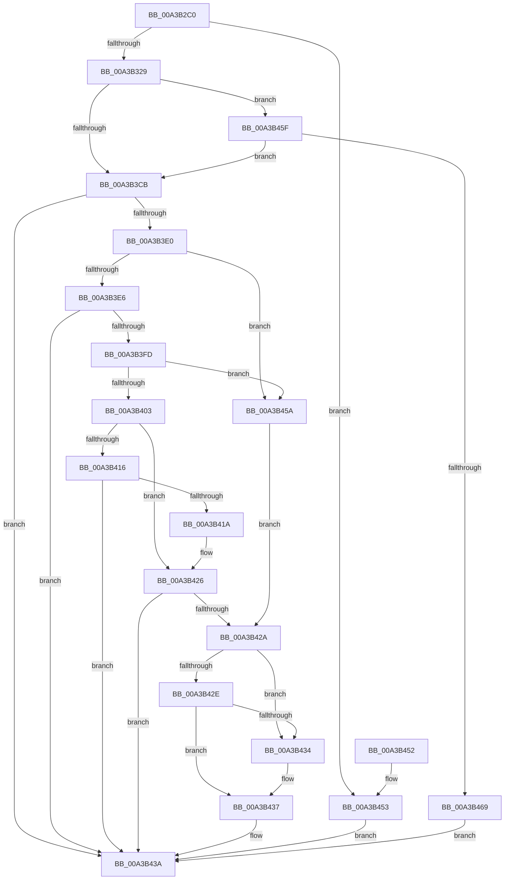

# SeIsTokenAssignableToProcess

- RVA: `0x00A3B2C0`–`0x00A3B470` (길이 `432` bytes)
- VA: `0x0000000140A3B2C0`
- 실행 섹션: `PAGE`
- PDB 이름 있음: `예`; PDB Function 태그: `아니요`
- unwind 정보 RVA: `0x000AE320`
- 디코드: `119`개 명령, `432/432` bytes 표시
- 미해석 바이트: `0` (있으면 어셈블리에 `.byte`로 보존)

> 이 문서는 커널 이미지의 기계어와 PDB 기호를 분석해 생성했습니다. 4번과 5번은 함수 원형과 자료형을 바이너리 사용 방식에서 추정한 C 해석이며 원본 소스 복구 결과는 아닙니다.

## 1. Dependencies

- 직접 호출 지점: **14**; 고유 호출 대상: **10**
- 직접 호출자로 확인된 함수: **2**
- RIP 상대 이미지 참조: **0**

### Outgoing calls
- `0x00A3B318` → [PsReferencePrimaryTokenWithTag](../../text/20/PsReferencePrimaryTokenWithTag_function_0020FF80.md) (function, `0x0020FF80`)
- `0x00A3B340` → [ExAcquireResourceSharedLite](../../text/21/ExAcquireResourceSharedLite_function_00211BC0.md) (function, `0x00211BC0`)
- `0x00A3B34C` → [SepCopyTokenIntegrity](../../text/41/SepCopyTokenIntegrity_function_00419D10.md) (function, `0x00419D10`)
- `0x00A3B35C` → [ExReleaseResourceLite](../../text/25/ExReleaseResourceLite_function_0025FA10.md) (function, `0x0025FA10`)
- `0x00A3B361` → [KeLeaveCriticalRegion](../../text/25/KeLeaveCriticalRegion_function_0025D8B0.md) (function, `0x0025D8B0`)
- `0x00A3B373` → [ObFastDereferenceObject](../../text/3E/ObFastDereferenceObject_function_003ED5F0.md) (function, `0x003ED5F0`)
- `0x00A3B38F` → [ExAcquireResourceSharedLite](../../text/21/ExAcquireResourceSharedLite_function_00211BC0.md) (function, `0x00211BC0`)
- `0x00A3B39B` → [SepCopyTokenIntegrity](../../text/41/SepCopyTokenIntegrity_function_00419D10.md) (function, `0x00419D10`)
- `0x00A3B3B8` → [ExReleaseResourceLite](../../text/25/ExReleaseResourceLite_function_0025FA10.md) (function, `0x0025FA10`)
- `0x00A3B3BD` → [KeLeaveCriticalRegion](../../text/25/KeLeaveCriticalRegion_function_0025D8B0.md) (function, `0x0025D8B0`)
- `0x00A3B3D7` → [RtlSidDominates](../../text/3F/RtlSidDominates_function_003FBD50.md) (function, `0x003FBD50`)
- `0x00A3B3F4` → [RtlSidDominatesForTrust](../../text/3E/RtlSidDominatesForTrust_function_003EDFE0.md) (function, `0x003EDFE0`)
- `0x00A3B40A` → [SepIsChildTokenByPointer](SepIsChildTokenByPointer_function_00A3B478.md) (function, `0x00A3B478`)
- `0x00A3B421` → [SepIsSiblingTokenByPointer](SepIsSiblingTokenByPointer_function_00A3B514.md) (function, `0x00A3B514`)

### Direct callers
- [PspAssignPrimaryToken](../78/PspAssignPrimaryToken_function_00784870.md) at `0x007848DC`
- [PspAllocateProcess](../A1/PspAllocateProcess_function_00A13B3C.md) at `0x00A14FC1`

### Static image references
- 디코드된 RIP-relative 메모리 참조가 없습니다.

## 2. Other-region calls and transfers

- 다른 실행 섹션으로 향하는 call: **12**
  - `0x00A3B318` → [PsReferencePrimaryTokenWithTag](../../text/20/PsReferencePrimaryTokenWithTag_function_0020FF80.md) (`PAGE` → `.text`)
  - `0x00A3B340` → [ExAcquireResourceSharedLite](../../text/21/ExAcquireResourceSharedLite_function_00211BC0.md) (`PAGE` → `.text`)
  - `0x00A3B34C` → [SepCopyTokenIntegrity](../../text/41/SepCopyTokenIntegrity_function_00419D10.md) (`PAGE` → `.text`)
  - `0x00A3B35C` → [ExReleaseResourceLite](../../text/25/ExReleaseResourceLite_function_0025FA10.md) (`PAGE` → `.text`)
  - `0x00A3B361` → [KeLeaveCriticalRegion](../../text/25/KeLeaveCriticalRegion_function_0025D8B0.md) (`PAGE` → `.text`)
  - `0x00A3B373` → [ObFastDereferenceObject](../../text/3E/ObFastDereferenceObject_function_003ED5F0.md) (`PAGE` → `.text`)
  - `0x00A3B38F` → [ExAcquireResourceSharedLite](../../text/21/ExAcquireResourceSharedLite_function_00211BC0.md) (`PAGE` → `.text`)
  - `0x00A3B39B` → [SepCopyTokenIntegrity](../../text/41/SepCopyTokenIntegrity_function_00419D10.md) (`PAGE` → `.text`)
  - `0x00A3B3B8` → [ExReleaseResourceLite](../../text/25/ExReleaseResourceLite_function_0025FA10.md) (`PAGE` → `.text`)
  - `0x00A3B3BD` → [KeLeaveCriticalRegion](../../text/25/KeLeaveCriticalRegion_function_0025D8B0.md) (`PAGE` → `.text`)
  - `0x00A3B3D7` → [RtlSidDominates](../../text/3F/RtlSidDominates_function_003FBD50.md) (`PAGE` → `.text`)
  - `0x00A3B3F4` → [RtlSidDominatesForTrust](../../text/3E/RtlSidDominatesForTrust_function_003EDFE0.md) (`PAGE` → `.text`)
- 별도 외부 분기/꼬리 이동을 확인하지 못했습니다.

## 3. Assembly (complete function range)

```asm
00A3B2C0  48 89 5C 24 08                  mov qword ptr [rsp + 8], rbx
00A3B2C5  55                              push rbp
00A3B2C6  56                              push rsi
00A3B2C7  57                              push rdi
00A3B2C8  41 54                           push r12
00A3B2CA  41 55                           push r13
00A3B2CC  41 56                           push r14
00A3B2CE  41 57                           push r15
00A3B2D0  48 8B EC                        mov rbp, rsp
00A3B2D3  48 83 EC 40                     sub rsp, 0x40
00A3B2D7  33 FF                           xor edi, edi
00A3B2D9  4C 8B F2                        mov r14, rdx
00A3B2DC  40 88 3A                        mov byte ptr [rdx], dil
00A3B2DF  48 8B F1                        mov rsi, rcx
00A3B2E2  65 48 8B 04 25 88 01 00 00      mov rax, qword ptr gs:[0x188]
00A3B2EB  0F 57 C0                        xorps xmm0, xmm0
00A3B2EE  0F 57 C9                        xorps xmm1, xmm1
00A3B2F1  40 88 7D 50                     mov byte ptr [rbp + 0x50], dil
00A3B2F5  41 BD 44 66 6C 74               mov r13d, 0x746c6644
00A3B2FB  40 88 7D 58                     mov byte ptr [rbp + 0x58], dil
00A3B2FF  41 8B D5                        mov edx, r13d
00A3B302  40 88 7D 48                     mov byte ptr [rbp + 0x48], dil
00A3B306  4C 8B B8 B8 00 00 00            mov r15, qword ptr [rax + 0xb8]
00A3B30D  49 8B CF                        mov rcx, r15
00A3B310  0F 11 45 E0                     movups xmmword ptr [rbp - 0x20], xmm0
00A3B314  0F 11 4D F0                     movups xmmword ptr [rbp - 0x10], xmm1
00A3B318  E8 63 4C 7D FF                  call 0x14020ff80
00A3B31D  48 8B D8                        mov rbx, rax
00A3B320  48 85 C0                        test rax, rax
00A3B323  0F 84 2A 01 00 00               je 0x140a3b453
00A3B329  65 48 8B 04 25 88 01 00 00      mov rax, qword ptr gs:[0x188]
00A3B332  B2 01                           mov dl, 1
00A3B334  66 FF 88 E4 01 00 00            dec word ptr [rax + 0x1e4]
00A3B33B  90                              nop
00A3B33C  48 8B 4B 30                     mov rcx, qword ptr [rbx + 0x30]
00A3B340  E8 7B 68 7D FF                  call 0x140211bc0
00A3B345  48 8D 55 F0                     lea rdx, [rbp - 0x10]
00A3B349  48 8B CB                        mov rcx, rbx
00A3B34C  E8 BF E9 9D FF                  call 0x140419d10
00A3B351  48 8B 4B 30                     mov rcx, qword ptr [rbx + 0x30]
00A3B355  4C 8B A3 50 04 00 00            mov r12, qword ptr [rbx + 0x450]
00A3B35C  E8 AF 46 82 FF                  call 0x14025fa10
00A3B361  E8 4A 25 82 FF                  call 0x14025d8b0
00A3B366  49 8D 8F 48 02 00 00            lea rcx, [r15 + 0x248]
00A3B36D  45 8B C5                        mov r8d, r13d
00A3B370  48 8B D3                        mov rdx, rbx
00A3B373  E8 78 22 9B FF                  call 0x1403ed5f0
00A3B378  65 48 8B 04 25 88 01 00 00      mov rax, qword ptr gs:[0x188]
00A3B381  B2 01                           mov dl, 1
00A3B383  66 FF 88 E4 01 00 00            dec word ptr [rax + 0x1e4]
00A3B38A  90                              nop
00A3B38B  48 8B 4E 30                     mov rcx, qword ptr [rsi + 0x30]
00A3B38F  E8 2C 68 7D FF                  call 0x140211bc0
00A3B394  48 8D 55 E0                     lea rdx, [rbp - 0x20]
00A3B398  48 8B CE                        mov rcx, rsi
00A3B39B  E8 70 E9 9D FF                  call 0x140419d10
00A3B3A0  48 8B 4E 30                     mov rcx, qword ptr [rsi + 0x30]
00A3B3A4  8B 9E C0 00 00 00               mov ebx, dword ptr [rsi + 0xc0]
00A3B3AA  44 8B BE C4 00 00 00            mov r15d, dword ptr [rsi + 0xc4]
00A3B3B1  4C 8B AE 50 04 00 00            mov r13, qword ptr [rsi + 0x450]
00A3B3B8  E8 53 46 82 FF                  call 0x14025fa10
00A3B3BD  E8 EE 24 82 FF                  call 0x14025d8b0
00A3B3C2  83 FB 02                        cmp ebx, 2
00A3B3C5  0F 84 94 00 00 00               je 0x140a3b45f
00A3B3CB  48 8B 55 E0                     mov rdx, qword ptr [rbp - 0x20]
00A3B3CF  4C 8D 45 48                     lea r8, [rbp + 0x48]
00A3B3D3  48 8B 4D F0                     mov rcx, qword ptr [rbp - 0x10]
00A3B3D7  E8 74 09 9C FF                  call 0x1403fbd50
00A3B3DC  85 C0                           test eax, eax
00A3B3DE  78 5A                           js 0x140a3b43a
00A3B3E0  40 38 7D 48                     cmp byte ptr [rbp + 0x48], dil
00A3B3E4  74 74                           je 0x140a3b45a
00A3B3E6  4C 8D 45 48                     lea r8, [rbp + 0x48]
00A3B3EA  40 88 7D 48                     mov byte ptr [rbp + 0x48], dil
00A3B3EE  49 8B D5                        mov rdx, r13
00A3B3F1  49 8B CC                        mov rcx, r12
00A3B3F4  E8 E7 2B 9B FF                  call 0x1403edfe0
00A3B3F9  85 C0                           test eax, eax
00A3B3FB  78 3D                           js 0x140a3b43a
00A3B3FD  40 38 7D 48                     cmp byte ptr [rbp + 0x48], dil
00A3B401  74 57                           je 0x140a3b45a
00A3B403  48 8D 55 50                     lea rdx, [rbp + 0x50]
00A3B407  48 8B CE                        mov rcx, rsi
00A3B40A  E8 69 00 00 00                  call 0x140a3b478
00A3B40F  8A 5D 50                        mov bl, byte ptr [rbp + 0x50]
00A3B412  84 DB                           test bl, bl
00A3B414  75 10                           jne 0x140a3b426
00A3B416  85 C0                           test eax, eax
00A3B418  78 20                           js 0x140a3b43a
00A3B41A  48 8D 55 58                     lea rdx, [rbp + 0x58]
00A3B41E  48 8B CE                        mov rcx, rsi
00A3B421  E8 EE 00 00 00                  call 0x140a3b514
00A3B426  85 C0                           test eax, eax
00A3B428  78 10                           js 0x140a3b43a
00A3B42A  84 DB                           test bl, bl
00A3B42C  75 06                           jne 0x140a3b434
00A3B42E  40 38 7D 58                     cmp byte ptr [rbp + 0x58], dil
00A3B432  74 03                           je 0x140a3b437
00A3B434  40 B7 01                        mov dil, 1
00A3B437  41 88 3E                        mov byte ptr [r14], dil
00A3B43A  48 8B 9C 24 80 00 00 00         mov rbx, qword ptr [rsp + 0x80]
00A3B442  48 83 C4 40                     add rsp, 0x40
00A3B446  41 5F                           pop r15
00A3B448  41 5E                           pop r14
00A3B44A  41 5D                           pop r13
00A3B44C  41 5C                           pop r12
00A3B44E  5F                              pop rdi
00A3B44F  5E                              pop rsi
00A3B450  5D                              pop rbp
00A3B451  C3                              ret
00A3B452  CC                              int3
00A3B453  B8 01 00 00 C0                  mov eax, 0xc0000001
00A3B458  EB E0                           jmp 0x140a3b43a
00A3B45A  8A 5D 50                        mov bl, byte ptr [rbp + 0x50]
00A3B45D  EB CB                           jmp 0x140a3b42a
00A3B45F  41 83 FF 02                     cmp r15d, 2
00A3B463  0F 8D 62 FF FF FF               jge 0x140a3b3cb
00A3B469  B8 A5 00 00 C0                  mov eax, 0xc00000a5
00A3B46E  EB CA                           jmp 0x140a3b43a
```

## 4. C-style interpretation (structured pseudocode)

```c
__int64 __fastcall SeIsTokenAssignableToProcess(__int64 a1, __int64 a2)
{
    __int64 result;
    __int64 v_rdi;
    __int64 v_rsp;
    unsigned __int64 v_stack_m48;
    unsigned __int64 v_stack_m58;
    unsigned __int8 v_stack_p10;
    unsigned __int8 v_stack_p18;
    unsigned __int8 v_stack_p20;
    unsigned __int64 v_stack_p8;

    v_stack_p8 = v_rbx;
    v_rsp = (v_rsp) - (64);
    v_rdi = 0;
    *(unsigned __int8 *)(a2) = 0;
    v_stack_p18 = 0;
    v_stack_p20 = 0;
    v_stack_p10 = 0;
    v_stack_m58 = v_xmm0;
    v_stack_m48 = v_xmm1;
    result = PsReferencePrimaryTokenWithTag(*(unsigned __int64 *)(*(unsigned __int64 *)(gs_base + (0 + 392)) + 184), (unsigned int)((unsigned int)((unsigned int)(0x746C6644ULL))), a3, a4);
    if (result == 0) goto loc_00A3B453;
    result = ExAcquireResourceSharedLite(*(unsigned __int64 *)(result + 48), 1, a3, a4);
    result = SepCopyTokenIntegrity(result, v_stack_m48, a3, a4);
    result = ExReleaseResourceLite(*(unsigned __int64 *)(result + 48), v_stack_m48, a3, a4);
    result = KeLeaveCriticalRegion(*(unsigned __int64 *)(result + 48), v_stack_m48, a3, a4);
    result = ObFastDereferenceObject(*(unsigned __int64 *)(*(unsigned __int64 *)(gs_base + (0 + 392)) + 184) + 584, result, (unsigned int)((unsigned int)((unsigned int)(0x746C6644ULL))), a4);
    result = ExAcquireResourceSharedLite(*(unsigned __int64 *)(a1 + 48), 1, (unsigned int)((unsigned int)((unsigned int)(0x746C6644ULL))), a4);
    result = SepCopyTokenIntegrity(a1, v_stack_m58, (unsigned int)((unsigned int)((unsigned int)(0x746C6644ULL))), a4);
    result = ExReleaseResourceLite(*(unsigned __int64 *)(a1 + 48), v_stack_m58, (unsigned int)((unsigned int)((unsigned int)(0x746C6644ULL))), a4);
    result = KeLeaveCriticalRegion(*(unsigned __int64 *)(a1 + 48), v_stack_m58, (unsigned int)((unsigned int)((unsigned int)(0x746C6644ULL))), a4);
    if (((unsigned int)((unsigned int)(*(unsigned int *)(a1 + 192)))) == 2) goto loc_00A3B45F;
loc_00A3B3CB:
    result = RtlSidDominates(v_stack_m48, v_stack_m58, v_stack_p10, a4);
    if (sign_flag) goto loc_00A3B43A;
    if (v_stack_p10 == 0) goto loc_00A3B45A;
    v_stack_p10 = 0;
    result = RtlSidDominatesForTrust(*(unsigned __int64 *)(result + 1104), *(unsigned __int64 *)(a1 + 1104), v_stack_p10, a4);
    if (sign_flag) goto loc_00A3B43A;
    if (v_stack_p10 == 0) goto loc_00A3B45A;
    result = SepIsChildTokenByPointer(a1, v_stack_p18, v_stack_p10, a4);
    if ((unsigned __int8)(v_stack_p18) != 0) goto loc_00A3B426;
    if (sign_flag) goto loc_00A3B43A;
    result = SepIsSiblingTokenByPointer(a1, v_stack_p20, v_stack_p10, a4);
loc_00A3B426:
    if (sign_flag) goto loc_00A3B43A;
loc_00A3B42A:
    if ((unsigned __int8)(v_stack_p18) != 0) goto loc_00A3B434;
    if (v_stack_p20 != 0) {
        v_rdi = 1;
    }
    *(unsigned __int8 *)(a2) = (unsigned __int8)(v_rdi);
loc_00A3B43A:
    v_rsp = (v_rsp) + (64);
    return result;
loc_00A3B453:
    goto loc_00A3B43A;
loc_00A3B45A:
    goto loc_00A3B42A;
loc_00A3B45F:
    if (((unsigned int)((unsigned int)(*(unsigned int *)(a1 + 196)))) >= 2) goto loc_00A3B3CB;
    goto loc_00A3B43A;
}
```

## 5. (Beta) C Style

```c
int64_t SeIsTokenAssignableToProcess(void *Arg1, void *Arg2)
{
    uint8_t *arg1 = (uint8_t *)Arg1;
    uint8_t *arg2 = (uint8_t *)Arg2;

    int64_t result;
    int64_t local_rdi;
    int64_t local_rsp;
    uint64_t v_stack_m48;
    uint64_t v_stack_m58;
    uint8_t v_stack_p10;
    uint8_t v_stack_p18;
    uint8_t v_stack_p20;
    uint64_t v_stack_p8;

    v_stack_p8 = local_rbx;
    local_rsp = (local_rsp) - (64);
    local_rdi = 0;
    *(uint8_t *)(arg2) = 0;
    v_stack_p18 = 0;
    v_stack_p20 = 0;
    v_stack_p10 = 0;
    v_stack_m58 = v_xmm0;
    v_stack_m48 = v_xmm1;
    result = PsReferencePrimaryTokenWithTag(*(uint64_t *)(*(uint64_t *)(gs_base + (0 + 0x188)) + 0xB8), (uint32_t)((uint32_t)((uint32_t)(0x746C6644ULL))), a3, a4);
    if (result == 0) goto loc_00A3B453;
    result = ExAcquireResourceSharedLite(*(uint64_t *)(result + 0x30), 1, a3, a4);
    result = SepCopyTokenIntegrity(result, v_stack_m48, a3, a4);
    result = ExReleaseResourceLite(*(uint64_t *)(result + 0x30), v_stack_m48, a3, a4);
    result = KeLeaveCriticalRegion(*(uint64_t *)(result + 0x30), v_stack_m48, a3, a4);
    result = ObFastDereferenceObject(*(uint64_t *)(*(uint64_t *)(gs_base + (0 + 0x188)) + 0xB8) + 584, result, (uint32_t)((uint32_t)((uint32_t)(0x746C6644ULL))), a4);
    result = ExAcquireResourceSharedLite(*(uint64_t *)(arg1 + 0x30), 1, (uint32_t)((uint32_t)((uint32_t)(0x746C6644ULL))), a4);
    result = SepCopyTokenIntegrity(Arg1, v_stack_m58, (uint32_t)((uint32_t)((uint32_t)(0x746C6644ULL))), a4);
    result = ExReleaseResourceLite(*(uint64_t *)(arg1 + 0x30), v_stack_m58, (uint32_t)((uint32_t)((uint32_t)(0x746C6644ULL))), a4);
    result = KeLeaveCriticalRegion(*(uint64_t *)(arg1 + 0x30), v_stack_m58, (uint32_t)((uint32_t)((uint32_t)(0x746C6644ULL))), a4);
    if (((uint32_t)((uint32_t)(*(uint32_t *)(arg1 + 0xC0)))) == 2) goto loc_00A3B45F;
loc_00A3B3CB:
    result = RtlSidDominates(v_stack_m48, v_stack_m58, v_stack_p10, a4);
    if (sign_flag) goto loc_00A3B43A;
    if (v_stack_p10 == 0) goto loc_00A3B45A;
    v_stack_p10 = 0;
    result = RtlSidDominatesForTrust(*(uint64_t *)(result + 0x450), *(uint64_t *)(arg1 + 0x450), v_stack_p10, a4);
    if (sign_flag) goto loc_00A3B43A;
    if (v_stack_p10 == 0) goto loc_00A3B45A;
    result = SepIsChildTokenByPointer(Arg1, v_stack_p18, v_stack_p10, a4);
    if ((uint8_t)(v_stack_p18) != 0) goto loc_00A3B426;
    if (sign_flag) goto loc_00A3B43A;
    result = SepIsSiblingTokenByPointer(Arg1, v_stack_p20, v_stack_p10, a4);
loc_00A3B426:
    if (sign_flag) goto loc_00A3B43A;
loc_00A3B42A:
    if ((uint8_t)(v_stack_p18) != 0) goto loc_00A3B434;
    if (v_stack_p20 != 0) {
        local_rdi = 1;
    }
    *(uint8_t *)(arg2) = (uint8_t)(local_rdi);
loc_00A3B43A:
    local_rsp = (local_rsp) + (64);
    return result;
loc_00A3B453:
    goto loc_00A3B43A;
loc_00A3B45A:
    goto loc_00A3B42A;
loc_00A3B45F:
    if (((uint32_t)((uint32_t)(*(uint32_t *)(arg1 + 0xC4)))) >= 2) goto loc_00A3B3CB;
    goto loc_00A3B43A;
}
```

### 관측된 메모리 오프셋

구조체 형식이 확인되지 않은 접근은 인자 기준의 오프셋으로만 기록했습니다.

| 기준 인자 | 오프셋 표현 | 폭 (bit) | 접근 |
|---|---:|---:|---|
| `Arg1` | `+ 0x30` | `64` | `R` |
| `Arg1` | `+ 0xC0` | `32` | `R` |
| `Arg1` | `+ 0xC4` | `32` | `R` |
| `Arg1` | `+ 0x450` | `64` | `R` |
| `Arg2` | `+ 0x0` | `8` | `W` |

## 6. Execution-region graph

[열기: 2D/3D 그래프와 함수 탐색 컨트롤 패널](../../../control-panel.html?section=page&rva=0x00A3B2C0&view=graph)

- 2D 그래프는 위에서 아래로 흐르고, 3D 그래프는 빈 공간을 드래그해 회전합니다. Shift+드래그는 이동, 휠은 확대·축소, 함수 노드 선택은 대상 보고서 이동입니다.

### Static fallback


