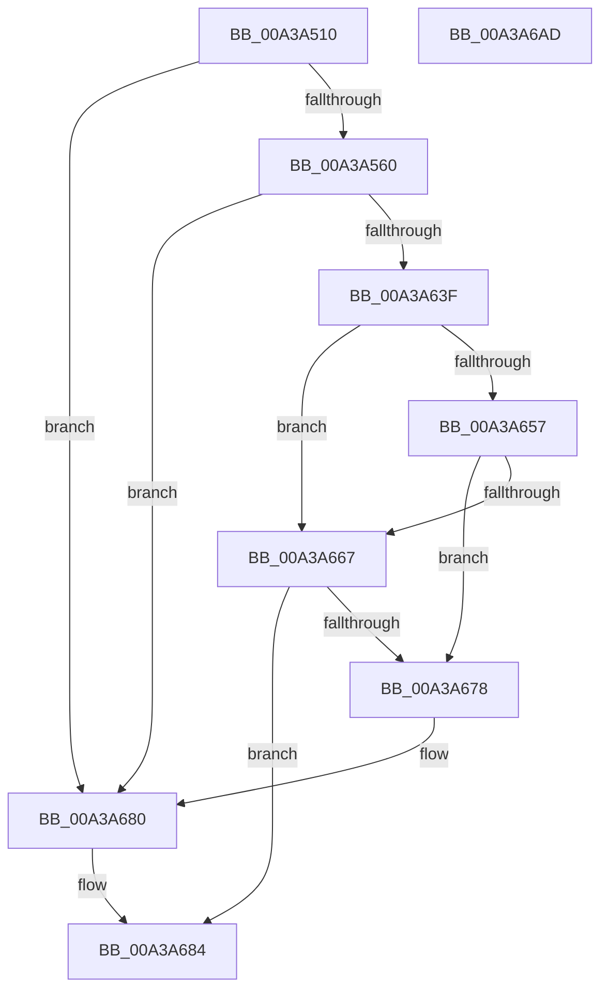

# SepCopyAnonymousTokenAndSetSilo

- RVA: `0x00A3A510`–`0x00A3A6AE` (길이 `414` bytes)
- VA: `0x0000000140A3A510`
- 실행 섹션: `PAGE`
- PDB 이름 있음: `예`; PDB Function 태그: `아니요`
- unwind 정보 RVA: `0x000AE110`
- 디코드: `103`개 명령, `414/414` bytes 표시
- 미해석 바이트: `0` (있으면 어셈블리에 `.byte`로 보존)

> 이 문서는 커널 이미지의 기계어와 PDB 기호를 분석해 생성했습니다. 4번과 5번은 함수 원형과 자료형을 바이너리 사용 방식에서 추정한 C 해석이며 원본 소스 복구 결과는 아닙니다.

## 1. Dependencies

- 직접 호출 지점: **14**; 고유 호출 대상: **13**
- 직접 호출자로 확인된 함수: **1**
- RIP 상대 이미지 참조: **4**

### Outgoing calls
- `0x00A3A551` → [SepGetAnonymousToken](../../text/30/SepGetAnonymousToken_function_00301830.md) (function, `0x00301830`)
- `0x00A3A56D` → [memset](../../text/6C/memset_function_006C6C40.md) (function, `0x006C6C40`)
- `0x00A3A57E` → [memset](../../text/6C/memset_function_006C6C40.md) (function, `0x006C6C40`)
- `0x00A3A5C0` → [SeCreateAccessState](../8C/SeCreateAccessState_function_008C6AC0.md) (function, `0x008C6AC0`)
- `0x00A3A5E8` → [ObFastDereferenceObject](../../text/3E/ObFastDereferenceObject_function_003ED5F0.md) (function, `0x003ED5F0`)
- `0x00A3A5F6` → [ObfReferenceObjectWithTag](../../text/21/ObfReferenceObjectWithTag_function_00210710.md) (function, `0x00210710`)
- `0x00A3A62A` → [ObInsertObjectEx](../8B/ObInsertObjectEx_function_008B97A0.md) (function, `0x008B97A0`)
- `0x00A3A636` → [SeDeleteAccessState](../8C/SeDeleteAccessState_function_008C5F70.md) (function, `0x008C5F70`)
- `0x00A3A642` → [SepFinalizeTokenAcls](../8B/SepFinalizeTokenAcls_function_008B63F4.md) (function, `0x008B63F4`)
- `0x00A3A64D` → [PsGetServerSiloServiceSessionId](../../text/45/PsGetServerSiloServiceSessionId_function_0045ED00.md) (function, `0x0045ED00`)
- `0x00A3A65C` → [SeSetSessionIdToken](../AF/SeSetSessionIdToken_function_00AF1F0C.md) (function, `0x00AF1F0C`)
- `0x00A3A66D` → [SepSetServerSiloToken](../79/SepSetServerSiloToken_function_0079D2A8.md) (function, `0x0079D2A8`)
- `0x00A3A67B` → [ObfDereferenceObject](../../text/2F/ObfDereferenceObject_function_002F9350.md) (function, `0x002F9350`)
- `0x00A3A690` → [_security_check_cookie](../../text/6A/_security_check_cookie_function_006AC640.md) (function, `0x006AC640`)

### Direct callers
- [NtImpersonateAnonymousToken](NtImpersonateAnonymousToken_function_00A3A150.md) at `0x00A3A28F`

### Static image references
- `0x00A3A52D` → RVA `0x00E0A740` (`.data`; read)
- `0x00A3A5A7` → RVA `0x00FC6E4C` (`ALMOSTRO`; read)
- `0x00A3A5B1` → RVA `0x00FC7800` (`ALMOSTRO`; read)
- `0x00A3A5ED` → RVA `0x00FD9D80` (`PAGEDATA`; read)

## 2. Other-region calls and transfers

- 다른 실행 섹션으로 향하는 call: **8**
  - `0x00A3A551` → [SepGetAnonymousToken](../../text/30/SepGetAnonymousToken_function_00301830.md) (`PAGE` → `.text`)
  - `0x00A3A56D` → [memset](../../text/6C/memset_function_006C6C40.md) (`PAGE` → `.text`)
  - `0x00A3A57E` → [memset](../../text/6C/memset_function_006C6C40.md) (`PAGE` → `.text`)
  - `0x00A3A5E8` → [ObFastDereferenceObject](../../text/3E/ObFastDereferenceObject_function_003ED5F0.md) (`PAGE` → `.text`)
  - `0x00A3A5F6` → [ObfReferenceObjectWithTag](../../text/21/ObfReferenceObjectWithTag_function_00210710.md) (`PAGE` → `.text`)
  - `0x00A3A64D` → [PsGetServerSiloServiceSessionId](../../text/45/PsGetServerSiloServiceSessionId_function_0045ED00.md) (`PAGE` → `.text`)
  - `0x00A3A67B` → [ObfDereferenceObject](../../text/2F/ObfDereferenceObject_function_002F9350.md) (`PAGE` → `.text`)
  - `0x00A3A690` → [_security_check_cookie](../../text/6A/_security_check_cookie_function_006AC640.md) (`PAGE` → `.text`)
- 별도 외부 분기/꼬리 이동을 확인하지 못했습니다.

## 3. Assembly (complete function range)

```asm
00A3A510  48 89 5C 24 18                  mov qword ptr [rsp + 0x18], rbx
00A3A515  48 89 74 24 20                  mov qword ptr [rsp + 0x20], rsi
00A3A51A  55                              push rbp
00A3A51B  57                              push rdi
00A3A51C  41 56                           push r14
00A3A51E  48 8D AC 24 20 FF FF FF         lea rbp, [rsp - 0xe0]
00A3A526  48 81 EC E0 01 00 00            sub rsp, 0x1e0
00A3A52D  48 8B 05 0C 02 3D 00            mov rax, qword ptr [rip + 0x3d020c]
00A3A534  48 33 C4                        xor rax, rsp
00A3A537  48 89 85 D0 00 00 00            mov qword ptr [rbp + 0xd0], rax
00A3A53E  48 83 64 24 40 00               and qword ptr [rsp + 0x40], 0
00A3A544  48 8B DA                        mov rbx, rdx
00A3A547  4C 8B F1                        mov r14, rcx
00A3A54A  48 8D 54 24 40                  lea rdx, [rsp + 0x40]
00A3A54F  33 C9                           xor ecx, ecx
00A3A551  E8 DA 72 8C FF                  call 0x140301830
00A3A556  8B F8                           mov edi, eax
00A3A558  85 C0                           test eax, eax
00A3A55A  0F 88 20 01 00 00               js 0x140a3a680
00A3A560  33 D2                           xor edx, edx
00A3A562  48 8D 4C 24 50                  lea rcx, [rsp + 0x50]
00A3A567  41 B8 A0 00 00 00               mov r8d, 0xa0
00A3A56D  E8 CE C6 C8 FF                  call 0x1406c6c40
00A3A572  33 D2                           xor edx, edx
00A3A574  48 8D 4D F0                     lea rcx, [rbp - 0x10]
00A3A578  41 B8 E0 00 00 00               mov r8d, 0xe0
00A3A57E  E8 BD C6 C8 FF                  call 0x1406c6c40
00A3A583  48 8B 4C 24 40                  mov rcx, qword ptr [rsp + 0x40]
00A3A588  48 8D 55 F0                     lea rdx, [rbp - 0x10]
00A3A58C  45 33 C0                        xor r8d, r8d
00A3A58F  48 8D 41 D0                     lea rax, [rcx - 0x30]
00A3A593  48 C1 E8 08                     shr rax, 8
00A3A597  44 0F B6 C8                     movzx r9d, al
00A3A59B  0F B6 41 E8                     movzx eax, byte ptr [rcx - 0x18]
00A3A59F  48 8D 4C 24 50                  lea rcx, [rsp + 0x50]
00A3A5A4  4C 33 C8                        xor r9, rax
00A3A5A7  0F B6 05 9E C8 58 00            movzx eax, byte ptr [rip + 0x58c89e]
00A3A5AE  4C 33 C8                        xor r9, rax
00A3A5B1  48 8D 05 48 D2 58 00            lea rax, [rip + 0x58d248]
00A3A5B8  4E 8B 0C C8                     mov r9, qword ptr [rax + r9*8]
00A3A5BC  49 83 C1 4C                     add r9, 0x4c
00A3A5C0  E8 FB C4 E8 FF                  call 0x1408c6ac0
00A3A5C5  65 48 8B 04 25 88 01 00 00      mov rax, qword ptr gs:[0x188]
00A3A5CE  BF 53 65 53 75                  mov edi, 0x75536553
00A3A5D3  48 8B 55 80                     mov rdx, qword ptr [rbp - 0x80]
00A3A5D7  44 8B C7                        mov r8d, edi
00A3A5DA  48 8B 88 B8 00 00 00            mov rcx, qword ptr [rax + 0xb8]
00A3A5E1  48 81 C1 48 02 00 00            add rcx, 0x248
00A3A5E8  E8 03 30 9B FF                  call 0x1403ed5f0
00A3A5ED  48 8B 0D 8C F7 59 00            mov rcx, qword ptr [rip + 0x59f78c]
00A3A5F4  8B D7                           mov edx, edi
00A3A5F6  E8 15 61 7D FF                  call 0x140210710
00A3A5FB  48 8B 05 7E F7 59 00            mov rax, qword ptr [rip + 0x59f77e]
00A3A602  48 8D 54 24 50                  lea rdx, [rsp + 0x50]
00A3A607  48 83 64 24 30 00               and qword ptr [rsp + 0x30], 0
00A3A60D  45 33 C9                        xor r9d, r9d
00A3A610  48 8B 74 24 40                  mov rsi, qword ptr [rsp + 0x40]
00A3A615  45 33 C0                        xor r8d, r8d
00A3A618  48 83 64 24 28 00               and qword ptr [rsp + 0x28], 0
00A3A61E  48 8B CE                        mov rcx, rsi
00A3A621  83 64 24 20 00                  and dword ptr [rsp + 0x20], 0
00A3A626  48 89 45 80                     mov qword ptr [rbp - 0x80], rax
00A3A62A  E8 71 F1 E7 FF                  call 0x1408b97a0
00A3A62F  48 8D 4C 24 50                  lea rcx, [rsp + 0x50]
00A3A634  8B F8                           mov edi, eax
00A3A636  E8 35 B9 E8 FF                  call 0x1408c5f70
00A3A63B  85 FF                           test edi, edi
00A3A63D  78 41                           js 0x140a3a680
00A3A63F  48 8B CE                        mov rcx, rsi
00A3A642  E8 AD BD E7 FF                  call 0x1408b63f4
00A3A647  49 8B CE                        mov rcx, r14
00A3A64A  48 89 33                        mov qword ptr [rbx], rsi
00A3A64D  E8 AE 46 A2 FF                  call 0x14045ed00
00A3A652  83 F8 FF                        cmp eax, -1
00A3A655  74 10                           je 0x140a3a667
00A3A657  8B D0                           mov edx, eax
00A3A659  48 8B CE                        mov rcx, rsi
00A3A65C  E8 AB 78 0B 00                  call 0x140af1f0c
00A3A661  8B F8                           mov edi, eax
00A3A663  85 C0                           test eax, eax
00A3A665  78 11                           js 0x140a3a678
00A3A667  48 8B 0B                        mov rcx, qword ptr [rbx]
00A3A66A  49 8B D6                        mov rdx, r14
00A3A66D  E8 36 2C D6 FF                  call 0x14079d2a8
00A3A672  8B F8                           mov edi, eax
00A3A674  85 C0                           test eax, eax
00A3A676  79 0C                           jns 0x140a3a684
00A3A678  48 8B 0B                        mov rcx, qword ptr [rbx]
00A3A67B  E8 D0 EC 8B FF                  call 0x1402f9350
00A3A680  48 83 23 00                     and qword ptr [rbx], 0
00A3A684  8B C7                           mov eax, edi
00A3A686  48 8B 8D D0 00 00 00            mov rcx, qword ptr [rbp + 0xd0]
00A3A68D  48 33 CC                        xor rcx, rsp
00A3A690  E8 AB 1F C7 FF                  call 0x1406ac640
00A3A695  4C 8D 9C 24 E0 01 00 00         lea r11, [rsp + 0x1e0]
00A3A69D  49 8B 5B 30                     mov rbx, qword ptr [r11 + 0x30]
00A3A6A1  49 8B 73 38                     mov rsi, qword ptr [r11 + 0x38]
00A3A6A5  49 8B E3                        mov rsp, r11
00A3A6A8  41 5E                           pop r14
00A3A6AA  5F                              pop rdi
00A3A6AB  5D                              pop rbp
00A3A6AC  C3                              ret
00A3A6AD  CC                              int3
```

## 4. C-style interpretation (structured pseudocode)

```c
__int64 __fastcall SepCopyAnonymousTokenAndSetSilo(__int64 a1, __int64 a2)
{
    __int64 result;
    __int64 v_rsp;
    unsigned __int64 v_stack_m108;
    unsigned __int64 v_stack_m178;
    unsigned __int64 v_stack_m18;
    unsigned __int64 v_stack_m1A8;
    unsigned __int64 v_stack_m1B8;
    unsigned __int64 v_stack_m1C8;
    unsigned __int64 v_stack_m1D0;
    unsigned int v_stack_m1D8;
    unsigned __int64 v_stack_m28;
    unsigned __int64 v_stack_mF8;
    unsigned __int64 v_stack_p18;
    unsigned __int64 v_stack_p20;

    v_stack_p18 = v_rbx;
    v_stack_p20 = v_rsi;
    v_rsp = (v_rsp) - (480);
    result = (*(unsigned __int64 *)(v_rip + 3998220)) ^ (v_rsp);
    v_stack_m28 = result;
    a1 = 0;
    result = SepGetAnonymousToken(a1, v_stack_m1B8, a3, a4);
    if (sign_flag) goto loc_00A3A680;
    a2 = 0;
    result = memset(v_stack_m1A8, a2, 160, a4);
    a2 = 0;
    result = memset(v_stack_m108, a2, 224, a4);
    a3 = 0;
    result = (v_stack_m1B8 - 48) >> (8);
    a4 = ((unsigned __int8)(result)) ^ (*(unsigned __int8 *)(v_stack_m1B8 - 24));
    a4 = (a4) ^ (*(unsigned __int8 *)(v_rip + 5818526));
    a4 = (*(unsigned __int64 *)(v_rip + 5821000 + a4 * 8)) + (76);
    result = SeCreateAccessState(v_stack_m1A8, v_stack_m108, a3, a4);
    a1 = (*(unsigned __int64 *)(*(unsigned __int64 *)(gs_base + (0 + 392)) + 184)) + (584);
    result = ObFastDereferenceObject(a1, v_stack_m178, (unsigned int)((unsigned int)((unsigned int)(0x75536553ULL))), a4);
    result = ObfReferenceObjectWithTag(*(unsigned __int64 *)(v_rip + 5896076), (unsigned int)((unsigned int)((unsigned int)(0x75536553ULL))), (unsigned int)((unsigned int)((unsigned int)(0x75536553ULL))), a4);
    a4 = 0;
    a3 = 0;
    v_stack_m178 = *(unsigned __int64 *)(v_rip + 5896062);
    result = ObInsertObjectEx(v_stack_m1B8, v_stack_m1A8, a3, a4);
    result = SeDeleteAccessState(v_stack_m1A8, v_stack_m1A8, a3, a4);
    if (sign_flag) goto loc_00A3A680;
    result = SepFinalizeTokenAcls(v_stack_m1B8, v_stack_m1A8, a3, a4);
    *(unsigned __int64 *)(a2) = v_stack_m1B8;
    result = PsGetServerSiloServiceSessionId(a1, v_stack_m1A8, a3, a4);
    if (((unsigned int)(result)) == -1) goto loc_00A3A667;
    result = SeSetSessionIdToken(v_stack_m1B8, (unsigned int)((unsigned int)(result)), a3, a4);
    if (sign_flag) goto loc_00A3A678;
loc_00A3A667:
    result = SepSetServerSiloToken(*(unsigned __int64 *)(a2), a1, a3, a4);
    if (!sign_flag) goto loc_00A3A684;
loc_00A3A678:
    result = ObfDereferenceObject(*(unsigned __int64 *)(a2), a1, a3, a4);
loc_00A3A680:
loc_00A3A684:
    a1 = (v_stack_m28) ^ (v_rsp);
    result = _security_check_cookie(a1, a1, a3, a4);
    return result;
}
```

## 5. (Beta) C Style

```c
int64_t SepCopyAnonymousTokenAndSetSilo(int64_t Arg1, void *Arg2)
{
    uint8_t *arg2 = (uint8_t *)Arg2;

    int64_t result;
    int64_t local_rsp;
    uint64_t v_stack_m108;
    uint64_t v_stack_m178;
    uint64_t v_stack_m18;
    uint64_t v_stack_m1A8;
    uint64_t v_stack_m1B8;
    uint64_t v_stack_m1C8;
    uint64_t v_stack_m1D0;
    uint32_t v_stack_m1D8;
    uint64_t v_stack_m28;
    uint64_t v_stack_mF8;
    uint64_t v_stack_p18;
    uint64_t v_stack_p20;

    v_stack_p18 = local_rbx;
    v_stack_p20 = local_rsi;
    local_rsp = (local_rsp) - (480);
    result = (*(uint64_t *)(v_rip + 0x3D020C)) ^ (local_rsp);
    v_stack_m28 = result;
    Arg1 = 0;
    result = SepGetAnonymousToken(Arg1, v_stack_m1B8, a3, a4);
    if (sign_flag) goto loc_00A3A680;
    Arg2 = 0;
    result = memset(v_stack_m1A8, Arg2, 160, a4);
    Arg2 = 0;
    result = memset(v_stack_m108, Arg2, 224, a4);
    a3 = 0;
    result = (v_stack_m1B8 - 48) >> (8);
    a4 = ((uint8_t)(result)) ^ (*(uint8_t *)(v_stack_m1B8 - 0x18));
    a4 = (a4) ^ (*(uint8_t *)(v_rip + 0x58C89E));
    a4 = (*(uint64_t *)(v_rip + 0x58D248 + a4 * 8)) + (76);
    result = SeCreateAccessState(v_stack_m1A8, v_stack_m108, a3, a4);
    Arg1 = (*(uint64_t *)(*(uint64_t *)(gs_base + (0 + 0x188)) + 0xB8)) + (584);
    result = ObFastDereferenceObject(Arg1, v_stack_m178, (uint32_t)((uint32_t)((uint32_t)(0x75536553ULL))), a4);
    result = ObfReferenceObjectWithTag(*(uint64_t *)(v_rip + 0x59F78C), (uint32_t)((uint32_t)((uint32_t)(0x75536553ULL))), (uint32_t)((uint32_t)((uint32_t)(0x75536553ULL))), a4);
    a4 = 0;
    a3 = 0;
    v_stack_m178 = *(uint64_t *)(v_rip + 0x59F77E);
    result = ObInsertObjectEx(v_stack_m1B8, v_stack_m1A8, a3, a4);
    result = SeDeleteAccessState(v_stack_m1A8, v_stack_m1A8, a3, a4);
    if (sign_flag) goto loc_00A3A680;
    result = SepFinalizeTokenAcls(v_stack_m1B8, v_stack_m1A8, a3, a4);
    *(uint64_t *)(arg2) = v_stack_m1B8;
    result = PsGetServerSiloServiceSessionId(Arg1, v_stack_m1A8, a3, a4);
    if (((uint32_t)(result)) == -1) goto loc_00A3A667;
    result = SeSetSessionIdToken(v_stack_m1B8, (uint32_t)((uint32_t)(result)), a3, a4);
    if (sign_flag) goto loc_00A3A678;
loc_00A3A667:
    result = SepSetServerSiloToken(*(uint64_t *)(arg2), Arg1, a3, a4);
    if (!sign_flag) goto loc_00A3A684;
loc_00A3A678:
    result = ObfDereferenceObject(*(uint64_t *)(arg2), Arg1, a3, a4);
loc_00A3A680:
loc_00A3A684:
    Arg1 = (v_stack_m28) ^ (local_rsp);
    result = _security_check_cookie(Arg1, Arg1, a3, a4);
    return result;
}
```

### 관측된 메모리 오프셋

구조체 형식이 확인되지 않은 접근은 인자 기준의 오프셋으로만 기록했습니다.

| 기준 인자 | 오프셋 표현 | 폭 (bit) | 접근 |
|---|---:|---:|---|
| `Arg2` | `+ 0x0` | `64` | `R` |
| `Arg2` | `+ 0x0` | `64` | `R/W` |
| `Arg2` | `+ 0x0` | `64` | `W` |

## 6. Execution-region graph

[열기: 2D/3D 그래프와 함수 탐색 컨트롤 패널](../../../control-panel.html?section=page&rva=0x00A3A510&view=graph)

- 2D 그래프는 위에서 아래로 흐르고, 3D 그래프는 빈 공간을 드래그해 회전합니다. Shift+드래그는 이동, 휠은 확대·축소, 함수 노드 선택은 대상 보고서 이동입니다.

### Static fallback


