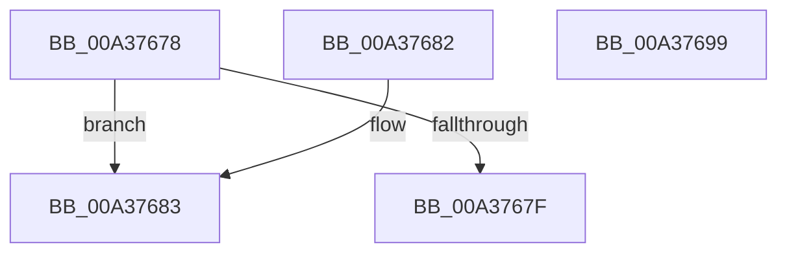

# SepIdAssignableAsOwner

- RVA: `0x00A37678`–`0x00A3769A` (길이 `34` bytes)
- VA: `0x0000000140A37678`
- 실행 섹션: `PAGE`
- PDB 이름 있음: `예`; PDB Function 태그: `아니요`
- unwind 정보 RVA: `0x000DB714`
- 디코드: `14`개 명령, `34/34` bytes 표시
- 미해석 바이트: `0` (있으면 어셈블리에 `.byte`로 보존)

> 이 문서는 커널 이미지의 기계어와 PDB 기호를 분석해 생성했습니다. 4번과 5번은 함수 원형과 자료형을 바이너리 사용 방식에서 추정한 C 해석이며 원본 소스 복구 결과는 아닙니다.

## 1. Dependencies

- 직접 호출 지점: **0**; 고유 호출 대상: **0**
- 직접 호출자로 확인된 함수: **2**
- RIP 상대 이미지 참조: **0**

### Outgoing calls
- 직접 디코드된 call 명령이 없습니다.

### Direct callers
- [SepValidOwnerSubjectContext](SepValidOwnerSubjectContext_function_00A37568.md) at `0x00A37607`
- [NtSetInformationToken](../AF/NtSetInformationToken_function_00AF0530.md) at `0x00AF0B77`

### Static image references
- 디코드된 RIP-relative 메모리 참조가 없습니다.

## 2. Other-region calls and transfers

- 다른 실행 섹션으로 향하는 call: **0**
- 별도 외부 분기/꼬리 이동을 확인하지 못했습니다.

## 3. Assembly (complete function range)

```asm
00A37678  48 8B C1                        mov rax, rcx
00A3767B  85 D2                           test edx, edx
00A3767D  75 04                           jne 0x140a37683
00A3767F  B0 01                           mov al, 1
00A37681  C3                              ret
00A37682  CC                              int3
00A37683  48 8B 80 98 00 00 00            mov rax, qword ptr [rax + 0x98]
00A3768A  8B CA                           mov ecx, edx
00A3768C  48 03 C9                        add rcx, rcx
00A3768F  8B 44 C8 08                     mov eax, dword ptr [rax + rcx*8 + 8]
00A37693  C1 E8 03                        shr eax, 3
00A37696  24 01                           and al, 1
00A37698  C3                              ret
00A37699  CC                              int3
```

## 4. C-style interpretation (structured pseudocode)

```c
__int64 __fastcall SepIdAssignableAsOwner(__int64 a1, int a2)
{
    __int64 result;

    if (a2 != 0) goto loc_00A37683;
    return 1;
loc_00A37683:
    a1 = ((unsigned int)(a2)) + ((unsigned int)(a2));
    result = (unsigned int)(((unsigned int)(*(unsigned int *)(*(unsigned __int64 *)(1 + 152) + a1 * 8 + 8))) >> (3));
    result = (unsigned __int8)((result) & (1));
    return result;
}
```

## 5. (Beta) C Style

```c
int64_t SepIdAssignableAsOwner(void *Arg1, int32_t Arg2)
{
    uint8_t *arg1 = (uint8_t *)Arg1;

    int64_t result;

    if (Arg2 != 0) goto loc_00A37683;
    return 1;
loc_00A37683:
    Arg1 = ((uint32_t)(Arg2)) + ((uint32_t)(Arg2));
    result = (uint32_t)(((uint32_t)(*(uint32_t *)(*(uint64_t *)(1 + 0x98) + arg1 * 8 + 0x8))) >> (3));
    result = (uint8_t)((result) & (1));
    return result;
}
```

### 관측된 메모리 오프셋

구조체 형식이 확인되지 않은 접근은 인자 기준의 오프셋으로만 기록했습니다.

| 기준 인자 | 오프셋 표현 | 폭 (bit) | 접근 |
|---|---:|---:|---|
| `Arg1` | `+ 0x98` | `64` | `R` |

## 6. Execution-region graph

[열기: 2D/3D 그래프와 함수 탐색 컨트롤 패널](../../../control-panel.html?section=page&rva=0x00A37678&view=graph)

- 2D 그래프는 위에서 아래로 흐르고, 3D 그래프는 빈 공간을 드래그해 회전합니다. Shift+드래그는 이동, 휠은 확대·축소, 함수 노드 선택은 대상 보고서 이동입니다.

### Static fallback


