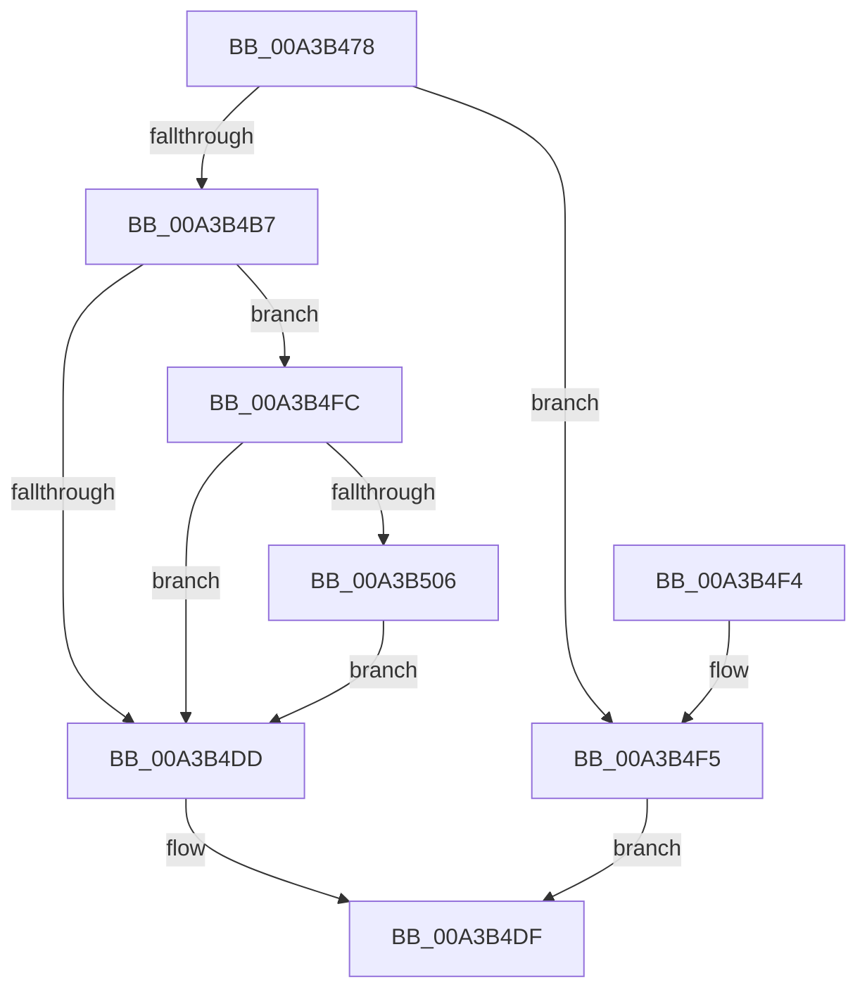

# SepIsChildTokenByPointer

- RVA: `0x00A3B478`–`0x00A3B50B` (길이 `147` bytes)
- VA: `0x0000000140A3B478`
- 실행 섹션: `PAGE`
- PDB 이름 있음: `예`; PDB Function 태그: `아니요`
- unwind 정보 RVA: `0x000AE33C`
- 디코드: `39`개 명령, `147/147` bytes 표시
- 미해석 바이트: `0` (있으면 어셈블리에 `.byte`로 보존)

> 이 문서는 커널 이미지의 기계어와 PDB 기호를 분석해 생성했습니다. 4번과 5번은 함수 원형과 자료형을 바이너리 사용 방식에서 추정한 C 해석이며 원본 소스 복구 결과는 아닙니다.

## 1. Dependencies

- 직접 호출 지점: **2**; 고유 호출 대상: **2**
- 직접 호출자로 확인된 함수: **1**
- RIP 상대 이미지 참조: **0**

### Outgoing calls
- `0x00A3B4AD` → [PsReferencePrimaryTokenWithTag](../../text/20/PsReferencePrimaryTokenWithTag_function_0020FF80.md) (function, `0x0020FF80`)
- `0x00A3B4D0` → [ObFastDereferenceObject](../../text/3E/ObFastDereferenceObject_function_003ED5F0.md) (function, `0x003ED5F0`)

### Direct callers
- [SeIsTokenAssignableToProcess](SeIsTokenAssignableToProcess_function_00A3B2C0.md) at `0x00A3B40A`

### Static image references
- 디코드된 RIP-relative 메모리 참조가 없습니다.

## 2. Other-region calls and transfers

- 다른 실행 섹션으로 향하는 call: **2**
  - `0x00A3B4AD` → [PsReferencePrimaryTokenWithTag](../../text/20/PsReferencePrimaryTokenWithTag_function_0020FF80.md) (`PAGE` → `.text`)
  - `0x00A3B4D0` → [ObFastDereferenceObject](../../text/3E/ObFastDereferenceObject_function_003ED5F0.md) (`PAGE` → `.text`)
- 별도 외부 분기/꼬리 이동을 확인하지 못했습니다.

## 3. Assembly (complete function range)

```asm
00A3B478  48 89 5C 24 08                  mov qword ptr [rsp + 8], rbx
00A3B47D  48 89 6C 24 18                  mov qword ptr [rsp + 0x18], rbp
00A3B482  48 89 74 24 20                  mov qword ptr [rsp + 0x20], rsi
00A3B487  57                              push rdi
00A3B488  48 83 EC 20                     sub rsp, 0x20
00A3B48C  65 48 8B 04 25 88 01 00 00      mov rax, qword ptr gs:[0x188]
00A3B495  48 8B FA                        mov rdi, rdx
00A3B498  48 8B E9                        mov rbp, rcx
00A3B49B  C6 02 00                        mov byte ptr [rdx], 0
00A3B49E  BA 44 66 6C 74                  mov edx, 0x746c6644
00A3B4A3  48 8B B0 B8 00 00 00            mov rsi, qword ptr [rax + 0xb8]
00A3B4AA  48 8B CE                        mov rcx, rsi
00A3B4AD  E8 CE 4A 7D FF                  call 0x14020ff80
00A3B4B2  48 85 C0                        test rax, rax
00A3B4B5  74 3E                           je 0x140a3b4f5
00A3B4B7  48 8B 58 10                     mov rbx, qword ptr [rax + 0x10]
00A3B4BB  48 8D 8E 48 02 00 00            lea rcx, [rsi + 0x248]
00A3B4C2  41 B8 44 66 6C 74               mov r8d, 0x746c6644
00A3B4C8  48 89 5C 24 38                  mov qword ptr [rsp + 0x38], rbx
00A3B4CD  48 8B D0                        mov rdx, rax
00A3B4D0  E8 1B 21 9B FF                  call 0x1403ed5f0
00A3B4D5  48 8B 45 20                     mov rax, qword ptr [rbp + 0x20]
00A3B4D9  3B C3                           cmp eax, ebx
00A3B4DB  74 1F                           je 0x140a3b4fc
00A3B4DD  33 C0                           xor eax, eax
00A3B4DF  48 8B 5C 24 30                  mov rbx, qword ptr [rsp + 0x30]
00A3B4E4  48 8B 6C 24 40                  mov rbp, qword ptr [rsp + 0x40]
00A3B4E9  48 8B 74 24 48                  mov rsi, qword ptr [rsp + 0x48]
00A3B4EE  48 83 C4 20                     add rsp, 0x20
00A3B4F2  5F                              pop rdi
00A3B4F3  C3                              ret
00A3B4F4  CC                              int3
00A3B4F5  B8 01 00 00 C0                  mov eax, 0xc0000001
00A3B4FA  EB E3                           jmp 0x140a3b4df
00A3B4FC  48 C1 E8 20                     shr rax, 0x20
00A3B500  3B 44 24 3C                     cmp eax, dword ptr [rsp + 0x3c]
00A3B504  75 D7                           jne 0x140a3b4dd
00A3B506  C6 07 01                        mov byte ptr [rdi], 1
00A3B509  EB D2                           jmp 0x140a3b4dd
```

## 4. C-style interpretation (structured pseudocode)

```c
__int64 __fastcall SepIsChildTokenByPointer(__int64 a1, __int64 a2)
{
    __int64 result;
    __int64 v_rsp;
    unsigned __int64 v_stack_p10;
    unsigned __int64 v_stack_p18;
    unsigned __int64 v_stack_p20;
    unsigned int v_stack_p3C;
    unsigned __int64 v_stack_p8;

    v_stack_p8 = v_rbx;
    v_stack_p18 = v_rbp;
    v_stack_p20 = v_rsi;
    v_rsp = (v_rsp) - (32);
    *(unsigned __int8 *)(a2) = 0;
    result = PsReferencePrimaryTokenWithTag(*(unsigned __int64 *)(*(unsigned __int64 *)(gs_base + (0 + 392)) + 184), (unsigned int)(0x746C6644ULL), a3, a4);
    if (result == 0) goto loc_00A3B4F5;
    v_stack_p10 = *(unsigned __int64 *)(result + 16);
    result = ObFastDereferenceObject(*(unsigned __int64 *)(*(unsigned __int64 *)(gs_base + (0 + 392)) + 184) + 584, result, (unsigned int)(0x746C6644ULL), a4);
    if (((unsigned int)(*(unsigned __int64 *)(a1 + 32))) == ((unsigned int)(*(unsigned __int64 *)(result + 16)))) goto loc_00A3B4FC;
loc_00A3B4DD:
    result = 0;
loc_00A3B4DF:
    v_rsp = (v_rsp) + (32);
    return result;
loc_00A3B4F5:
    goto loc_00A3B4DF;
loc_00A3B4FC:
    result = ((unsigned int)(0xC0000001ULL)) >> (32);
    if (((unsigned int)(result)) != v_stack_p3C) goto loc_00A3B4DD;
    *(unsigned __int8 *)(a2) = 1;
    goto loc_00A3B4DD;
}
```

## 5. (Beta) C Style

```c
int64_t SepIsChildTokenByPointer(void *Arg1, void *Arg2)
{
    uint8_t *arg1 = (uint8_t *)Arg1;
    uint8_t *arg2 = (uint8_t *)Arg2;

    int64_t result;
    int64_t local_rsp;
    uint64_t v_stack_p10;
    uint64_t v_stack_p18;
    uint64_t v_stack_p20;
    uint32_t v_stack_p3C;
    uint64_t v_stack_p8;

    v_stack_p8 = local_rbx;
    v_stack_p18 = local_rbp;
    v_stack_p20 = local_rsi;
    local_rsp = (local_rsp) - (32);
    *(uint8_t *)(arg2) = 0;
    result = PsReferencePrimaryTokenWithTag(*(uint64_t *)(*(uint64_t *)(gs_base + (0 + 0x188)) + 0xB8), (uint32_t)(0x746C6644ULL), a3, a4);
    if (result == 0) goto loc_00A3B4F5;
    v_stack_p10 = *(uint64_t *)(result + 0x10);
    result = ObFastDereferenceObject(*(uint64_t *)(*(uint64_t *)(gs_base + (0 + 0x188)) + 0xB8) + 584, result, (uint32_t)(0x746C6644ULL), a4);
    if (((uint32_t)(*(uint64_t *)(arg1 + 0x20))) == ((uint32_t)(*(uint64_t *)(result + 0x10)))) goto loc_00A3B4FC;
loc_00A3B4DD:
    result = 0;
loc_00A3B4DF:
    local_rsp = (local_rsp) + (32);
    return result;
loc_00A3B4F5:
    goto loc_00A3B4DF;
loc_00A3B4FC:
    result = ((uint32_t)(0xC0000001ULL)) >> (32);
    if (((uint32_t)(result)) != v_stack_p3C) goto loc_00A3B4DD;
    *(uint8_t *)(arg2) = 1;
    goto loc_00A3B4DD;
}
```

### 관측된 메모리 오프셋

구조체 형식이 확인되지 않은 접근은 인자 기준의 오프셋으로만 기록했습니다.

| 기준 인자 | 오프셋 표현 | 폭 (bit) | 접근 |
|---|---:|---:|---|
| `Arg1` | `+ 0x20` | `64` | `R` |
| `Arg2` | `+ 0x0` | `8` | `W` |

## 6. Execution-region graph

[열기: 2D/3D 그래프와 함수 탐색 컨트롤 패널](../../../control-panel.html?section=page&rva=0x00A3B478&view=graph)

- 2D 그래프는 위에서 아래로 흐르고, 3D 그래프는 빈 공간을 드래그해 회전합니다. Shift+드래그는 이동, 휠은 확대·축소, 함수 노드 선택은 대상 보고서 이동입니다.

### Static fallback


