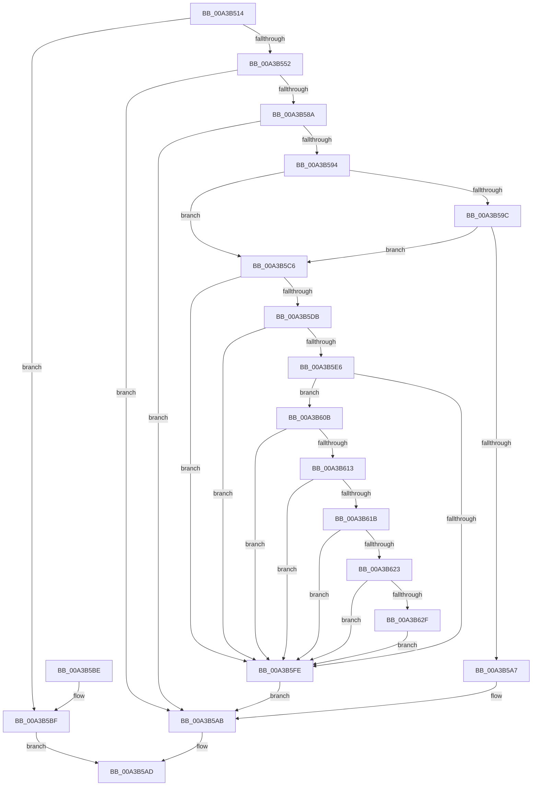

# SepIsSiblingTokenByPointer

- RVA: `0x00A3B514`–`0x00A3B635` (길이 `289` bytes)
- VA: `0x0000000140A3B514`
- 실행 섹션: `PAGE`
- PDB 이름 있음: `예`; PDB Function 태그: `아니요`
- unwind 정보 RVA: `0x000AE354`
- 디코드: `84`개 명령, `289/289` bytes 표시
- 미해석 바이트: `0` (있으면 어셈블리에 `.byte`로 보존)

> 이 문서는 커널 이미지의 기계어와 PDB 기호를 분석해 생성했습니다. 4번과 5번은 함수 원형과 자료형을 바이너리 사용 방식에서 추정한 C 해석이며 원본 소스 복구 결과는 아닙니다.

## 1. Dependencies

- 직접 호출 지점: **4**; 고유 호출 대상: **4**
- 직접 호출자로 확인된 함수: **1**
- RIP 상대 이미지 참조: **0**

### Outgoing calls
- `0x00A3B545` → [PsReferencePrimaryTokenWithTag](../../text/20/PsReferencePrimaryTokenWithTag_function_0020FF80.md) (function, `0x0020FF80`)
- `0x00A3B574` → [ObFastDereferenceObject](../../text/3E/ObFastDereferenceObject_function_003ED5F0.md) (function, `0x003ED5F0`)
- `0x00A3B5CC` → [SepAcquireOrderedReadLocks](../../text/21/SepAcquireOrderedReadLocks_function_00213BA0.md) (function, `0x00213BA0`)
- `0x00A3B604` → [SepReleaseOrderedReadLocks](../../text/45/SepReleaseOrderedReadLocks_function_0045C4C8.md) (function, `0x0045C4C8`)

### Direct callers
- [SeIsTokenAssignableToProcess](SeIsTokenAssignableToProcess_function_00A3B2C0.md) at `0x00A3B421`

### Static image references
- 디코드된 RIP-relative 메모리 참조가 없습니다.

## 2. Other-region calls and transfers

- 다른 실행 섹션으로 향하는 call: **4**
  - `0x00A3B545` → [PsReferencePrimaryTokenWithTag](../../text/20/PsReferencePrimaryTokenWithTag_function_0020FF80.md) (`PAGE` → `.text`)
  - `0x00A3B574` → [ObFastDereferenceObject](../../text/3E/ObFastDereferenceObject_function_003ED5F0.md) (`PAGE` → `.text`)
  - `0x00A3B5CC` → [SepAcquireOrderedReadLocks](../../text/21/SepAcquireOrderedReadLocks_function_00213BA0.md) (`PAGE` → `.text`)
  - `0x00A3B604` → [SepReleaseOrderedReadLocks](../../text/45/SepReleaseOrderedReadLocks_function_0045C4C8.md) (`PAGE` → `.text`)
- 별도 외부 분기/꼬리 이동을 확인하지 못했습니다.

## 3. Assembly (complete function range)

```asm
00A3B514  48 89 5C 24 08                  mov qword ptr [rsp + 8], rbx
00A3B519  55                              push rbp
00A3B51A  56                              push rsi
00A3B51B  57                              push rdi
00A3B51C  41 56                           push r14
00A3B51E  41 57                           push r15
00A3B520  48 83 EC 20                     sub rsp, 0x20
00A3B524  65 48 8B 04 25 88 01 00 00      mov rax, qword ptr gs:[0x188]
00A3B52D  4C 8B FA                        mov r15, rdx
00A3B530  4C 8B F1                        mov r14, rcx
00A3B533  C6 02 00                        mov byte ptr [rdx], 0
00A3B536  BA 44 66 6C 74                  mov edx, 0x746c6644
00A3B53B  48 8B B8 B8 00 00 00            mov rdi, qword ptr [rax + 0xb8]
00A3B542  48 8B CF                        mov rcx, rdi
00A3B545  E8 36 4A 7D FF                  call 0x14020ff80
00A3B54A  48 8B E8                        mov rbp, rax
00A3B54D  48 85 C0                        test rax, rax
00A3B550  74 6D                           je 0x140a3b5bf
00A3B552  48 8B 58 20                     mov rbx, qword ptr [rax + 0x20]
00A3B556  48 8D 8F 48 02 00 00            lea rcx, [rdi + 0x248]
00A3B55D  48 8B 70 18                     mov rsi, qword ptr [rax + 0x18]
00A3B561  41 B8 44 66 6C 74               mov r8d, 0x746c6644
00A3B567  48 8B D0                        mov rdx, rax
00A3B56A  48 89 5C 24 58                  mov qword ptr [rsp + 0x58], rbx
00A3B56F  48 89 74 24 60                  mov qword ptr [rsp + 0x60], rsi
00A3B574  E8 77 20 9B FF                  call 0x1403ed5f0
00A3B579  49 8B 46 20                     mov rax, qword ptr [r14 + 0x20]
00A3B57D  49 8B 7E 18                     mov rdi, qword ptr [r14 + 0x18]
00A3B581  48 89 7C 24 68                  mov qword ptr [rsp + 0x68], rdi
00A3B586  3B C3                           cmp eax, ebx
00A3B588  75 21                           jne 0x140a3b5ab
00A3B58A  48 C1 E8 20                     shr rax, 0x20
00A3B58E  3B 44 24 5C                     cmp eax, dword ptr [rsp + 0x5c]
00A3B592  75 17                           jne 0x140a3b5ab
00A3B594  8B 5C 24 64                     mov ebx, dword ptr [rsp + 0x64]
00A3B598  3B FE                           cmp edi, esi
00A3B59A  75 2A                           jne 0x140a3b5c6
00A3B59C  48 8B C7                        mov rax, rdi
00A3B59F  48 C1 E8 20                     shr rax, 0x20
00A3B5A3  3B C3                           cmp eax, ebx
00A3B5A5  75 1F                           jne 0x140a3b5c6
00A3B5A7  41 C6 07 01                     mov byte ptr [r15], 1
00A3B5AB  33 C0                           xor eax, eax
00A3B5AD  48 8B 5C 24 50                  mov rbx, qword ptr [rsp + 0x50]
00A3B5B2  48 83 C4 20                     add rsp, 0x20
00A3B5B6  41 5F                           pop r15
00A3B5B8  41 5E                           pop r14
00A3B5BA  5F                              pop rdi
00A3B5BB  5E                              pop rsi
00A3B5BC  5D                              pop rbp
00A3B5BD  C3                              ret
00A3B5BE  CC                              int3
00A3B5BF  B8 01 00 00 C0                  mov eax, 0xc0000001
00A3B5C4  EB E7                           jmp 0x140a3b5ad
00A3B5C6  49 8B D6                        mov rdx, r14
00A3B5C9  48 8B CD                        mov rcx, rbp
00A3B5CC  E8 CF 85 7D FF                  call 0x140213ba0
00A3B5D1  8B 85 C8 00 00 00               mov eax, dword ptr [rbp + 0xc8]
00A3B5D7  A8 20                           test al, 0x20
00A3B5D9  75 23                           jne 0x140a3b5fe
00A3B5DB  41 8B 86 C8 00 00 00            mov eax, dword ptr [r14 + 0xc8]
00A3B5E2  A8 20                           test al, 0x20
00A3B5E4  75 18                           jne 0x140a3b5fe
00A3B5E6  49 8B 96 D8 00 00 00            mov rdx, qword ptr [r14 + 0xd8]
00A3B5ED  48 8B 8D D8 00 00 00            mov rcx, qword ptr [rbp + 0xd8]
00A3B5F4  8B 42 28                        mov eax, dword ptr [rdx + 0x28]
00A3B5F7  23 41 28                        and eax, dword ptr [rcx + 0x28]
00A3B5FA  A8 40                           test al, 0x40
00A3B5FC  75 0D                           jne 0x140a3b60b
00A3B5FE  49 8B D6                        mov rdx, r14
00A3B601  48 8B CD                        mov rcx, rbp
00A3B604  E8 BF 0E A2 FF                  call 0x14045c4c8
00A3B609  EB A0                           jmp 0x140a3b5ab
00A3B60B  3B B2 B0 00 00 00               cmp esi, dword ptr [rdx + 0xb0]
00A3B611  75 EB                           jne 0x140a3b5fe
00A3B613  3B 9A B4 00 00 00               cmp ebx, dword ptr [rdx + 0xb4]
00A3B619  75 E3                           jne 0x140a3b5fe
00A3B61B  3B B9 B0 00 00 00               cmp edi, dword ptr [rcx + 0xb0]
00A3B621  75 DB                           jne 0x140a3b5fe
00A3B623  8B 81 B4 00 00 00               mov eax, dword ptr [rcx + 0xb4]
00A3B629  39 44 24 6C                     cmp dword ptr [rsp + 0x6c], eax
00A3B62D  75 CF                           jne 0x140a3b5fe
00A3B62F  41 C6 07 01                     mov byte ptr [r15], 1
00A3B633  EB C9                           jmp 0x140a3b5fe
```

## 4. C-style interpretation (structured pseudocode)

```c
__int64 __fastcall SepIsSiblingTokenByPointer(__int64 a1, __int64 a2)
{
    __int64 result;
    __int64 v_rsp;
    unsigned __int64 v_stack_p10;
    unsigned int v_stack_p14;
    unsigned __int64 v_stack_p18;
    unsigned int v_stack_p1C;
    unsigned __int64 v_stack_p20;
    unsigned int v_stack_p6C;
    unsigned __int64 v_stack_p8;

    v_stack_p8 = v_rbx;
    v_rsp = (v_rsp) - (32);
    *(unsigned __int8 *)(a2) = 0;
    result = PsReferencePrimaryTokenWithTag(*(unsigned __int64 *)(*(unsigned __int64 *)(gs_base + (0 + 392)) + 184), (unsigned int)(0x746C6644ULL), a3, a4);
    if (result == 0) goto loc_00A3B5BF;
    v_stack_p10 = *(unsigned __int64 *)(result + 32);
    v_stack_p18 = *(unsigned __int64 *)(result + 24);
    result = ObFastDereferenceObject(*(unsigned __int64 *)(*(unsigned __int64 *)(gs_base + (0 + 392)) + 184) + 584, result, (unsigned int)(0x746C6644ULL), a4);
    v_stack_p20 = *(unsigned __int64 *)(a1 + 24);
    if (((unsigned int)(*(unsigned __int64 *)(a1 + 32))) != ((unsigned int)(*(unsigned __int64 *)(result + 32)))) goto loc_00A3B5AB;
    result = (*(unsigned __int64 *)(a1 + 32)) >> (32);
    if (((unsigned int)(result)) != v_stack_p14) goto loc_00A3B5AB;
    if (((unsigned int)(*(unsigned __int64 *)(a1 + 24))) != ((unsigned int)(*(unsigned __int64 *)(result + 24)))) goto loc_00A3B5C6;
    result = (*(unsigned __int64 *)(a1 + 24)) >> (32);
    if (((unsigned int)(result)) != ((unsigned int)((unsigned int)(v_stack_p1C)))) goto loc_00A3B5C6;
    *(unsigned __int8 *)(a2) = 1;
loc_00A3B5AB:
    result = 0;
loc_00A3B5AD:
    v_rsp = (v_rsp) + (32);
    return result;
loc_00A3B5BF:
    goto loc_00A3B5AD;
loc_00A3B5C6:
    result = SepAcquireOrderedReadLocks(0, a1, (unsigned int)(0x746C6644ULL), a4);
    if ((((unsigned __int8)((unsigned int)(*(unsigned int *)(result + 200)))) & (32)) != 0) goto loc_00A3B5FE;
    if ((((unsigned __int8)((unsigned int)(*(unsigned int *)(a1 + 200)))) & (32)) != 0) goto loc_00A3B5FE;
    result = (unsigned int)(((unsigned int)(*(unsigned int *)(*(unsigned __int64 *)(a1 + 216) + 40))) & (*(unsigned int *)(*(unsigned __int64 *)(result + 216) + 40)));
    if ((((unsigned __int8)(result)) & (64)) != 0) goto loc_00A3B60B;
loc_00A3B5FE:
    result = SepReleaseOrderedReadLocks(result, a1, (unsigned int)(0x746C6644ULL), a4);
    goto loc_00A3B5AB;
loc_00A3B60B:
    if (((unsigned int)(*(unsigned __int64 *)(result + 24))) != (*(unsigned int *)(a1 + 176))) goto loc_00A3B5FE;
    if (((unsigned int)(v_stack_p8)) != (*(unsigned int *)(a1 + 180))) goto loc_00A3B5FE;
    if (((unsigned int)(*(unsigned __int64 *)(a1 + 24))) != (*(unsigned int *)(result + 176))) goto loc_00A3B5FE;
    if (v_stack_p6C != ((unsigned int)((unsigned int)(*(unsigned int *)(result + 180))))) goto loc_00A3B5FE;
    *(unsigned __int8 *)(a2) = 1;
    goto loc_00A3B5FE;
}
```

## 5. (Beta) C Style

```c
int64_t SepIsSiblingTokenByPointer(void *Arg1, void *Arg2)
{
    uint8_t *arg1 = (uint8_t *)Arg1;
    uint8_t *arg2 = (uint8_t *)Arg2;

    int64_t result;
    int64_t local_rsp;
    uint64_t v_stack_p10;
    uint32_t v_stack_p14;
    uint64_t v_stack_p18;
    uint32_t v_stack_p1C;
    uint64_t v_stack_p20;
    uint32_t v_stack_p6C;
    uint64_t v_stack_p8;

    v_stack_p8 = local_rbx;
    local_rsp = (local_rsp) - (32);
    *(uint8_t *)(arg2) = 0;
    result = PsReferencePrimaryTokenWithTag(*(uint64_t *)(*(uint64_t *)(gs_base + (0 + 0x188)) + 0xB8), (uint32_t)(0x746C6644ULL), a3, a4);
    if (result == 0) goto loc_00A3B5BF;
    v_stack_p10 = *(uint64_t *)(result + 0x20);
    v_stack_p18 = *(uint64_t *)(result + 0x18);
    result = ObFastDereferenceObject(*(uint64_t *)(*(uint64_t *)(gs_base + (0 + 0x188)) + 0xB8) + 584, result, (uint32_t)(0x746C6644ULL), a4);
    v_stack_p20 = *(uint64_t *)(arg1 + 0x18);
    if (((uint32_t)(*(uint64_t *)(arg1 + 0x20))) != ((uint32_t)(*(uint64_t *)(result + 0x20)))) goto loc_00A3B5AB;
    result = (*(uint64_t *)(arg1 + 0x20)) >> (32);
    if (((uint32_t)(result)) != v_stack_p14) goto loc_00A3B5AB;
    if (((uint32_t)(*(uint64_t *)(arg1 + 0x18))) != ((uint32_t)(*(uint64_t *)(result + 0x18)))) goto loc_00A3B5C6;
    result = (*(uint64_t *)(arg1 + 0x18)) >> (32);
    if (((uint32_t)(result)) != ((uint32_t)((uint32_t)(v_stack_p1C)))) goto loc_00A3B5C6;
    *(uint8_t *)(arg2) = 1;
loc_00A3B5AB:
    result = 0;
loc_00A3B5AD:
    local_rsp = (local_rsp) + (32);
    return result;
loc_00A3B5BF:
    goto loc_00A3B5AD;
loc_00A3B5C6:
    result = SepAcquireOrderedReadLocks(0, Arg1, (uint32_t)(0x746C6644ULL), a4);
    if ((((uint8_t)((uint32_t)(*(uint32_t *)(result + 0xC8)))) & (32)) != 0) goto loc_00A3B5FE;
    if ((((uint8_t)((uint32_t)(*(uint32_t *)(arg1 + 0xC8)))) & (32)) != 0) goto loc_00A3B5FE;
    result = (uint32_t)(((uint32_t)(*(uint32_t *)(*(uint64_t *)(arg1 + 0xD8) + 0x28))) & (*(uint32_t *)(*(uint64_t *)(result + 0xD8) + 0x28)));
    if ((((uint8_t)(result)) & (64)) != 0) goto loc_00A3B60B;
loc_00A3B5FE:
    result = SepReleaseOrderedReadLocks(result, Arg1, (uint32_t)(0x746C6644ULL), a4);
    goto loc_00A3B5AB;
loc_00A3B60B:
    if (((uint32_t)(*(uint64_t *)(result + 0x18))) != (*(uint32_t *)(arg1 + 0xB0))) goto loc_00A3B5FE;
    if (((uint32_t)(v_stack_p8)) != (*(uint32_t *)(arg1 + 0xB4))) goto loc_00A3B5FE;
    if (((uint32_t)(*(uint64_t *)(arg1 + 0x18))) != (*(uint32_t *)(result + 0xB0))) goto loc_00A3B5FE;
    if (v_stack_p6C != ((uint32_t)((uint32_t)(*(uint32_t *)(result + 0xB4))))) goto loc_00A3B5FE;
    *(uint8_t *)(arg2) = 1;
    goto loc_00A3B5FE;
}
```

### 관측된 메모리 오프셋

구조체 형식이 확인되지 않은 접근은 인자 기준의 오프셋으로만 기록했습니다.

| 기준 인자 | 오프셋 표현 | 폭 (bit) | 접근 |
|---|---:|---:|---|
| `Arg1` | `+ 0x18` | `64` | `R` |
| `Arg1` | `+ 0x20` | `64` | `R` |
| `Arg1` | `+ 0xC8` | `32` | `R` |
| `Arg1` | `+ 0xD8` | `64` | `R` |
| `Arg2` | `+ 0x0` | `8` | `W` |

## 6. Execution-region graph

[열기: 2D/3D 그래프와 함수 탐색 컨트롤 패널](../../../control-panel.html?section=page&rva=0x00A3B514&view=graph)

- 2D 그래프는 위에서 아래로 흐르고, 3D 그래프는 빈 공간을 드래그해 회전합니다. Shift+드래그는 이동, 휠은 확대·축소, 함수 노드 선택은 대상 보고서 이동입니다.

### Static fallback


