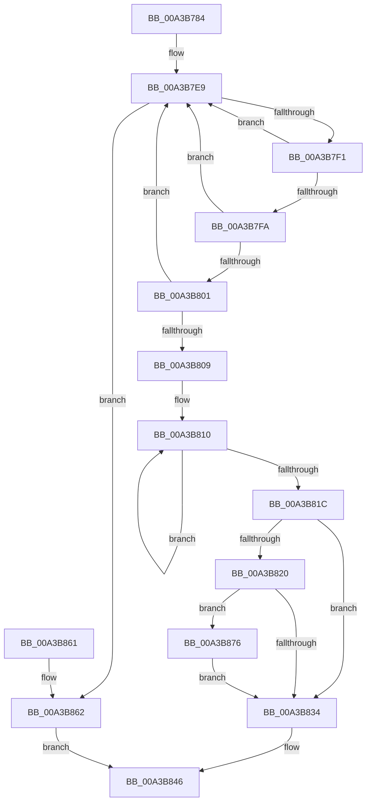

# SepReferenceLogonSessionSilo

- RVA: `0x00A3B784`–`0x00A3B87F` (길이 `251` bytes)
- VA: `0x0000000140A3B784`
- 실행 섹션: `PAGE`
- PDB 이름 있음: `예`; PDB Function 태그: `아니요`
- unwind 정보 RVA: `0x0009C638`
- 디코드: `69`개 명령, `251/251` bytes 표시
- 미해석 바이트: `0` (있으면 어셈블리에 `.byte`로 보존)

> 이 문서는 커널 이미지의 기계어와 PDB 기호를 분석해 생성했습니다. 4번과 5번은 함수 원형과 자료형을 바이너리 사용 방식에서 추정한 C 해석이며 원본 소스 복구 결과는 아닙니다.

## 1. Dependencies

- 직접 호출 지점: **5**; 고유 호출 대상: **3**
- 직접 호출자로 확인된 함수: **6**
- RIP 상대 이미지 참조: **2**

### Outgoing calls
- `0x00A3B7E4` → [ExAcquireResourceExclusiveLite](../../text/21/ExAcquireResourceExclusiveLite_function_00214E20.md) (function, `0x00214E20`)
- `0x00A3B837` → [ExReleaseResourceLite](../../text/25/ExReleaseResourceLite_function_0025FA10.md) (function, `0x0025FA10`)
- `0x00A3B83C` → [KeLeaveCriticalRegion](../../text/25/KeLeaveCriticalRegion_function_0025D8B0.md) (function, `0x0025D8B0`)
- `0x00A3B865` → [ExReleaseResourceLite](../../text/25/ExReleaseResourceLite_function_0025FA10.md) (function, `0x0025FA10`)
- `0x00A3B86A` → [KeLeaveCriticalRegion](../../text/25/KeLeaveCriticalRegion_function_0025D8B0.md) (function, `0x0025D8B0`)

### Direct callers
- [SeInitServerSilo](../79/SeInitServerSilo_function_0079C3EC.md) at `0x0079C459`
- [SeInitServerSilo](../79/SeInitServerSilo_function_0079C3EC.md) at `0x0079C497`
- [SeSetSessionIdTokenWithLinked](../79/SeSetSessionIdTokenWithLinked_function_0079CF90.md) at `0x0079D03C`
- [SeSetSessionIdTokenWithLinked](../79/SeSetSessionIdTokenWithLinked_function_0079CF90.md) at `0x0079D078`
- [SepSetServerSiloToken](../79/SepSetServerSiloToken_function_0079D2A8.md) at `0x0079D2F5`
- [SeGetLinkedToken](SeGetLinkedToken_function_00A3B640.md) at `0x00A3B6AC`
- [SepReferenceLogonSession](SepReferenceLogonSession_function_00A3B74C.md) at `0x00A3B76A`
- [NtQueryInformationToken](../AE/NtQueryInformationToken_function_00AECDD0.md) at `0x00AED62E`
- [NtQueryInformationToken](../AE/NtQueryInformationToken_function_00AECDD0.md) at `0x00AEE688`
- [NtQueryInformationToken](../AE/NtQueryInformationToken_function_00AECDD0.md) at `0x00AEE748`

### Static image references
- `0x00A3B7A7` → RVA `0x00FD9AF0` (`PAGEDATA`; read)
- `0x00A3B7D6` → RVA `0x00E67F20` (`.data`; read)

## 2. Other-region calls and transfers

- 다른 실행 섹션으로 향하는 call: **5**
  - `0x00A3B7E4` → [ExAcquireResourceExclusiveLite](../../text/21/ExAcquireResourceExclusiveLite_function_00214E20.md) (`PAGE` → `.text`)
  - `0x00A3B837` → [ExReleaseResourceLite](../../text/25/ExReleaseResourceLite_function_0025FA10.md) (`PAGE` → `.text`)
  - `0x00A3B83C` → [KeLeaveCriticalRegion](../../text/25/KeLeaveCriticalRegion_function_0025D8B0.md) (`PAGE` → `.text`)
  - `0x00A3B865` → [ExReleaseResourceLite](../../text/25/ExReleaseResourceLite_function_0025FA10.md) (`PAGE` → `.text`)
  - `0x00A3B86A` → [KeLeaveCriticalRegion](../../text/25/KeLeaveCriticalRegion_function_0025D8B0.md) (`PAGE` → `.text`)
- 별도 외부 분기/꼬리 이동을 확인하지 못했습니다.

## 3. Assembly (complete function range)

```asm
00A3B784  48 8B C4                        mov rax, rsp
00A3B787  48 89 58 08                     mov qword ptr [rax + 8], rbx
00A3B78B  48 89 68 10                     mov qword ptr [rax + 0x10], rbp
00A3B78F  48 89 70 18                     mov qword ptr [rax + 0x18], rsi
00A3B793  48 89 78 20                     mov qword ptr [rax + 0x20], rdi
00A3B797  41 56                           push r14
00A3B799  48 83 EC 20                     sub rsp, 0x20
00A3B79D  44 69 09 24 0A 25 5B            imul r9d, dword ptr [rcx], 0x5b250a24
00A3B7A4  48 8B EA                        mov rbp, rdx
00A3B7A7  48 8B 05 42 E3 59 00            mov rax, qword ptr [rip + 0x59e342]
00A3B7AE  48 8B F1                        mov rsi, rcx
00A3B7B1  B2 01                           mov dl, 1
00A3B7B3  4D 8B F0                        mov r14, r8
00A3B7B6  49 C1 E9 1C                     shr r9, 0x1c
00A3B7BA  4A 8D 1C C8                     lea rbx, [rax + r9*8]
00A3B7BE  65 48 8B 04 25 88 01 00 00      mov rax, qword ptr gs:[0x188]
00A3B7C7  41 83 E1 03                     and r9d, 3
00A3B7CB  49 6B F9 68                     imul rdi, r9, 0x68
00A3B7CF  66 FF 88 E4 01 00 00            dec word ptr [rax + 0x1e4]
00A3B7D6  48 8D 05 43 C7 42 00            lea rax, [rip + 0x42c743]
00A3B7DD  48 03 F8                        add rdi, rax
00A3B7E0  90                              nop
00A3B7E1  48 8B CF                        mov rcx, rdi
00A3B7E4  E8 37 96 7D FF                  call 0x140214e20
00A3B7E9  48 8B 1B                        mov rbx, qword ptr [rbx]
00A3B7EC  48 85 DB                        test rbx, rbx
00A3B7EF  74 71                           je 0x140a3b862
00A3B7F1  48 39 AB A8 00 00 00            cmp qword ptr [rbx + 0xa8], rbp
00A3B7F8  75 EF                           jne 0x140a3b7e9
00A3B7FA  8B 43 08                        mov eax, dword ptr [rbx + 8]
00A3B7FD  39 06                           cmp dword ptr [rsi], eax
00A3B7FF  75 E8                           jne 0x140a3b7e9
00A3B801  8B 43 0C                        mov eax, dword ptr [rbx + 0xc]
00A3B804  39 46 04                        cmp dword ptr [rsi + 4], eax
00A3B807  75 E0                           jne 0x140a3b7e9
00A3B809  0F 0D 4B 28                     prefetchw byte ptr [rbx + 0x28]
00A3B80D  8B 43 28                        mov eax, dword ptr [rbx + 0x28]
00A3B810  8B C8                           mov ecx, eax
00A3B812  83 C9 08                        or ecx, 8
00A3B815  F0 0F B1 4B 28                  lock cmpxchg dword ptr [rbx + 0x28], ecx
00A3B81A  75 F4                           jne 0x140a3b810
00A3B81C  A8 08                           test al, 8
00A3B81E  74 14                           je 0x140a3b834
00A3B820  B8 01 00 00 00                  mov eax, 1
00A3B825  F0 48 0F C1 43 20               lock xadd qword ptr [rbx + 0x20], rax
00A3B82B  48 FF C0                        inc rax
00A3B82E  48 83 F8 01                     cmp rax, 1
00A3B832  7E 42                           jle 0x140a3b876
00A3B834  48 8B CF                        mov rcx, rdi
00A3B837  E8 D4 41 82 FF                  call 0x14025fa10
00A3B83C  E8 6F 20 82 FF                  call 0x14025d8b0
00A3B841  33 C0                           xor eax, eax
00A3B843  49 89 1E                        mov qword ptr [r14], rbx
00A3B846  48 8B 5C 24 30                  mov rbx, qword ptr [rsp + 0x30]
00A3B84B  48 8B 6C 24 38                  mov rbp, qword ptr [rsp + 0x38]
00A3B850  48 8B 74 24 40                  mov rsi, qword ptr [rsp + 0x40]
00A3B855  48 8B 7C 24 48                  mov rdi, qword ptr [rsp + 0x48]
00A3B85A  48 83 C4 20                     add rsp, 0x20
00A3B85E  41 5E                           pop r14
00A3B860  C3                              ret
00A3B861  CC                              int3
00A3B862  48 8B CF                        mov rcx, rdi
00A3B865  E8 A6 41 82 FF                  call 0x14025fa10
00A3B86A  E8 41 20 82 FF                  call 0x14025d8b0
00A3B86F  B8 5F 00 00 C0                  mov eax, 0xc000005f
00A3B874  EB D0                           jmp 0x140a3b846
00A3B876  B9 0E 00 00 00                  mov ecx, 0xe
00A3B87B  CD 29                           int 0x29
00A3B87D  EB B5                           jmp 0x140a3b834
```

## 4. C-style interpretation (structured pseudocode)

```c
__int64 __fastcall SepReferenceLogonSessionSilo(__int64 a1, __int64 a2, __int64 a3)
{
    __int64 result;
    __int64 v_rdi;
    __int64 v_rsp;
    unsigned __int64 v_stack_p10;
    unsigned __int64 v_stack_p18;
    unsigned __int64 v_stack_p20;
    unsigned __int64 v_stack_p8;

    *(unsigned __int64 *)(v_rsp + 8) = v_rbx;
    *(unsigned __int64 *)(v_rsp + 16) = v_rbp;
    *(unsigned __int64 *)(v_rsp + 24) = v_rsi;
    *(unsigned __int64 *)(v_rsp + 32) = v_rdi;
    v_rsp = (v_rsp) - (32);
    a4 = (unsigned int)((a4) * (*(unsigned int *)(a1)));
    a4 = (a4) >> (28);
    a4 = (unsigned int)((a4) & (3));
    v_rdi = (v_rdi) * (a4);
    v_rdi = (v_rdi) + (v_rip + 4376387);
    result = ExAcquireResourceExclusiveLite(v_rdi, 1, a3, a4);
loc_00A3B7E9:
    if (*(unsigned __int64 *)(*(unsigned __int64 *)(v_rip + 5890882) + a4 * 8) == 0) goto loc_00A3B862;
    if ((*(unsigned __int64 *)(*(unsigned __int64 *)(*(unsigned __int64 *)(v_rip + 5890882) + a4 * 8) + 168)) != a2) goto loc_00A3B7E9;
    if ((*(unsigned int *)(a1)) != ((unsigned int)((unsigned int)(*(unsigned int *)(*(unsigned __int64 *)(*(unsigned __int64 *)(v_rip + 5890882) + a4 * 8) + 8))))) goto loc_00A3B7E9;
    if ((*(unsigned int *)(a1 + 4)) != ((unsigned int)((unsigned int)(*(unsigned int *)(*(unsigned __int64 *)(*(unsigned __int64 *)(v_rip + 5890882) + a4 * 8) + 12))))) goto loc_00A3B7E9;
loc_00A3B810:
    a1 = (unsigned int)(((unsigned int)((unsigned int)((unsigned int)(*(unsigned int *)(*(unsigned __int64 *)(*(unsigned __int64 *)(v_rip + 5890882) + a4 * 8) + 40))))) | (8));
    if (condition_is_not_equal) goto loc_00A3B810;
    if ((((unsigned __int8)((unsigned int)(*(unsigned int *)(*(unsigned __int64 *)(*(unsigned __int64 *)(v_rip + 5890882) + a4 * 8) + 40)))) & (8)) == 0) goto loc_00A3B834;
    result = (1) + 1;
    if (result <= 1) goto loc_00A3B876;
loc_00A3B834:
    result = ExReleaseResourceLite(v_rdi, 1, a3, a4);
    result = KeLeaveCriticalRegion(v_rdi, 1, a3, a4);
    result = 0;
    *(unsigned __int64 *)(a3) = *(unsigned __int64 *)(*(unsigned __int64 *)(v_rip + 5890882) + a4 * 8);
loc_00A3B846:
    v_rsp = (v_rsp) + (32);
    return result;
loc_00A3B862:
    result = ExReleaseResourceLite(v_stack_p20, 1, a3, a4);
    result = KeLeaveCriticalRegion(v_stack_p20, 1, a3, a4);
    goto loc_00A3B846;
loc_00A3B876:
    goto loc_00A3B834;
}
```

## 5. (Beta) C Style

```c
int64_t SepReferenceLogonSessionSilo(void *Arg1, int64_t Arg2, void *Arg3)
{
    uint8_t *arg1 = (uint8_t *)Arg1;
    uint8_t *arg3 = (uint8_t *)Arg3;

    int64_t result;
    int64_t local_rdi;
    int64_t local_rsp;
    uint64_t v_stack_p10;
    uint64_t v_stack_p18;
    uint64_t v_stack_p20;
    uint64_t v_stack_p8;

    *(uint64_t *)(local_rsp + 0x8) = local_rbx;
    *(uint64_t *)(local_rsp + 0x10) = local_rbp;
    *(uint64_t *)(local_rsp + 0x18) = local_rsi;
    *(uint64_t *)(local_rsp + 0x20) = local_rdi;
    local_rsp = (local_rsp) - (32);
    a4 = (uint32_t)((a4) * (*(uint32_t *)(arg1)));
    a4 = (a4) >> (28);
    a4 = (uint32_t)((a4) & (3));
    local_rdi = (local_rdi) * (a4);
    local_rdi = (local_rdi) + (v_rip + 4376387);
    result = ExAcquireResourceExclusiveLite(local_rdi, 1, Arg3, a4);
loc_00A3B7E9:
    if (*(uint64_t *)(*(uint64_t *)(v_rip + 0x59E342) + a4 * 8) == 0) goto loc_00A3B862;
    if ((*(uint64_t *)(*(uint64_t *)(*(uint64_t *)(v_rip + 0x59E342) + a4 * 8) + 0xA8)) != Arg2) goto loc_00A3B7E9;
    if ((*(uint32_t *)(arg1)) != ((uint32_t)((uint32_t)(*(uint32_t *)(*(uint64_t *)(*(uint64_t *)(v_rip + 0x59E342) + a4 * 8) + 0x8))))) goto loc_00A3B7E9;
    if ((*(uint32_t *)(arg1 + 0x4)) != ((uint32_t)((uint32_t)(*(uint32_t *)(*(uint64_t *)(*(uint64_t *)(v_rip + 0x59E342) + a4 * 8) + 0xC))))) goto loc_00A3B7E9;
loc_00A3B810:
    Arg1 = (uint32_t)(((uint32_t)((uint32_t)((uint32_t)(*(uint32_t *)(*(uint64_t *)(*(uint64_t *)(v_rip + 0x59E342) + a4 * 8) + 0x28))))) | (8));
    if (condition_is_not_equal) goto loc_00A3B810;
    if ((((uint8_t)((uint32_t)(*(uint32_t *)(*(uint64_t *)(*(uint64_t *)(v_rip + 0x59E342) + a4 * 8) + 0x28)))) & (8)) == 0) goto loc_00A3B834;
    result = (1) + 1;
    if (result <= 1) goto loc_00A3B876;
loc_00A3B834:
    result = ExReleaseResourceLite(local_rdi, 1, Arg3, a4);
    result = KeLeaveCriticalRegion(local_rdi, 1, Arg3, a4);
    result = 0;
    *(uint64_t *)(arg3) = *(uint64_t *)(*(uint64_t *)(v_rip + 0x59E342) + a4 * 8);
loc_00A3B846:
    local_rsp = (local_rsp) + (32);
    return result;
loc_00A3B862:
    result = ExReleaseResourceLite(v_stack_p20, 1, Arg3, a4);
    result = KeLeaveCriticalRegion(v_stack_p20, 1, Arg3, a4);
    goto loc_00A3B846;
loc_00A3B876:
    goto loc_00A3B834;
}
```

### 관측된 메모리 오프셋

구조체 형식이 확인되지 않은 접근은 인자 기준의 오프셋으로만 기록했습니다.

| 기준 인자 | 오프셋 표현 | 폭 (bit) | 접근 |
|---|---:|---:|---|
| `Arg1` | `+ 0x0` | `32` | `R` |
| `Arg1` | `+ 0x4` | `32` | `R` |
| `Arg3` | `+ 0x0` | `64` | `W` |

## 6. Execution-region graph

[열기: 2D/3D 그래프와 함수 탐색 컨트롤 패널](../../../control-panel.html?section=page&rva=0x00A3B784&view=graph)

- 2D 그래프는 위에서 아래로 흐르고, 3D 그래프는 빈 공간을 드래그해 회전합니다. Shift+드래그는 이동, 휠은 확대·축소, 함수 노드 선택은 대상 보고서 이동입니다.

### Static fallback


