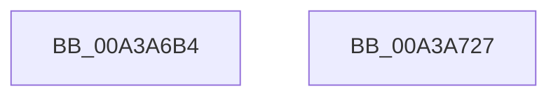

# SepRegOpenKey

- RVA: `0x00A3A6B4`–`0x00A3A728` (길이 `116` bytes)
- VA: `0x0000000140A3A6B4`
- 실행 섹션: `PAGE`
- PDB 이름 있음: `예`; PDB Function 태그: `아니요`
- unwind 정보 RVA: `0x0008C33C`
- 디코드: `30`개 명령, `116/116` bytes 표시
- 미해석 바이트: `0` (있으면 어셈블리에 `.byte`로 보존)

> 이 문서는 커널 이미지의 기계어와 PDB 기호를 분석해 생성했습니다. 4번과 5번은 함수 원형과 자료형을 바이너리 사용 방식에서 추정한 C 해석이며 원본 소스 복구 결과는 아닙니다.

## 1. Dependencies

- 직접 호출 지점: **2**; 고유 호출 대상: **2**
- 직접 호출자로 확인된 함수: **6**
- RIP 상대 이미지 참조: **0**

### Outgoing calls
- `0x00A3A6DB` → [RtlInitUnicodeString](../../text/42/RtlInitUnicodeString_function_0042A780.md) (function, `0x0042A780`)
- `0x00A3A717` → [ZwOpenKey](../../text/6A/ZwOpenKey_function_006AD310.md) (function, `0x006AD310`)

### Direct callers
- [SepBuildCapPolicyTable](../../text/60/SepBuildCapPolicyTable_function_0060B8F0.md) at `0x0060B932`
- [SepBuildCapPolicyTable](../../text/60/SepBuildCapPolicyTable_function_0060B8F0.md) at `0x0060B94F`
- [SepBuildCapPolicyTable](../../text/60/SepBuildCapPolicyTable_function_0060B8F0.md) at `0x0060B965`
- [SepRmFetchGlobalSacl](../7A/SepRmFetchGlobalSacl_function_007A298C.md) at `0x007A2A18`
- [SepReadAndInsertCaps](../7A/SepReadAndInsertCaps_function_007A3960.md) at `0x007A3B39`
- [SepReadAndPopulateCapes](../7A/SepReadAndPopulateCapes_function_007A3CB8.md) at `0x007A3E38`
- [SepReadAndPopulateCapes](../7A/SepReadAndPopulateCapes_function_007A3CB8.md) at `0x007A40B2`
- [SepAdtOpenRegAndSetupNotification](../7A/SepAdtOpenRegAndSetupNotification_function_007A4A80.md) at `0x007A4A97`
- [SepRegQueryDwordValue](SepRegQueryDwordValue_function_00A3A494.md) at `0x00A3A4C3`

### Static image references
- 디코드된 RIP-relative 메모리 참조가 없습니다.

## 2. Other-region calls and transfers

- 다른 실행 섹션으로 향하는 call: **2**
  - `0x00A3A6DB` → [RtlInitUnicodeString](../../text/42/RtlInitUnicodeString_function_0042A780.md) (`PAGE` → `.text`)
  - `0x00A3A717` → [ZwOpenKey](../../text/6A/ZwOpenKey_function_006AD310.md) (`PAGE` → `.text`)
- 별도 외부 분기/꼬리 이동을 확인하지 못했습니다.

## 3. Assembly (complete function range)

```asm
00A3A6B4  48 8B C4                        mov rax, rsp
00A3A6B7  48 89 58 08                     mov qword ptr [rax + 8], rbx
00A3A6BB  57                              push rdi
00A3A6BC  48 83 EC 60                     sub rsp, 0x60
00A3A6C0  83 60 CC 00                     and dword ptr [rax - 0x34], 0
00A3A6C4  8B DA                           mov ebx, edx
00A3A6C6  83 60 E4 00                     and dword ptr [rax - 0x1c], 0
00A3A6CA  48 8B D1                        mov rdx, rcx
00A3A6CD  0F 57 C0                        xorps xmm0, xmm0
00A3A6D0  48 8D 48 B8                     lea rcx, [rax - 0x48]
00A3A6D4  49 8B F8                        mov rdi, r8
00A3A6D7  0F 11 40 B8                     movups xmmword ptr [rax - 0x48], xmm0
00A3A6DB  E8 A0 00 9F FF                  call 0x14042a780
00A3A6E0  48 83 64 24 38 00               and qword ptr [rsp + 0x38], 0
00A3A6E6  48 8D 44 24 20                  lea rax, [rsp + 0x20]
00A3A6EB  48 83 27 00                     and qword ptr [rdi], 0
00A3A6EF  4C 8D 44 24 30                  lea r8, [rsp + 0x30]
00A3A6F4  0F 57 C0                        xorps xmm0, xmm0
00A3A6F7  48 89 44 24 40                  mov qword ptr [rsp + 0x40], rax
00A3A6FC  8B D3                           mov edx, ebx
00A3A6FE  C7 44 24 30 30 00 00 00         mov dword ptr [rsp + 0x30], 0x30
00A3A706  48 8B CF                        mov rcx, rdi
00A3A709  C7 44 24 48 40 02 00 00         mov dword ptr [rsp + 0x48], 0x240
00A3A711  F3 0F 7F 44 24 50               movdqu xmmword ptr [rsp + 0x50], xmm0
00A3A717  E8 F4 2B C7 FF                  call 0x1406ad310
00A3A71C  48 8B 5C 24 70                  mov rbx, qword ptr [rsp + 0x70]
00A3A721  48 83 C4 60                     add rsp, 0x60
00A3A725  5F                              pop rdi
00A3A726  C3                              ret
00A3A727  CC                              int3
```

## 4. C-style interpretation (structured pseudocode)

```c
__int64 __fastcall SepRegOpenKey(__int64 a1, int a2, __int64 a3)
{
    __int64 result;
    __int64 v_rsp;
    unsigned __int64 v_stack_m18;
    unsigned int v_stack_m20;
    unsigned __int64 v_stack_m28;
    unsigned __int64 v_stack_m30;
    unsigned __int64 v_stack_m38;
    unsigned __int64 v_stack_m48;
    unsigned __int64 v_stack_p8;

    *(unsigned __int64 *)(v_rsp + 8) = v_rbx;
    v_rsp = (v_rsp) - (96);
    *(unsigned __int64 *)(v_rsp - 72) = v_xmm0;
    result = RtlInitUnicodeString(v_rsp - 72, a1, a3, a4);
    v_stack_m28 = v_stack_m48;
    v_stack_m38 = 48;
    v_stack_m20 = 576;
    v_stack_m18 = v_xmm0;
    result = ZwOpenKey(a3, (unsigned int)((unsigned int)((unsigned int)(a2))), v_stack_m38, a4);
    v_rsp = (v_rsp) + (96);
    return result;
}
```

## 5. (Beta) C Style

```c
int64_t SepRegOpenKey(int64_t Arg1, int32_t Arg2, void *Arg3)
{
    uint8_t *arg3 = (uint8_t *)Arg3;

    int64_t result;
    int64_t local_rsp;
    uint64_t v_stack_m18;
    uint32_t v_stack_m20;
    uint64_t v_stack_m28;
    uint64_t v_stack_m30;
    uint64_t v_stack_m38;
    uint64_t v_stack_m48;
    uint64_t v_stack_p8;

    *(uint64_t *)(local_rsp + 0x8) = local_rbx;
    local_rsp = (local_rsp) - (96);
    *(uint64_t *)(local_rsp - 0x48) = v_xmm0;
    result = RtlInitUnicodeString(local_rsp - 72, Arg1, Arg3, a4);
    v_stack_m28 = v_stack_m48;
    v_stack_m38 = 48;
    v_stack_m20 = 576;
    v_stack_m18 = v_xmm0;
    result = ZwOpenKey(Arg3, (uint32_t)((uint32_t)((uint32_t)(Arg2))), v_stack_m38, a4);
    local_rsp = (local_rsp) + (96);
    return result;
}
```

### 관측된 메모리 오프셋

구조체 형식이 확인되지 않은 접근은 인자 기준의 오프셋으로만 기록했습니다.

| 기준 인자 | 오프셋 표현 | 폭 (bit) | 접근 |
|---|---:|---:|---|
| `Arg3` | `+ 0x0` | `64` | `R/W` |

## 6. Execution-region graph

[열기: 2D/3D 그래프와 함수 탐색 컨트롤 패널](../../../control-panel.html?section=page&rva=0x00A3A6B4&view=graph)

- 2D 그래프는 위에서 아래로 흐르고, 3D 그래프는 빈 공간을 드래그해 회전합니다. Shift+드래그는 이동, 휠은 확대·축소, 함수 노드 선택은 대상 보고서 이동입니다.

### Static fallback


