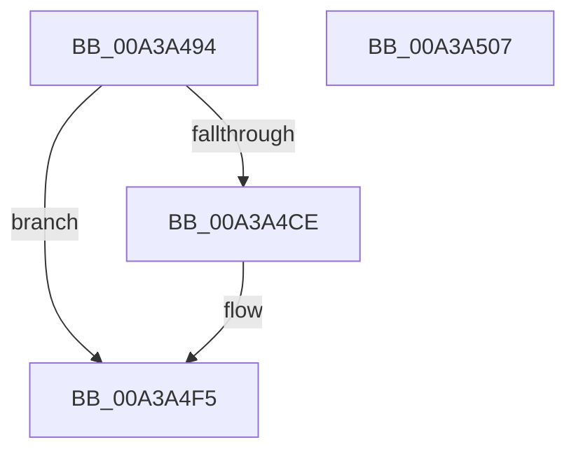

# SepRegQueryDwordValue

- RVA: `0x00A3A494`–`0x00A3A508` (길이 `116` bytes)
- VA: `0x0000000140A3A494`
- 실행 섹션: `PAGE`
- PDB 이름 있음: `예`; PDB Function 태그: `아니요`
- unwind 정보 RVA: `0x000AE0FC`
- 디코드: `32`개 명령, `116/116` bytes 표시
- 미해석 바이트: `0` (있으면 어셈블리에 `.byte`로 보존)

> 이 문서는 커널 이미지의 기계어와 PDB 기호를 분석해 생성했습니다. 4번과 5번은 함수 원형과 자료형을 바이너리 사용 방식에서 추정한 C 해석이며 원본 소스 복구 결과는 아닙니다.

## 1. Dependencies

- 직접 호출 지점: **3**; 고유 호출 대상: **3**
- 직접 호출자로 확인된 함수: **1**
- RIP 상대 이미지 참조: **1**

### Outgoing calls
- `0x00A3A4C3` → [SepRegOpenKey](SepRegOpenKey_function_00A3A6B4.md) (function, `0x00A3A6B4`)
- `0x00A3A4E4` → [SepRegQueryValue](SepRegQueryValue_function_00A3A730.md) (function, `0x00A3A730`)
- `0x00A3A4F0` → [ZwClose](../../text/6A/ZwClose_function_006AD2B0.md) (function, `0x006AD2B0`)

### Direct callers
- [NtImpersonateAnonymousToken](NtImpersonateAnonymousToken_function_00A3A150.md) at `0x00A3A1F3`
- [NtImpersonateAnonymousToken](NtImpersonateAnonymousToken_function_00A3A150.md) at `0x00A3A25C`

### Static image references
- `0x00A3A4AD` → RVA `0x00B06020` (` ?? ::NNGAKEGL::`string'`; read)

## 2. Other-region calls and transfers

- 다른 실행 섹션으로 향하는 call: **1**
  - `0x00A3A4F0` → [ZwClose](../../text/6A/ZwClose_function_006AD2B0.md) (`PAGE` → `.text`)
- 별도 외부 분기/꼬리 이동을 확인하지 못했습니다.

## 3. Assembly (complete function range)

```asm
00A3A494  48 8B C4                        mov rax, rsp
00A3A497  48 89 58 10                     mov qword ptr [rax + 0x10], rbx
00A3A49B  48 89 70 18                     mov qword ptr [rax + 0x18], rsi
00A3A49F  48 89 48 08                     mov qword ptr [rax + 8], rcx
00A3A4A3  57                              push rdi
00A3A4A4  48 83 EC 30                     sub rsp, 0x30
00A3A4A8  48 83 60 08 00                  and qword ptr [rax + 8], 0
00A3A4AD  48 8D 0D 6C BB 0C 00            lea rcx, [rip + 0xcbb6c]
00A3A4B4  49 8B F8                        mov rdi, r8
00A3A4B7  48 8B F2                        mov rsi, rdx
00A3A4BA  4C 8D 40 08                     lea r8, [rax + 8]
00A3A4BE  BA 01 02 00 00                  mov edx, 0x201
00A3A4C3  E8 EC 01 00 00                  call 0x140a3a6b4
00A3A4C8  8B D8                           mov ebx, eax
00A3A4CA  85 C0                           test eax, eax
00A3A4CC  78 27                           js 0x140a3a4f5
00A3A4CE  48 8B 4C 24 40                  mov rcx, qword ptr [rsp + 0x40]
00A3A4D3  41 B8 04 00 00 00               mov r8d, 4
00A3A4D9  45 8B C8                        mov r9d, r8d
00A3A4DC  48 89 7C 24 20                  mov qword ptr [rsp + 0x20], rdi
00A3A4E1  48 8B D6                        mov rdx, rsi
00A3A4E4  E8 47 02 00 00                  call 0x140a3a730
00A3A4E9  48 8B 4C 24 40                  mov rcx, qword ptr [rsp + 0x40]
00A3A4EE  8B D8                           mov ebx, eax
00A3A4F0  E8 BB 2D C7 FF                  call 0x1406ad2b0
00A3A4F5  48 8B 74 24 50                  mov rsi, qword ptr [rsp + 0x50]
00A3A4FA  8B C3                           mov eax, ebx
00A3A4FC  48 8B 5C 24 48                  mov rbx, qword ptr [rsp + 0x48]
00A3A501  48 83 C4 30                     add rsp, 0x30
00A3A505  5F                              pop rdi
00A3A506  C3                              ret
00A3A507  CC                              int3
```

## 4. C-style interpretation (structured pseudocode)

```c
__int64 __fastcall SepRegQueryDwordValue(__int64 a1, __int64 a2, __int64 a3)
{
    __int64 result;
    __int64 v_rbx;
    __int64 v_rsp;
    unsigned __int64 v_stack_m18;
    unsigned __int64 v_stack_p10;
    unsigned __int64 v_stack_p18;
    unsigned __int64 v_stack_p8;

    *(unsigned __int64 *)(v_rsp + 16) = v_rbx;
    *(unsigned __int64 *)(v_rsp + 24) = v_rsi;
    *(unsigned __int64 *)(v_rsp + 8) = a1;
    v_rsp = (v_rsp) - (48);
    result = SepRegOpenKey(v_rip + 834412, 513, v_rsp + 8, a4);
    v_rbx = (unsigned int)((unsigned int)(result));
    if (!(sign_flag)) {
        a1 = v_stack_p8;
        a3 = 4;
        a4 = (unsigned int)(a3);
        v_stack_m18 = a3;
        a2 = a2;
        result = SepRegQueryValue(a1, a2, a3, a4);
        a1 = v_stack_p8;
        v_rbx = (unsigned int)(result);
        result = ZwClose(a1, a2, a3, a4);
    }
    v_rsp = (v_rsp) + (48);
    return (unsigned int)((unsigned int)(v_rbx));
}
```

## 5. (Beta) C Style

```c
int64_t SepRegQueryDwordValue(int64_t Arg1, int64_t Arg2, int64_t Arg3)
{
    int64_t result;
    int64_t local_rbx;
    int64_t local_rsp;
    uint64_t v_stack_m18;
    uint64_t v_stack_p10;
    uint64_t v_stack_p18;
    uint64_t v_stack_p8;

    *(uint64_t *)(local_rsp + 0x10) = local_rbx;
    *(uint64_t *)(local_rsp + 0x18) = local_rsi;
    *(uint64_t *)(local_rsp + 0x8) = Arg1;
    local_rsp = (local_rsp) - (48);
    result = SepRegOpenKey(v_rip + 834412, 513, local_rsp + 8, a4);
    local_rbx = (uint32_t)((uint32_t)(result));
    if (!(sign_flag)) {
        Arg1 = v_stack_p8;
        Arg3 = 4;
        a4 = (uint32_t)(Arg3);
        v_stack_m18 = Arg3;
        Arg2 = Arg2;
        result = SepRegQueryValue(Arg1, Arg2, Arg3, a4);
        Arg1 = v_stack_p8;
        local_rbx = (uint32_t)(result);
        result = ZwClose(Arg1, Arg2, Arg3, a4);
    }
    local_rsp = (local_rsp) + (48);
    return (uint32_t)((uint32_t)(local_rbx));
}
```

## 6. Execution-region graph

[열기: 2D/3D 그래프와 함수 탐색 컨트롤 패널](../../../control-panel.html?section=page&rva=0x00A3A494&view=graph)

- 2D 그래프는 위에서 아래로 흐르고, 3D 그래프는 빈 공간을 드래그해 회전합니다. Shift+드래그는 이동, 휠은 확대·축소, 함수 노드 선택은 대상 보고서 이동입니다.

### Static fallback


