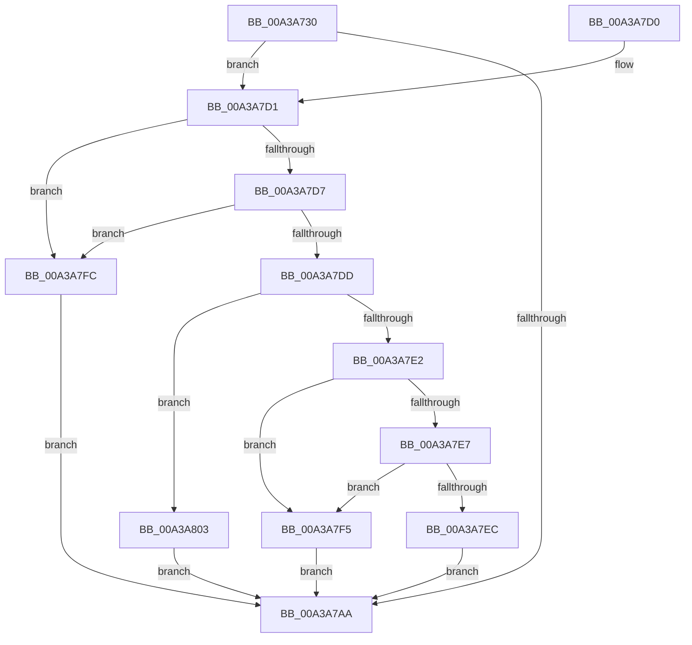

# SepRegQueryValue

- RVA: `0x00A3A730`–`0x00A3A815` (길이 `229` bytes)
- VA: `0x0000000140A3A730`
- 실행 섹션: `PAGE`
- PDB 이름 있음: `예`; PDB Function 태그: `아니요`
- unwind 정보 RVA: `0x000AE134`
- 디코드: `61`개 명령, `229/229` bytes 표시
- 미해석 바이트: `0` (있으면 어셈블리에 `.byte`로 보존)

> 이 문서는 커널 이미지의 기계어와 PDB 기호를 분석해 생성했습니다. 4번과 5번은 함수 원형과 자료형을 바이너리 사용 방식에서 추정한 C 해석이며 원본 소스 복구 결과는 아닙니다.

## 1. Dependencies

- 직접 호출 지점: **4**; 고유 호출 대상: **4**
- 직접 호출자로 확인된 함수: **4**
- RIP 상대 이미지 참조: **1**

### Outgoing calls
- `0x00A3A775` → [RtlInitUnicodeString](../../text/42/RtlInitUnicodeString_function_0042A780.md) (function, `0x0042A780`)
- `0x00A3A79F` → [ZwQueryValueKey](../../text/6A/ZwQueryValueKey_function_006AD3B0.md) (function, `0x006AD3B0`)
- `0x00A3A7B7` → [_security_check_cookie](../../text/6A/_security_check_cookie_function_006AC640.md) (function, `0x006AC640`)
- `0x00A3A80E` → [memcpy](../../text/6C/memcpy_function_006C6840.md) (function, `0x006C6840`)

### Direct callers
- [SepAdtInitializeBounds](../7A/SepAdtInitializeBounds_function_007A493C.md) at `0x007A4976`
- [SepAdtInitializeCrashOnFail](../7A/SepAdtInitializeCrashOnFail_function_007A49C0.md) at `0x007A49EE`
- [SepAdtInitializePrivilegeAuditing](../7A/SepAdtInitializePrivilegeAuditing_function_007A4A20.md) at `0x007A4A50`
- [SepRegQueryDwordValue](SepRegQueryDwordValue_function_00A3A494.md) at `0x00A3A4E4`

### Static image references
- `0x00A3A740` → RVA `0x00E0A740` (`.data`; read)

## 2. Other-region calls and transfers

- 다른 실행 섹션으로 향하는 call: **4**
  - `0x00A3A775` → [RtlInitUnicodeString](../../text/42/RtlInitUnicodeString_function_0042A780.md) (`PAGE` → `.text`)
  - `0x00A3A79F` → [ZwQueryValueKey](../../text/6A/ZwQueryValueKey_function_006AD3B0.md) (`PAGE` → `.text`)
  - `0x00A3A7B7` → [_security_check_cookie](../../text/6A/_security_check_cookie_function_006AC640.md) (`PAGE` → `.text`)
  - `0x00A3A80E` → [memcpy](../../text/6C/memcpy_function_006C6840.md) (`PAGE` → `.text`)
- 별도 외부 분기/꼬리 이동을 확인하지 못했습니다.

## 3. Assembly (complete function range)

```asm
00A3A730  48 89 5C 24 18                  mov qword ptr [rsp + 0x18], rbx
00A3A735  56                              push rsi
00A3A736  57                              push rdi
00A3A737  41 56                           push r14
00A3A739  48 81 EC B0 00 00 00            sub rsp, 0xb0
00A3A740  48 8B 05 F9 FF 3C 00            mov rax, qword ptr [rip + 0x3cfff9]
00A3A747  48 33 C4                        xor rax, rsp
00A3A74A  48 89 84 24 A0 00 00 00         mov qword ptr [rsp + 0xa0], rax
00A3A752  4C 8B B4 24 F0 00 00 00         mov r14, qword ptr [rsp + 0xf0]
00A3A75A  48 8B D9                        mov rbx, rcx
00A3A75D  83 64 24 30 00                  and dword ptr [rsp + 0x30], 0
00A3A762  48 8D 4C 24 38                  lea rcx, [rsp + 0x38]
00A3A767  0F 57 C0                        xorps xmm0, xmm0
00A3A76A  41 8B F1                        mov esi, r9d
00A3A76D  0F 11 44 24 38                  movups xmmword ptr [rsp + 0x38], xmm0
00A3A772  41 8B F8                        mov edi, r8d
00A3A775  E8 06 00 9F FF                  call 0x14042a780
00A3A77A  48 8D 44 24 30                  lea rax, [rsp + 0x30]
00A3A77F  41 B8 02 00 00 00               mov r8d, 2
00A3A785  48 89 44 24 28                  mov qword ptr [rsp + 0x28], rax
00A3A78A  4C 8D 4C 24 50                  lea r9, [rsp + 0x50]
00A3A78F  48 8D 54 24 38                  lea rdx, [rsp + 0x38]
00A3A794  C7 44 24 20 50 00 00 00         mov dword ptr [rsp + 0x20], 0x50
00A3A79C  48 8B CB                        mov rcx, rbx
00A3A79F  E8 0C 2C C7 FF                  call 0x1406ad3b0
00A3A7A4  8B D8                           mov ebx, eax
00A3A7A6  85 C0                           test eax, eax
00A3A7A8  79 27                           jns 0x140a3a7d1
00A3A7AA  8B C3                           mov eax, ebx
00A3A7AC  48 8B 8C 24 A0 00 00 00         mov rcx, qword ptr [rsp + 0xa0]
00A3A7B4  48 33 CC                        xor rcx, rsp
00A3A7B7  E8 84 1E C7 FF                  call 0x1406ac640
00A3A7BC  48 8B 9C 24 E0 00 00 00         mov rbx, qword ptr [rsp + 0xe0]
00A3A7C4  48 81 C4 B0 00 00 00            add rsp, 0xb0
00A3A7CB  41 5E                           pop r14
00A3A7CD  5F                              pop rdi
00A3A7CE  5E                              pop rsi
00A3A7CF  C3                              ret
00A3A7D0  CC                              int3
00A3A7D1  39 7C 24 54                     cmp dword ptr [rsp + 0x54], edi
00A3A7D5  75 25                           jne 0x140a3a7fc
00A3A7D7  39 74 24 58                     cmp dword ptr [rsp + 0x58], esi
00A3A7DB  75 1F                           jne 0x140a3a7fc
00A3A7DD  83 EF 03                        sub edi, 3
00A3A7E0  74 21                           je 0x140a3a803
00A3A7E2  83 FF 01                        cmp edi, 1
00A3A7E5  75 0E                           jne 0x140a3a7f5
00A3A7E7  83 FE 04                        cmp esi, 4
00A3A7EA  72 09                           jb 0x140a3a7f5
00A3A7EC  8B 44 24 5C                     mov eax, dword ptr [rsp + 0x5c]
00A3A7F0  41 89 06                        mov dword ptr [r14], eax
00A3A7F3  EB B5                           jmp 0x140a3a7aa
00A3A7F5  BB 0D 00 00 C0                  mov ebx, 0xc000000d
00A3A7FA  EB AE                           jmp 0x140a3a7aa
00A3A7FC  BB 24 00 00 C0                  mov ebx, 0xc0000024
00A3A801  EB A7                           jmp 0x140a3a7aa
00A3A803  4C 8B C6                        mov r8, rsi
00A3A806  48 8D 54 24 5C                  lea rdx, [rsp + 0x5c]
00A3A80B  49 8B CE                        mov rcx, r14
00A3A80E  E8 2D C0 C8 FF                  call 0x1406c6840
00A3A813  EB 95                           jmp 0x140a3a7aa
```

## 4. C-style interpretation (structured pseudocode)

```c
__int64 __fastcall SepRegQueryValue(__int64 a1, __int64 a2, int a3, int a4, __int64 a5)
{
    __int64 result;
    __int64 v_rdi;
    __int64 v_rsp;
    unsigned __int64 v_stack_m28;
    unsigned __int64 v_stack_m78;
    unsigned __int64 v_stack_m90;
    unsigned int v_stack_m98;
    unsigned __int64 v_stack_mA0;
    unsigned int v_stack_mA8;
    unsigned __int64 v_stack_p18;
    unsigned int v_stack_p54;
    unsigned int v_stack_p58;
    unsigned int v_stack_p5C;

    v_stack_p18 = v_rbx;
    v_rsp = (v_rsp) - (176);
    result = (*(unsigned __int64 *)(v_rip + 3997689)) ^ (v_rsp);
    v_stack_m28 = result;
    v_stack_m90 = v_xmm0;
    result = RtlInitUnicodeString(v_stack_m90, a2, a3, a4);
    v_stack_mA0 = v_stack_m98;
    v_stack_mA8 = 80;
    result = ZwQueryValueKey(a1, v_stack_m90, 2, v_stack_m78);
    if (!sign_flag) goto loc_00A3A7D1;
loc_00A3A7AA:
    a1 = (v_stack_m28) ^ (v_rsp);
    result = _security_check_cookie(a1, v_stack_m90, 2, v_stack_m78);
    v_rsp = (v_rsp) + (176);
    return result;
loc_00A3A7D1:
    if (v_stack_p54 != ((unsigned int)((unsigned int)(a3)))) goto loc_00A3A7FC;
    if (v_stack_p58 != ((unsigned int)((unsigned int)(a4)))) goto loc_00A3A7FC;
    v_rdi = (unsigned int)(((unsigned int)(a3)) - (3));
    if (condition_is_equal) goto loc_00A3A803;
    if (((unsigned int)(v_rdi)) != 1) goto loc_00A3A7F5;
    if (((unsigned int)((unsigned int)(a4))) < 4) goto loc_00A3A7F5;
    *(unsigned int *)(a5) = (unsigned int)((unsigned int)(v_stack_p5C));
    goto loc_00A3A7AA;
loc_00A3A7F5:
    goto loc_00A3A7AA;
loc_00A3A7FC:
    goto loc_00A3A7AA;
loc_00A3A803:
    result = memcpy(a5, v_stack_p5C, (unsigned int)(a4), v_stack_m78);
    goto loc_00A3A7AA;
}
```

## 5. (Beta) C Style

```c
int64_t SepRegQueryValue(int64_t Arg1, int64_t Arg2, int32_t Arg3, int32_t Arg4, void *Arg5)
{
    uint8_t *arg5 = (uint8_t *)Arg5;

    int64_t result;
    int64_t local_rdi;
    int64_t local_rsp;
    uint64_t v_stack_m28;
    uint64_t v_stack_m78;
    uint64_t v_stack_m90;
    uint32_t v_stack_m98;
    uint64_t v_stack_mA0;
    uint32_t v_stack_mA8;
    uint64_t v_stack_p18;
    uint32_t v_stack_p54;
    uint32_t v_stack_p58;
    uint32_t v_stack_p5C;

    v_stack_p18 = local_rbx;
    local_rsp = (local_rsp) - (176);
    result = (*(uint64_t *)(v_rip + 0x3CFFF9)) ^ (local_rsp);
    v_stack_m28 = result;
    v_stack_m90 = v_xmm0;
    result = RtlInitUnicodeString(v_stack_m90, Arg2, Arg3, Arg4);
    v_stack_mA0 = v_stack_m98;
    v_stack_mA8 = 80;
    result = ZwQueryValueKey(Arg1, v_stack_m90, 2, v_stack_m78);
    if (!sign_flag) goto loc_00A3A7D1;
loc_00A3A7AA:
    Arg1 = (v_stack_m28) ^ (local_rsp);
    result = _security_check_cookie(Arg1, v_stack_m90, 2, v_stack_m78);
    local_rsp = (local_rsp) + (176);
    return result;
loc_00A3A7D1:
    if (v_stack_p54 != ((uint32_t)((uint32_t)(Arg3)))) goto loc_00A3A7FC;
    if (v_stack_p58 != ((uint32_t)((uint32_t)(Arg4)))) goto loc_00A3A7FC;
    local_rdi = (uint32_t)(((uint32_t)(Arg3)) - (3));
    if (condition_is_equal) goto loc_00A3A803;
    if (((uint32_t)(local_rdi)) != 1) goto loc_00A3A7F5;
    if (((uint32_t)((uint32_t)(Arg4))) < 4) goto loc_00A3A7F5;
    *(uint32_t *)(arg5) = (uint32_t)((uint32_t)(v_stack_p5C));
    goto loc_00A3A7AA;
loc_00A3A7F5:
    goto loc_00A3A7AA;
loc_00A3A7FC:
    goto loc_00A3A7AA;
loc_00A3A803:
    result = memcpy(Arg5, v_stack_p5C, (uint32_t)(Arg4), v_stack_m78);
    goto loc_00A3A7AA;
}
```

### 관측된 메모리 오프셋

구조체 형식이 확인되지 않은 접근은 인자 기준의 오프셋으로만 기록했습니다.

| 기준 인자 | 오프셋 표현 | 폭 (bit) | 접근 |
|---|---:|---:|---|
| `Arg5` | `+ 0x0` | `32` | `W` |

## 6. Execution-region graph

[열기: 2D/3D 그래프와 함수 탐색 컨트롤 패널](../../../control-panel.html?section=page&rva=0x00A3A730&view=graph)

- 2D 그래프는 위에서 아래로 흐르고, 3D 그래프는 빈 공간을 드래그해 회전합니다. Shift+드래그는 이동, 휠은 확대·축소, 함수 노드 선택은 대상 보고서 이동입니다.

### Static fallback


