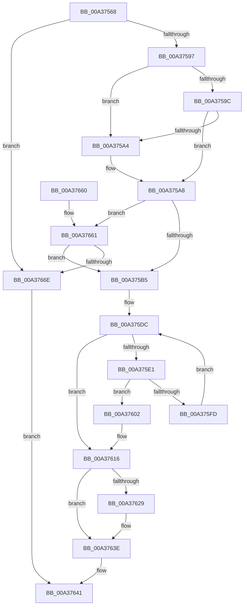

# SepValidOwnerSubjectContext

- RVA: `0x00A37568`–`0x00A37672` (길이 `266` bytes)
- VA: `0x0000000140A37568`
- 실행 섹션: `PAGE`
- PDB 이름 있음: `예`; PDB Function 태그: `아니요`
- unwind 정보 RVA: `0x000ADAB8`
- 디코드: `74`개 명령, `266/266` bytes 표시
- 미해석 바이트: `0` (있으면 어셈블리에 `.byte`로 보존)

> 이 문서는 커널 이미지의 기계어와 PDB 기호를 분석해 생성했습니다. 4번과 5번은 함수 원형과 자료형을 바이너리 사용 방식에서 추정한 C 해석이며 원본 소스 복구 결과는 아닙니다.

## 1. Dependencies

- 직접 호출 지점: **6**; 고유 호출 대상: **6**
- 직접 호출자로 확인된 함수: **2**
- RIP 상대 이미지 참조: **1**

### Outgoing calls
- `0x00A375D3` → [ExAcquireResourceSharedLite](../../text/21/ExAcquireResourceSharedLite_function_00211BC0.md) (function, `0x00211BC0`)
- `0x00A375F4` → [RtlEqualSid](../../text/40/RtlEqualSid_function_00400AD0.md) (function, `0x00400AD0`)
- `0x00A37607` → [SepIdAssignableAsOwner](SepIdAssignableAsOwner_function_00A37678.md) (function, `0x00A37678`)
- `0x00A3761A` → [ExReleaseResourceLite](../../text/25/ExReleaseResourceLite_function_0025FA10.md) (function, `0x0025FA10`)
- `0x00A3761F` → [KeLeaveCriticalRegion](../../text/25/KeLeaveCriticalRegion_function_0025D8B0.md) (function, `0x0025D8B0`)
- `0x00A37636` → [SeSinglePrivilegeCheckEx](../87/SeSinglePrivilegeCheckEx_function_00871AC0.md) (function, `0x00871AC0`)

### Direct callers
- [sub_008BC25B](../8B/Unknown_function_008BC25B.md) at `0x008BC32D`
- [RtlpNewSecurityObject](../92/RtlpNewSecurityObject_function_0092AB50.md) at `0x0092C4FB`

### Static image references
- `0x00A37629` → RVA `0x00FD9AE0` (`PAGEDATA`; read)

## 2. Other-region calls and transfers

- 다른 실행 섹션으로 향하는 call: **4**
  - `0x00A375D3` → [ExAcquireResourceSharedLite](../../text/21/ExAcquireResourceSharedLite_function_00211BC0.md) (`PAGE` → `.text`)
  - `0x00A375F4` → [RtlEqualSid](../../text/40/RtlEqualSid_function_00400AD0.md) (`PAGE` → `.text`)
  - `0x00A3761A` → [ExReleaseResourceLite](../../text/25/ExReleaseResourceLite_function_0025FA10.md) (`PAGE` → `.text`)
  - `0x00A3761F` → [KeLeaveCriticalRegion](../../text/25/KeLeaveCriticalRegion_function_0025D8B0.md) (`PAGE` → `.text`)
- 별도 외부 분기/꼬리 이동을 확인하지 못했습니다.

## 3. Assembly (complete function range)

```asm
00A37568  48 8B C4                        mov rax, rsp
00A3756B  48 89 58 08                     mov qword ptr [rax + 8], rbx
00A3756F  48 89 68 10                     mov qword ptr [rax + 0x10], rbp
00A37573  48 89 70 18                     mov qword ptr [rax + 0x18], rsi
00A37577  48 89 78 20                     mov qword ptr [rax + 0x20], rdi
00A3757B  41 54                           push r12
00A3757D  41 56                           push r14
00A3757F  41 57                           push r15
00A37581  48 83 EC 20                     sub rsp, 0x20
00A37585  40 32 FF                        xor dil, dil
00A37588  48 8B EA                        mov rbp, rdx
00A3758B  4C 8B F1                        mov r14, rcx
00A3758E  48 85 D2                        test rdx, rdx
00A37591  0F 84 D7 00 00 00               je 0x140a3766e
00A37597  45 84 C0                        test r8b, r8b
00A3759A  75 08                           jne 0x140a375a4
00A3759C  48 8B 19                        mov rbx, qword ptr [rcx]
00A3759F  48 85 DB                        test rbx, rbx
00A375A2  75 04                           jne 0x140a375a8
00A375A4  48 8B 59 10                     mov rbx, qword ptr [rcx + 0x10]
00A375A8  83 BB C0 00 00 00 02            cmp dword ptr [rbx + 0xc0], 2
00A375AF  0F 84 AC 00 00 00               je 0x140a37661
00A375B5  65 48 8B 04 25 88 01 00 00      mov rax, qword ptr gs:[0x188]
00A375BE  33 F6                           xor esi, esi
00A375C0  66 FF 88 E4 01 00 00            dec word ptr [rax + 0x1e4]
00A375C7  44 8D 66 01                     lea r12d, [rsi + 1]
00A375CB  90                              nop
00A375CC  41 8A D4                        mov dl, r12b
00A375CF  48 8B 4B 30                     mov rcx, qword ptr [rbx + 0x30]
00A375D3  E8 E8 A5 7D FF                  call 0x140211bc0
00A375D8  44 8B 7B 7C                     mov r15d, dword ptr [rbx + 0x7c]
00A375DC  41 3B F7                        cmp esi, r15d
00A375DF  73 35                           jae 0x140a37616
00A375E1  48 8B 93 98 00 00 00            mov rdx, qword ptr [rbx + 0x98]
00A375E8  48 8B CD                        mov rcx, rbp
00A375EB  8B C6                           mov eax, esi
00A375ED  48 03 C0                        add rax, rax
00A375F0  48 8B 14 C2                     mov rdx, qword ptr [rdx + rax*8]
00A375F4  E8 D7 94 9C FF                  call 0x140400ad0
00A375F9  84 C0                           test al, al
00A375FB  75 05                           jne 0x140a37602
00A375FD  41 03 F4                        add esi, r12d
00A37600  EB DA                           jmp 0x140a375dc
00A37602  8B D6                           mov edx, esi
00A37604  48 8B CB                        mov rcx, rbx
00A37607  E8 6C 00 00 00                  call 0x140a37678
00A3760C  84 C0                           test al, al
00A3760E  40 0F B6 FF                     movzx edi, dil
00A37612  41 0F 45 FC                     cmovne edi, r12d
00A37616  48 8B 4B 30                     mov rcx, qword ptr [rbx + 0x30]
00A3761A  E8 F1 83 82 FF                  call 0x14025fa10
00A3761F  E8 8C 62 82 FF                  call 0x14025d8b0
00A37624  40 84 FF                        test dil, dil
00A37627  75 15                           jne 0x140a3763e
00A37629  48 8B 0D B0 24 5A 00            mov rcx, qword ptr [rip + 0x5a24b0]
00A37630  45 8A C4                        mov r8b, r12b
00A37633  49 8B D6                        mov rdx, r14
00A37636  E8 85 A4 E3 FF                  call 0x140871ac0
00A3763B  40 8A F8                        mov dil, al
00A3763E  40 8A C7                        mov al, dil
00A37641  48 8B 5C 24 40                  mov rbx, qword ptr [rsp + 0x40]
00A37646  48 8B 6C 24 48                  mov rbp, qword ptr [rsp + 0x48]
00A3764B  48 8B 74 24 50                  mov rsi, qword ptr [rsp + 0x50]
00A37650  48 8B 7C 24 58                  mov rdi, qword ptr [rsp + 0x58]
00A37655  48 83 C4 20                     add rsp, 0x20
00A37659  41 5F                           pop r15
00A3765B  41 5E                           pop r14
00A3765D  41 5C                           pop r12
00A3765F  C3                              ret
00A37660  CC                              int3
00A37661  83 BB C4 00 00 00 02            cmp dword ptr [rbx + 0xc4], 2
00A37668  0F 8D 47 FF FF FF               jge 0x140a375b5
00A3766E  32 C0                           xor al, al
00A37670  EB CF                           jmp 0x140a37641
```

## 4. C-style interpretation (structured pseudocode)

```c
__int64 __fastcall SepValidOwnerSubjectContext(__int64 a1, __int64 a2, unsigned __int8 a3)
{
    __int64 result;
    __int64 v_rbx;
    __int64 v_rdi;
    __int64 v_rsi;
    __int64 v_rsp;
    unsigned __int64 v_stack_p10;
    unsigned __int64 v_stack_p18;
    unsigned __int64 v_stack_p20;
    unsigned __int64 v_stack_p8;

    *(unsigned __int64 *)(v_rsp + 8) = v_rbx;
    *(unsigned __int64 *)(v_rsp + 16) = v_rbp;
    *(unsigned __int64 *)(v_rsp + 24) = v_rsi;
    *(unsigned __int64 *)(v_rsp + 32) = v_rdi;
    v_rsp = (v_rsp) - (32);
    v_rdi = 0;
    if (a2 == 0) goto loc_00A3766E;
    if (a3 != 0) goto loc_00A375A4;
    v_rbx = *(unsigned __int64 *)(a1);
    if (*(unsigned __int64 *)(a1) == 0) {
        v_rbx = *(unsigned __int64 *)(a1 + 16);
    }
    if ((*(unsigned int *)(v_rbx + 192)) == 2) goto loc_00A37661;
loc_00A375B5:
    v_rsi = 0;
    result = ExAcquireResourceSharedLite(*(unsigned __int64 *)(v_rbx + 48), (unsigned __int8)(v_rsi + 1), a3, a4);
loc_00A375DC:
    if (0 >= ((unsigned int)((unsigned int)(*(unsigned int *)(v_rbx + 124))))) goto loc_00A37616;
    result = (0) + (0);
    result = RtlEqualSid(a2, *(unsigned __int64 *)(*(unsigned __int64 *)(v_rbx + 152) + result * 8), a3, a4);
    if ((unsigned __int8)(result) != 0) goto loc_00A37602;
    v_rsi = (unsigned int)((v_rsi) + ((unsigned int)(v_rsi + 1)));
    goto loc_00A375DC;
loc_00A37602:
    result = SepIdAssignableAsOwner(v_rbx, (unsigned int)((unsigned int)(v_rsi)), a3, a4);
    v_rdi = 0;
    if ((unsigned __int8)(result) != 0) { v_rdi = (unsigned int)(v_rsi + 1); }
loc_00A37616:
    result = ExReleaseResourceLite(*(unsigned __int64 *)(v_rbx + 48), (unsigned int)((unsigned int)(v_rsi)), a3, a4);
    result = KeLeaveCriticalRegion(*(unsigned __int64 *)(v_rbx + 48), (unsigned int)((unsigned int)(v_rsi)), a3, a4);
    if ((unsigned __int8)(v_rdi) == 0) {
        a1 = *(unsigned __int64 *)(v_rip + 5907632);
        a3 = (unsigned __int8)(v_rsi + 1);
        a2 = a1;
        result = SeSinglePrivilegeCheckEx(a1, a2, a3, a4);
        v_rdi = (unsigned __int8)(result);
    }
loc_00A37641:
    v_rsp = (v_rsp) + (32);
    return (unsigned __int8)(v_rdi);
loc_00A37661:
    if ((*(unsigned int *)(v_stack_p8 + 196)) >= 2) goto loc_00A375B5;
loc_00A3766E:
    result = 0;
    goto loc_00A37641;
}
```

## 5. (Beta) C Style

```c
int64_t SepValidOwnerSubjectContext(void *Arg1, int64_t Arg2, uint8_t Arg3)
{
    uint8_t *arg1 = (uint8_t *)Arg1;

    int64_t result;
    int64_t local_rbx;
    int64_t local_rdi;
    int64_t local_rsi;
    int64_t local_rsp;
    uint64_t v_stack_p10;
    uint64_t v_stack_p18;
    uint64_t v_stack_p20;
    uint64_t v_stack_p8;

    *(uint64_t *)(local_rsp + 0x8) = local_rbx;
    *(uint64_t *)(local_rsp + 0x10) = local_rbp;
    *(uint64_t *)(local_rsp + 0x18) = local_rsi;
    *(uint64_t *)(local_rsp + 0x20) = local_rdi;
    local_rsp = (local_rsp) - (32);
    local_rdi = 0;
    if (Arg2 == 0) goto loc_00A3766E;
    if (Arg3 != 0) goto loc_00A375A4;
    local_rbx = *(uint64_t *)(arg1);
    if (*(uint64_t *)(arg1) == 0) {
        local_rbx = *(uint64_t *)(arg1 + 0x10);
    }
    if ((*(uint32_t *)(local_rbx + 0xC0)) == 2) goto loc_00A37661;
loc_00A375B5:
    local_rsi = 0;
    result = ExAcquireResourceSharedLite(*(uint64_t *)(local_rbx + 0x30), (uint8_t)(local_rsi + 1), Arg3, a4);
loc_00A375DC:
    if (0 >= ((uint32_t)((uint32_t)(*(uint32_t *)(local_rbx + 0x7C))))) goto loc_00A37616;
    result = (0) + (0);
    result = RtlEqualSid(Arg2, *(uint64_t *)(*(uint64_t *)(local_rbx + 0x98) + result * 8), Arg3, a4);
    if ((uint8_t)(result) != 0) goto loc_00A37602;
    local_rsi = (uint32_t)((local_rsi) + ((uint32_t)(local_rsi + 1)));
    goto loc_00A375DC;
loc_00A37602:
    result = SepIdAssignableAsOwner(local_rbx, (uint32_t)((uint32_t)(local_rsi)), Arg3, a4);
    local_rdi = 0;
    if ((uint8_t)(result) != 0) { local_rdi = (uint32_t)(local_rsi + 1); }
loc_00A37616:
    result = ExReleaseResourceLite(*(uint64_t *)(local_rbx + 0x30), (uint32_t)((uint32_t)(local_rsi)), Arg3, a4);
    result = KeLeaveCriticalRegion(*(uint64_t *)(local_rbx + 0x30), (uint32_t)((uint32_t)(local_rsi)), Arg3, a4);
    if ((uint8_t)(local_rdi) == 0) {
        Arg1 = *(uint64_t *)(v_rip + 0x5A24B0);
        Arg3 = (uint8_t)(local_rsi + 1);
        Arg2 = Arg1;
        result = SeSinglePrivilegeCheckEx(Arg1, Arg2, Arg3, a4);
        local_rdi = (uint8_t)(result);
    }
loc_00A37641:
    local_rsp = (local_rsp) + (32);
    return (uint8_t)(local_rdi);
loc_00A37661:
    if ((*(uint32_t *)(v_stack_p8 + 0xC4)) >= 2) goto loc_00A375B5;
loc_00A3766E:
    result = 0;
    goto loc_00A37641;
}
```

### 관측된 메모리 오프셋

구조체 형식이 확인되지 않은 접근은 인자 기준의 오프셋으로만 기록했습니다.

| 기준 인자 | 오프셋 표현 | 폭 (bit) | 접근 |
|---|---:|---:|---|
| `Arg1` | `+ 0x0` | `64` | `R` |
| `Arg1` | `+ 0x10` | `64` | `R` |

## 6. Execution-region graph

[열기: 2D/3D 그래프와 함수 탐색 컨트롤 패널](../../../control-panel.html?section=page&rva=0x00A37568&view=graph)

- 2D 그래프는 위에서 아래로 흐르고, 3D 그래프는 빈 공간을 드래그해 회전합니다. Shift+드래그는 이동, 휠은 확대·축소, 함수 노드 선택은 대상 보고서 이동입니다.

### Static fallback


