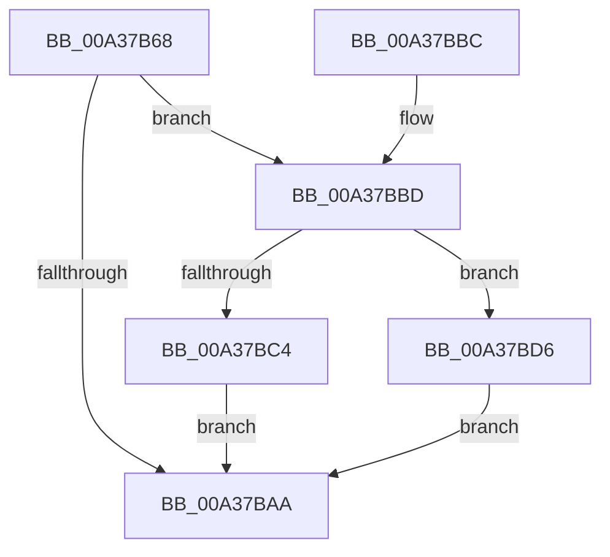

# SiGetBootDeviceNameFromRegistry

- RVA: `0x00A37B68`–`0x00A37BDD` (길이 `117` bytes)
- VA: `0x0000000140A37B68`
- 실행 섹션: `PAGE`
- PDB 이름 있음: `예`; PDB Function 태그: `아니요`
- unwind 정보 RVA: `0x00085864`
- 디코드: `34`개 명령, `117/117` bytes 표시
- 미해석 바이트: `0` (있으면 어셈블리에 `.byte`로 보존)

> 이 문서는 커널 이미지의 기계어와 PDB 기호를 분석해 생성했습니다. 4번과 5번은 함수 원형과 자료형을 바이너리 사용 방식에서 추정한 C 해석이며 원본 소스 복구 결과는 아닙니다.

## 1. Dependencies

- 직접 호출 지점: **2**; 고유 호출 대상: **2**
- 직접 호출자로 확인된 함수: **2**
- RIP 상대 이미지 참조: **1**

### Outgoing calls
- `0x00A37B9F` → [SiGetRegistryValue](SiGetRegistryValue_function_00A37D8C.md) (function, `0x00A37D8C`)
- `0x00A37BCC` → [wcslwr](../../text/50/wcslwr_function_005000E0.md) (function, `0x005000E0`)

### Direct callers
- [SiIsWinPeHardDiskZeroUfdBoot](../82/SiIsWinPeHardDiskZeroUfdBoot_function_00828808.md) at `0x0082885B`
- [SiGetBootDeviceName](SiGetBootDeviceName_function_00A378FC.md) at `0x00A3794A`

### Static image references
- `0x00A37B86` → RVA `0x00B0C260` (` ?? ::NNGAKEGL::`string'`; read)

## 2. Other-region calls and transfers

- 다른 실행 섹션으로 향하는 call: **1**
  - `0x00A37BCC` → [wcslwr](../../text/50/wcslwr_function_005000E0.md) (`PAGE` → `.text`)
- 별도 외부 분기/꼬리 이동을 확인하지 못했습니다.

## 3. Assembly (complete function range)

```asm
00A37B68  4C 8B DC                        mov r11, rsp
00A37B6B  49 89 5B 08                     mov qword ptr [r11 + 8], rbx
00A37B6F  49 89 73 10                     mov qword ptr [r11 + 0x10], rsi
00A37B73  57                              push rdi
00A37B74  48 83 EC 30                     sub rsp, 0x30
00A37B78  49 83 63 20 00                  and qword ptr [r11 + 0x20], 0
00A37B7D  49 8D 43 18                     lea rax, [r11 + 0x18]
00A37B81  83 64 24 50 00                  and dword ptr [rsp + 0x50], 0
00A37B86  4C 8D 05 D3 46 0D 00            lea r8, [rip + 0xd46d3]
00A37B8D  49 89 43 F0                     mov qword ptr [r11 - 0x10], rax
00A37B91  48 8B F2                        mov rsi, rdx
00A37B94  49 8D 43 20                     lea rax, [r11 + 0x20]
00A37B98  48 8B D1                        mov rdx, rcx
00A37B9B  49 89 43 E8                     mov qword ptr [r11 - 0x18], rax
00A37B9F  E8 E8 01 00 00                  call 0x140a37d8c
00A37BA4  8B F8                           mov edi, eax
00A37BA6  85 C0                           test eax, eax
00A37BA8  79 13                           jns 0x140a37bbd
00A37BAA  48 8B 5C 24 40                  mov rbx, qword ptr [rsp + 0x40]
00A37BAF  8B C7                           mov eax, edi
00A37BB1  48 8B 74 24 48                  mov rsi, qword ptr [rsp + 0x48]
00A37BB6  48 83 C4 30                     add rsp, 0x30
00A37BBA  5F                              pop rdi
00A37BBB  C3                              ret
00A37BBC  CC                              int3
00A37BBD  83 7C 24 50 04                  cmp dword ptr [rsp + 0x50], 4
00A37BC2  72 12                           jb 0x140a37bd6
00A37BC4  48 8B 5C 24 58                  mov rbx, qword ptr [rsp + 0x58]
00A37BC9  48 8B CB                        mov rcx, rbx
00A37BCC  E8 0F 85 AC FF                  call 0x1405000e0
00A37BD1  48 89 1E                        mov qword ptr [rsi], rbx
00A37BD4  EB D4                           jmp 0x140a37baa
00A37BD6  BF 01 00 00 C0                  mov edi, 0xc0000001
00A37BDB  EB CD                           jmp 0x140a37baa
```

## 4. C-style interpretation (structured pseudocode)

```c
__int64 __fastcall SiGetBootDeviceNameFromRegistry(__int64 a1, __int64 a2)
{
    __int64 result;
    __int64 v_rsp;
    unsigned __int64 v_stack_p10;
    unsigned int v_stack_p18;
    unsigned int v_stack_p50;
    unsigned __int64 v_stack_p58;
    unsigned __int64 v_stack_p8;

    *(unsigned __int64 *)(v_rsp + 8) = v_rbx;
    *(unsigned __int64 *)(v_rsp + 16) = v_rsi;
    v_rsp = (v_rsp) - (48);
    *(unsigned __int64 *)(v_rsp - 16) = v_rsp + 24;
    *(unsigned __int64 *)(v_rsp - 24) = v_rsp + 32;
    result = SiGetRegistryValue(a1, a1, v_rip + 870099, a4);
    if (!sign_flag) goto loc_00A37BBD;
loc_00A37BAA:
    v_rsp = (v_rsp) + (48);
    return (unsigned int)((unsigned int)((unsigned int)((unsigned int)(result))));
loc_00A37BBD:
    if (v_stack_p50 < 4) goto loc_00A37BD6;
    result = wcslwr(v_stack_p58, a1, v_rip + 870099, a4);
    *(unsigned __int64 *)(v_stack_p10) = v_stack_p58;
    goto loc_00A37BAA;
loc_00A37BD6:
    goto loc_00A37BAA;
}
```

## 5. (Beta) C Style

```c
int64_t SiGetBootDeviceNameFromRegistry(int64_t Arg1, void *Arg2)
{
    uint8_t *arg2 = (uint8_t *)Arg2;

    int64_t result;
    int64_t local_rsp;
    uint64_t v_stack_p10;
    uint32_t v_stack_p18;
    uint32_t v_stack_p50;
    uint64_t v_stack_p58;
    uint64_t v_stack_p8;

    *(uint64_t *)(local_rsp + 0x8) = local_rbx;
    *(uint64_t *)(local_rsp + 0x10) = local_rsi;
    local_rsp = (local_rsp) - (48);
    *(uint64_t *)(local_rsp - 0x10) = local_rsp + 24;
    *(uint64_t *)(local_rsp - 0x18) = local_rsp + 32;
    result = SiGetRegistryValue(Arg1, Arg1, v_rip + 870099, a4);
    if (!sign_flag) goto loc_00A37BBD;
loc_00A37BAA:
    local_rsp = (local_rsp) + (48);
    return (uint32_t)((uint32_t)((uint32_t)((uint32_t)(result))));
loc_00A37BBD:
    if (v_stack_p50 < 4) goto loc_00A37BD6;
    result = wcslwr(v_stack_p58, Arg1, v_rip + 870099, a4);
    *(uint64_t *)(v_stack_p10) = v_stack_p58;
    goto loc_00A37BAA;
loc_00A37BD6:
    goto loc_00A37BAA;
}
```

### 관측된 메모리 오프셋

구조체 형식이 확인되지 않은 접근은 인자 기준의 오프셋으로만 기록했습니다.

| 기준 인자 | 오프셋 표현 | 폭 (bit) | 접근 |
|---|---:|---:|---|
| `Arg2` | `+ 0x0` | `64` | `W` |

## 6. Execution-region graph

[열기: 2D/3D 그래프와 함수 탐색 컨트롤 패널](../../../control-panel.html?section=page&rva=0x00A37B68&view=graph)

- 2D 그래프는 위에서 아래로 흐르고, 3D 그래프는 빈 공간을 드래그해 회전합니다. Shift+드래그는 이동, 휠은 확대·축소, 함수 노드 선택은 대상 보고서 이동입니다.

### Static fallback


