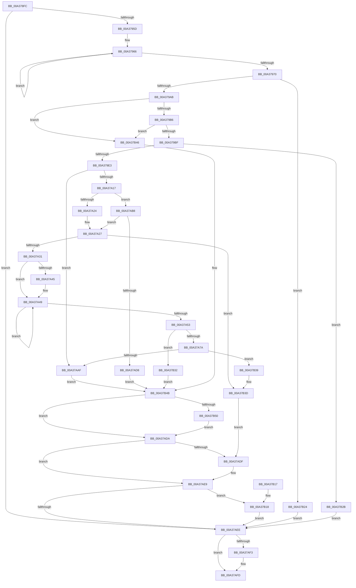

# SiGetBootDeviceName

- RVA: `0x00A378FC`–`0x00A37B5F` (길이 `611` bytes)
- VA: `0x0000000140A378FC`
- 실행 섹션: `PAGE`
- PDB 이름 있음: `예`; PDB Function 태그: `아니요`
- unwind 정보 RVA: `0x000ADBC4`
- 디코드: `169`개 명령, `611/611` bytes 표시
- 미해석 바이트: `0` (있으면 어셈블리에 `.byte`로 보존)

> 이 문서는 커널 이미지의 기계어와 PDB 기호를 분석해 생성했습니다. 4번과 5번은 함수 원형과 자료형을 바이너리 사용 방식에서 추정한 C 해석이며 원본 소스 복구 결과는 아닙니다.

## 1. Dependencies

- 직접 호출 지점: **15**; 고유 호출 대상: **9**
- 직접 호출자로 확인된 함수: **5**
- RIP 상대 이미지 참조: **4**

### Outgoing calls
- `0x00A3794A` → [SiGetBootDeviceNameFromRegistry](SiGetBootDeviceNameFromRegistry_function_00A37B68.md) (function, `0x00A37B68`)
- `0x00A3799D` → [snwscanf_s](../../text/50/snwscanf_s_function_00505520.md) (function, `0x00505520`)
- `0x00A379D2` → [ExAllocatePool2](../../poolcode/B8/ExAllocatePool2_function_00B820F0.md) (function, `0x00B820F0`)
- `0x00A379FC` → [swprintf_s](../../text/50/swprintf_s_function_00504B20.md) (function, `0x00504B20`)
- `0x00A37A08` → [SiTranslateSymbolicLink](SiTranslateSymbolicLink_function_00A37BE4.md) (function, `0x00A37BE4`)
- `0x00A37A3B` → [wcsstr](../../text/50/wcsstr_function_00501F80.md) (function, `0x00501F80`)
- `0x00A37A69` → [ExAllocatePool2](../../poolcode/B8/ExAllocatePool2_function_00B820F0.md) (function, `0x00B820F0`)
- `0x00A37A83` → [memcpy](../../text/6C/memcpy_function_006C6840.md) (function, `0x006C6840`)
- `0x00A37A8D` → [ExFreePoolWithTag](../../poolcode/B8/ExFreePoolWithTag_function_00B82870.md) (function, `0x00B82870`)
- `0x00A37AA0` → [SiTranslateSymbolicLink](SiTranslateSymbolicLink_function_00A37BE4.md) (function, `0x00A37BE4`)
- `0x00A37AC6` → [SiValidateSystemPartition](../../text/49/SiValidateSystemPartition_function_0049C280.md) (function, `0x0049C280`)
- `0x00A37AE4` → [ExFreePoolWithTag](../../poolcode/B8/ExFreePoolWithTag_function_00B82870.md) (function, `0x00B82870`)
- `0x00A37AF8` → [ExFreePoolWithTag](../../poolcode/B8/ExFreePoolWithTag_function_00B82870.md) (function, `0x00B82870`)
- `0x00A37B1D` → [ExFreePoolWithTag](../../poolcode/B8/ExFreePoolWithTag_function_00B82870.md) (function, `0x00B82870`)
- `0x00A37B55` → [ExFreePoolWithTag](../../poolcode/B8/ExFreePoolWithTag_function_00B82870.md) (function, `0x00B82870`)

### Direct callers
- [SiGetSystemDisk](SiGetSystemDisk_function_00A376F0.md) at `0x00A37730`
- [SiGetSystemDisk](SiGetSystemDisk_function_00A376F0.md) at `0x00A37759`
- [SiGetFirmwareSystemPartition](SiGetFirmwareSystemPartition_function_00A377A0.md) at `0x00A377E5`
- [SiGetSystemPartition](SiGetSystemPartition_function_00A37830.md) at `0x00A3785A`
- [sub_00B3A076](../B3/Unknown_function_00B3A076.md) at `0x00B3A0C8`
- [sub_00B3A106](../B3/Unknown_function_00B3A106.md) at `0x00B3A15C`

### Static image references
- `0x00A37989` → RVA `0x00B0CEF0` (` ?? ::NNGAKEGL::`string'`; read)
- `0x00A379E3` → RVA `0x00B08870` (` ?? ::NNGAKEGL::`string'`; read)
- `0x00A379EF` → RVA `0x00B0C7C0` (` ?? ::NNGAKEGL::`string'`; read)
- `0x00A37A31` → RVA `0x00B0CF40` (` ?? ::NNGAKEGL::`string'`; read)

## 2. Other-region calls and transfers

- 다른 실행 섹션으로 향하는 call: **12**
  - `0x00A3799D` → [snwscanf_s](../../text/50/snwscanf_s_function_00505520.md) (`PAGE` → `.text`)
  - `0x00A379D2` → [ExAllocatePool2](../../poolcode/B8/ExAllocatePool2_function_00B820F0.md) (`PAGE` → `POOLCODE`)
  - `0x00A379FC` → [swprintf_s](../../text/50/swprintf_s_function_00504B20.md) (`PAGE` → `.text`)
  - `0x00A37A3B` → [wcsstr](../../text/50/wcsstr_function_00501F80.md) (`PAGE` → `.text`)
  - `0x00A37A69` → [ExAllocatePool2](../../poolcode/B8/ExAllocatePool2_function_00B820F0.md) (`PAGE` → `POOLCODE`)
  - `0x00A37A83` → [memcpy](../../text/6C/memcpy_function_006C6840.md) (`PAGE` → `.text`)
  - `0x00A37A8D` → [ExFreePoolWithTag](../../poolcode/B8/ExFreePoolWithTag_function_00B82870.md) (`PAGE` → `POOLCODE`)
  - `0x00A37AC6` → [SiValidateSystemPartition](../../text/49/SiValidateSystemPartition_function_0049C280.md) (`PAGE` → `.text`)
  - `0x00A37AE4` → [ExFreePoolWithTag](../../poolcode/B8/ExFreePoolWithTag_function_00B82870.md) (`PAGE` → `POOLCODE`)
  - `0x00A37AF8` → [ExFreePoolWithTag](../../poolcode/B8/ExFreePoolWithTag_function_00B82870.md) (`PAGE` → `POOLCODE`)
  - `0x00A37B1D` → [ExFreePoolWithTag](../../poolcode/B8/ExFreePoolWithTag_function_00B82870.md) (`PAGE` → `POOLCODE`)
  - `0x00A37B55` → [ExFreePoolWithTag](../../poolcode/B8/ExFreePoolWithTag_function_00B82870.md) (`PAGE` → `POOLCODE`)
- 별도 외부 분기/꼬리 이동을 확인하지 못했습니다.

## 3. Assembly (complete function range)

```asm
00A378FC  48 89 5C 24 10                  mov qword ptr [rsp + 0x10], rbx
00A37901  4C 89 4C 24 20                  mov qword ptr [rsp + 0x20], r9
00A37906  89 4C 24 08                     mov dword ptr [rsp + 8], ecx
00A3790A  55                              push rbp
00A3790B  56                              push rsi
00A3790C  57                              push rdi
00A3790D  41 54                           push r12
00A3790F  41 55                           push r13
00A37911  41 56                           push r14
00A37913  41 57                           push r15
00A37915  48 8B EC                        mov rbp, rsp
00A37918  48 83 EC 60                     sub rsp, 0x60
00A3791C  45 33 FF                        xor r15d, r15d
00A3791F  48 8B CA                        mov rcx, rdx
00A37922  48 8D 55 F8                     lea rdx, [rbp - 8]
00A37926  44 89 7D E4                     mov dword ptr [rbp - 0x1c], r15d
00A3792A  44 89 7D E0                     mov dword ptr [rbp - 0x20], r15d
00A3792E  45 8B F7                        mov r14d, r15d
00A37931  44 89 7D E8                     mov dword ptr [rbp - 0x18], r15d
00A37935  41 8B F7                        mov esi, r15d
00A37938  44 89 7D EC                     mov dword ptr [rbp - 0x14], r15d
00A3793C  41 8B FF                        mov edi, r15d
00A3793F  4C 89 7D F0                     mov qword ptr [rbp - 0x10], r15
00A37943  45 8A E8                        mov r13b, r8b
00A37946  4C 89 7D F8                     mov qword ptr [rbp - 8], r15
00A3794A  E8 19 02 00 00                  call 0x140a37b68
00A3794F  4C 8B 65 F8                     mov r12, qword ptr [rbp - 8]
00A37953  8B D8                           mov ebx, eax
00A37955  85 C0                           test eax, eax
00A37957  0F 88 91 01 00 00               js 0x140a37aee
00A3795D  49 83 CF FF                     or r15, 0xffffffffffffffff
00A37961  49 8B DF                        mov rbx, r15
00A37964  33 C0                           xor eax, eax
00A37966  48 FF C3                        inc rbx
00A37969  66 41 39 04 5C                  cmp word ptr [r12 + rbx*2], ax
00A3796E  75 F6                           jne 0x140a37966
00A37970  48 8D 45 E8                     lea rax, [rbp - 0x18]
00A37974  49 8B CC                        mov rcx, r12
00A37977  48 89 44 24 30                  mov qword ptr [rsp + 0x30], rax
00A3797C  4C 8D 4D E0                     lea r9, [rbp - 0x20]
00A37980  48 8D 45 EC                     lea rax, [rbp - 0x14]
00A37984  48 89 44 24 28                  mov qword ptr [rsp + 0x28], rax
00A37989  4C 8D 05 60 55 0D 00            lea r8, [rip + 0xd5560]
00A37990  48 8D 45 E4                     lea rax, [rbp - 0x1c]
00A37994  48 8D 53 01                     lea rdx, [rbx + 1]
00A37998  48 89 44 24 20                  mov qword ptr [rsp + 0x20], rax
00A3799D  E8 7E DB AC FF                  call 0x140505520
00A379A2  83 F8 04                        cmp eax, 4
00A379A5  0F 85 79 01 00 00               jne 0x140a37b24
00A379AB  33 C0                           xor eax, eax
00A379AD  39 45 E0                        cmp dword ptr [rbp - 0x20], eax
00A379B0  0F 85 90 01 00 00               jne 0x140a37b46
00A379B6  39 45 E4                        cmp dword ptr [rbp - 0x1c], eax
00A379B9  0F 85 87 01 00 00               jne 0x140a37b46
00A379BF  48 83 C3 0B                     add rbx, 0xb
00A379C3  B9 00 01 00 00                  mov ecx, 0x100
00A379C8  41 B8 53 59 50 4B               mov r8d, 0x4b505953
00A379CE  48 8D 14 1B                     lea rdx, [rbx + rbx]
00A379D2  E8 19 A7 14 00                  call 0x140b820f0
00A379D7  48 8B F0                        mov rsi, rax
00A379DA  48 85 C0                        test rax, rax
00A379DD  0F 84 48 01 00 00               je 0x140a37b2b
00A379E3  4C 8D 0D 86 0E 0D 00            lea r9, [rip + 0xd0e86]
00A379EA  4C 89 64 24 20                  mov qword ptr [rsp + 0x20], r12
00A379EF  4C 8D 05 CA 4D 0D 00            lea r8, [rip + 0xd4dca]
00A379F6  48 8B D3                        mov rdx, rbx
00A379F9  48 8B C8                        mov rcx, rax
00A379FC  E8 1F D1 AC FF                  call 0x140504b20
00A37A01  48 8D 55 F0                     lea rdx, [rbp - 0x10]
00A37A05  48 8B CE                        mov rcx, rsi
00A37A08  E8 D7 01 00 00                  call 0x140a37be4
00A37A0D  8B D8                           mov ebx, eax
00A37A0F  85 C0                           test eax, eax
00A37A11  0F 88 98 00 00 00               js 0x140a37aaf
00A37A17  48 8B 7D F0                     mov rdi, qword ptr [rbp - 0x10]
00A37A1B  45 84 ED                        test r13b, r13b
00A37A1E  0F 85 94 00 00 00               jne 0x140a37ab8
00A37A24  45 33 ED                        xor r13d, r13d
00A37A27  44 39 6D 40                     cmp dword ptr [rbp + 0x40], r13d
00A37A2B  0F 85 0C 01 00 00               jne 0x140a37b3d
00A37A31  48 8D 15 08 55 0D 00            lea rdx, [rip + 0xd5508]
00A37A38  48 8B CE                        mov rcx, rsi
00A37A3B  E8 40 A5 AC FF                  call 0x140501f80
00A37A40  48 85 C0                        test rax, rax
00A37A43  74 04                           je 0x140a37a49
00A37A45  66 44 89 28                     mov word ptr [rax], r13w
00A37A49  49 FF C7                        inc r15
00A37A4C  66 46 39 2C 7E                  cmp word ptr [rsi + r15*2], r13w
00A37A51  75 F6                           jne 0x140a37a49
00A37A53  4E 8D 3C 7D 02 00 00 00         lea r15, [r15*2 + 2]
00A37A5B  41 B8 53 59 50 4B               mov r8d, 0x4b505953
00A37A61  49 8B D7                        mov rdx, r15
00A37A64  B9 00 01 00 00                  mov ecx, 0x100
00A37A69  E8 82 A6 14 00                  call 0x140b820f0
00A37A6E  4C 8B F0                        mov r14, rax
00A37A71  48 85 C0                        test rax, rax
00A37A74  0F 84 B8 00 00 00               je 0x140a37b32
00A37A7A  4D 8B C7                        mov r8, r15
00A37A7D  48 8B D6                        mov rdx, rsi
00A37A80  48 8B C8                        mov rcx, rax
00A37A83  E8 B8 ED C8 FF                  call 0x1406c6840
00A37A88  33 D2                           xor edx, edx
00A37A8A  48 8B CF                        mov rcx, rdi
00A37A8D  E8 DE AD 14 00                  call 0x140b82870
00A37A92  45 33 FF                        xor r15d, r15d
00A37A95  48 8D 55 F0                     lea rdx, [rbp - 0x10]
00A37A99  49 8B CE                        mov rcx, r14
00A37A9C  4C 89 7D F0                     mov qword ptr [rbp - 0x10], r15
00A37AA0  E8 3F 01 00 00                  call 0x140a37be4
00A37AA5  8B D8                           mov ebx, eax
00A37AA7  85 C0                           test eax, eax
00A37AA9  0F 89 8A 00 00 00               jns 0x140a37b39
00A37AAF  48 8B 7D F0                     mov rdi, qword ptr [rbp - 0x10]
00A37AB3  E9 93 00 00 00                  jmp 0x140a37b4b
00A37AB8  8A 45 60                        mov al, byte ptr [rbp + 0x60]
00A37ABB  48 8B CF                        mov rcx, rdi
00A37ABE  48 8B 55 58                     mov rdx, qword ptr [rbp + 0x58]
00A37AC2  88 44 24 20                     mov byte ptr [rsp + 0x20], al
00A37AC6  E8 B5 47 A6 FF                  call 0x14049c280
00A37ACB  45 33 ED                        xor r13d, r13d
00A37ACE  8B D8                           mov ebx, eax
00A37AD0  85 C0                           test eax, eax
00A37AD2  0F 89 4F FF FF FF               jns 0x140a37a27
00A37AD8  EB 71                           jmp 0x140a37b4b
00A37ADA  48 85 F6                        test rsi, rsi
00A37ADD  74 0A                           je 0x140a37ae9
00A37ADF  33 D2                           xor edx, edx
00A37AE1  48 8B CE                        mov rcx, rsi
00A37AE4  E8 87 AD 14 00                  call 0x140b82870
00A37AE9  4D 85 F6                        test r14, r14
00A37AEC  75 2A                           jne 0x140a37b18
00A37AEE  4D 85 E4                        test r12, r12
00A37AF1  74 0A                           je 0x140a37afd
00A37AF3  33 D2                           xor edx, edx
00A37AF5  49 8B CC                        mov rcx, r12
00A37AF8  E8 73 AD 14 00                  call 0x140b82870
00A37AFD  8B C3                           mov eax, ebx
00A37AFF  48 8B 9C 24 A8 00 00 00         mov rbx, qword ptr [rsp + 0xa8]
00A37B07  48 83 C4 60                     add rsp, 0x60
00A37B0B  41 5F                           pop r15
00A37B0D  41 5E                           pop r14
00A37B0F  41 5D                           pop r13
00A37B11  41 5C                           pop r12
00A37B13  5F                              pop rdi
00A37B14  5E                              pop rsi
00A37B15  5D                              pop rbp
00A37B16  C3                              ret
00A37B17  CC                              int3
00A37B18  33 D2                           xor edx, edx
00A37B1A  49 8B CE                        mov rcx, r14
00A37B1D  E8 4E AD 14 00                  call 0x140b82870
00A37B22  EB CA                           jmp 0x140a37aee
00A37B24  BB 01 00 00 C0                  mov ebx, 0xc0000001
00A37B29  EB C3                           jmp 0x140a37aee
00A37B2B  BB 9A 00 00 C0                  mov ebx, 0xc000009a
00A37B30  EB BC                           jmp 0x140a37aee
00A37B32  BB 9A 00 00 C0                  mov ebx, 0xc000009a
00A37B37  EB 12                           jmp 0x140a37b4b
00A37B39  48 8B 7D F0                     mov rdi, qword ptr [rbp - 0x10]
00A37B3D  48 8B 45 68                     mov rax, qword ptr [rbp + 0x68]
00A37B41  48 89 38                        mov qword ptr [rax], rdi
00A37B44  EB 99                           jmp 0x140a37adf
00A37B46  BB 01 00 00 C0                  mov ebx, 0xc0000001
00A37B4B  48 85 FF                        test rdi, rdi
00A37B4E  74 8A                           je 0x140a37ada
00A37B50  33 D2                           xor edx, edx
00A37B52  48 8B CF                        mov rcx, rdi
00A37B55  E8 16 AD 14 00                  call 0x140b82870
00A37B5A  E9 7B FF FF FF                  jmp 0x140a37ada
```

## 4. C-style interpretation (structured pseudocode)

```c
__int64 __fastcall SiGetBootDeviceName(int a1, __int64 a2, unsigned __int8 a3, __int64 a4, unsigned __int8 a5, __int64 a6)
{
    __int64 result;
    __int64 v_r13;
    __int64 v_r15;
    __int64 v_rbx;
    __int64 v_rsp;
    unsigned __int64 v_stack_m40;
    unsigned __int64 v_stack_m48;
    unsigned int v_stack_m4C;
    unsigned int v_stack_m50;
    unsigned int v_stack_m54;
    unsigned int v_stack_m58;
    unsigned __int64 v_stack_m68;
    unsigned __int64 v_stack_m70;
    unsigned __int64 v_stack_m78;
    unsigned __int64 v_stack_p10;
    unsigned __int64 v_stack_p20;
    unsigned int v_stack_p8;

    v_stack_p10 = v_rbx;
    v_stack_p20 = a4;
    v_stack_p8 = a1;
    v_rsp = (v_rsp) - (96);
    v_r15 = 0;
    v_stack_m54 = 0;
    v_stack_m58 = 0;
    v_stack_m50 = 0;
    v_stack_m4C = 0;
    v_stack_m48 = 0;
    v_stack_m40 = 0;
    result = SiGetBootDeviceNameFromRegistry(a2, v_stack_m40, a3, a4);
    if (sign_flag) goto loc_00A37AEE;
    v_r15 = (v_r15) | (-1);
    result = 0;
loc_00A37966:
    v_rbx = (v_r15) + 1;
    if ((*(unsigned __int16 *)(v_stack_m40 + v_rbx * 2)) != 0) goto loc_00A37966;
    v_stack_m68 = v_stack_m50;
    v_stack_m70 = v_stack_m4C;
    v_stack_m78 = v_stack_m54;
    result = snwscanf_s(v_stack_m40, v_rbx + 1, v_rip + 873824, v_stack_m58);
    if (((unsigned int)(result)) != 4) goto loc_00A37B24;
    result = 0;
    if (v_stack_m58 != 0) goto loc_00A37B46;
    if (v_stack_m54 != 0) goto loc_00A37B46;
    v_rbx = (v_rbx) + (11);
    result = ExAllocatePool2(256, v_rbx + v_rbx * 1, (unsigned int)(0x4B505953ULL), v_stack_m58);
    if (result == 0) goto loc_00A37B2B;
    v_stack_m78 = v_stack_m40;
    result = swprintf_s(result, v_rbx, v_rip + 871882, v_rip + 855686);
    result = SiTranslateSymbolicLink(result, v_stack_m48, v_rip + 871882, v_rip + 855686);
    if (sign_flag) goto loc_00A37AAF;
    if (a3 != 0) goto loc_00A37AB8;
    v_r13 = 0;
loc_00A37A27:
    if (v_stack_p8 != 0) goto loc_00A37B3D;
    result = wcsstr(result, v_rip + 873736, v_rip + 871882, v_rip + 855686);
    if (result != 0) {
        *(unsigned __int16 *)(result) = 0;
    }
    v_r15 = (v_r15) + 1;
    if ((*(unsigned __int16 *)(result + v_r15 * 2)) != 0) goto loc_00A37A49;
    result = ExAllocatePool2(256, v_r15 * 2 + 2, (unsigned int)(0x4B505953ULL), v_rip + 855686);
    if (result == 0) goto loc_00A37B32;
    result = memcpy(result, result, v_r15 * 2 + 2, v_rip + 855686);
    a2 = 0;
    result = ExFreePoolWithTag(v_stack_m48, a2, v_r15 * 2 + 2, v_rip + 855686);
    v_r15 = 0;
    v_stack_m48 = 0;
    result = SiTranslateSymbolicLink(result, v_stack_m48, v_r15 * 2 + 2, v_rip + 855686);
    if (!sign_flag) goto loc_00A37B39;
loc_00A37AAF:
    goto loc_00A37B4B;
loc_00A37AB8:
    v_stack_m78 = a5;
    result = SiValidateSystemPartition(v_stack_m48, v_stack_p20, v_r15 * 2 + 2, v_rip + 855686);
    v_r13 = 0;
    if (!sign_flag) goto loc_00A37A27;
    goto loc_00A37B4B;
loc_00A37ADA:
    if (result != 0) {
        a2 = 0;
        a1 = result;
        result = ExFreePoolWithTag(a1, a2, v_r15 * 2 + 2, v_rip + 855686);
    }
    if (result != 0) goto loc_00A37B18;
loc_00A37AEE:
    if (v_stack_m40 != 0) {
        a2 = 0;
        a1 = v_stack_m40;
        result = ExFreePoolWithTag(a1, a2, v_r15 * 2 + 2, v_rip + 855686);
    }
    v_rsp = (v_rsp) + (96);
    return (unsigned int)((unsigned int)((unsigned int)((unsigned int)(result))));
loc_00A37B18:
    a2 = 0;
    result = ExFreePoolWithTag(result, a2, v_r15 * 2 + 2, v_rip + 855686);
    goto loc_00A37AEE;
loc_00A37B24:
    goto loc_00A37AEE;
loc_00A37B2B:
    goto loc_00A37AEE;
loc_00A37B32:
    goto loc_00A37B4B;
loc_00A37B39:
loc_00A37B3D:
    *(unsigned __int64 *)(a6) = v_stack_m48;
    goto loc_00A37ADF;
loc_00A37B46:
loc_00A37B4B:
    if (v_stack_m48 == 0) goto loc_00A37ADA;
    a2 = 0;
    result = ExFreePoolWithTag(v_stack_m48, a2, v_r15 * 2 + 2, v_rip + 855686);
    goto loc_00A37ADA;
}
```

## 5. (Beta) C Style

```c
int64_t SiGetBootDeviceName(int32_t Arg1, int64_t Arg2, uint8_t Arg3, int64_t Arg4, uint8_t Arg5, void *Arg6)
{
    uint8_t *arg6 = (uint8_t *)Arg6;

    int64_t result;
    int64_t local_r13;
    int64_t local_r15;
    int64_t local_rbx;
    int64_t local_rsp;
    uint64_t v_stack_m40;
    uint64_t v_stack_m48;
    uint32_t v_stack_m4C;
    uint32_t v_stack_m50;
    uint32_t v_stack_m54;
    uint32_t v_stack_m58;
    uint64_t v_stack_m68;
    uint64_t v_stack_m70;
    uint64_t v_stack_m78;
    uint64_t v_stack_p10;
    uint64_t v_stack_p20;
    uint32_t v_stack_p8;

    v_stack_p10 = local_rbx;
    v_stack_p20 = Arg4;
    v_stack_p8 = Arg1;
    local_rsp = (local_rsp) - (96);
    local_r15 = 0;
    v_stack_m54 = 0;
    v_stack_m58 = 0;
    v_stack_m50 = 0;
    v_stack_m4C = 0;
    v_stack_m48 = 0;
    v_stack_m40 = 0;
    result = SiGetBootDeviceNameFromRegistry(Arg2, v_stack_m40, Arg3, Arg4);
    if (sign_flag) goto loc_00A37AEE;
    local_r15 = (local_r15) | (-1);
    result = 0;
loc_00A37966:
    local_rbx = (local_r15) + 1;
    if ((*(uint16_t *)(v_stack_m40 + local_rbx * 2)) != 0) goto loc_00A37966;
    v_stack_m68 = v_stack_m50;
    v_stack_m70 = v_stack_m4C;
    v_stack_m78 = v_stack_m54;
    result = snwscanf_s(v_stack_m40, local_rbx + 1, v_rip + 873824, v_stack_m58);
    if (((uint32_t)(result)) != 4) goto loc_00A37B24;
    result = 0;
    if (v_stack_m58 != 0) goto loc_00A37B46;
    if (v_stack_m54 != 0) goto loc_00A37B46;
    local_rbx = (local_rbx) + (11);
    result = ExAllocatePool2(256, local_rbx + local_rbx * 1, (uint32_t)(0x4B505953ULL), v_stack_m58);
    if (result == 0) goto loc_00A37B2B;
    v_stack_m78 = v_stack_m40;
    result = swprintf_s(result, local_rbx, v_rip + 871882, v_rip + 855686);
    result = SiTranslateSymbolicLink(result, v_stack_m48, v_rip + 871882, v_rip + 855686);
    if (sign_flag) goto loc_00A37AAF;
    if (Arg3 != 0) goto loc_00A37AB8;
    local_r13 = 0;
loc_00A37A27:
    if (v_stack_p8 != 0) goto loc_00A37B3D;
    result = wcsstr(result, v_rip + 873736, v_rip + 871882, v_rip + 855686);
    if (result != 0) {
        *(uint16_t *)(result) = 0;
    }
    local_r15 = (local_r15) + 1;
    if ((*(uint16_t *)(result + local_r15 * 2)) != 0) goto loc_00A37A49;
    result = ExAllocatePool2(256, local_r15 * 2 + 2, (uint32_t)(0x4B505953ULL), v_rip + 855686);
    if (result == 0) goto loc_00A37B32;
    result = memcpy(result, result, local_r15 * 2 + 2, v_rip + 855686);
    Arg2 = 0;
    result = ExFreePoolWithTag(v_stack_m48, Arg2, local_r15 * 2 + 2, v_rip + 855686);
    local_r15 = 0;
    v_stack_m48 = 0;
    result = SiTranslateSymbolicLink(result, v_stack_m48, local_r15 * 2 + 2, v_rip + 855686);
    if (!sign_flag) goto loc_00A37B39;
loc_00A37AAF:
    goto loc_00A37B4B;
loc_00A37AB8:
    v_stack_m78 = Arg5;
    result = SiValidateSystemPartition(v_stack_m48, v_stack_p20, local_r15 * 2 + 2, v_rip + 855686);
    local_r13 = 0;
    if (!sign_flag) goto loc_00A37A27;
    goto loc_00A37B4B;
loc_00A37ADA:
    if (result != 0) {
        Arg2 = 0;
        Arg1 = result;
        result = ExFreePoolWithTag(Arg1, Arg2, local_r15 * 2 + 2, v_rip + 855686);
    }
    if (result != 0) goto loc_00A37B18;
loc_00A37AEE:
    if (v_stack_m40 != 0) {
        Arg2 = 0;
        Arg1 = v_stack_m40;
        result = ExFreePoolWithTag(Arg1, Arg2, local_r15 * 2 + 2, v_rip + 855686);
    }
    local_rsp = (local_rsp) + (96);
    return (uint32_t)((uint32_t)((uint32_t)((uint32_t)(result))));
loc_00A37B18:
    Arg2 = 0;
    result = ExFreePoolWithTag(result, Arg2, local_r15 * 2 + 2, v_rip + 855686);
    goto loc_00A37AEE;
loc_00A37B24:
    goto loc_00A37AEE;
loc_00A37B2B:
    goto loc_00A37AEE;
loc_00A37B32:
    goto loc_00A37B4B;
loc_00A37B39:
loc_00A37B3D:
    *(uint64_t *)(arg6) = v_stack_m48;
    goto loc_00A37ADF;
loc_00A37B46:
loc_00A37B4B:
    if (v_stack_m48 == 0) goto loc_00A37ADA;
    Arg2 = 0;
    result = ExFreePoolWithTag(v_stack_m48, Arg2, local_r15 * 2 + 2, v_rip + 855686);
    goto loc_00A37ADA;
}
```

### 관측된 메모리 오프셋

구조체 형식이 확인되지 않은 접근은 인자 기준의 오프셋으로만 기록했습니다.

| 기준 인자 | 오프셋 표현 | 폭 (bit) | 접근 |
|---|---:|---:|---|
| `Arg6` | `+ 0x0` | `64` | `W` |

## 6. Execution-region graph

[열기: 2D/3D 그래프와 함수 탐색 컨트롤 패널](../../../control-panel.html?section=page&rva=0x00A378FC&view=graph)

- 2D 그래프는 위에서 아래로 흐르고, 3D 그래프는 빈 공간을 드래그해 회전합니다. Shift+드래그는 이동, 휠은 확대·축소, 함수 노드 선택은 대상 보고서 이동입니다.

### Static fallback


