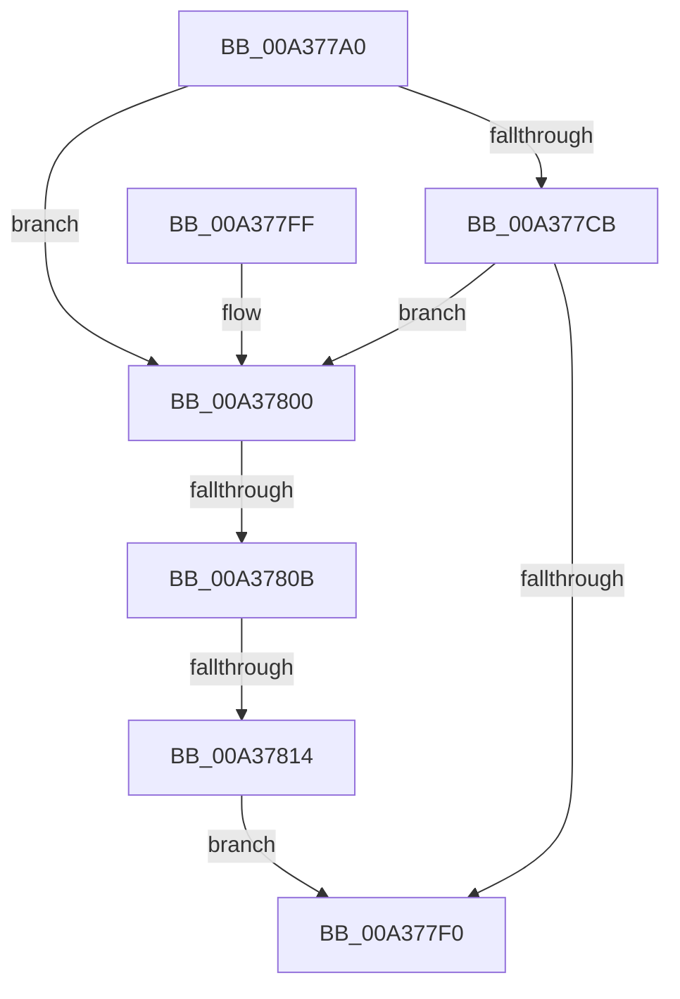

# SiGetFirmwareSystemPartition

- RVA: `0x00A377A0`–`0x00A3781B` (길이 `123` bytes)
- VA: `0x0000000140A377A0`
- 실행 섹션: `PAGE`
- PDB 이름 있음: `예`; PDB Function 태그: `예`
- unwind 정보 RVA: `0x000ADB80`
- 디코드: `38`개 명령, `123/123` bytes 표시
- 미해석 바이트: `0` (있으면 어셈블리에 `.byte`로 보존)

> 이 문서는 커널 이미지의 기계어와 PDB 기호를 분석해 생성했습니다. 4번과 5번은 함수 원형과 자료형을 바이너리 사용 방식에서 추정한 C 해석이며 원본 소스 복구 결과는 아닙니다.

## 1. Dependencies

- 직접 호출 지점: **2**; 고유 호출 대상: **2**
- 직접 호출자로 확인된 함수: **1**
- RIP 상대 이미지 참조: **1**

### Outgoing calls
- `0x00A377BF` → [SiIsWinPEBoot](SiIsWinPEBoot_function_00A37880.md) (function, `0x00A37880`)
- `0x00A377E5` → [SiGetBootDeviceName](SiGetBootDeviceName_function_00A378FC.md) (function, `0x00A378FC`)

### Direct callers
- [SiGetSystemPartition](SiGetSystemPartition_function_00A37830.md) at `0x00A37868`

### Static image references
- `0x00A377DA` → RVA `0x00B0CE90` (` ?? ::NNGAKEGL::`string'`; read)

## 2. Other-region calls and transfers

- 다른 실행 섹션으로 향하는 call: **0**
- call이 아닌 외부 분기/꼬리 이동: **2**
  - `0x00A37805` → [sub_00B3A106 + 0xF](../B3/Unknown_function_00B3A106.md) (`tail-transfer`)
  - `0x00A3780E` → [sub_00B3A106](../B3/Unknown_function_00B3A106.md) (`tail-transfer`)

## 3. Assembly (complete function range)

```asm
00A377A0  48 89 5C 24 08                  mov qword ptr [rsp + 8], rbx
00A377A5  55                              push rbp
00A377A6  56                              push rsi
00A377A7  57                              push rdi
00A377A8  48 83 EC 30                     sub rsp, 0x30
00A377AC  48 83 64 24 68 00               and qword ptr [rsp + 0x68], 0
00A377B2  48 8B FA                        mov rdi, rdx
00A377B5  8B F1                           mov esi, ecx
00A377B7  C7 44 24 60 01 00 00 00         mov dword ptr [rsp + 0x60], 1
00A377BF  E8 BC 00 00 00                  call 0x140a37880
00A377C4  40 8A E8                        mov bpl, al
00A377C7  84 C0                           test al, al
00A377C9  75 35                           jne 0x140a37800
00A377CB  45 33 C9                        xor r9d, r9d
00A377CE  48 89 7C 24 28                  mov qword ptr [rsp + 0x28], rdi
00A377D3  41 B0 01                        mov r8b, 1
00A377D6  88 44 24 20                     mov byte ptr [rsp + 0x20], al
00A377DA  48 8D 15 AF 56 0D 00            lea rdx, [rip + 0xd56af]
00A377E1  41 8D 49 01                     lea ecx, [r9 + 1]
00A377E5  E8 12 01 00 00                  call 0x140a378fc
00A377EA  8B D8                           mov ebx, eax
00A377EC  85 C0                           test eax, eax
00A377EE  78 10                           js 0x140a37800
00A377F0  8B C3                           mov eax, ebx
00A377F2  48 8B 5C 24 50                  mov rbx, qword ptr [rsp + 0x50]
00A377F7  48 83 C4 30                     add rsp, 0x30
00A377FB  5F                              pop rdi
00A377FC  5E                              pop rsi
00A377FD  5D                              pop rbp
00A377FE  C3                              ret
00A377FF  CC                              int3
00A37800  8B CE                           mov ecx, esi
00A37802  83 E9 01                        sub ecx, 1
00A37805  0F 84 0A 29 10 00               je 0x140b3a115
00A3780B  83 F9 01                        cmp ecx, 1
00A3780E  0F 84 F2 28 10 00               je 0x140b3a106
00A37814  BB BB 00 00 C0                  mov ebx, 0xc00000bb
00A37819  EB D5                           jmp 0x140a377f0
```

## 4. C-style interpretation (structured pseudocode)

```c
__int64 __fastcall SiGetFirmwareSystemPartition(int a1, __int64 a2, __int64 a3, int a4)
{
    __int64 result;
    __int64 v_rsp;
    unsigned __int64 v_stack_m20;
    unsigned __int8 v_stack_m28;
    unsigned int v_stack_p18;
    unsigned __int64 v_stack_p20;
    unsigned __int64 v_stack_p8;

    v_stack_p8 = v_rbx;
    v_rsp = (v_rsp) - (48);
    v_stack_p18 = 1;
    result = SiIsWinPEBoot(a1, a2, a3, a4);
    if ((unsigned __int8)(result) != 0) goto loc_00A37800;
    a4 = 0;
    v_stack_m20 = a2;
    v_stack_m28 = (unsigned __int8)(result);
    result = SiGetBootDeviceName(a4 + 1, v_rip + 874159, 1, a4);
    if (sign_flag) goto loc_00A37800;
loc_00A377F0:
    v_rsp = (v_rsp) + (48);
    return (unsigned int)((unsigned int)((unsigned int)((unsigned int)(result))));
loc_00A37800:
    a1 = (unsigned int)(((unsigned int)((unsigned int)((unsigned int)(a1)))) - (1));
    goto loc_00A377F0;
}
```

## 5. (Beta) C Style

```c
int64_t SiGetFirmwareSystemPartition(int32_t Arg1, int64_t Arg2, int64_t Arg3, int32_t Arg4)
{
    int64_t result;
    int64_t local_rsp;
    uint64_t v_stack_m20;
    uint8_t v_stack_m28;
    uint32_t v_stack_p18;
    uint64_t v_stack_p20;
    uint64_t v_stack_p8;

    v_stack_p8 = local_rbx;
    local_rsp = (local_rsp) - (48);
    v_stack_p18 = 1;
    result = SiIsWinPEBoot(Arg1, Arg2, Arg3, Arg4);
    if ((uint8_t)(result) != 0) goto loc_00A37800;
    Arg4 = 0;
    v_stack_m20 = Arg2;
    v_stack_m28 = (uint8_t)(result);
    result = SiGetBootDeviceName(Arg4 + 1, v_rip + 874159, 1, Arg4);
    if (sign_flag) goto loc_00A37800;
loc_00A377F0:
    local_rsp = (local_rsp) + (48);
    return (uint32_t)((uint32_t)((uint32_t)((uint32_t)(result))));
loc_00A37800:
    Arg1 = (uint32_t)(((uint32_t)((uint32_t)((uint32_t)(Arg1)))) - (1));
    goto loc_00A377F0;
}
```

## 6. Execution-region graph

[열기: 2D/3D 그래프와 함수 탐색 컨트롤 패널](../../../control-panel.html?section=page&rva=0x00A377A0&view=graph)

- 2D 그래프는 위에서 아래로 흐르고, 3D 그래프는 빈 공간을 드래그해 회전합니다. Shift+드래그는 이동, 휠은 확대·축소, 함수 노드 선택은 대상 보고서 이동입니다.

### Static fallback


