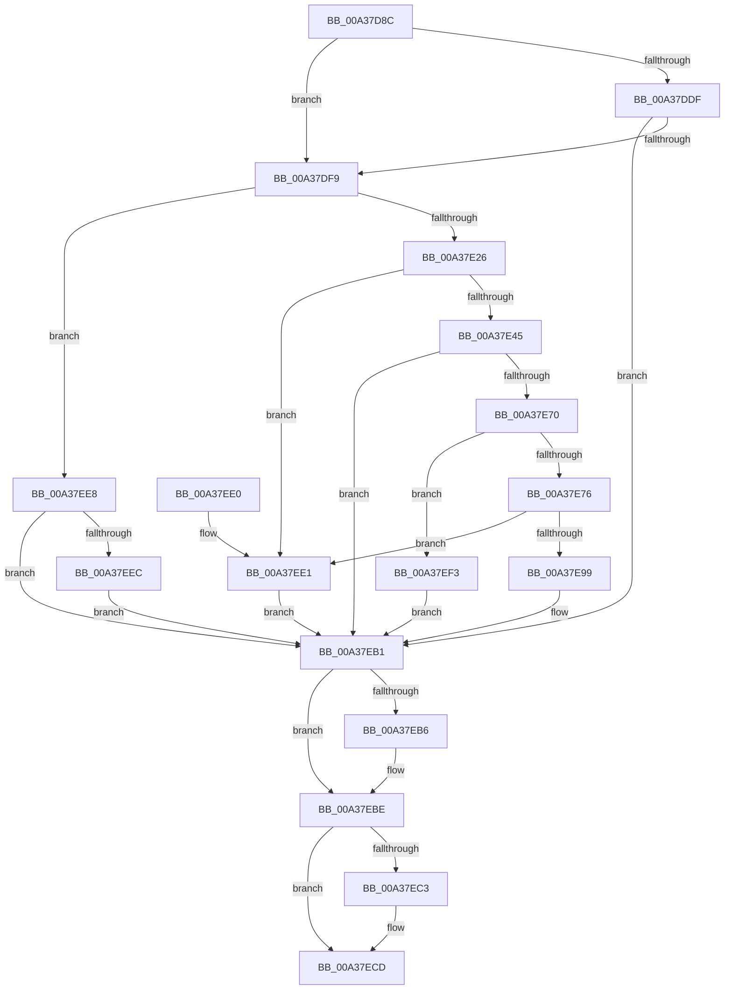

# SiGetRegistryValue

- RVA: `0x00A37D8C`–`0x00A37EFA` (길이 `366` bytes)
- VA: `0x0000000140A37D8C`
- 실행 섹션: `PAGE`
- PDB 이름 있음: `예`; PDB Function 태그: `아니요`
- unwind 정보 RVA: `0x000ADBF8`
- 디코드: `109`개 명령, `366/366` bytes 표시
- 미해석 바이트: `0` (있으면 어셈블리에 `.byte`로 보존)

> 이 문서는 커널 이미지의 기계어와 PDB 기호를 분석해 생성했습니다. 4번과 5번은 함수 원형과 자료형을 바이너리 사용 방식에서 추정한 C 해석이며 원본 소스 복구 결과는 아닙니다.

## 1. Dependencies

- 직접 호출 지점: **9**; 고유 호출 대상: **7**
- 직접 호출자로 확인된 함수: **3**
- RIP 상대 이미지 참조: **0**

### Outgoing calls
- `0x00A37DD5` → [RtlInitUnicodeString](../../text/42/RtlInitUnicodeString_function_0042A780.md) (function, `0x0042A780`)
- `0x00A37DE6` → [SiOpenRegistryKey](SiOpenRegistryKey_function_00A37F00.md) (function, `0x00A37F00`)
- `0x00A37E14` → [ZwQueryValueKey](../../text/6A/ZwQueryValueKey_function_006AD3B0.md) (function, `0x006AD3B0`)
- `0x00A37E34` → [ExAllocatePool2](../../poolcode/B8/ExAllocatePool2_function_00B820F0.md) (function, `0x00B820F0`)
- `0x00A37E65` → [ZwQueryValueKey](../../text/6A/ZwQueryValueKey_function_006AD3B0.md) (function, `0x006AD3B0`)
- `0x00A37E8C` → [ExAllocatePool2](../../poolcode/B8/ExAllocatePool2_function_00B820F0.md) (function, `0x00B820F0`)
- `0x00A37EA4` → [memcpy](../../text/6C/memcpy_function_006C6840.md) (function, `0x006C6840`)
- `0x00A37EB9` → [ZwClose](../../text/6A/ZwClose_function_006AD2B0.md) (function, `0x006AD2B0`)
- `0x00A37EC8` → [ExFreePoolWithTag](../../poolcode/B8/ExFreePoolWithTag_function_00B82870.md) (function, `0x00B82870`)

### Direct callers
- [SiDisambiguateSystemDevice](../82/SiDisambiguateSystemDevice_function_00827B9C.md) at `0x00827BE3`
- [SiIsWinPEBoot](SiIsWinPEBoot_function_00A37880.md) at `0x00A378B4`
- [SiGetBootDeviceNameFromRegistry](SiGetBootDeviceNameFromRegistry_function_00A37B68.md) at `0x00A37B9F`

### Static image references
- 디코드된 RIP-relative 메모리 참조가 없습니다.

## 2. Other-region calls and transfers

- 다른 실행 섹션으로 향하는 call: **8**
  - `0x00A37DD5` → [RtlInitUnicodeString](../../text/42/RtlInitUnicodeString_function_0042A780.md) (`PAGE` → `.text`)
  - `0x00A37E14` → [ZwQueryValueKey](../../text/6A/ZwQueryValueKey_function_006AD3B0.md) (`PAGE` → `.text`)
  - `0x00A37E34` → [ExAllocatePool2](../../poolcode/B8/ExAllocatePool2_function_00B820F0.md) (`PAGE` → `POOLCODE`)
  - `0x00A37E65` → [ZwQueryValueKey](../../text/6A/ZwQueryValueKey_function_006AD3B0.md) (`PAGE` → `.text`)
  - `0x00A37E8C` → [ExAllocatePool2](../../poolcode/B8/ExAllocatePool2_function_00B820F0.md) (`PAGE` → `POOLCODE`)
  - `0x00A37EA4` → [memcpy](../../text/6C/memcpy_function_006C6840.md) (`PAGE` → `.text`)
  - `0x00A37EB9` → [ZwClose](../../text/6A/ZwClose_function_006AD2B0.md) (`PAGE` → `.text`)
  - `0x00A37EC8` → [ExFreePoolWithTag](../../poolcode/B8/ExFreePoolWithTag_function_00B82870.md) (`PAGE` → `POOLCODE`)
- 별도 외부 분기/꼬리 이동을 확인하지 못했습니다.

## 3. Assembly (complete function range)

```asm
00A37D8C  48 89 5C 24 10                  mov qword ptr [rsp + 0x10], rbx
00A37D91  44 89 4C 24 20                  mov dword ptr [rsp + 0x20], r9d
00A37D96  48 89 4C 24 08                  mov qword ptr [rsp + 8], rcx
00A37D9B  55                              push rbp
00A37D9C  56                              push rsi
00A37D9D  57                              push rdi
00A37D9E  41 56                           push r14
00A37DA0  41 57                           push r15
00A37DA2  48 8B EC                        mov rbp, rsp
00A37DA5  48 83 EC 40                     sub rsp, 0x40
00A37DA9  4C 8B 7D 50                     mov r15, qword ptr [rbp + 0x50]
00A37DAD  48 8D 4D F0                     lea rcx, [rbp - 0x10]
00A37DB1  4C 8B 75 58                     mov r14, qword ptr [rbp + 0x58]
00A37DB5  0F 57 C0                        xorps xmm0, xmm0
00A37DB8  83 65 30 00                     and dword ptr [rbp + 0x30], 0
00A37DBC  33 F6                           xor esi, esi
00A37DBE  83 65 48 00                     and dword ptr [rbp + 0x48], 0
00A37DC2  33 FF                           xor edi, edi
00A37DC4  49 21 37                        and qword ptr [r15], rsi
00A37DC7  49 8B D8                        mov rbx, r8
00A37DCA  41 21 36                        and dword ptr [r14], esi
00A37DCD  0F 11 45 F0                     movups xmmword ptr [rbp - 0x10], xmm0
00A37DD1  48 89 7D 40                     mov qword ptr [rbp + 0x40], rdi
00A37DD5  E8 A6 29 9F FF                  call 0x14042a780
00A37DDA  48 85 DB                        test rbx, rbx
00A37DDD  74 1A                           je 0x140a37df9
00A37DDF  4C 8D 4D 40                     lea r9, [rbp + 0x40]
00A37DE3  48 8B D3                        mov rdx, rbx
00A37DE6  E8 15 01 00 00                  call 0x140a37f00
00A37DEB  48 8B 7D 40                     mov rdi, qword ptr [rbp + 0x40]
00A37DEF  8B D8                           mov ebx, eax
00A37DF1  85 C0                           test eax, eax
00A37DF3  0F 88 B8 00 00 00               js 0x140a37eb1
00A37DF9  45 33 C9                        xor r9d, r9d
00A37DFC  48 8D 45 48                     lea rax, [rbp + 0x48]
00A37E00  48 89 44 24 28                  mov qword ptr [rsp + 0x28], rax
00A37E05  48 8D 55 F0                     lea rdx, [rbp - 0x10]
00A37E09  21 74 24 20                     and dword ptr [rsp + 0x20], esi
00A37E0D  48 8B CF                        mov rcx, rdi
00A37E10  45 8D 41 02                     lea r8d, [r9 + 2]
00A37E14  E8 97 55 C7 FF                  call 0x1406ad3b0
00A37E19  8B D8                           mov ebx, eax
00A37E1B  3D 23 00 00 C0                  cmp eax, 0xc0000023
00A37E20  0F 85 C2 00 00 00               jne 0x140a37ee8
00A37E26  8B 55 48                        mov edx, dword ptr [rbp + 0x48]
00A37E29  B9 00 01 00 00                  mov ecx, 0x100
00A37E2E  41 B8 53 59 50 4B               mov r8d, 0x4b505953
00A37E34  E8 B7 A2 14 00                  call 0x140b820f0
00A37E39  48 8B F0                        mov rsi, rax
00A37E3C  48 85 C0                        test rax, rax
00A37E3F  0F 84 9C 00 00 00               je 0x140a37ee1
00A37E45  48 8D 45 30                     lea rax, [rbp + 0x30]
00A37E49  4C 8B CE                        mov r9, rsi
00A37E4C  48 89 44 24 28                  mov qword ptr [rsp + 0x28], rax
00A37E51  48 8D 55 F0                     lea rdx, [rbp - 0x10]
00A37E55  8B 45 48                        mov eax, dword ptr [rbp + 0x48]
00A37E58  41 B8 02 00 00 00               mov r8d, 2
00A37E5E  48 8B CF                        mov rcx, rdi
00A37E61  89 44 24 20                     mov dword ptr [rsp + 0x20], eax
00A37E65  E8 46 55 C7 FF                  call 0x1406ad3b0
00A37E6A  8B D8                           mov ebx, eax
00A37E6C  85 C0                           test eax, eax
00A37E6E  78 41                           js 0x140a37eb1
00A37E70  83 7E 04 01                     cmp dword ptr [rsi + 4], 1
00A37E74  75 7D                           jne 0x140a37ef3
00A37E76  8B 45 48                        mov eax, dword ptr [rbp + 0x48]
00A37E79  B9 00 01 00 00                  mov ecx, 0x100
00A37E7E  83 C0 F4                        add eax, -0xc
00A37E81  41 B8 53 59 50 4B               mov r8d, 0x4b505953
00A37E87  8B D0                           mov edx, eax
00A37E89  89 45 48                        mov dword ptr [rbp + 0x48], eax
00A37E8C  E8 5F A2 14 00                  call 0x140b820f0
00A37E91  49 89 07                        mov qword ptr [r15], rax
00A37E94  48 85 C0                        test rax, rax
00A37E97  74 48                           je 0x140a37ee1
00A37E99  44 8B 45 48                     mov r8d, dword ptr [rbp + 0x48]
00A37E9D  48 8D 56 0C                     lea rdx, [rsi + 0xc]
00A37EA1  48 8B C8                        mov rcx, rax
00A37EA4  E8 97 E9 C8 FF                  call 0x1406c6840
00A37EA9  8B 45 48                        mov eax, dword ptr [rbp + 0x48]
00A37EAC  33 DB                           xor ebx, ebx
00A37EAE  41 89 06                        mov dword ptr [r14], eax
00A37EB1  48 85 FF                        test rdi, rdi
00A37EB4  74 08                           je 0x140a37ebe
00A37EB6  48 8B CF                        mov rcx, rdi
00A37EB9  E8 F2 53 C7 FF                  call 0x1406ad2b0
00A37EBE  48 85 F6                        test rsi, rsi
00A37EC1  74 0A                           je 0x140a37ecd
00A37EC3  33 D2                           xor edx, edx
00A37EC5  48 8B CE                        mov rcx, rsi
00A37EC8  E8 A3 A9 14 00                  call 0x140b82870
00A37ECD  8B C3                           mov eax, ebx
00A37ECF  48 8B 5C 24 78                  mov rbx, qword ptr [rsp + 0x78]
00A37ED4  48 83 C4 40                     add rsp, 0x40
00A37ED8  41 5F                           pop r15
00A37EDA  41 5E                           pop r14
00A37EDC  5F                              pop rdi
00A37EDD  5E                              pop rsi
00A37EDE  5D                              pop rbp
00A37EDF  C3                              ret
00A37EE0  CC                              int3
00A37EE1  BB 9A 00 00 C0                  mov ebx, 0xc000009a
00A37EE6  EB C9                           jmp 0x140a37eb1
00A37EE8  85 C0                           test eax, eax
00A37EEA  78 C5                           js 0x140a37eb1
00A37EEC  BB 01 00 00 C0                  mov ebx, 0xc0000001
00A37EF1  EB BE                           jmp 0x140a37eb1
00A37EF3  BB 24 00 00 C0                  mov ebx, 0xc0000024
00A37EF8  EB B7                           jmp 0x140a37eb1
```

## 4. C-style interpretation (structured pseudocode)

```c
__int64 __fastcall SiGetRegistryValue(__int64 a1, __int64 a2, __int64 a3, int a4, __int64 a5, __int64 a6)
{
    __int64 result;
    __int64 v_rbx;
    __int64 v_rdi;
    __int64 v_rsi;
    __int64 v_rsp;
    unsigned __int64 v_stack_m38;
    unsigned __int64 v_stack_m40;
    unsigned int v_stack_m48;
    unsigned __int64 v_stack_p10;
    unsigned __int64 v_stack_p18;
    unsigned int v_stack_p20;
    unsigned __int64 v_stack_p8;

    v_stack_p10 = v_rbx;
    v_stack_p20 = a4;
    v_stack_p8 = a1;
    v_rsp = (v_rsp) - (64);
    v_rsi = 0;
    v_rdi = 0;
    v_stack_m38 = v_xmm0;
    v_stack_p18 = 0;
    result = RtlInitUnicodeString(v_stack_m38, a2, a3, a4);
    if (a3 == 0) goto loc_00A37DF9;
    result = SiOpenRegistryKey(v_stack_m38, a3, a3, v_stack_p18);
    if (sign_flag) goto loc_00A37EB1;
loc_00A37DF9:
    a4 = 0;
    v_stack_m40 = v_stack_p20;
    result = ZwQueryValueKey(v_stack_p18, v_stack_m38, a4 + 2, a4);
    if (((unsigned int)(result)) != 0xC0000023ULL) goto loc_00A37EE8;
    result = ExAllocatePool2(256, (unsigned int)(v_stack_p20), (unsigned int)(0x4B505953ULL), a4);
    if (result == 0) goto loc_00A37EE1;
    v_stack_m40 = v_stack_p8;
    v_stack_m48 = (unsigned int)((unsigned int)(v_stack_p20));
    result = ZwQueryValueKey(v_stack_p18, v_stack_m38, 2, result);
    if (sign_flag) goto loc_00A37EB1;
    if ((*(unsigned int *)(result + 4)) != 1) goto loc_00A37EF3;
    result = (unsigned int)(((unsigned int)(v_stack_p20)) + (-12));
    v_stack_p20 = (unsigned int)(result);
    result = ExAllocatePool2(256, (unsigned int)((unsigned int)(result)), (unsigned int)(0x4B505953ULL), result);
    *(unsigned __int64 *)(a5) = result;
    if (result == 0) goto loc_00A37EE1;
    result = memcpy(result, result + 12, (unsigned int)(v_stack_p20), result);
    v_rbx = 0;
    *(unsigned int *)(a6) = (unsigned int)((unsigned int)(v_stack_p20));
loc_00A37EB1:
    result = (unsigned int)(v_stack_p20);
    if (v_stack_p18 != 0) {
        a1 = v_stack_p18;
        result = ZwClose(a1, result + 12, (unsigned int)(v_stack_p20), result);
    }
    if (result != 0) {
        a2 = 0;
        a1 = result;
        result = ExFreePoolWithTag(a1, a2, (unsigned int)(v_stack_p20), result);
    }
    v_rsp = (v_rsp) + (64);
    return 0;
loc_00A37EE1:
    goto loc_00A37EB1;
loc_00A37EE8:
    if (sign_flag) goto loc_00A37EB1;
    goto loc_00A37EB1;
loc_00A37EF3:
    goto loc_00A37EB1;
}
```

## 5. (Beta) C Style

```c
int64_t SiGetRegistryValue(int64_t Arg1, int64_t Arg2, int64_t Arg3, int32_t Arg4, void *Arg5, void *Arg6)
{
    uint8_t *arg5 = (uint8_t *)Arg5;
    uint8_t *arg6 = (uint8_t *)Arg6;

    int64_t result;
    int64_t local_rbx;
    int64_t local_rdi;
    int64_t local_rsi;
    int64_t local_rsp;
    uint64_t v_stack_m38;
    uint64_t v_stack_m40;
    uint32_t v_stack_m48;
    uint64_t v_stack_p10;
    uint64_t v_stack_p18;
    uint32_t v_stack_p20;
    uint64_t v_stack_p8;

    v_stack_p10 = local_rbx;
    v_stack_p20 = Arg4;
    v_stack_p8 = Arg1;
    local_rsp = (local_rsp) - (64);
    local_rsi = 0;
    local_rdi = 0;
    v_stack_m38 = v_xmm0;
    v_stack_p18 = 0;
    result = RtlInitUnicodeString(v_stack_m38, Arg2, Arg3, Arg4);
    if (Arg3 == 0) goto loc_00A37DF9;
    result = SiOpenRegistryKey(v_stack_m38, Arg3, Arg3, v_stack_p18);
    if (sign_flag) goto loc_00A37EB1;
loc_00A37DF9:
    Arg4 = 0;
    v_stack_m40 = v_stack_p20;
    result = ZwQueryValueKey(v_stack_p18, v_stack_m38, Arg4 + 2, Arg4);
    if (((uint32_t)(result)) != 0xC0000023ULL) goto loc_00A37EE8;
    result = ExAllocatePool2(256, (uint32_t)(v_stack_p20), (uint32_t)(0x4B505953ULL), Arg4);
    if (result == 0) goto loc_00A37EE1;
    v_stack_m40 = v_stack_p8;
    v_stack_m48 = (uint32_t)((uint32_t)(v_stack_p20));
    result = ZwQueryValueKey(v_stack_p18, v_stack_m38, 2, result);
    if (sign_flag) goto loc_00A37EB1;
    if ((*(uint32_t *)(result + 0x4)) != 1) goto loc_00A37EF3;
    result = (uint32_t)(((uint32_t)(v_stack_p20)) + (-12));
    v_stack_p20 = (uint32_t)(result);
    result = ExAllocatePool2(256, (uint32_t)((uint32_t)(result)), (uint32_t)(0x4B505953ULL), result);
    *(uint64_t *)(arg5) = result;
    if (result == 0) goto loc_00A37EE1;
    result = memcpy(result, result + 12, (uint32_t)(v_stack_p20), result);
    local_rbx = 0;
    *(uint32_t *)(arg6) = (uint32_t)((uint32_t)(v_stack_p20));
loc_00A37EB1:
    result = (uint32_t)(v_stack_p20);
    if (v_stack_p18 != 0) {
        Arg1 = v_stack_p18;
        result = ZwClose(Arg1, result + 12, (uint32_t)(v_stack_p20), result);
    }
    if (result != 0) {
        Arg2 = 0;
        Arg1 = result;
        result = ExFreePoolWithTag(Arg1, Arg2, (uint32_t)(v_stack_p20), result);
    }
    local_rsp = (local_rsp) + (64);
    return 0;
loc_00A37EE1:
    goto loc_00A37EB1;
loc_00A37EE8:
    if (sign_flag) goto loc_00A37EB1;
    goto loc_00A37EB1;
loc_00A37EF3:
    goto loc_00A37EB1;
}
```

### 관측된 메모리 오프셋

구조체 형식이 확인되지 않은 접근은 인자 기준의 오프셋으로만 기록했습니다.

| 기준 인자 | 오프셋 표현 | 폭 (bit) | 접근 |
|---|---:|---:|---|
| `Arg5` | `+ 0x0` | `64` | `R/W` |
| `Arg5` | `+ 0x0` | `64` | `W` |
| `Arg6` | `+ 0x0` | `32` | `R/W` |
| `Arg6` | `+ 0x0` | `32` | `W` |

## 6. Execution-region graph

[열기: 2D/3D 그래프와 함수 탐색 컨트롤 패널](../../../control-panel.html?section=page&rva=0x00A37D8C&view=graph)

- 2D 그래프는 위에서 아래로 흐르고, 3D 그래프는 빈 공간을 드래그해 회전합니다. Shift+드래그는 이동, 휠은 확대·축소, 함수 노드 선택은 대상 보고서 이동입니다.

### Static fallback


