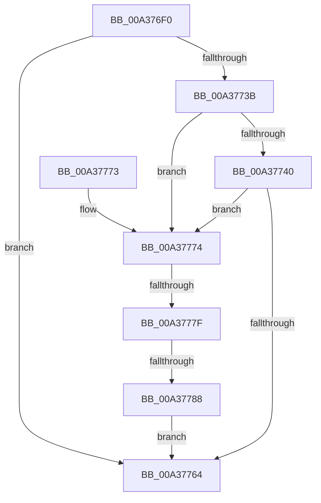

# SiGetSystemDisk

- RVA: `0x00A376F0`–`0x00A3778F` (길이 `159` bytes)
- VA: `0x0000000140A376F0`
- 실행 섹션: `PAGE`
- PDB 이름 있음: `예`; PDB Function 태그: `예`
- unwind 정보 RVA: `0x000ADB80`
- 디코드: `48`개 명령, `159/159` bytes 표시
- 미해석 바이트: `0` (있으면 어셈블리에 `.byte`로 보존)

> 이 문서는 커널 이미지의 기계어와 PDB 기호를 분석해 생성했습니다. 4번과 5번은 함수 원형과 자료형을 바이너리 사용 방식에서 추정한 C 해석이며 원본 소스 복구 결과는 아닙니다.

## 1. Dependencies

- 직접 호출 지점: **3**; 고유 호출 대상: **2**
- 직접 호출자로 확인된 함수: **0**
- RIP 상대 이미지 참조: **2**

### Outgoing calls
- `0x00A3770F` → [SiIsWinPEBoot](SiIsWinPEBoot_function_00A37880.md) (function, `0x00A37880`)
- `0x00A37730` → [SiGetBootDeviceName](SiGetBootDeviceName_function_00A378FC.md) (function, `0x00A378FC`)
- `0x00A37759` → [SiGetBootDeviceName](SiGetBootDeviceName_function_00A378FC.md) (function, `0x00A378FC`)

### Direct callers
- 이 함수 시작 RVA로 연결되는 직접 call은 확인되지 않았습니다. 간접 호출은 완전히 역산할 수 없습니다.

### Static image references
- `0x00A37724` → RVA `0x00B0CEC0` (` ?? ::NNGAKEGL::`string'`; read)
- `0x00A37745` → RVA `0x00B0CE90` (` ?? ::NNGAKEGL::`string'`; read)

## 2. Other-region calls and transfers

- 다른 실행 섹션으로 향하는 call: **0**
- call이 아닌 외부 분기/꼬리 이동: **2**
  - `0x00A37779` → [sub_00B3A076 + 0xC](../B3/Unknown_function_00B3A076.md) (`tail-transfer`)
  - `0x00A37782` → [sub_00B3A076](../B3/Unknown_function_00B3A076.md) (`tail-transfer`)

## 3. Assembly (complete function range)

```asm
00A376F0  48 89 5C 24 08                  mov qword ptr [rsp + 8], rbx
00A376F5  55                              push rbp
00A376F6  56                              push rsi
00A376F7  57                              push rdi
00A376F8  48 83 EC 30                     sub rsp, 0x30
00A376FC  48 83 64 24 68 00               and qword ptr [rsp + 0x68], 0
00A37702  48 8B FA                        mov rdi, rdx
00A37705  8B F1                           mov esi, ecx
00A37707  C7 44 24 60 01 00 00 00         mov dword ptr [rsp + 0x60], 1
00A3770F  E8 6C 01 00 00                  call 0x140a37880
00A37714  45 33 C9                        xor r9d, r9d
00A37717  48 89 7C 24 28                  mov qword ptr [rsp + 0x28], rdi
00A3771C  45 33 C0                        xor r8d, r8d
00A3771F  C6 44 24 20 00                  mov byte ptr [rsp + 0x20], 0
00A37724  48 8D 15 95 57 0D 00            lea rdx, [rip + 0xd5795]
00A3772B  33 C9                           xor ecx, ecx
00A3772D  40 8A E8                        mov bpl, al
00A37730  E8 C7 01 00 00                  call 0x140a378fc
00A37735  8B D8                           mov ebx, eax
00A37737  85 C0                           test eax, eax
00A37739  79 29                           jns 0x140a37764
00A3773B  40 84 ED                        test bpl, bpl
00A3773E  75 34                           jne 0x140a37774
00A37740  48 89 7C 24 28                  mov qword ptr [rsp + 0x28], rdi
00A37745  48 8D 15 44 57 0D 00            lea rdx, [rip + 0xd5744]
00A3774C  45 33 C9                        xor r9d, r9d
00A3774F  40 88 6C 24 20                  mov byte ptr [rsp + 0x20], bpl
00A37754  41 B0 01                        mov r8b, 1
00A37757  33 C9                           xor ecx, ecx
00A37759  E8 9E 01 00 00                  call 0x140a378fc
00A3775E  8B D8                           mov ebx, eax
00A37760  85 C0                           test eax, eax
00A37762  78 10                           js 0x140a37774
00A37764  8B C3                           mov eax, ebx
00A37766  48 8B 5C 24 50                  mov rbx, qword ptr [rsp + 0x50]
00A3776B  48 83 C4 30                     add rsp, 0x30
00A3776F  5F                              pop rdi
00A37770  5E                              pop rsi
00A37771  5D                              pop rbp
00A37772  C3                              ret
00A37773  CC                              int3
00A37774  8B CE                           mov ecx, esi
00A37776  83 E9 01                        sub ecx, 1
00A37779  0F 84 03 29 10 00               je 0x140b3a082
00A3777F  83 F9 01                        cmp ecx, 1
00A37782  0F 84 EE 28 10 00               je 0x140b3a076
00A37788  BB BB 00 00 C0                  mov ebx, 0xc00000bb
00A3778D  EB D5                           jmp 0x140a37764
```

## 4. C-style interpretation (structured pseudocode)

```c
__int64 __fastcall SiGetSystemDisk(int a1, __int64 a2, int a3, int a4)
{
    __int64 result;
    __int64 v_rsp;
    unsigned __int64 v_stack_m20;
    unsigned __int8 v_stack_m28;
    unsigned int v_stack_p18;
    unsigned __int64 v_stack_p20;
    unsigned __int64 v_stack_p8;

    v_stack_p8 = v_rbx;
    v_rsp = (v_rsp) - (48);
    v_stack_p18 = 1;
    result = SiIsWinPEBoot(a1, a2, a3, a4);
    a4 = 0;
    v_stack_m20 = a2;
    a3 = 0;
    v_stack_m28 = 0;
    a1 = 0;
    result = SiGetBootDeviceName(a1, v_rip + 874389, a3, a4);
    if (!sign_flag) goto loc_00A37764;
    if ((unsigned __int8)((unsigned __int8)(result)) != 0) goto loc_00A37774;
    v_stack_m20 = a2;
    a4 = 0;
    v_stack_m28 = (unsigned __int8)((unsigned __int8)(result));
    a1 = 0;
    result = SiGetBootDeviceName(a1, v_rip + 874308, 1, a4);
    if (sign_flag) goto loc_00A37774;
loc_00A37764:
    v_rsp = (v_rsp) + (48);
    return (unsigned int)((unsigned int)((unsigned int)((unsigned int)(result))));
loc_00A37774:
    a1 = (unsigned int)(((unsigned int)((unsigned int)((unsigned int)(a1)))) - (1));
    goto loc_00A37764;
}
```

## 5. (Beta) C Style

```c
int64_t SiGetSystemDisk(int32_t Arg1, int64_t Arg2, int32_t Arg3, int32_t Arg4)
{
    int64_t result;
    int64_t local_rsp;
    uint64_t v_stack_m20;
    uint8_t v_stack_m28;
    uint32_t v_stack_p18;
    uint64_t v_stack_p20;
    uint64_t v_stack_p8;

    v_stack_p8 = local_rbx;
    local_rsp = (local_rsp) - (48);
    v_stack_p18 = 1;
    result = SiIsWinPEBoot(Arg1, Arg2, Arg3, Arg4);
    Arg4 = 0;
    v_stack_m20 = Arg2;
    Arg3 = 0;
    v_stack_m28 = 0;
    Arg1 = 0;
    result = SiGetBootDeviceName(Arg1, v_rip + 874389, Arg3, Arg4);
    if (!sign_flag) goto loc_00A37764;
    if ((uint8_t)((uint8_t)(result)) != 0) goto loc_00A37774;
    v_stack_m20 = Arg2;
    Arg4 = 0;
    v_stack_m28 = (uint8_t)((uint8_t)(result));
    Arg1 = 0;
    result = SiGetBootDeviceName(Arg1, v_rip + 874308, 1, Arg4);
    if (sign_flag) goto loc_00A37774;
loc_00A37764:
    local_rsp = (local_rsp) + (48);
    return (uint32_t)((uint32_t)((uint32_t)((uint32_t)(result))));
loc_00A37774:
    Arg1 = (uint32_t)(((uint32_t)((uint32_t)((uint32_t)(Arg1)))) - (1));
    goto loc_00A37764;
}
```

## 6. Execution-region graph

[열기: 2D/3D 그래프와 함수 탐색 컨트롤 패널](../../../control-panel.html?section=page&rva=0x00A376F0&view=graph)

- 2D 그래프는 위에서 아래로 흐르고, 3D 그래프는 빈 공간을 드래그해 회전합니다. Shift+드래그는 이동, 휠은 확대·축소, 함수 노드 선택은 대상 보고서 이동입니다.

### Static fallback


