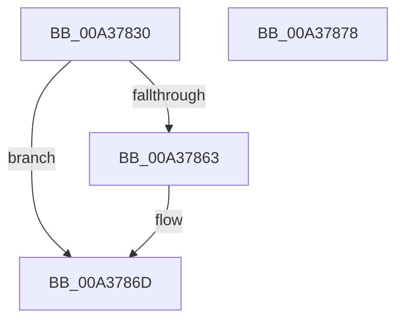

# SiGetSystemPartition

- RVA: `0x00A37830`–`0x00A37879` (길이 `73` bytes)
- VA: `0x0000000140A37830`
- 실행 섹션: `PAGE`
- PDB 이름 있음: `예`; PDB Function 태그: `아니요`
- unwind 정보 RVA: `0x0006E5F8`
- 디코드: `22`개 명령, `73/73` bytes 표시
- 미해석 바이트: `0` (있으면 어셈블리에 `.byte`로 보존)

> 이 문서는 커널 이미지의 기계어와 PDB 기호를 분석해 생성했습니다. 4번과 5번은 함수 원형과 자료형을 바이너리 사용 방식에서 추정한 C 해석이며 원본 소스 복구 결과는 아닙니다.

## 1. Dependencies

- 직접 호출 지점: **2**; 고유 호출 대상: **2**
- 직접 호출자로 확인된 함수: **0**
- RIP 상대 이미지 참조: **1**

### Outgoing calls
- `0x00A3785A` → [SiGetBootDeviceName](SiGetBootDeviceName_function_00A378FC.md) (function, `0x00A378FC`)
- `0x00A37868` → [SiGetFirmwareSystemPartition](SiGetFirmwareSystemPartition_function_00A377A0.md) (function, `0x00A377A0`)

### Direct callers
- 이 함수 시작 RVA로 연결되는 직접 call은 확인되지 않았습니다. 간접 호출은 완전히 역산할 수 없습니다.

### Static image references
- `0x00A3784C` → RVA `0x00B0CEC0` (` ?? ::NNGAKEGL::`string'`; read)

## 2. Other-region calls and transfers

- 다른 실행 섹션으로 향하는 call: **0**
- 별도 외부 분기/꼬리 이동을 확인하지 못했습니다.

## 3. Assembly (complete function range)

```asm
00A37830  48 89 5C 24 08                  mov qword ptr [rsp + 8], rbx
00A37835  57                              push rdi
00A37836  48 83 EC 30                     sub rsp, 0x30
00A3783A  48 89 54 24 28                  mov qword ptr [rsp + 0x28], rdx
00A3783F  45 33 C9                        xor r9d, r9d
00A37842  48 8B DA                        mov rbx, rdx
00A37845  C6 44 24 20 00                  mov byte ptr [rsp + 0x20], 0
00A3784A  8B F9                           mov edi, ecx
00A3784C  48 8D 15 6D 56 0D 00            lea rdx, [rip + 0xd566d]
00A37853  45 33 C0                        xor r8d, r8d
00A37856  41 8D 49 01                     lea ecx, [r9 + 1]
00A3785A  E8 9D 00 00 00                  call 0x140a378fc
00A3785F  85 C0                           test eax, eax
00A37861  79 0A                           jns 0x140a3786d
00A37863  48 8B D3                        mov rdx, rbx
00A37866  8B CF                           mov ecx, edi
00A37868  E8 33 FF FF FF                  call 0x140a377a0
00A3786D  48 8B 5C 24 40                  mov rbx, qword ptr [rsp + 0x40]
00A37872  48 83 C4 30                     add rsp, 0x30
00A37876  5F                              pop rdi
00A37877  C3                              ret
00A37878  CC                              int3
```

## 4. C-style interpretation (structured pseudocode)

```c
__int64 __fastcall SiGetSystemPartition(int a1, __int64 a2, int a3, int a4)
{
    __int64 result;
    __int64 v_rsp;
    unsigned __int64 v_stack_m10;
    unsigned __int8 v_stack_m18;
    unsigned __int64 v_stack_p8;

    v_stack_p8 = v_rbx;
    v_rsp = (v_rsp) - (48);
    v_stack_m10 = a2;
    a4 = 0;
    v_stack_m18 = 0;
    a3 = 0;
    result = SiGetBootDeviceName(a4 + 1, v_rip + 874093, a3, a4);
    if (sign_flag) {
        a2 = a2;
        a1 = (unsigned int)((unsigned int)(a1));
        result = SiGetFirmwareSystemPartition(a1, a2, a3, a4);
    }
    v_rsp = (v_rsp) + (48);
    return result;
}
```

## 5. (Beta) C Style

```c
int64_t SiGetSystemPartition(int32_t Arg1, int64_t Arg2, int32_t Arg3, int32_t Arg4)
{
    int64_t result;
    int64_t local_rsp;
    uint64_t v_stack_m10;
    uint8_t v_stack_m18;
    uint64_t v_stack_p8;

    v_stack_p8 = local_rbx;
    local_rsp = (local_rsp) - (48);
    v_stack_m10 = Arg2;
    Arg4 = 0;
    v_stack_m18 = 0;
    Arg3 = 0;
    result = SiGetBootDeviceName(Arg4 + 1, v_rip + 874093, Arg3, Arg4);
    if (sign_flag) {
        Arg2 = Arg2;
        Arg1 = (uint32_t)((uint32_t)(Arg1));
        result = SiGetFirmwareSystemPartition(Arg1, Arg2, Arg3, Arg4);
    }
    local_rsp = (local_rsp) + (48);
    return result;
}
```

## 6. Execution-region graph

[열기: 2D/3D 그래프와 함수 탐색 컨트롤 패널](../../../control-panel.html?section=page&rva=0x00A37830&view=graph)

- 2D 그래프는 위에서 아래로 흐르고, 3D 그래프는 빈 공간을 드래그해 회전합니다. Shift+드래그는 이동, 휠은 확대·축소, 함수 노드 선택은 대상 보고서 이동입니다.

### Static fallback


