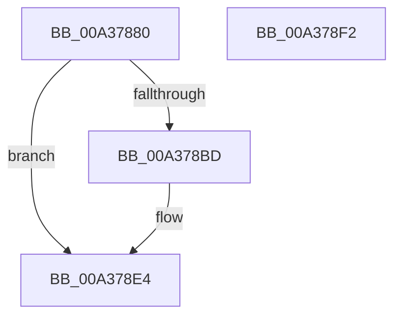

# SiIsWinPEBoot

- RVA: `0x00A37880`–`0x00A378F3` (길이 `115` bytes)
- VA: `0x0000000140A37880`
- 실행 섹션: `PAGE`
- PDB 이름 있음: `예`; PDB Function 태그: `아니요`
- unwind 정보 RVA: `0x000ADBB4`
- 디코드: `31`개 명령, `115/115` bytes 표시
- 미해석 바이트: `0` (있으면 어셈블리에 `.byte`로 보존)

> 이 문서는 커널 이미지의 기계어와 PDB 기호를 분석해 생성했습니다. 4번과 5번은 함수 원형과 자료형을 바이너리 사용 방식에서 추정한 C 해석이며 원본 소스 복구 결과는 아닙니다.

## 1. Dependencies

- 직접 호출 지점: **3**; 고유 호출 대상: **3**
- 직접 호출자로 확인된 함수: **3**
- RIP 상대 이미지 참조: **3**

### Outgoing calls
- `0x00A378B4` → [SiGetRegistryValue](SiGetRegistryValue_function_00A37D8C.md) (function, `0x00A37D8C`)
- `0x00A378C9` → [wcsstr](../../text/50/wcsstr_function_00501F80.md) (function, `0x00501F80`)
- `0x00A378D8` → [ExFreePoolWithTag](../../poolcode/B8/ExFreePoolWithTag_function_00B82870.md) (function, `0x00B82870`)

### Direct callers
- [SiIsWinPeHardDiskZeroUfdBoot](../82/SiIsWinPeHardDiskZeroUfdBoot_function_00828808.md) at `0x00828843`
- [SiGetSystemDisk](SiGetSystemDisk_function_00A376F0.md) at `0x00A3770F`
- [SiGetFirmwareSystemPartition](SiGetFirmwareSystemPartition_function_00A377A0.md) at `0x00A377BF`

### Static image references
- `0x00A37896` → RVA `0x00B0C260` (` ?? ::NNGAKEGL::`string'`; read)
- `0x00A378A5` → RVA `0x00B0C1A0` (` ?? ::NNGAKEGL::`string'`; read)
- `0x00A378C2` → RVA `0x00B0C1D0` (` ?? ::NNGAKEGL::`string'`; read)

## 2. Other-region calls and transfers

- 다른 실행 섹션으로 향하는 call: **2**
  - `0x00A378C9` → [wcsstr](../../text/50/wcsstr_function_00501F80.md) (`PAGE` → `.text`)
  - `0x00A378D8` → [ExFreePoolWithTag](../../poolcode/B8/ExFreePoolWithTag_function_00B82870.md) (`PAGE` → `POOLCODE`)
- 별도 외부 분기/꼬리 이동을 확인하지 못했습니다.

## 3. Assembly (complete function range)

```asm
00A37880  4C 8B DC                        mov r11, rsp
00A37883  49 89 5B 18                     mov qword ptr [r11 + 0x18], rbx
00A37887  57                              push rdi
00A37888  48 83 EC 30                     sub rsp, 0x30
00A3788C  49 8D 43 08                     lea rax, [r11 + 8]
00A37890  33 FF                           xor edi, edi
00A37892  49 89 43 F0                     mov qword ptr [r11 - 0x10], rax
00A37896  4C 8D 05 C3 49 0D 00            lea r8, [rip + 0xd49c3]
00A3789D  49 8D 43 10                     lea rax, [r11 + 0x10]
00A378A1  49 89 7B 10                     mov qword ptr [r11 + 0x10], rdi
00A378A5  48 8D 15 F4 48 0D 00            lea rdx, [rip + 0xd48f4]
00A378AC  49 89 43 E8                     mov qword ptr [r11 - 0x18], rax
00A378B0  89 7C 24 40                     mov dword ptr [rsp + 0x40], edi
00A378B4  E8 D3 04 00 00                  call 0x140a37d8c
00A378B9  85 C0                           test eax, eax
00A378BB  78 27                           js 0x140a378e4
00A378BD  48 8B 4C 24 48                  mov rcx, qword ptr [rsp + 0x48]
00A378C2  48 8D 15 07 49 0D 00            lea rdx, [rip + 0xd4907]
00A378C9  E8 B2 A6 AC FF                  call 0x140501f80
00A378CE  48 8B 4C 24 48                  mov rcx, qword ptr [rsp + 0x48]
00A378D3  33 D2                           xor edx, edx
00A378D5  48 8B D8                        mov rbx, rax
00A378D8  E8 93 AF 14 00                  call 0x140b82870
00A378DD  48 85 DB                        test rbx, rbx
00A378E0  40 0F 95 C7                     setne dil
00A378E4  48 8B 5C 24 50                  mov rbx, qword ptr [rsp + 0x50]
00A378E9  40 8A C7                        mov al, dil
00A378EC  48 83 C4 30                     add rsp, 0x30
00A378F0  5F                              pop rdi
00A378F1  C3                              ret
00A378F2  CC                              int3
```

## 4. C-style interpretation (structured pseudocode)

```c
__int64 __fastcall SiIsWinPEBoot(void)
{
    __int64 result;
    __int64 v_rbx;
    __int64 v_rdi;
    __int64 v_rsp;
    unsigned __int64 v_stack_p10;
    unsigned __int64 v_stack_p18;
    unsigned int v_stack_p8;

    *(unsigned __int64 *)(v_rsp + 24) = v_rbx;
    v_rsp = (v_rsp) - (48);
    v_rdi = 0;
    *(unsigned __int64 *)(v_rsp - 16) = v_rsp + 8;
    *(unsigned __int64 *)(v_rsp + 16) = 0;
    *(unsigned __int64 *)(v_rsp - 24) = v_rsp + 16;
    v_stack_p8 = 0;
    result = SiGetRegistryValue(a1, v_rip + 870644, v_rip + 870851, a4);
    if (!(sign_flag)) {
        a1 = v_stack_p10;
        a2 = v_rip + 870663;
        result = wcsstr(a1, a2, v_rip + 870851, a4);
        a1 = v_stack_p10;
        a2 = 0;
        v_rbx = result;
        result = ExFreePoolWithTag(a1, a2, v_rip + 870851, a4);
        v_rdi = (v_rbx != 0) ? 1 : 0;
    }
    v_rsp = (v_rsp) + (48);
    return (unsigned __int8)(v_rdi);
}
```

## 5. (Beta) C Style

```c
void SiIsWinPEBoot(void)
{
    int64_t result;
    int64_t local_rbx;
    int64_t local_rdi;
    int64_t local_rsp;
    uint64_t v_stack_p10;
    uint64_t v_stack_p18;
    uint32_t v_stack_p8;

    *(uint64_t *)(local_rsp + 0x18) = local_rbx;
    local_rsp = (local_rsp) - (48);
    local_rdi = 0;
    *(uint64_t *)(local_rsp - 0x10) = local_rsp + 8;
    *(uint64_t *)(local_rsp + 0x10) = 0;
    *(uint64_t *)(local_rsp - 0x18) = local_rsp + 16;
    v_stack_p8 = 0;
    result = SiGetRegistryValue(a1, v_rip + 870644, v_rip + 870851, a4);
    if (!(sign_flag)) {
        a1 = v_stack_p10;
        a2 = v_rip + 870663;
        result = wcsstr(a1, a2, v_rip + 870851, a4);
        a1 = v_stack_p10;
        a2 = 0;
        local_rbx = result;
        result = ExFreePoolWithTag(a1, a2, v_rip + 870851, a4);
        local_rdi = (local_rbx != 0) ? 1 : 0;
    }
    local_rsp = (local_rsp) + (48);
    return (uint8_t)(local_rdi);
}
```

## 6. Execution-region graph

[열기: 2D/3D 그래프와 함수 탐색 컨트롤 패널](../../../control-panel.html?section=page&rva=0x00A37880&view=graph)

- 2D 그래프는 위에서 아래로 흐르고, 3D 그래프는 빈 공간을 드래그해 회전합니다. Shift+드래그는 이동, 휠은 확대·축소, 함수 노드 선택은 대상 보고서 이동입니다.

### Static fallback


