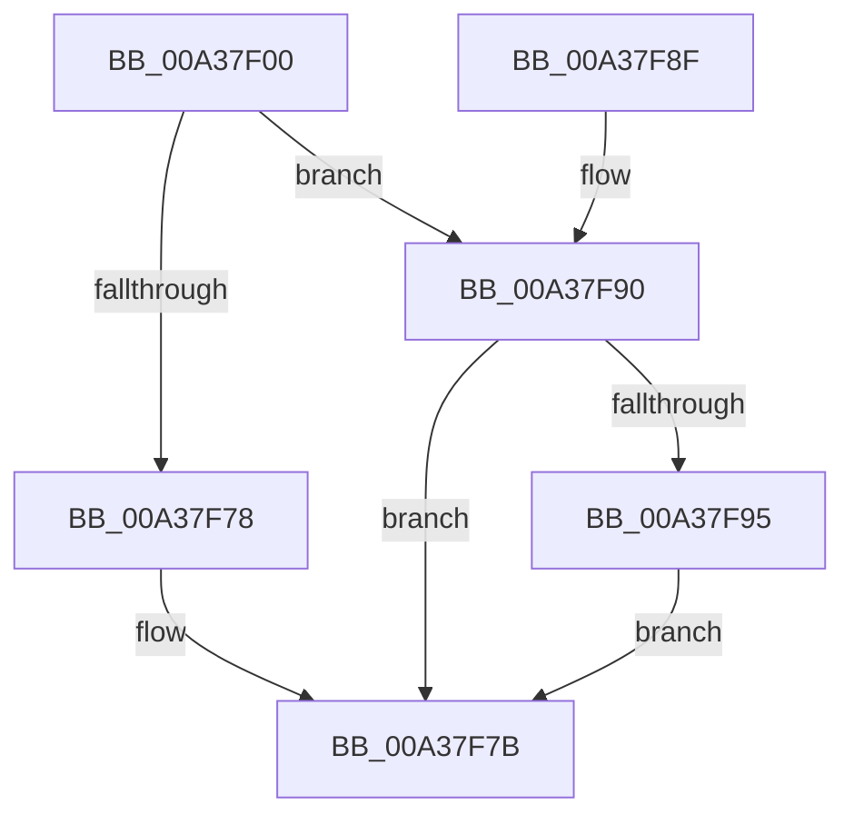

# SiOpenRegistryKey

- RVA: `0x00A37F00`–`0x00A37F9C` (길이 `156` bytes)
- VA: `0x0000000140A37F00`
- 실행 섹션: `PAGE`
- PDB 이름 있음: `예`; PDB Function 태그: `아니요`
- unwind 정보 RVA: `0x000ADC10`
- 디코드: `44`개 명령, `156/156` bytes 표시
- 미해석 바이트: `0` (있으면 어셈블리에 `.byte`로 보존)

> 이 문서는 커널 이미지의 기계어와 PDB 기호를 분석해 생성했습니다. 4번과 5번은 함수 원형과 자료형을 바이너리 사용 방식에서 추정한 C 해석이며 원본 소스 복구 결과는 아닙니다.

## 1. Dependencies

- 직접 호출 지점: **3**; 고유 호출 대상: **3**
- 직접 호출자로 확인된 함수: **1**
- RIP 상대 이미지 참조: **0**

### Outgoing calls
- `0x00A37F34` → [RtlInitUnicodeString](../../text/42/RtlInitUnicodeString_function_0042A780.md) (function, `0x0042A780`)
- `0x00A37F69` → [ZwOpenKey](../../text/6A/ZwOpenKey_function_006AD310.md) (function, `0x006AD310`)
- `0x00A37F95` → [ZwClose](../../text/6A/ZwClose_function_006AD2B0.md) (function, `0x006AD2B0`)

### Direct callers
- [SiGetRegistryValue](SiGetRegistryValue_function_00A37D8C.md) at `0x00A37DE6`

### Static image references
- 디코드된 RIP-relative 메모리 참조가 없습니다.

## 2. Other-region calls and transfers

- 다른 실행 섹션으로 향하는 call: **3**
  - `0x00A37F34` → [RtlInitUnicodeString](../../text/42/RtlInitUnicodeString_function_0042A780.md) (`PAGE` → `.text`)
  - `0x00A37F69` → [ZwOpenKey](../../text/6A/ZwOpenKey_function_006AD310.md) (`PAGE` → `.text`)
  - `0x00A37F95` → [ZwClose](../../text/6A/ZwClose_function_006AD2B0.md) (`PAGE` → `.text`)
- 별도 외부 분기/꼬리 이동을 확인하지 못했습니다.

## 3. Assembly (complete function range)

```asm
00A37F00  48 89 5C 24 10                  mov qword ptr [rsp + 0x10], rbx
00A37F05  48 89 7C 24 18                  mov qword ptr [rsp + 0x18], rdi
00A37F0A  48 89 4C 24 08                  mov qword ptr [rsp + 8], rcx
00A37F0F  55                              push rbp
00A37F10  48 8B EC                        mov rbp, rsp
00A37F13  48 83 EC 60                     sub rsp, 0x60
00A37F17  33 C0                           xor eax, eax
00A37F19  48 8D 4D C0                     lea rcx, [rbp - 0x40]
00A37F1D  21 45 EC                        and dword ptr [rbp - 0x14], eax
00A37F20  0F 57 C0                        xorps xmm0, xmm0
00A37F23  48 21 45 10                     and qword ptr [rbp + 0x10], rax
00A37F27  49 8B F9                        mov rdi, r9
00A37F2A  89 45 D4                        mov dword ptr [rbp - 0x2c], eax
00A37F2D  21 45 D4                        and dword ptr [rbp - 0x2c], eax
00A37F30  0F 11 45 C0                     movups xmmword ptr [rbp - 0x40], xmm0
00A37F34  E8 47 28 9F FF                  call 0x14042a780
00A37F39  48 83 65 D8 00                  and qword ptr [rbp - 0x28], 0
00A37F3E  48 8D 45 C0                     lea rax, [rbp - 0x40]
00A37F42  0F 57 C0                        xorps xmm0, xmm0
00A37F45  48 89 45 E0                     mov qword ptr [rbp - 0x20], rax
00A37F49  4C 8D 45 D0                     lea r8, [rbp - 0x30]
00A37F4D  C7 45 D0 30 00 00 00            mov dword ptr [rbp - 0x30], 0x30
00A37F54  BA 19 00 02 00                  mov edx, 0x20019
00A37F59  C7 45 E8 40 02 00 00            mov dword ptr [rbp - 0x18], 0x240
00A37F60  48 8D 4D 10                     lea rcx, [rbp + 0x10]
00A37F64  F3 0F 7F 45 F0                  movdqu xmmword ptr [rbp - 0x10], xmm0
00A37F69  E8 A2 53 C7 FF                  call 0x1406ad310
00A37F6E  48 8B 4D 10                     mov rcx, qword ptr [rbp + 0x10]
00A37F72  8B D8                           mov ebx, eax
00A37F74  85 C0                           test eax, eax
00A37F76  78 18                           js 0x140a37f90
00A37F78  48 89 0F                        mov qword ptr [rdi], rcx
00A37F7B  4C 8D 5C 24 60                  lea r11, [rsp + 0x60]
00A37F80  8B C3                           mov eax, ebx
00A37F82  49 8B 5B 18                     mov rbx, qword ptr [r11 + 0x18]
00A37F86  49 8B 7B 20                     mov rdi, qword ptr [r11 + 0x20]
00A37F8A  49 8B E3                        mov rsp, r11
00A37F8D  5D                              pop rbp
00A37F8E  C3                              ret
00A37F8F  CC                              int3
00A37F90  48 85 C9                        test rcx, rcx
00A37F93  74 E6                           je 0x140a37f7b
00A37F95  E8 16 53 C7 FF                  call 0x1406ad2b0
00A37F9A  EB DF                           jmp 0x140a37f7b
```

## 4. C-style interpretation (structured pseudocode)

```c
__int64 __fastcall SiOpenRegistryKey(__int64 a1, __int64 a2, __int64 a3, __int64 a4)
{
    __int64 result;
    __int64 v_rsp;
    unsigned __int64 v_stack_m18;
    unsigned int v_stack_m1C;
    unsigned int v_stack_m20;
    unsigned __int64 v_stack_m28;
    unsigned __int64 v_stack_m30;
    unsigned int v_stack_m34;
    unsigned __int64 v_stack_m38;
    unsigned __int64 v_stack_m48;
    unsigned __int64 v_stack_m8;
    unsigned __int64 v_stack_p10;
    unsigned __int64 v_stack_p18;
    unsigned __int64 v_stack_p8;

    v_stack_p10 = v_rbx;
    v_stack_p18 = v_rdi;
    v_stack_p8 = a1;
    v_rsp = (v_rsp) - (96);
    result = 0;
    v_stack_m34 = 0;
    v_stack_m48 = v_xmm0;
    result = RtlInitUnicodeString(v_stack_m48, a2, a3, a4);
    v_stack_m28 = v_stack_m48;
    v_stack_m38 = 48;
    v_stack_m20 = 576;
    v_stack_m18 = v_xmm0;
    result = ZwOpenKey(v_stack_p8, (unsigned int)(0x20019ULL), v_stack_m38, a4);
    if (sign_flag) goto loc_00A37F90;
    *(unsigned __int64 *)(a4) = v_stack_p8;
loc_00A37F7B:
    return (unsigned int)((unsigned int)((unsigned int)((unsigned int)(result))));
loc_00A37F90:
    if (v_stack_p8 == 0) goto loc_00A37F7B;
    result = ZwClose(v_stack_p8, (unsigned int)(0x20019ULL), v_stack_m38, a4);
    goto loc_00A37F7B;
}
```

## 5. (Beta) C Style

```c
int64_t SiOpenRegistryKey(int64_t Arg1, int64_t Arg2, int64_t Arg3, void *Arg4)
{
    uint8_t *arg4 = (uint8_t *)Arg4;

    int64_t result;
    int64_t local_rsp;
    uint64_t v_stack_m18;
    uint32_t v_stack_m1C;
    uint32_t v_stack_m20;
    uint64_t v_stack_m28;
    uint64_t v_stack_m30;
    uint32_t v_stack_m34;
    uint64_t v_stack_m38;
    uint64_t v_stack_m48;
    uint64_t v_stack_m8;
    uint64_t v_stack_p10;
    uint64_t v_stack_p18;
    uint64_t v_stack_p8;

    v_stack_p10 = local_rbx;
    v_stack_p18 = local_rdi;
    v_stack_p8 = Arg1;
    local_rsp = (local_rsp) - (96);
    result = 0;
    v_stack_m34 = 0;
    v_stack_m48 = v_xmm0;
    result = RtlInitUnicodeString(v_stack_m48, Arg2, Arg3, Arg4);
    v_stack_m28 = v_stack_m48;
    v_stack_m38 = 48;
    v_stack_m20 = 576;
    v_stack_m18 = v_xmm0;
    result = ZwOpenKey(v_stack_p8, (uint32_t)(0x20019ULL), v_stack_m38, Arg4);
    if (sign_flag) goto loc_00A37F90;
    *(uint64_t *)(arg4) = v_stack_p8;
loc_00A37F7B:
    return (uint32_t)((uint32_t)((uint32_t)((uint32_t)(result))));
loc_00A37F90:
    if (v_stack_p8 == 0) goto loc_00A37F7B;
    result = ZwClose(v_stack_p8, (uint32_t)(0x20019ULL), v_stack_m38, Arg4);
    goto loc_00A37F7B;
}
```

### 관측된 메모리 오프셋

구조체 형식이 확인되지 않은 접근은 인자 기준의 오프셋으로만 기록했습니다.

| 기준 인자 | 오프셋 표현 | 폭 (bit) | 접근 |
|---|---:|---:|---|
| `Arg4` | `+ 0x0` | `64` | `W` |

## 6. Execution-region graph

[열기: 2D/3D 그래프와 함수 탐색 컨트롤 패널](../../../control-panel.html?section=page&rva=0x00A37F00&view=graph)

- 2D 그래프는 위에서 아래로 흐르고, 3D 그래프는 빈 공간을 드래그해 회전합니다. Shift+드래그는 이동, 휠은 확대·축소, 함수 노드 선택은 대상 보고서 이동입니다.

### Static fallback


