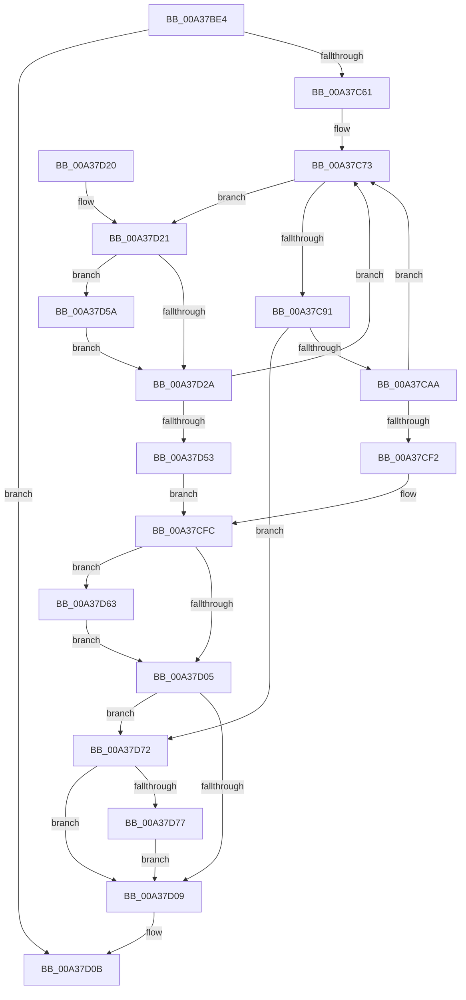

# SiTranslateSymbolicLink

- RVA: `0x00A37BE4`–`0x00A37D83` (길이 `415` bytes)
- VA: `0x0000000140A37BE4`
- 실행 섹션: `PAGE`
- PDB 이름 있음: `예`; PDB Function 태그: `아니요`
- unwind 정보 RVA: `0x000ADBE0`
- 디코드: `113`개 명령, `415/415` bytes 표시
- 미해석 바이트: `0` (있으면 어셈블리에 `.byte`로 보존)

> 이 문서는 커널 이미지의 기계어와 PDB 기호를 분석해 생성했습니다. 4번과 5번은 함수 원형과 자료형을 바이너리 사용 방식에서 추정한 C 해석이며 원본 소스 복구 결과는 아닙니다.

## 1. Dependencies

- 직접 호출 지점: **10**; 고유 호출 대상: **6**
- 직접 호출자로 확인된 함수: **4**
- RIP 상대 이미지 참조: **0**

### Outgoing calls
- `0x00A37C21` → [RtlInitUnicodeString](../../text/42/RtlInitUnicodeString_function_0042A780.md) (function, `0x0042A780`)
- `0x00A37C54` → [ZwOpenSymbolicLinkObject](../../text/6A/ZwOpenSymbolicLinkObject_function_006AF7F0.md) (function, `0x006AF7F0`)
- `0x00A37C67` → [RtlInitUnicodeString](../../text/42/RtlInitUnicodeString_function_0042A780.md) (function, `0x0042A780`)
- `0x00A37C7F` → [ZwQuerySymbolicLinkObject](../../text/6A/ZwQuerySymbolicLinkObject_function_006AFE50.md) (function, `0x006AFE50`)
- `0x00A37C95` → [ZwClose](../../text/6A/ZwClose_function_006AD2B0.md) (function, `0x006AD2B0`)
- `0x00A37CE9` → [ZwOpenSymbolicLinkObject](../../text/6A/ZwOpenSymbolicLinkObject_function_006AF7F0.md) (function, `0x006AF7F0`)
- `0x00A37D41` → [ExAllocatePool2](../../poolcode/B8/ExAllocatePool2_function_00B820F0.md) (function, `0x00B820F0`)
- `0x00A37D5C` → [ExFreePoolWithTag](../../poolcode/B8/ExFreePoolWithTag_function_00B82870.md) (function, `0x00B82870`)
- `0x00A37D63` → [ZwClose](../../text/6A/ZwClose_function_006AD2B0.md) (function, `0x006AD2B0`)
- `0x00A37D7C` → [ExFreePoolWithTag](../../poolcode/B8/ExFreePoolWithTag_function_00B82870.md) (function, `0x00B82870`)

### Direct callers
- [SiIsWinPeHardDiskZeroUfdBoot](../82/SiIsWinPeHardDiskZeroUfdBoot_function_00828808.md) at `0x008288C4`
- [SiGetBootDeviceName](SiGetBootDeviceName_function_00A378FC.md) at `0x00A37A08`
- [SiGetBootDeviceName](SiGetBootDeviceName_function_00A378FC.md) at `0x00A37AA0`
- [sub_00B3A076](../B3/Unknown_function_00B3A076.md) at `0x00B3A0E4`
- [sub_00B3A106](../B3/Unknown_function_00B3A106.md) at `0x00B3A178`

### Static image references
- 디코드된 RIP-relative 메모리 참조가 없습니다.

## 2. Other-region calls and transfers

- 다른 실행 섹션으로 향하는 call: **10**
  - `0x00A37C21` → [RtlInitUnicodeString](../../text/42/RtlInitUnicodeString_function_0042A780.md) (`PAGE` → `.text`)
  - `0x00A37C54` → [ZwOpenSymbolicLinkObject](../../text/6A/ZwOpenSymbolicLinkObject_function_006AF7F0.md) (`PAGE` → `.text`)
  - `0x00A37C67` → [RtlInitUnicodeString](../../text/42/RtlInitUnicodeString_function_0042A780.md) (`PAGE` → `.text`)
  - `0x00A37C7F` → [ZwQuerySymbolicLinkObject](../../text/6A/ZwQuerySymbolicLinkObject_function_006AFE50.md) (`PAGE` → `.text`)
  - `0x00A37C95` → [ZwClose](../../text/6A/ZwClose_function_006AD2B0.md) (`PAGE` → `.text`)
  - `0x00A37CE9` → [ZwOpenSymbolicLinkObject](../../text/6A/ZwOpenSymbolicLinkObject_function_006AF7F0.md) (`PAGE` → `.text`)
  - `0x00A37D41` → [ExAllocatePool2](../../poolcode/B8/ExAllocatePool2_function_00B820F0.md) (`PAGE` → `POOLCODE`)
  - `0x00A37D5C` → [ExFreePoolWithTag](../../poolcode/B8/ExFreePoolWithTag_function_00B82870.md) (`PAGE` → `POOLCODE`)
  - `0x00A37D63` → [ZwClose](../../text/6A/ZwClose_function_006AD2B0.md) (`PAGE` → `.text`)
  - `0x00A37D7C` → [ExFreePoolWithTag](../../poolcode/B8/ExFreePoolWithTag_function_00B82870.md) (`PAGE` → `POOLCODE`)
- 별도 외부 분기/꼬리 이동을 확인하지 못했습니다.

## 3. Assembly (complete function range)

```asm
00A37BE4  48 89 5C 24 08                  mov qword ptr [rsp + 8], rbx
00A37BE9  48 89 74 24 10                  mov qword ptr [rsp + 0x10], rsi
00A37BEE  55                              push rbp
00A37BEF  57                              push rdi
00A37BF0  41 56                           push r14
00A37BF2  48 8B EC                        mov rbp, rsp
00A37BF5  48 83 EC 70                     sub rsp, 0x70
00A37BF9  45 33 F6                        xor r14d, r14d
00A37BFC  48 8B F2                        mov rsi, rdx
00A37BFF  48 8B D1                        mov rdx, rcx
00A37C02  4C 89 75 B0                     mov qword ptr [rbp - 0x50], r14
00A37C06  0F 57 C0                        xorps xmm0, xmm0
00A37C09  44 89 75 D4                     mov dword ptr [rbp - 0x2c], r14d
00A37C0D  48 8D 4D C0                     lea rcx, [rbp - 0x40]
00A37C11  44 89 75 EC                     mov dword ptr [rbp - 0x14], r14d
00A37C15  0F 11 45 C0                     movups xmmword ptr [rbp - 0x40], xmm0
00A37C19  4C 89 75 38                     mov qword ptr [rbp + 0x38], r14
00A37C1D  4C 89 75 B8                     mov qword ptr [rbp - 0x48], r14
00A37C21  E8 5A 2B 9F FF                  call 0x14042a780
00A37C26  48 8D 45 C0                     lea rax, [rbp - 0x40]
00A37C2A  C7 45 D0 30 00 00 00            mov dword ptr [rbp - 0x30], 0x30
00A37C31  0F 57 C0                        xorps xmm0, xmm0
00A37C34  48 89 45 E0                     mov qword ptr [rbp - 0x20], rax
00A37C38  4C 8D 45 D0                     lea r8, [rbp - 0x30]
00A37C3C  4C 89 75 D8                     mov qword ptr [rbp - 0x28], r14
00A37C40  41 8D 56 01                     lea edx, [r14 + 1]
00A37C44  C7 45 E8 40 02 00 00            mov dword ptr [rbp - 0x18], 0x240
00A37C4B  48 8D 4D 38                     lea rcx, [rbp + 0x38]
00A37C4F  F3 0F 7F 45 F0                  movdqu xmmword ptr [rbp - 0x10], xmm0
00A37C54  E8 97 7B C7 FF                  call 0x1406af7f0
00A37C59  85 C0                           test eax, eax
00A37C5B  0F 88 AA 00 00 00               js 0x140a37d0b
00A37C61  33 D2                           xor edx, edx
00A37C63  48 8D 4D B0                     lea rcx, [rbp - 0x50]
00A37C67  E8 14 2B 9F FF                  call 0x14042a780
00A37C6C  41 8B FE                        mov edi, r14d
00A37C6F  44 89 75 30                     mov dword ptr [rbp + 0x30], r14d
00A37C73  48 8B 4D 38                     mov rcx, qword ptr [rbp + 0x38]
00A37C77  4C 8D 45 30                     lea r8, [rbp + 0x30]
00A37C7B  48 8D 55 B0                     lea rdx, [rbp - 0x50]
00A37C7F  E8 CC 81 C7 FF                  call 0x1406afe50
00A37C84  8B D8                           mov ebx, eax
00A37C86  3D 23 00 00 C0                  cmp eax, 0xc0000023
00A37C8B  0F 84 90 00 00 00               je 0x140a37d21
00A37C91  48 8B 4D 38                     mov rcx, qword ptr [rbp + 0x38]
00A37C95  E8 16 56 C7 FF                  call 0x1406ad2b0
00A37C9A  48 8B 45 B8                     mov rax, qword ptr [rbp - 0x48]
00A37C9E  4C 89 75 38                     mov qword ptr [rbp + 0x38], r14
00A37CA2  85 DB                           test ebx, ebx
00A37CA4  0F 88 C8 00 00 00               js 0x140a37d72
00A37CAA  0F B7 4D B0                     movzx ecx, word ptr [rbp - 0x50]
00A37CAE  4C 8D 45 D0                     lea r8, [rbp - 0x30]
00A37CB2  48 D1 E9                        shr rcx, 1
00A37CB5  0F 57 C0                        xorps xmm0, xmm0
00A37CB8  BA 01 00 00 00                  mov edx, 1
00A37CBD  66 44 89 34 48                  mov word ptr [rax + rcx*2], r14w
00A37CC2  48 8D 45 B0                     lea rax, [rbp - 0x50]
00A37CC6  48 8D 4D 38                     lea rcx, [rbp + 0x38]
00A37CCA  48 89 45 E0                     mov qword ptr [rbp - 0x20], rax
00A37CCE  66 89 7D B2                     mov word ptr [rbp - 0x4e], di
00A37CD2  C7 45 D0 30 00 00 00            mov dword ptr [rbp - 0x30], 0x30
00A37CD9  4C 89 75 D8                     mov qword ptr [rbp - 0x28], r14
00A37CDD  C7 45 E8 40 02 00 00            mov dword ptr [rbp - 0x18], 0x240
00A37CE4  F3 0F 7F 45 F0                  movdqu xmmword ptr [rbp - 0x10], xmm0
00A37CE9  E8 02 7B C7 FF                  call 0x1406af7f0
00A37CEE  85 C0                           test eax, eax
00A37CF0  79 81                           jns 0x140a37c73
00A37CF2  48 8B 45 B8                     mov rax, qword ptr [rbp - 0x48]
00A37CF6  41 8B DE                        mov ebx, r14d
00A37CF9  48 89 06                        mov qword ptr [rsi], rax
00A37CFC  48 8B 4D 38                     mov rcx, qword ptr [rbp + 0x38]
00A37D00  48 85 C9                        test rcx, rcx
00A37D03  75 5E                           jne 0x140a37d63
00A37D05  85 DB                           test ebx, ebx
00A37D07  78 69                           js 0x140a37d72
00A37D09  8B C3                           mov eax, ebx
00A37D0B  4C 8D 5C 24 70                  lea r11, [rsp + 0x70]
00A37D10  49 8B 5B 20                     mov rbx, qword ptr [r11 + 0x20]
00A37D14  49 8B 73 28                     mov rsi, qword ptr [r11 + 0x28]
00A37D18  49 8B E3                        mov rsp, r11
00A37D1B  41 5E                           pop r14
00A37D1D  5F                              pop rdi
00A37D1E  5D                              pop rbp
00A37D1F  C3                              ret
00A37D20  CC                              int3
00A37D21  48 8B 4D B8                     mov rcx, qword ptr [rbp - 0x48]
00A37D25  48 85 C9                        test rcx, rcx
00A37D28  75 30                           jne 0x140a37d5a
00A37D2A  8B 45 30                        mov eax, dword ptr [rbp + 0x30]
00A37D2D  B9 00 01 00 00                  mov ecx, 0x100
00A37D32  41 B8 53 59 50 4B               mov r8d, 0x4b505953
00A37D38  66 89 45 B2                     mov word ptr [rbp - 0x4e], ax
00A37D3C  8D 78 02                        lea edi, [rax + 2]
00A37D3F  8B D7                           mov edx, edi
00A37D41  E8 AA A3 14 00                  call 0x140b820f0
00A37D46  48 89 45 B8                     mov qword ptr [rbp - 0x48], rax
00A37D4A  48 85 C0                        test rax, rax
00A37D4D  0F 85 20 FF FF FF               jne 0x140a37c73
00A37D53  BB 9A 00 00 C0                  mov ebx, 0xc000009a
00A37D58  EB A2                           jmp 0x140a37cfc
00A37D5A  33 D2                           xor edx, edx
00A37D5C  E8 0F AB 14 00                  call 0x140b82870
00A37D61  EB C7                           jmp 0x140a37d2a
00A37D63  E8 48 55 C7 FF                  call 0x1406ad2b0
00A37D68  48 8B 45 B8                     mov rax, qword ptr [rbp - 0x48]
00A37D6C  4C 89 75 38                     mov qword ptr [rbp + 0x38], r14
00A37D70  EB 93                           jmp 0x140a37d05
00A37D72  48 85 C0                        test rax, rax
00A37D75  74 92                           je 0x140a37d09
00A37D77  33 D2                           xor edx, edx
00A37D79  48 8B C8                        mov rcx, rax
00A37D7C  E8 EF AA 14 00                  call 0x140b82870
00A37D81  EB 86                           jmp 0x140a37d09
```

## 4. C-style interpretation (structured pseudocode)

```c
__int64 __fastcall SiTranslateSymbolicLink(__int64 a1, __int64 a2)
{
    __int64 result;
    __int64 v_r14;
    __int64 v_rsp;
    unsigned __int64 v_stack_m18;
    unsigned __int64 v_stack_m28;
    unsigned int v_stack_m2C;
    unsigned int v_stack_m30;
    unsigned __int64 v_stack_m38;
    unsigned __int64 v_stack_m40;
    unsigned int v_stack_m44;
    unsigned int v_stack_m48;
    unsigned __int64 v_stack_m58;
    unsigned __int64 v_stack_m60;
    unsigned __int16 v_stack_m66;
    unsigned __int64 v_stack_m68;
    unsigned __int64 v_stack_p10;
    unsigned int v_stack_p18;
    unsigned __int64 v_stack_p20;
    unsigned __int64 v_stack_p8;

    v_stack_p8 = v_rbx;
    v_stack_p10 = v_rsi;
    v_rsp = (v_rsp) - (112);
    v_r14 = 0;
    v_stack_m68 = 0;
    v_stack_m44 = 0;
    v_stack_m2C = 0;
    v_stack_m58 = v_xmm0;
    v_stack_p20 = 0;
    v_stack_m60 = 0;
    result = RtlInitUnicodeString(v_stack_m58, a1, a3, a4);
    v_stack_m48 = 48;
    v_stack_m38 = v_stack_m58;
    v_stack_m40 = 0;
    v_stack_m30 = 576;
    v_stack_m28 = v_xmm0;
    result = ZwOpenSymbolicLinkObject(v_stack_p20, v_r14 + 1, v_stack_m48, a4);
    if (sign_flag) goto loc_00A37D0B;
    a2 = 0;
    result = RtlInitUnicodeString(v_stack_m68, a2, v_stack_m48, a4);
    v_stack_p18 = 0;
loc_00A37C73:
    result = ZwQuerySymbolicLinkObject(v_stack_p20, v_stack_m68, v_stack_p18, a4);
    if (((unsigned int)(result)) == 0xC0000023ULL) goto loc_00A37D21;
    result = ZwClose(v_stack_p20, v_stack_m68, v_stack_p18, a4);
    v_stack_p20 = 0;
    if (sign_flag) goto loc_00A37D72;
    a1 = (v_stack_m68) >> (1);
    *(unsigned __int16 *)(v_stack_m60 + a1 * 2) = 0;
    v_stack_m38 = v_stack_m68;
    v_stack_m66 = 0;
    v_stack_m48 = 48;
    v_stack_m40 = 0;
    v_stack_m30 = 576;
    v_stack_m28 = v_xmm0;
    result = ZwOpenSymbolicLinkObject(v_stack_p20, 1, v_stack_m48, a4);
    if (!sign_flag) goto loc_00A37C73;
    *(unsigned __int64 *)(a2) = v_stack_m60;
loc_00A37CFC:
    if (v_stack_p20 != 0) goto loc_00A37D63;
loc_00A37D05:
    if (sign_flag) goto loc_00A37D72;
loc_00A37D09:
loc_00A37D0B:
    return 0;
loc_00A37D21:
    if (v_stack_m60 != 0) goto loc_00A37D5A;
loc_00A37D2A:
    v_stack_m66 = (unsigned __int16)((unsigned int)(v_stack_p18));
    result = ExAllocatePool2(256, (unsigned int)((unsigned int)((unsigned int)(v_stack_p18) + 2)), (unsigned int)(0x4B505953ULL), a4);
    v_stack_m60 = result;
    if (result != 0) goto loc_00A37C73;
    goto loc_00A37CFC;
loc_00A37D5A:
    a2 = 0;
    result = ExFreePoolWithTag(256, a2, (unsigned int)(0x4B505953ULL), a4);
    goto loc_00A37D2A;
loc_00A37D63:
    result = ZwClose(256, a2, (unsigned int)(0x4B505953ULL), a4);
    v_stack_p20 = 0;
    goto loc_00A37D05;
loc_00A37D72:
    if (v_stack_m60 == 0) goto loc_00A37D09;
    a2 = 0;
    result = ExFreePoolWithTag(v_stack_m60, a2, (unsigned int)(0x4B505953ULL), a4);
    goto loc_00A37D09;
}
```

## 5. (Beta) C Style

```c
int64_t SiTranslateSymbolicLink(int64_t Arg1, void *Arg2)
{
    uint8_t *arg2 = (uint8_t *)Arg2;

    int64_t result;
    int64_t local_r14;
    int64_t local_rsp;
    uint64_t v_stack_m18;
    uint64_t v_stack_m28;
    uint32_t v_stack_m2C;
    uint32_t v_stack_m30;
    uint64_t v_stack_m38;
    uint64_t v_stack_m40;
    uint32_t v_stack_m44;
    uint32_t v_stack_m48;
    uint64_t v_stack_m58;
    uint64_t v_stack_m60;
    uint16_t v_stack_m66;
    uint64_t v_stack_m68;
    uint64_t v_stack_p10;
    uint32_t v_stack_p18;
    uint64_t v_stack_p20;
    uint64_t v_stack_p8;

    v_stack_p8 = local_rbx;
    v_stack_p10 = local_rsi;
    local_rsp = (local_rsp) - (112);
    local_r14 = 0;
    v_stack_m68 = 0;
    v_stack_m44 = 0;
    v_stack_m2C = 0;
    v_stack_m58 = v_xmm0;
    v_stack_p20 = 0;
    v_stack_m60 = 0;
    result = RtlInitUnicodeString(v_stack_m58, Arg1, a3, a4);
    v_stack_m48 = 48;
    v_stack_m38 = v_stack_m58;
    v_stack_m40 = 0;
    v_stack_m30 = 576;
    v_stack_m28 = v_xmm0;
    result = ZwOpenSymbolicLinkObject(v_stack_p20, local_r14 + 1, v_stack_m48, a4);
    if (sign_flag) goto loc_00A37D0B;
    Arg2 = 0;
    result = RtlInitUnicodeString(v_stack_m68, Arg2, v_stack_m48, a4);
    v_stack_p18 = 0;
loc_00A37C73:
    result = ZwQuerySymbolicLinkObject(v_stack_p20, v_stack_m68, v_stack_p18, a4);
    if (((uint32_t)(result)) == 0xC0000023ULL) goto loc_00A37D21;
    result = ZwClose(v_stack_p20, v_stack_m68, v_stack_p18, a4);
    v_stack_p20 = 0;
    if (sign_flag) goto loc_00A37D72;
    Arg1 = (v_stack_m68) >> (1);
    *(uint16_t *)(v_stack_m60 + Arg1 * 2) = 0;
    v_stack_m38 = v_stack_m68;
    v_stack_m66 = 0;
    v_stack_m48 = 48;
    v_stack_m40 = 0;
    v_stack_m30 = 576;
    v_stack_m28 = v_xmm0;
    result = ZwOpenSymbolicLinkObject(v_stack_p20, 1, v_stack_m48, a4);
    if (!sign_flag) goto loc_00A37C73;
    *(uint64_t *)(arg2) = v_stack_m60;
loc_00A37CFC:
    if (v_stack_p20 != 0) goto loc_00A37D63;
loc_00A37D05:
    if (sign_flag) goto loc_00A37D72;
loc_00A37D09:
loc_00A37D0B:
    return 0;
loc_00A37D21:
    if (v_stack_m60 != 0) goto loc_00A37D5A;
loc_00A37D2A:
    v_stack_m66 = (uint16_t)((uint32_t)(v_stack_p18));
    result = ExAllocatePool2(256, (uint32_t)((uint32_t)((uint32_t)(v_stack_p18) + 2)), (uint32_t)(0x4B505953ULL), a4);
    v_stack_m60 = result;
    if (result != 0) goto loc_00A37C73;
    goto loc_00A37CFC;
loc_00A37D5A:
    Arg2 = 0;
    result = ExFreePoolWithTag(256, Arg2, (uint32_t)(0x4B505953ULL), a4);
    goto loc_00A37D2A;
loc_00A37D63:
    result = ZwClose(256, Arg2, (uint32_t)(0x4B505953ULL), a4);
    v_stack_p20 = 0;
    goto loc_00A37D05;
loc_00A37D72:
    if (v_stack_m60 == 0) goto loc_00A37D09;
    Arg2 = 0;
    result = ExFreePoolWithTag(v_stack_m60, Arg2, (uint32_t)(0x4B505953ULL), a4);
    goto loc_00A37D09;
}
```

### 관측된 메모리 오프셋

구조체 형식이 확인되지 않은 접근은 인자 기준의 오프셋으로만 기록했습니다.

| 기준 인자 | 오프셋 표현 | 폭 (bit) | 접근 |
|---|---:|---:|---|
| `Arg2` | `+ 0x0` | `64` | `W` |

## 6. Execution-region graph

[열기: 2D/3D 그래프와 함수 탐색 컨트롤 패널](../../../control-panel.html?section=page&rva=0x00A37BE4&view=graph)

- 2D 그래프는 위에서 아래로 흐르고, 3D 그래프는 빈 공간을 드래그해 회전합니다. Shift+드래그는 이동, 휠은 확대·축소, 함수 노드 선택은 대상 보고서 이동입니다.

### Static fallback


