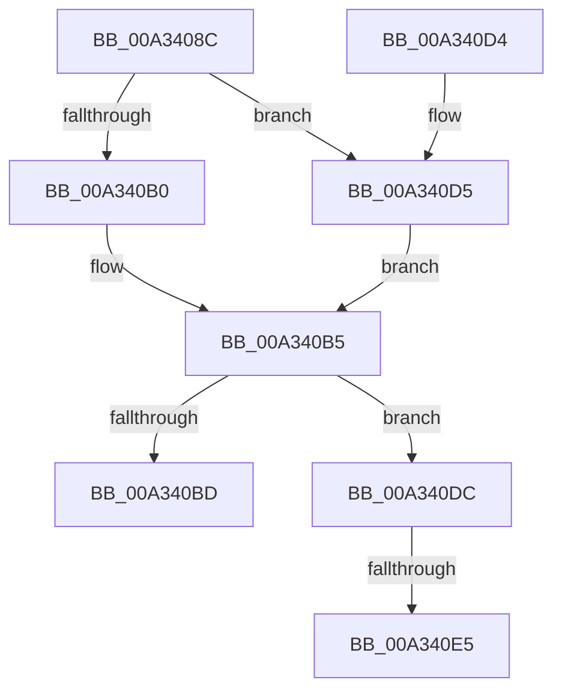

# SubstringMatch

- RVA: `0x00A3408C`–`0x00A340ED` (길이 `97` bytes)
- VA: `0x0000000140A3408C`
- 실행 섹션: `PAGE`
- PDB 이름 있음: `예`; PDB Function 태그: `예`
- unwind 정보 RVA: `0x000ABA64`
- 디코드: `29`개 명령, `97/97` bytes 표시
- 미해석 바이트: `0` (있으면 어셈블리에 `.byte`로 보존)

> 이 문서는 커널 이미지의 기계어와 PDB 기호를 분석해 생성했습니다. 4번과 5번은 함수 원형과 자료형을 바이너리 사용 방식에서 추정한 C 해석이며 원본 소스 복구 결과는 아닙니다.

## 1. Dependencies

- 직접 호출 지점: **2**; 고유 호출 대상: **2**
- 직접 호출자로 확인된 함수: **2**
- RIP 상대 이미지 참조: **0**

### Outgoing calls
- `0x00A340B0` → [wcsistr](wcsistr_function_00A340F4.md) (function, `0x00A340F4`)
- `0x00A340D5` → [wcsstr](../../text/50/wcsstr_function_00501F80.md) (function, `0x00501F80`)

### Direct callers
- [StringListElementSubstringMatch](../83/StringListElementSubstringMatch_function_00835DA8.md) at `0x00835E1F`
- [PropertyEval](../9C/PropertyEval_function_009CB300.md) at `0x009CB675`

### Static image references
- 디코드된 RIP-relative 메모리 참조가 없습니다.

## 2. Other-region calls and transfers

- 다른 실행 섹션으로 향하는 call: **1**
  - `0x00A340D5` → [wcsstr](../../text/50/wcsstr_function_00501F80.md) (`PAGE` → `.text`)
- call이 아닌 외부 분기/꼬리 이동: **2**
  - `0x00A340DF` → [sub_00B39FE2](../B3/Unknown_function_00B39FE2.md) (`tail-transfer`)
  - `0x00A340E8` → [sub_00B39FE2 + 0x28](../B3/Unknown_function_00B39FE2.md) (`tail-transfer`)

## 3. Assembly (complete function range)

```asm
00A3408C  48 89 5C 24 08                  mov qword ptr [rsp + 8], rbx
00A34091  48 89 6C 24 10                  mov qword ptr [rsp + 0x10], rbp
00A34096  48 89 74 24 18                  mov qword ptr [rsp + 0x18], rsi
00A3409B  57                              push rdi
00A3409C  48 83 EC 20                     sub rsp, 0x20
00A340A0  33 DB                           xor ebx, ebx
00A340A2  41 8B F9                        mov edi, r9d
00A340A5  48 8B EA                        mov rbp, rdx
00A340A8  48 8B F1                        mov rsi, rcx
00A340AB  45 85 C0                        test r8d, r8d
00A340AE  74 25                           je 0x140a340d5
00A340B0  E8 3F 00 00 00                  call 0x140a340f4
00A340B5  4C 8B C0                        mov r8, rax
00A340B8  48 85 C0                        test rax, rax
00A340BB  75 1F                           jne 0x140a340dc
00A340BD  48 8B 6C 24 38                  mov rbp, qword ptr [rsp + 0x38]
00A340C2  8B C3                           mov eax, ebx
00A340C4  48 8B 5C 24 30                  mov rbx, qword ptr [rsp + 0x30]
00A340C9  48 8B 74 24 40                  mov rsi, qword ptr [rsp + 0x40]
00A340CE  48 83 C4 20                     add rsp, 0x20
00A340D2  5F                              pop rdi
00A340D3  C3                              ret
00A340D4  CC                              int3
00A340D5  E8 A6 DE AC FF                  call 0x140501f80
00A340DA  EB D9                           jmp 0x140a340b5
00A340DC  83 FF 09                        cmp edi, 9
00A340DF  0F 85 FD 5E 10 00               jne 0x140b39fe2
00A340E5  4C 3B C6                        cmp r8, rsi
00A340E8  E9 1D 5F 10 00                  jmp 0x140b3a00a
```

## 4. C-style interpretation (structured pseudocode)

```c
__int64 __fastcall SubstringMatch(__int64 a1, __int64 a2, int a3, int a4)
{
    __int64 result;
    __int64 v_rbx;
    __int64 v_rsp;
    unsigned __int64 v_stack_p10;
    unsigned __int64 v_stack_p18;
    unsigned __int64 v_stack_p8;

    v_stack_p8 = v_rbx;
    v_stack_p10 = v_rbp;
    v_stack_p18 = v_rsi;
    v_rsp = (v_rsp) - (32);
    v_rbx = 0;
    if (a3 == 0) goto loc_00A340D5;
    result = wcsistr(a1, a2, a3, a4);
loc_00A340B5:
    if (result != 0) goto loc_00A340DC;
    v_rsp = (v_rsp) + (32);
    return 0;
loc_00A340D5:
    result = wcsstr(a1, a2, result, a4);
    goto loc_00A340B5;
loc_00A340DC:
}
```

## 5. (Beta) C Style

```c
int64_t SubstringMatch(int64_t Arg1, int64_t Arg2, int32_t Arg3, int32_t Arg4)
{
    int64_t result;
    int64_t local_rbx;
    int64_t local_rsp;
    uint64_t v_stack_p10;
    uint64_t v_stack_p18;
    uint64_t v_stack_p8;

    v_stack_p8 = local_rbx;
    v_stack_p10 = local_rbp;
    v_stack_p18 = local_rsi;
    local_rsp = (local_rsp) - (32);
    local_rbx = 0;
    if (Arg3 == 0) goto loc_00A340D5;
    result = wcsistr(Arg1, Arg2, Arg3, Arg4);
loc_00A340B5:
    if (result != 0) goto loc_00A340DC;
    local_rsp = (local_rsp) + (32);
    return 0;
loc_00A340D5:
    result = wcsstr(Arg1, Arg2, result, Arg4);
    goto loc_00A340B5;
loc_00A340DC:
}
```

## 6. Execution-region graph

[열기: 2D/3D 그래프와 함수 탐색 컨트롤 패널](../../../control-panel.html?section=page&rva=0x00A3408C&view=graph)

- 2D 그래프는 위에서 아래로 흐르고, 3D 그래프는 빈 공간을 드래그해 회전합니다. Shift+드래그는 이동, 휠은 확대·축소, 함수 노드 선택은 대상 보고서 이동입니다.

### Static fallback


