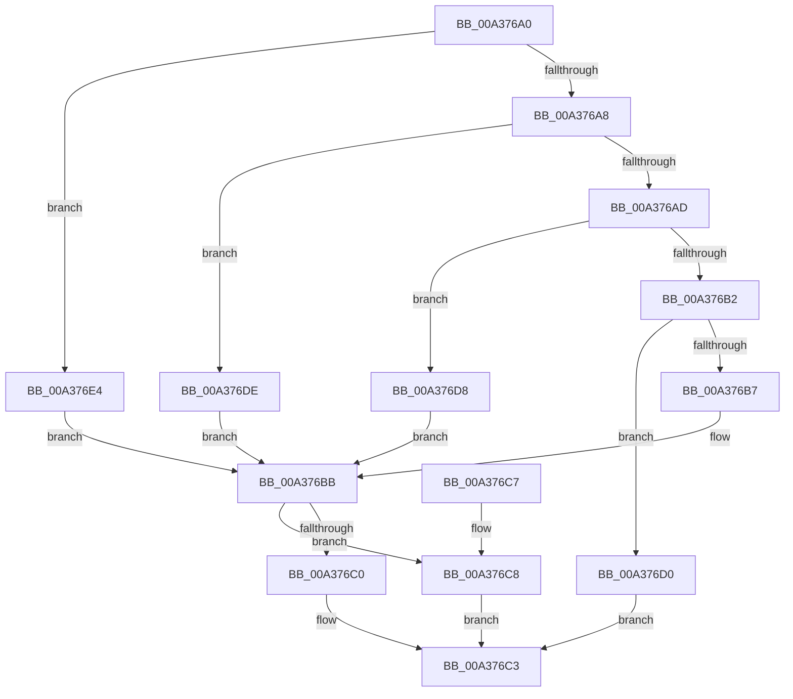

# SysCtxGetCachedContextBaseKey

- RVA: `0x00A376A0`–`0x00A376EA` (길이 `74` bytes)
- VA: `0x0000000140A376A0`
- 실행 섹션: `PAGE`
- PDB 이름 있음: `예`; PDB Function 태그: `아니요`
- unwind 정보 RVA: `0x000DB714`
- 디코드: `26`개 명령, `74/74` bytes 표시
- 미해석 바이트: `0` (있으면 어셈블리에 `.byte`로 보존)

> 이 문서는 커널 이미지의 기계어와 PDB 기호를 분석해 생성했습니다. 4번과 5번은 함수 원형과 자료형을 바이너리 사용 방식에서 추정한 C 해석이며 원본 소스 복구 결과는 아닙니다.

## 1. Dependencies

- 직접 호출 지점: **0**; 고유 호출 대상: **0**
- 직접 호출자로 확인된 함수: **3**
- RIP 상대 이미지 참조: **0**

### Outgoing calls
- 직접 디코드된 call 명령이 없습니다.

### Direct callers
- [_PnpCtxGetCachedNodeBaseKey](../8E/_PnpCtxGetCachedNodeBaseKey_function_008EF9C0.md) at `0x008EFAD2`
- [SysCtxRegOpenCurrentUserKey](../8F/SysCtxRegOpenCurrentUserKey_function_008F455C.md) at `0x008F477B`
- [sub_00B1E19D](../B1/Unknown_function_00B1E19D.md) at `0x00B1E23E`

### Static image references
- 디코드된 RIP-relative 메모리 참조가 없습니다.

## 2. Other-region calls and transfers

- 다른 실행 섹션으로 향하는 call: **0**
- 별도 외부 분기/꼬리 이동을 확인하지 못했습니다.

## 3. Assembly (complete function range)

```asm
00A376A0  45 33 C9                        xor r9d, r9d
00A376A3  83 EA 01                        sub edx, 1
00A376A6  74 3C                           je 0x140a376e4
00A376A8  83 EA 01                        sub edx, 1
00A376AB  74 31                           je 0x140a376de
00A376AD  83 EA 01                        sub edx, 1
00A376B0  74 26                           je 0x140a376d8
00A376B2  83 FA 01                        cmp edx, 1
00A376B5  75 19                           jne 0x140a376d0
00A376B7  48 8B 41 30                     mov rax, qword ptr [rcx + 0x30]
00A376BB  48 85 C0                        test rax, rax
00A376BE  74 08                           je 0x140a376c8
00A376C0  49 89 00                        mov qword ptr [r8], rax
00A376C3  41 8B C1                        mov eax, r9d
00A376C6  C3                              ret
00A376C7  CC                              int3
00A376C8  41 B9 34 00 00 C0               mov r9d, 0xc0000034
00A376CE  EB F3                           jmp 0x140a376c3
00A376D0  41 B9 0D 00 00 C0               mov r9d, 0xc000000d
00A376D6  EB EB                           jmp 0x140a376c3
00A376D8  48 8B 41 28                     mov rax, qword ptr [rcx + 0x28]
00A376DC  EB DD                           jmp 0x140a376bb
00A376DE  48 8B 41 20                     mov rax, qword ptr [rcx + 0x20]
00A376E2  EB D7                           jmp 0x140a376bb
00A376E4  48 8B 41 18                     mov rax, qword ptr [rcx + 0x18]
00A376E8  EB D1                           jmp 0x140a376bb
```

## 4. C-style interpretation (structured pseudocode)

```c
__int64 __fastcall SysCtxGetCachedContextBaseKey(__int64 a1, int a2, __int64 a3, int a4)
{
    a4 = 0;
    a2 = (unsigned int)((a2) - (1));
    if (condition_is_equal) goto loc_00A376E4;
    a2 = (unsigned int)((a2) - (1));
    if (condition_is_equal) goto loc_00A376DE;
    a2 = (unsigned int)((a2) - (1));
    if (condition_is_equal) goto loc_00A376D8;
    if (a2 != 1) goto loc_00A376D0;
loc_00A376BB:
    if (*(unsigned __int64 *)(a1 + 48) == 0) goto loc_00A376C8;
    *(unsigned __int64 *)(a3) = *(unsigned __int64 *)(a1 + 48);
loc_00A376C3:
    return 0;
loc_00A376C8:
    goto loc_00A376C3;
loc_00A376D0:
    goto loc_00A376C3;
loc_00A376D8:
    goto loc_00A376BB;
loc_00A376DE:
    goto loc_00A376BB;
loc_00A376E4:
    goto loc_00A376BB;
}
```

## 5. (Beta) C Style

```c
int64_t SysCtxGetCachedContextBaseKey(void *Arg1, int32_t Arg2, void *Arg3, int32_t Arg4)
{
    uint8_t *arg1 = (uint8_t *)Arg1;
    uint8_t *arg3 = (uint8_t *)Arg3;

    Arg4 = 0;
    Arg2 = (uint32_t)((Arg2) - (1));
    if (condition_is_equal) goto loc_00A376E4;
    Arg2 = (uint32_t)((Arg2) - (1));
    if (condition_is_equal) goto loc_00A376DE;
    Arg2 = (uint32_t)((Arg2) - (1));
    if (condition_is_equal) goto loc_00A376D8;
    if (Arg2 != 1) goto loc_00A376D0;
loc_00A376BB:
    if (*(uint64_t *)(arg1 + 0x30) == 0) goto loc_00A376C8;
    *(uint64_t *)(arg3) = *(uint64_t *)(arg1 + 0x30);
loc_00A376C3:
    return 0;
loc_00A376C8:
    goto loc_00A376C3;
loc_00A376D0:
    goto loc_00A376C3;
loc_00A376D8:
    goto loc_00A376BB;
loc_00A376DE:
    goto loc_00A376BB;
loc_00A376E4:
    goto loc_00A376BB;
}
```

### 관측된 메모리 오프셋

구조체 형식이 확인되지 않은 접근은 인자 기준의 오프셋으로만 기록했습니다.

| 기준 인자 | 오프셋 표현 | 폭 (bit) | 접근 |
|---|---:|---:|---|
| `Arg1` | `+ 0x18` | `64` | `R` |
| `Arg1` | `+ 0x20` | `64` | `R` |
| `Arg1` | `+ 0x28` | `64` | `R` |
| `Arg1` | `+ 0x30` | `64` | `R` |
| `Arg3` | `+ 0x0` | `64` | `W` |

## 6. Execution-region graph

[열기: 2D/3D 그래프와 함수 탐색 컨트롤 패널](../../../control-panel.html?section=page&rva=0x00A376A0&view=graph)

- 2D 그래프는 위에서 아래로 흐르고, 3D 그래프는 빈 공간을 드래그해 회전합니다. Shift+드래그는 이동, 휠은 확대·축소, 함수 노드 선택은 대상 보고서 이동입니다.

### Static fallback


