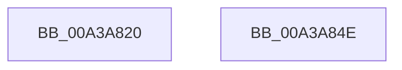

# sub_00A3A820

- RVA: `0x00A3A820`–`0x00A3A84F` (길이 `47` bytes)
- VA: `0x0000000140A3A820`
- 실행 섹션: `PAGE`
- PDB 이름 있음: `아니요`; PDB Function 태그: `아니요`
- unwind 정보 RVA: `0x00064C80`
- 디코드: `15`개 명령, `47/47` bytes 표시
- 미해석 바이트: `0` (있으면 어셈블리에 `.byte`로 보존)

> 이 문서는 커널 이미지의 기계어와 PDB 기호를 분석해 생성했습니다. 4번과 5번은 함수 원형과 자료형을 바이너리 사용 방식에서 추정한 C 해석이며 원본 소스 복구 결과는 아닙니다.

## 1. Dependencies

- 직접 호출 지점: **1**; 고유 호출 대상: **1**
- 직접 호출자로 확인된 함수: **0**
- RIP 상대 이미지 참조: **0**

### Outgoing calls
- `0x00A3A840` → [sub_00967C80](../96/Unknown_function_00967C80.md) (function, `0x00967C80`)

### Direct callers
- 이 함수 시작 RVA로 연결되는 직접 call은 확인되지 않았습니다. 간접 호출은 완전히 역산할 수 없습니다.

### Static image references
- 디코드된 RIP-relative 메모리 참조가 없습니다.

## 2. Other-region calls and transfers

- 다른 실행 섹션으로 향하는 call: **0**
- 별도 외부 분기/꼬리 이동을 확인하지 못했습니다.

## 3. Assembly (complete function range)

```asm
00A3A820  40 53                           push rbx
00A3A822  48 83 EC 30                     sub rsp, 0x30
00A3A826  44 8B 41 0C                     mov r8d, dword ptr [rcx + 0xc]
00A3A82A  48 8D 41 18                     lea rax, [rcx + 0x18]
00A3A82E  8B 51 08                        mov edx, dword ptr [rcx + 8]
00A3A831  4C 8D 49 10                     lea r9, [rcx + 0x10]
00A3A835  48 8B D9                        mov rbx, rcx
00A3A838  48 89 44 24 20                  mov qword ptr [rsp + 0x20], rax
00A3A83D  48 8B 09                        mov rcx, qword ptr [rcx]
00A3A840  E8 3B D4 F2 FF                  call 0x140967c80
00A3A845  89 43 1C                        mov dword ptr [rbx + 0x1c], eax
00A3A848  48 83 C4 30                     add rsp, 0x30
00A3A84C  5B                              pop rbx
00A3A84D  C3                              ret
00A3A84E  CC                              int3
```

## 4. C-style interpretation (structured pseudocode)

```c
__int64 __fastcall sub_00A3A820(__int64 a1)
{
    __int64 result;
    __int64 v_rsp;
    unsigned __int64 v_stack_m18;

    v_rsp = (v_rsp) - (48);
    v_stack_m18 = a1 + 24;
    result = sub_00967C80(*(unsigned __int64 *)(a1), (unsigned int)(*(unsigned int *)(a1 + 8)), (unsigned int)(*(unsigned int *)(a1 + 12)), a1 + 16);
    *(unsigned int *)(a1 + 28) = (unsigned int)(result);
    v_rsp = (v_rsp) + (48);
    return result;
}
```

## 5. (Beta) C Style

```c
int64_t sub_00A3A820(void *Arg1)
{
    uint8_t *arg1 = (uint8_t *)Arg1;

    int64_t result;
    int64_t local_rsp;
    uint64_t v_stack_m18;

    local_rsp = (local_rsp) - (48);
    v_stack_m18 = Arg1 + 24;
    result = sub_00967C80(*(uint64_t *)(arg1), (uint32_t)(*(uint32_t *)(arg1 + 0x8)), (uint32_t)(*(uint32_t *)(arg1 + 0xC)), Arg1 + 16);
    *(uint32_t *)(arg1 + 0x1C) = (uint32_t)(result);
    local_rsp = (local_rsp) + (48);
    return result;
}
```

### 관측된 메모리 오프셋

구조체 형식이 확인되지 않은 접근은 인자 기준의 오프셋으로만 기록했습니다.

| 기준 인자 | 오프셋 표현 | 폭 (bit) | 접근 |
|---|---:|---:|---|
| `Arg1` | `+ 0x0` | `64` | `R` |
| `Arg1` | `+ 0x8` | `32` | `R` |
| `Arg1` | `+ 0xC` | `32` | `R` |
| `Arg1` | `+ 0x10` | `64` | `R` |
| `Arg1` | `+ 0x18` | `64` | `R` |
| `Arg1` | `+ 0x1C` | `32` | `W` |

## 6. Execution-region graph

[열기: 2D/3D 그래프와 함수 탐색 컨트롤 패널](../../../control-panel.html?section=page&rva=0x00A3A820&view=graph)

- 2D 그래프는 위에서 아래로 흐르고, 3D 그래프는 빈 공간을 드래그해 회전합니다. Shift+드래그는 이동, 휠은 확대·축소, 함수 노드 선택은 대상 보고서 이동입니다.

### Static fallback


