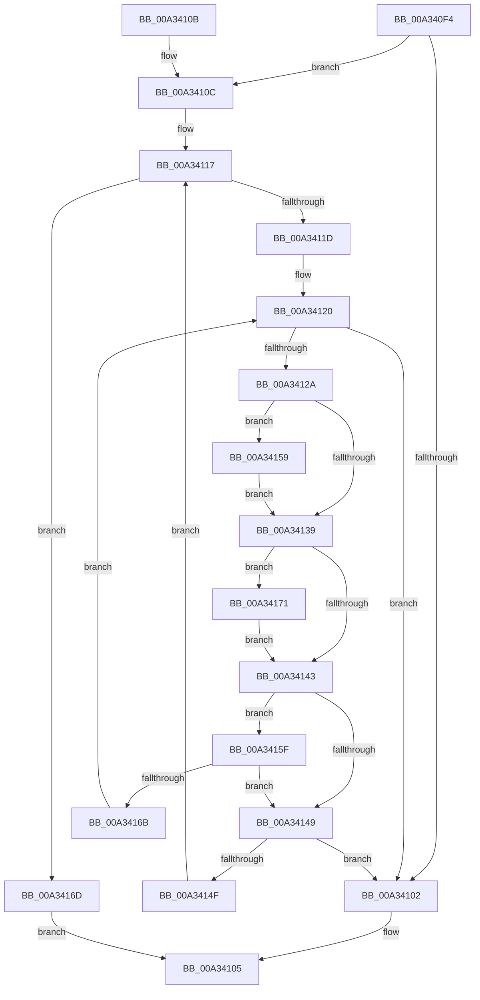

# wcsistr

- RVA: `0x00A340F4`–`0x00A34177` (길이 `131` bytes)
- VA: `0x0000000140A340F4`
- 실행 섹션: `PAGE`
- PDB 이름 있음: `예`; PDB Function 태그: `아니요`
- unwind 정보 RVA: `0x000AD5E4`
- 디코드: `41`개 명령, `131/131` bytes 표시
- 미해석 바이트: `0` (있으면 어셈블리에 `.byte`로 보존)

> 이 문서는 커널 이미지의 기계어와 PDB 기호를 분석해 생성했습니다. 4번과 5번은 함수 원형과 자료형을 바이너리 사용 방식에서 추정한 C 해석이며 원본 소스 복구 결과는 아닙니다.

## 1. Dependencies

- 직접 호출 지점: **0**; 고유 호출 대상: **0**
- 직접 호출자로 확인된 함수: **1**
- RIP 상대 이미지 참조: **0**

### Outgoing calls
- 직접 디코드된 call 명령이 없습니다.

### Direct callers
- [SubstringMatch](SubstringMatch_function_00A3408C.md) at `0x00A340B0`

### Static image references
- 디코드된 RIP-relative 메모리 참조가 없습니다.

## 2. Other-region calls and transfers

- 다른 실행 섹션으로 향하는 call: **0**
- 별도 외부 분기/꼬리 이동을 확인하지 못했습니다.

## 3. Assembly (complete function range)

```asm
00A340F4  48 89 7C 24 08                  mov qword ptr [rsp + 8], rdi
00A340F9  66 83 3A 00                     cmp word ptr [rdx], 0
00A340FD  4C 8B D2                        mov r10, rdx
00A34100  75 0A                           jne 0x140a3410c
00A34102  48 8B C1                        mov rax, rcx
00A34105  48 8B 7C 24 08                  mov rdi, qword ptr [rsp + 8]
00A3410A  C3                              ret
00A3410B  CC                              int3
00A3410C  4C 8B C1                        mov r8, rcx
00A3410F  BF E0 FF 00 00                  mov edi, 0xffe0
00A34114  4D 2B C2                        sub r8, r10
00A34117  66 83 39 00                     cmp word ptr [rcx], 0
00A3411B  74 50                           je 0x140a3416d
00A3411D  49 8B D2                        mov rdx, r10
00A34120  44 0F B7 0A                     movzx r9d, word ptr [rdx]
00A34124  66 45 85 C9                     test r9w, r9w
00A34128  74 D8                           je 0x140a34102
00A3412A  45 0F B7 1C 10                  movzx r11d, word ptr [r8 + rdx]
00A3412F  41 8D 43 9F                     lea eax, [r11 - 0x61]
00A34133  66 83 F8 19                     cmp ax, 0x19
00A34137  76 20                           jbe 0x140a34159
00A34139  41 8D 41 9F                     lea eax, [r9 - 0x61]
00A3413D  66 83 F8 19                     cmp ax, 0x19
00A34141  76 2E                           jbe 0x140a34171
00A34143  66 45 3B D9                     cmp r11w, r9w
00A34147  74 16                           je 0x140a3415f
00A34149  66 83 3A 00                     cmp word ptr [rdx], 0
00A3414D  74 B3                           je 0x140a34102
00A3414F  48 83 C1 02                     add rcx, 2
00A34153  49 83 C0 02                     add r8, 2
00A34157  EB BE                           jmp 0x140a34117
00A34159  66 44 03 DF                     add r11w, di
00A3415D  EB DA                           jmp 0x140a34139
00A3415F  48 83 C2 02                     add rdx, 2
00A34163  66 41 83 3C 10 00               cmp word ptr [r8 + rdx], 0
00A34169  74 DE                           je 0x140a34149
00A3416B  EB B3                           jmp 0x140a34120
00A3416D  33 C0                           xor eax, eax
00A3416F  EB 94                           jmp 0x140a34105
00A34171  66 44 03 CF                     add r9w, di
00A34175  EB CC                           jmp 0x140a34143
```

## 4. C-style interpretation (structured pseudocode)

```c
__int64 __fastcall wcsistr(__int64 a1, __int64 a2)
{
    __int64 result;
    __int64 v_r11;
    unsigned __int64 v_stack_p8;

    v_stack_p8 = v_rdi;
    if ((*(unsigned __int16 *)(a2)) != 0) goto loc_00A3410C;
loc_00A34102:
loc_00A34105:
    return a1;
loc_00A3410C:
    a3 = (a1) - (a2);
loc_00A34117:
    if ((*(unsigned __int16 *)(a1)) == 0) goto loc_00A3416D;
loc_00A34120:
    if ((unsigned __int16)(*(unsigned __int16 *)(a2)) == 0) goto loc_00A34102;
    if (((unsigned __int16)(*(unsigned __int16 *)(a3 + a2 * 1) - 97)) <= 25) goto loc_00A34159;
loc_00A34139:
    if (((unsigned __int16)(*(unsigned __int16 *)(a2) - 97)) <= 25) goto loc_00A34171;
loc_00A34143:
    if (((unsigned __int16)(*(unsigned __int16 *)(a3 + a2 * 1))) == ((unsigned __int16)(*(unsigned __int16 *)(a2)))) goto loc_00A3415F;
loc_00A34149:
    if ((*(unsigned __int16 *)(a2)) == 0) goto loc_00A34102;
    a1 = (a1) + (2);
    a3 = (a3) + (2);
    goto loc_00A34117;
loc_00A34159:
    v_r11 = (unsigned __int16)((*(unsigned __int16 *)(a3 + a2 * 1)) + ((unsigned __int16)((unsigned int)(0xFFE0ULL))));
    goto loc_00A34139;
loc_00A3415F:
    a2 = (a2) + (2);
    if ((*(unsigned __int16 *)(a3 + a2 * 1)) == 0) goto loc_00A34149;
    goto loc_00A34120;
loc_00A3416D:
    result = 0;
    goto loc_00A34105;
loc_00A34171:
    a4 = (unsigned __int16)((*(unsigned __int16 *)(a2)) + ((unsigned __int16)((unsigned int)(0xFFE0ULL))));
    goto loc_00A34143;
}
```

## 5. (Beta) C Style

```c
void *wcsistr(void *Arg1, void *Arg2)
{
    uint8_t *arg1 = (uint8_t *)Arg1;
    uint8_t *arg2 = (uint8_t *)Arg2;

    int64_t result;
    int64_t local_r11;
    uint64_t v_stack_p8;

    v_stack_p8 = local_rdi;
    if ((*(uint16_t *)(arg2)) != 0) goto loc_00A3410C;
loc_00A34102:
loc_00A34105:
    return Arg1;
loc_00A3410C:
    a3 = (Arg1) - (Arg2);
loc_00A34117:
    if ((*(uint16_t *)(arg1)) == 0) goto loc_00A3416D;
loc_00A34120:
    if ((uint16_t)(*(uint16_t *)(arg2)) == 0) goto loc_00A34102;
    if (((uint16_t)(*(uint16_t *)(a3 + arg2 * 1) - 97)) <= 25) goto loc_00A34159;
loc_00A34139:
    if (((uint16_t)(*(uint16_t *)(arg2) - 97)) <= 25) goto loc_00A34171;
loc_00A34143:
    if (((uint16_t)(*(uint16_t *)(a3 + arg2 * 1))) == ((uint16_t)(*(uint16_t *)(arg2)))) goto loc_00A3415F;
loc_00A34149:
    if ((*(uint16_t *)(arg2)) == 0) goto loc_00A34102;
    Arg1 = (Arg1) + (2);
    a3 = (a3) + (2);
    goto loc_00A34117;
loc_00A34159:
    local_r11 = (uint16_t)((*(uint16_t *)(a3 + arg2 * 1)) + ((uint16_t)((uint32_t)(0xFFE0ULL))));
    goto loc_00A34139;
loc_00A3415F:
    Arg2 = (Arg2) + (2);
    if ((*(uint16_t *)(a3 + arg2 * 1)) == 0) goto loc_00A34149;
    goto loc_00A34120;
loc_00A3416D:
    result = 0;
    goto loc_00A34105;
loc_00A34171:
    a4 = (uint16_t)((*(uint16_t *)(arg2)) + ((uint16_t)((uint32_t)(0xFFE0ULL))));
    goto loc_00A34143;
}
```

### 관측된 메모리 오프셋

구조체 형식이 확인되지 않은 접근은 인자 기준의 오프셋으로만 기록했습니다.

| 기준 인자 | 오프셋 표현 | 폭 (bit) | 접근 |
|---|---:|---:|---|
| `Arg1` | `+ 0x0` | `16` | `R` |
| `Arg1` | `+ 0x0 + rdx*1` | `16` | `R` |
| `Arg2` | `+ 0x0` | `16` | `R` |

## 6. Execution-region graph

[열기: 2D/3D 그래프와 함수 탐색 컨트롤 패널](../../../control-panel.html?section=page&rva=0x00A340F4&view=graph)

- 2D 그래프는 위에서 아래로 흐르고, 3D 그래프는 빈 공간을 드래그해 회전합니다. Shift+드래그는 이동, 휠은 확대·축소, 함수 노드 선택은 대상 보고서 이동입니다.

### Static fallback


