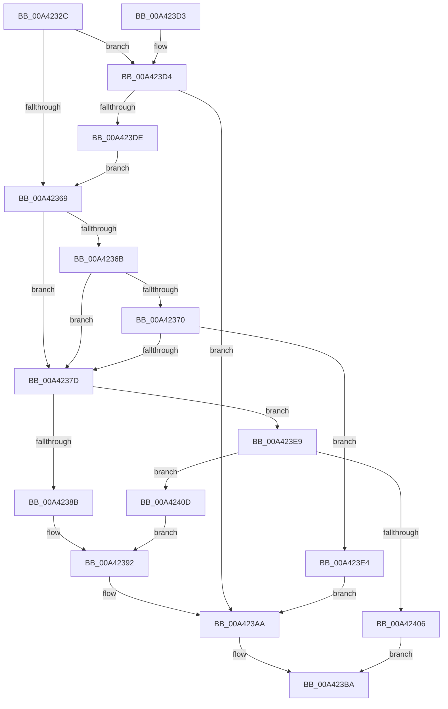

# AdtpEtwBuildString

- RVA: `0x00A4232C`–`0x00A4241A` (길이 `238` bytes)
- VA: `0x0000000140A4232C`
- 실행 섹션: `PAGE`
- PDB 이름 있음: `예`; PDB Function 태그: `아니요`
- unwind 정보 RVA: `0x000AECF8`
- 디코드: `71`개 명령, `238/238` bytes 표시
- 미해석 바이트: `0` (있으면 어셈블리에 `.byte`로 보존)

> 이 문서는 커널 이미지의 기계어와 PDB 기호를 분석해 생성했습니다. 4번과 5번은 함수 원형과 자료형을 바이너리 사용 방식에서 추정한 C 해석이며 원본 소스 복구 결과는 아닙니다.

## 1. Dependencies

- 직접 호출 지점: **2**; 고유 호출 대상: **2**
- 직접 호출자로 확인된 함수: **1**
- RIP 상대 이미지 참조: **0**

### Outgoing calls
- `0x00A4239D` → [memcpy](../../text/6C/memcpy_function_006C6840.md) (function, `0x006C6840`)
- `0x00A423F9` → [ExAllocatePool2](../../poolcode/B8/ExAllocatePool2_function_00B820F0.md) (function, `0x00B820F0`)

### Direct callers
- [AdtpPackageParameters](../../text/45/AdtpPackageParameters_function_00459964.md) at `0x00459CA0`

### Static image references
- 디코드된 RIP-relative 메모리 참조가 없습니다.

## 2. Other-region calls and transfers

- 다른 실행 섹션으로 향하는 call: **2**
  - `0x00A4239D` → [memcpy](../../text/6C/memcpy_function_006C6840.md) (`PAGE` → `.text`)
  - `0x00A423F9` → [ExAllocatePool2](../../poolcode/B8/ExAllocatePool2_function_00B820F0.md) (`PAGE` → `POOLCODE`)
- 별도 외부 분기/꼬리 이동을 확인하지 못했습니다.

## 3. Assembly (complete function range)

```asm
00A4232C  48 89 5C 24 08                  mov qword ptr [rsp + 8], rbx
00A42331  48 89 6C 24 10                  mov qword ptr [rsp + 0x10], rbp
00A42336  48 89 74 24 18                  mov qword ptr [rsp + 0x18], rsi
00A4233B  57                              push rdi
00A4233C  41 56                           push r14
00A4233E  41 57                           push r15
00A42340  48 83 EC 20                     sub rsp, 0x20
00A42344  44 0F B7 5A 02                  movzx r11d, word ptr [rdx + 2]
00A42349  48 8D 72 08                     lea rsi, [rdx + 8]
00A4234D  4C 8B F1                        mov r14, rcx
00A42350  45 33 FF                        xor r15d, r15d
00A42353  0F B7 0A                        movzx ecx, word ptr [rdx]
00A42356  48 8B EA                        mov rbp, rdx
00A42359  44 8B D1                        mov r10d, ecx
00A4235C  41 D1 EA                        shr r10d, 1
00A4235F  41 8D 7A 01                     lea edi, [r10 + 1]
00A42363  66 44 3B D9                     cmp r11w, cx
00A42367  77 6B                           ja 0x140a423d4
00A42369  75 12                           jne 0x140a4237d
00A4236B  83 FF 01                        cmp edi, 1
00A4236E  76 0D                           jbe 0x140a4237d
00A42370  48 8B 1E                        mov rbx, qword ptr [rsi]
00A42373  8D 47 FE                        lea eax, [rdi - 2]
00A42376  66 44 39 3C 43                  cmp word ptr [rbx + rax*2], r15w
00A4237B  74 67                           je 0x140a423e4
00A4237D  41 8B 01                        mov eax, dword ptr [r9]
00A42380  8D 0C 38                        lea ecx, [rax + rdi]
00A42383  81 F9 00 04 00 00               cmp ecx, 0x400
00A42389  73 5E                           jae 0x140a423e9
00A4238B  49 8D 1C 40                     lea rbx, [r8 + rax*2]
00A4238F  41 89 09                        mov dword ptr [r9], ecx
00A42392  44 0F B7 45 00                  movzx r8d, word ptr [rbp]
00A42397  48 8B CB                        mov rcx, rbx
00A4239A  48 8B 16                        mov rdx, qword ptr [rsi]
00A4239D  E8 9E 44 C8 FF                  call 0x1406c6840
00A423A2  8D 47 FF                        lea eax, [rdi - 1]
00A423A5  66 44 89 3C 43                  mov word ptr [rbx + rax*2], r15w
00A423AA  8D 04 3F                        lea eax, [rdi + rdi]
00A423AD  49 89 1E                        mov qword ptr [r14], rbx
00A423B0  41 89 46 08                     mov dword ptr [r14 + 8], eax
00A423B4  33 C0                           xor eax, eax
00A423B6  45 89 7E 0C                     mov dword ptr [r14 + 0xc], r15d
00A423BA  48 8B 5C 24 40                  mov rbx, qword ptr [rsp + 0x40]
00A423BF  48 8B 6C 24 48                  mov rbp, qword ptr [rsp + 0x48]
00A423C4  48 8B 74 24 50                  mov rsi, qword ptr [rsp + 0x50]
00A423C9  48 83 C4 20                     add rsp, 0x20
00A423CD  41 5F                           pop r15
00A423CF  41 5E                           pop r14
00A423D1  5F                              pop rdi
00A423D2  C3                              ret
00A423D3  CC                              int3
00A423D4  48 8B 1E                        mov rbx, qword ptr [rsi]
00A423D7  66 46 39 3C 53                  cmp word ptr [rbx + r10*2], r15w
00A423DC  74 CC                           je 0x140a423aa
00A423DE  66 44 3B D9                     cmp r11w, cx
00A423E2  EB 85                           jmp 0x140a42369
00A423E4  41 8B FA                        mov edi, r10d
00A423E7  EB C1                           jmp 0x140a423aa
00A423E9  8B D7                           mov edx, edi
00A423EB  B9 00 01 00 00                  mov ecx, 0x100
00A423F0  48 03 D2                        add rdx, rdx
00A423F3  41 B8 53 65 41 6B               mov r8d, 0x6b416553
00A423F9  E8 F2 FC 13 00                  call 0x140b820f0
00A423FE  48 8B D8                        mov rbx, rax
00A42401  48 85 C0                        test rax, rax
00A42404  75 07                           jne 0x140a4240d
00A42406  B8 17 00 00 C0                  mov eax, 0xc0000017
00A4240B  EB AD                           jmp 0x140a423ba
00A4240D  48 8B 44 24 60                  mov rax, qword ptr [rsp + 0x60]
00A42412  C6 00 01                        mov byte ptr [rax], 1
00A42415  E9 78 FF FF FF                  jmp 0x140a42392
```

## 4. C-style interpretation (structured pseudocode)

```c
__int64 __fastcall AdtpEtwBuildString(__int64 a1, __int64 a2, __int64 a3, __int64 a4, __int64 a5)
{
    __int64 result;
    __int64 v_r10;
    __int64 v_r15;
    __int64 v_rsp;
    unsigned __int64 v_stack_p10;
    unsigned __int64 v_stack_p18;
    unsigned __int64 v_stack_p8;

    v_stack_p8 = v_rbx;
    v_stack_p10 = v_rbp;
    v_stack_p18 = v_rsi;
    v_rsp = (v_rsp) - (32);
    v_r15 = 0;
    v_r10 = (unsigned int)(((unsigned int)((unsigned int)(*(unsigned __int16 *)(a2)))) >> (1));
    if (((unsigned __int16)(*(unsigned __int16 *)(a2 + 2))) > ((unsigned __int16)(*(unsigned __int16 *)(a2)))) goto loc_00A423D4;
loc_00A42369:
    if (((unsigned __int16)(*(unsigned __int16 *)(a2 + 2))) != ((unsigned __int16)(*(unsigned __int16 *)(a2)))) goto loc_00A4237D;
    if (((unsigned int)(v_r10 + 1)) <= 1) goto loc_00A4237D;
    if ((*(unsigned __int16 *)(*(unsigned __int64 *)(a2 + 8) + v_r10 + 1 - 2 * 2)) == 0) goto loc_00A423E4;
loc_00A4237D:
    if (((unsigned int)((unsigned int)(*(unsigned int *)(a4)) + v_r10 + 1 * 1)) >= 0x400ULL) goto loc_00A423E9;
    *(unsigned int *)(a4) = (unsigned int)((unsigned int)(*(unsigned int *)(a4)) + v_r10 + 1 * 1);
loc_00A42392:
    result = memcpy(a3 + (unsigned int)(*(unsigned int *)(a4)) * 2, *(unsigned __int64 *)(a2 + 8), *(unsigned __int16 *)(a2), a4);
    *(unsigned __int16 *)(a3 + (unsigned int)(*(unsigned int *)(a4)) * 2 + v_r10 + 1 - 1 * 2) = 0;
loc_00A423AA:
    *(unsigned __int64 *)(a1) = a3 + (unsigned int)(*(unsigned int *)(a4)) * 2;
    *(unsigned int *)(a1 + 8) = (unsigned int)(v_r10 + 1 + v_r10 + 1 * 1);
    result = 0;
    *(unsigned int *)(a1 + 12) = 0;
loc_00A423BA:
    v_rsp = (v_rsp) + (32);
    return result;
loc_00A423D4:
    if ((*(unsigned __int16 *)(*(unsigned __int64 *)(v_stack_p18) + v_r10 * 2)) == 0) goto loc_00A423AA;
    goto loc_00A42369;
loc_00A423E4:
    goto loc_00A423AA;
loc_00A423E9:
    a2 = ((unsigned int)((unsigned int)((unsigned int)((unsigned int)(v_r10))))) + ((unsigned int)((unsigned int)((unsigned int)((unsigned int)(v_r10)))));
    result = ExAllocatePool2(256, a2, (unsigned int)(0x6B416553ULL), a4);
    if (result != 0) goto loc_00A4240D;
    goto loc_00A423BA;
loc_00A4240D:
    *(unsigned __int8 *)(a5) = 1;
    goto loc_00A42392;
}
```

## 5. (Beta) C Style

```c
int64_t AdtpEtwBuildString(void *Arg1, void *Arg2, void *Arg3, void *Arg4, void *Arg5)
{
    uint8_t *arg1 = (uint8_t *)Arg1;
    uint8_t *arg2 = (uint8_t *)Arg2;
    uint8_t *arg3 = (uint8_t *)Arg3;
    uint8_t *arg4 = (uint8_t *)Arg4;
    uint8_t *arg5 = (uint8_t *)Arg5;

    int64_t result;
    int64_t local_r10;
    int64_t local_r15;
    int64_t local_rsp;
    uint64_t v_stack_p10;
    uint64_t v_stack_p18;
    uint64_t v_stack_p8;

    v_stack_p8 = local_rbx;
    v_stack_p10 = local_rbp;
    v_stack_p18 = local_rsi;
    local_rsp = (local_rsp) - (32);
    local_r15 = 0;
    local_r10 = (uint32_t)(((uint32_t)((uint32_t)(*(uint16_t *)(arg2)))) >> (1));
    if (((uint16_t)(*(uint16_t *)(arg2 + 0x2))) > ((uint16_t)(*(uint16_t *)(arg2)))) goto loc_00A423D4;
loc_00A42369:
    if (((uint16_t)(*(uint16_t *)(arg2 + 0x2))) != ((uint16_t)(*(uint16_t *)(arg2)))) goto loc_00A4237D;
    if (((uint32_t)(local_r10 + 1)) <= 1) goto loc_00A4237D;
    if ((*(uint16_t *)(*(uint64_t *)(arg2 + 0x8) + local_r10 + 0x1 - 0x2 * 2)) == 0) goto loc_00A423E4;
loc_00A4237D:
    if (((uint32_t)((uint32_t)(*(uint32_t *)(arg4)) + local_r10 + 1 * 1)) >= 0x400ULL) goto loc_00A423E9;
    *(uint32_t *)(arg4) = (uint32_t)((uint32_t)(*(uint32_t *)(arg4)) + local_r10 + 1 * 1);
loc_00A42392:
    result = memcpy(Arg3 + (uint32_t)(*(uint32_t *)(arg4)) * 2, *(uint64_t *)(arg2 + 0x8), *(uint16_t *)(arg2), Arg4);
    *(uint16_t *)(arg3 + (uint32_t)(*(uint32_t *)(arg4)) * 2 + local_r10 + 0x1 - 0x1 * 2) = 0;
loc_00A423AA:
    *(void **)(arg1) = Arg3 + (uint32_t)(*(uint32_t *)(arg4)) * 2;
    *(uint32_t *)(arg1 + 0x8) = (uint32_t)(local_r10 + 1 + local_r10 + 1 * 1);
    result = 0;
    *(uint32_t *)(arg1 + 0xC) = 0;
loc_00A423BA:
    local_rsp = (local_rsp) + (32);
    return result;
loc_00A423D4:
    if ((*(uint16_t *)(*(uint64_t *)(v_stack_p18) + local_r10 * 2)) == 0) goto loc_00A423AA;
    goto loc_00A42369;
loc_00A423E4:
    goto loc_00A423AA;
loc_00A423E9:
    Arg2 = ((uint32_t)((uint32_t)((uint32_t)((uint32_t)(local_r10))))) + ((uint32_t)((uint32_t)((uint32_t)((uint32_t)(local_r10)))));
    result = ExAllocatePool2(256, Arg2, (uint32_t)(0x6B416553ULL), Arg4);
    if (result != 0) goto loc_00A4240D;
    goto loc_00A423BA;
loc_00A4240D:
    *(uint8_t *)(arg5) = 1;
    goto loc_00A42392;
}
```

### 관측된 메모리 오프셋

구조체 형식이 확인되지 않은 접근은 인자 기준의 오프셋으로만 기록했습니다.

| 기준 인자 | 오프셋 표현 | 폭 (bit) | 접근 |
|---|---:|---:|---|
| `Arg1` | `+ 0x0` | `64` | `W` |
| `Arg1` | `+ 0x8` | `32` | `W` |
| `Arg1` | `+ 0xC` | `32` | `W` |
| `Arg2` | `+ 0x0` | `16` | `R` |
| `Arg2` | `+ 0x0` | `64` | `R` |
| `Arg2` | `+ 0x2` | `16` | `R` |
| `Arg2` | `+ 0x8` | `64` | `R` |
| `Arg3` | `+ 0x0 + rax*2` | `64` | `R` |
| `Arg4` | `+ 0x0` | `32` | `R` |
| `Arg4` | `+ 0x0` | `32` | `W` |
| `Arg5` | `+ 0x0` | `8` | `W` |

## 6. Execution-region graph

[열기: 2D/3D 그래프와 함수 탐색 컨트롤 패널](../../../control-panel.html?section=page&rva=0x00A4232C&view=graph)

- 2D 그래프는 위에서 아래로 흐르고, 3D 그래프는 빈 공간을 드래그해 회전합니다. Shift+드래그는 이동, 휠은 확대·축소, 함수 노드 선택은 대상 보고서 이동입니다.

### Static fallback


