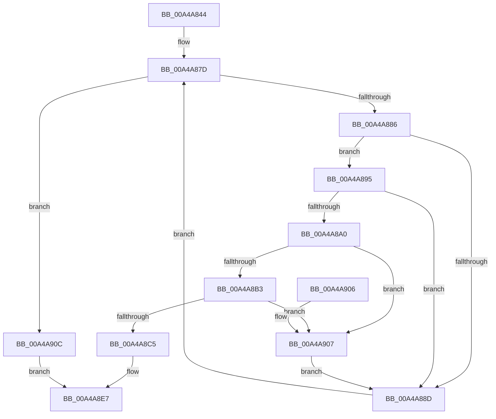

# AdtpLookupDriveLetter

- RVA: `0x00A4A844`–`0x00A4A910` (길이 `204` bytes)
- VA: `0x0000000140A4A844`
- 실행 섹션: `PAGE`
- PDB 이름 있음: `예`; PDB Function 태그: `아니요`
- unwind 정보 RVA: `0x000AFFE0`
- 디코드: `61`개 명령, `204/204` bytes 표시
- 미해석 바이트: `0` (있으면 어셈블리에 `.byte`로 보존)

> 이 문서는 커널 이미지의 기계어와 PDB 기호를 분석해 생성했습니다. 4번과 5번은 함수 원형과 자료형을 바이너리 사용 방식에서 추정한 C 해석이며 원본 소스 복구 결과는 아닙니다.

## 1. Dependencies

- 직접 호출 지점: **1**; 고유 호출 대상: **1**
- 직접 호출자로 확인된 함수: **1**
- RIP 상대 이미지 참조: **3**

### Outgoing calls
- `0x00A4A8BC` → [RtlEqualUnicodeString](../93/RtlEqualUnicodeString_function_00932A20.md) (function, `0x00932A20`)

### Direct callers
- [AdtpSubstituteDriveLetter](AdtpSubstituteDriveLetter_function_00A4A7D0.md) at `0x00A4A7F1`

### Static image references
- `0x00A4A864` → RVA `0x00FDAC10` (`PAGEDATA`; read)
- `0x00A4A86E` → RVA `0x00FDA9B8` (`PAGEDATA`; read)
- `0x00A4A8C8` → RVA `0x00FDA9B0` (`PAGEDATA`; read)

## 2. Other-region calls and transfers

- 다른 실행 섹션으로 향하는 call: **0**
- 별도 외부 분기/꼬리 이동을 확인하지 못했습니다.

## 3. Assembly (complete function range)

```asm
00A4A844  48 8B C4                        mov rax, rsp
00A4A847  48 89 58 08                     mov qword ptr [rax + 8], rbx
00A4A84B  48 89 68 10                     mov qword ptr [rax + 0x10], rbp
00A4A84F  48 89 70 18                     mov qword ptr [rax + 0x18], rsi
00A4A853  48 89 78 20                     mov qword ptr [rax + 0x20], rdi
00A4A857  41 54                           push r12
00A4A859  41 56                           push r14
00A4A85B  41 57                           push r15
00A4A85D  48 83 EC 20                     sub rsp, 0x20
00A4A861  4D 8B F0                        mov r14, r8
00A4A864  48 8D 1D A5 03 59 00            lea rbx, [rip + 0x5903a5]
00A4A86B  4C 8B FA                        mov r15, rdx
00A4A86E  4C 8D 25 43 01 59 00            lea r12, [rip + 0x590143]
00A4A875  48 8B F9                        mov rdi, rcx
00A4A878  BE 19 00 00 00                  mov esi, 0x19
00A4A87D  49 3B DC                        cmp rbx, r12
00A4A880  0F 8C 86 00 00 00               jl 0x140a4a90c
00A4A886  48 83 7B 08 00                  cmp qword ptr [rbx + 8], 0
00A4A88B  75 08                           jne 0x140a4a895
00A4A88D  FF CE                           dec esi
00A4A88F  48 83 EB 18                     sub rbx, 0x18
00A4A893  EB E8                           jmp 0x140a4a87d
00A4A895  0F B7 03                        movzx eax, word ptr [rbx]
00A4A898  0F B7 2F                        movzx ebp, word ptr [rdi]
00A4A89B  66 3B C5                        cmp ax, bp
00A4A89E  73 ED                           jae 0x140a4a88d
00A4A8A0  8B C8                           mov ecx, eax
00A4A8A2  66 89 07                        mov word ptr [rdi], ax
00A4A8A5  48 8B 47 08                     mov rax, qword ptr [rdi + 8]
00A4A8A9  48 D1 E9                        shr rcx, 1
00A4A8AC  66 83 3C 48 5C                  cmp word ptr [rax + rcx*2], 0x5c
00A4A8B1  75 54                           jne 0x140a4a907
00A4A8B3  41 B0 01                        mov r8b, 1
00A4A8B6  48 8B D3                        mov rdx, rbx
00A4A8B9  48 8B CF                        mov rcx, rdi
00A4A8BC  E8 5F 81 EE FF                  call 0x140932a20
00A4A8C1  84 C0                           test al, al
00A4A8C3  74 42                           je 0x140a4a907
00A4A8C5  66 89 2F                        mov word ptr [rdi], bp
00A4A8C8  48 8D 15 E1 00 59 00            lea rdx, [rip + 0x5900e1]
00A4A8CF  48 63 CE                        movsxd rcx, esi
00A4A8D2  B0 01                           mov al, 1
00A4A8D4  48 8D 0C 49                     lea rcx, [rcx + rcx*2]
00A4A8D8  0F B7 0C CA                     movzx ecx, word ptr [rdx + rcx*8]
00A4A8DC  66 41 89 0E                     mov word ptr [r14], cx
00A4A8E0  0F B7 0B                        movzx ecx, word ptr [rbx]
00A4A8E3  66 41 89 0F                     mov word ptr [r15], cx
00A4A8E7  48 8B 5C 24 40                  mov rbx, qword ptr [rsp + 0x40]
00A4A8EC  48 8B 6C 24 48                  mov rbp, qword ptr [rsp + 0x48]
00A4A8F1  48 8B 74 24 50                  mov rsi, qword ptr [rsp + 0x50]
00A4A8F6  48 8B 7C 24 58                  mov rdi, qword ptr [rsp + 0x58]
00A4A8FB  48 83 C4 20                     add rsp, 0x20
00A4A8FF  41 5F                           pop r15
00A4A901  41 5E                           pop r14
00A4A903  41 5C                           pop r12
00A4A905  C3                              ret
00A4A906  CC                              int3
00A4A907  66 89 2F                        mov word ptr [rdi], bp
00A4A90A  EB 81                           jmp 0x140a4a88d
00A4A90C  32 C0                           xor al, al
00A4A90E  EB D7                           jmp 0x140a4a8e7
```

## 4. C-style interpretation (structured pseudocode)

```c
__int64 __fastcall AdtpLookupDriveLetter(__int64 a1, __int64 a2, __int64 a3)
{
    __int64 result;
    __int64 v_rbx;
    __int64 v_rsi;
    __int64 v_rsp;
    unsigned __int64 v_stack_p10;
    unsigned __int64 v_stack_p18;
    unsigned __int64 v_stack_p20;
    unsigned __int64 v_stack_p8;

    *(unsigned __int64 *)(v_rsp + 8) = v_rbx;
    *(unsigned __int64 *)(v_rsp + 16) = v_rbp;
    *(unsigned __int64 *)(v_rsp + 24) = v_rsi;
    *(unsigned __int64 *)(v_rsp + 32) = v_rdi;
    v_rsp = (v_rsp) - (32);
loc_00A4A87D:
    if ((v_rip + 5833637) < (v_rip + 5833027)) goto loc_00A4A90C;
    if ((*(unsigned __int64 *)(v_rip + 5833637 + 8)) != 0) goto loc_00A4A895;
loc_00A4A88D:
    v_rsi = (unsigned int)((25) - 1);
    v_rbx = (v_rip + 5833637) - (24);
    goto loc_00A4A87D;
loc_00A4A895:
    if (((unsigned __int16)(*(unsigned __int16 *)(v_rbx))) >= ((unsigned __int16)(*(unsigned __int16 *)(a1)))) goto loc_00A4A88D;
    *(unsigned __int16 *)(a1) = (unsigned __int16)(*(unsigned __int16 *)(v_rbx));
    a1 = ((unsigned int)((unsigned int)(*(unsigned __int16 *)(v_rbx)))) >> (1);
    if ((*(unsigned __int16 *)(*(unsigned __int64 *)(a1 + 8) + a1 * 2)) != 92) goto loc_00A4A907;
    result = RtlEqualUnicodeString(a1, v_rbx, 1, a4);
    if ((unsigned __int8)(result) == 0) goto loc_00A4A907;
    *(unsigned __int16 *)(a1) = (unsigned __int16)(*(unsigned __int16 *)(a1));
    *(unsigned __int16 *)(a3) = (unsigned __int16)(*(unsigned __int16 *)(v_rip + 5832929 + (int)((unsigned int)(v_rsi)) + (int)((unsigned int)(v_rsi)) * 2 * 8));
    *(unsigned __int16 *)(a2) = (unsigned __int16)(*(unsigned __int16 *)(v_rbx));
loc_00A4A8E7:
    v_rsp = (v_rsp) + (32);
    return 1;
loc_00A4A907:
    *(unsigned __int16 *)(v_stack_p20) = (unsigned __int16)(v_stack_p10);
    goto loc_00A4A88D;
loc_00A4A90C:
    result = 0;
    goto loc_00A4A8E7;
}
```

## 5. (Beta) C Style

```c
int64_t AdtpLookupDriveLetter(void *Arg1, void *Arg2, void *Arg3)
{
    uint8_t *arg1 = (uint8_t *)Arg1;
    uint8_t *arg2 = (uint8_t *)Arg2;
    uint8_t *arg3 = (uint8_t *)Arg3;

    int64_t result;
    int64_t local_rbx;
    int64_t local_rsi;
    int64_t local_rsp;
    uint64_t v_stack_p10;
    uint64_t v_stack_p18;
    uint64_t v_stack_p20;
    uint64_t v_stack_p8;

    *(uint64_t *)(local_rsp + 0x8) = local_rbx;
    *(uint64_t *)(local_rsp + 0x10) = local_rbp;
    *(uint64_t *)(local_rsp + 0x18) = local_rsi;
    *(uint64_t *)(local_rsp + 0x20) = local_rdi;
    local_rsp = (local_rsp) - (32);
loc_00A4A87D:
    if ((v_rip + 5833637) < (v_rip + 5833027)) goto loc_00A4A90C;
    if ((*(uint64_t *)(v_rip + 0x5903A5 + 0x8)) != 0) goto loc_00A4A895;
loc_00A4A88D:
    local_rsi = (uint32_t)((25) - 1);
    local_rbx = (v_rip + 5833637) - (24);
    goto loc_00A4A87D;
loc_00A4A895:
    if (((uint16_t)(*(uint16_t *)(local_rbx))) >= ((uint16_t)(*(uint16_t *)(arg1)))) goto loc_00A4A88D;
    *(uint16_t *)(arg1) = (uint16_t)(*(uint16_t *)(local_rbx));
    Arg1 = ((uint32_t)((uint32_t)(*(uint16_t *)(local_rbx)))) >> (1);
    if ((*(uint16_t *)(*(uint64_t *)(arg1 + 0x8) + arg1 * 2)) != 92) goto loc_00A4A907;
    result = RtlEqualUnicodeString(Arg1, local_rbx, 1, a4);
    if ((uint8_t)(result) == 0) goto loc_00A4A907;
    *(uint16_t *)(arg1) = (uint16_t)(*(uint16_t *)(arg1));
    *(uint16_t *)(arg3) = (uint16_t)(*(uint16_t *)(v_rip + 0x5900E1 + (int32_t)((uint32_t)(local_rsi)) + (int32_t)((uint32_t)(local_rsi)) * 2 * 8));
    *(uint16_t *)(arg2) = (uint16_t)(*(uint16_t *)(local_rbx));
loc_00A4A8E7:
    local_rsp = (local_rsp) + (32);
    return 1;
loc_00A4A907:
    *(uint16_t *)(v_stack_p20) = (uint16_t)(v_stack_p10);
    goto loc_00A4A88D;
loc_00A4A90C:
    result = 0;
    goto loc_00A4A8E7;
}
```

### 관측된 메모리 오프셋

구조체 형식이 확인되지 않은 접근은 인자 기준의 오프셋으로만 기록했습니다.

| 기준 인자 | 오프셋 표현 | 폭 (bit) | 접근 |
|---|---:|---:|---|
| `Arg1` | `+ 0x0` | `16` | `R` |
| `Arg1` | `+ 0x0` | `16` | `W` |
| `Arg1` | `+ 0x8` | `64` | `R` |
| `Arg2` | `+ 0x0` | `16` | `W` |
| `Arg3` | `+ 0x0` | `16` | `W` |

## 6. Execution-region graph

[열기: 2D/3D 그래프와 함수 탐색 컨트롤 패널](../../../control-panel.html?section=page&rva=0x00A4A844&view=graph)

- 2D 그래프는 위에서 아래로 흐르고, 3D 그래프는 빈 공간을 드래그해 회전합니다. Shift+드래그는 이동, 휠은 확대·축소, 함수 노드 선택은 대상 보고서 이동입니다.

### Static fallback


