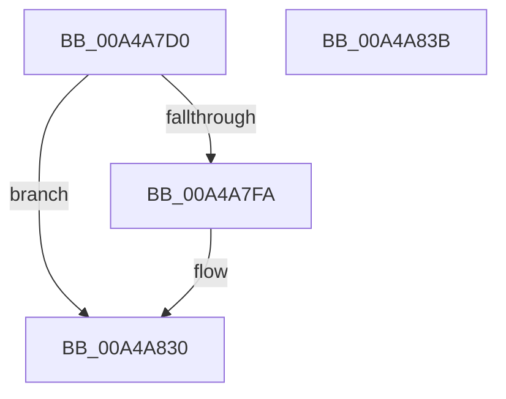

# AdtpSubstituteDriveLetter

- RVA: `0x00A4A7D0`–`0x00A4A83C` (길이 `108` bytes)
- VA: `0x0000000140A4A7D0`
- 실행 섹션: `PAGE`
- PDB 이름 있음: `예`; PDB Function 태그: `아니요`
- unwind 정보 RVA: `0x000A5538`
- 디코드: `31`개 명령, `108/108` bytes 표시
- 미해석 바이트: `0` (있으면 어셈블리에 `.byte`로 보존)

> 이 문서는 커널 이미지의 기계어와 PDB 기호를 분석해 생성했습니다. 4번과 5번은 함수 원형과 자료형을 바이너리 사용 방식에서 추정한 C 해석이며 원본 소스 복구 결과는 아닙니다.

## 1. Dependencies

- 직접 호출 지점: **2**; 고유 호출 대상: **2**
- 직접 호출자로 확인된 함수: **1**
- RIP 상대 이미지 참조: **0**

### Outgoing calls
- `0x00A4A7F1` → [AdtpLookupDriveLetter](AdtpLookupDriveLetter_function_00A4A844.md) (function, `0x00A4A844`)
- `0x00A4A824` → [memcpy](../../text/6C/memcpy_function_006C6840.md) (function, `0x006C6840`)

### Direct callers
- [AdtpPackageParameters](../../text/45/AdtpPackageParameters_function_00459964.md) at `0x00459E83`

### Static image references
- 디코드된 RIP-relative 메모리 참조가 없습니다.

## 2. Other-region calls and transfers

- 다른 실행 섹션으로 향하는 call: **1**
  - `0x00A4A824` → [memcpy](../../text/6C/memcpy_function_006C6840.md) (`PAGE` → `.text`)
- 별도 외부 분기/꼬리 이동을 확인하지 못했습니다.

## 3. Assembly (complete function range)

```asm
00A4A7D0  48 8B C4                        mov rax, rsp
00A4A7D3  48 89 58 08                     mov qword ptr [rax + 8], rbx
00A4A7D7  57                              push rdi
00A4A7D8  48 83 EC 20                     sub rsp, 0x20
00A4A7DC  33 DB                           xor ebx, ebx
00A4A7DE  4C 8D 40 18                     lea r8, [rax + 0x18]
00A4A7E2  48 8D 50 10                     lea rdx, [rax + 0x10]
00A4A7E6  66 89 58 18                     mov word ptr [rax + 0x18], bx
00A4A7EA  66 89 58 10                     mov word ptr [rax + 0x10], bx
00A4A7EE  48 8B F9                        mov rdi, rcx
00A4A7F1  E8 4E 00 00 00                  call 0x140a4a844
00A4A7F6  84 C0                           test al, al
00A4A7F8  74 36                           je 0x140a4a830
00A4A7FA  48 8B 4F 08                     mov rcx, qword ptr [rdi + 8]
00A4A7FE  0F B7 1F                        movzx ebx, word ptr [rdi]
00A4A801  0F B7 44 24 40                  movzx eax, word ptr [rsp + 0x40]
00A4A806  0F B7 54 24 38                  movzx edx, word ptr [rsp + 0x38]
00A4A80B  66 2B 5C 24 38                  sub bx, word ptr [rsp + 0x38]
00A4A810  48 03 D1                        add rdx, rcx
00A4A813  66 89 01                        mov word ptr [rcx], ax
00A4A816  66 C7 41 02 3A 00               mov word ptr [rcx + 2], 0x3a
00A4A81C  48 83 C1 04                     add rcx, 4
00A4A820  44 0F B7 C3                     movzx r8d, bx
00A4A824  E8 17 C0 C7 FF                  call 0x1406c6840
00A4A829  66 83 C3 04                     add bx, 4
00A4A82D  66 89 1F                        mov word ptr [rdi], bx
00A4A830  48 8B 5C 24 30                  mov rbx, qword ptr [rsp + 0x30]
00A4A835  48 83 C4 20                     add rsp, 0x20
00A4A839  5F                              pop rdi
00A4A83A  C3                              ret
00A4A83B  CC                              int3
```

## 4. C-style interpretation (structured pseudocode)

```c
__int64 __fastcall AdtpSubstituteDriveLetter(__int64 a1)
{
    __int64 result;
    __int64 v_rbx;
    __int64 v_rsp;
    unsigned __int16 v_stack_p10;
    unsigned __int16 v_stack_p18;
    unsigned __int64 v_stack_p8;

    *(unsigned __int64 *)(v_rsp + 8) = v_rbx;
    v_rsp = (v_rsp) - (32);
    v_rbx = 0;
    *(unsigned __int16 *)(v_rsp + 24) = 0;
    *(unsigned __int16 *)(v_rsp + 16) = 0;
    result = AdtpLookupDriveLetter(a1, v_rsp + 16, v_rsp + 24, a4);
    if ((unsigned __int8)(result) != 0) {
        a1 = *(unsigned __int64 *)(a1 + 8);
        v_rbx = *(unsigned __int16 *)(a1);
        result = v_stack_p18;
        a2 = v_stack_p10;
        v_rbx = (unsigned __int16)((v_rbx) - (v_stack_p10));
        a2 = (a2) + (a1);
        *(unsigned __int16 *)(a1) = (unsigned __int16)(result);
        *(unsigned __int16 *)(a1 + 2) = 58;
        a1 = (a1) + (4);
        a3 = (unsigned __int16)(v_rbx);
        result = memcpy(a1, a2, a3, a4);
        v_rbx = (unsigned __int16)((v_rbx) + (4));
        *(unsigned __int16 *)(a1) = (unsigned __int16)(v_rbx);
    }
    v_rsp = (v_rsp) + (32);
    return result;
}
```

## 5. (Beta) C Style

```c
int64_t AdtpSubstituteDriveLetter(void *Arg1)
{
    uint8_t *arg1 = (uint8_t *)Arg1;

    int64_t result;
    int64_t local_rbx;
    int64_t local_rsp;
    uint16_t v_stack_p10;
    uint16_t v_stack_p18;
    uint64_t v_stack_p8;

    *(uint64_t *)(local_rsp + 0x8) = local_rbx;
    local_rsp = (local_rsp) - (32);
    local_rbx = 0;
    *(uint16_t *)(local_rsp + 0x18) = 0;
    *(uint16_t *)(local_rsp + 0x10) = 0;
    result = AdtpLookupDriveLetter(Arg1, local_rsp + 16, local_rsp + 24, a4);
    if ((uint8_t)(result) != 0) {
        Arg1 = *(uint64_t *)(arg1 + 0x8);
        local_rbx = *(uint16_t *)(arg1);
        result = v_stack_p18;
        a2 = v_stack_p10;
        local_rbx = (uint16_t)((local_rbx) - (v_stack_p10));
        a2 = (a2) + (Arg1);
        *(uint16_t *)(arg1) = (uint16_t)(result);
        *(uint16_t *)(arg1 + 0x2) = 58;
        Arg1 = (Arg1) + (4);
        a3 = (uint16_t)(local_rbx);
        result = memcpy(Arg1, a2, a3, a4);
        local_rbx = (uint16_t)((local_rbx) + (4));
        *(uint16_t *)(arg1) = (uint16_t)(local_rbx);
    }
    local_rsp = (local_rsp) + (32);
    return result;
}
```

### 관측된 메모리 오프셋

구조체 형식이 확인되지 않은 접근은 인자 기준의 오프셋으로만 기록했습니다.

| 기준 인자 | 오프셋 표현 | 폭 (bit) | 접근 |
|---|---:|---:|---|
| `Arg1` | `+ 0x0` | `16` | `R` |
| `Arg1` | `+ 0x0` | `16` | `W` |
| `Arg1` | `+ 0x8` | `64` | `R` |

## 6. Execution-region graph

[열기: 2D/3D 그래프와 함수 탐색 컨트롤 패널](../../../control-panel.html?section=page&rva=0x00A4A7D0&view=graph)

- 2D 그래프는 위에서 아래로 흐르고, 3D 그래프는 빈 공간을 드래그해 회전합니다. Shift+드래그는 이동, 휠은 확대·축소, 함수 노드 선택은 대상 보고서 이동입니다.

### Static fallback


