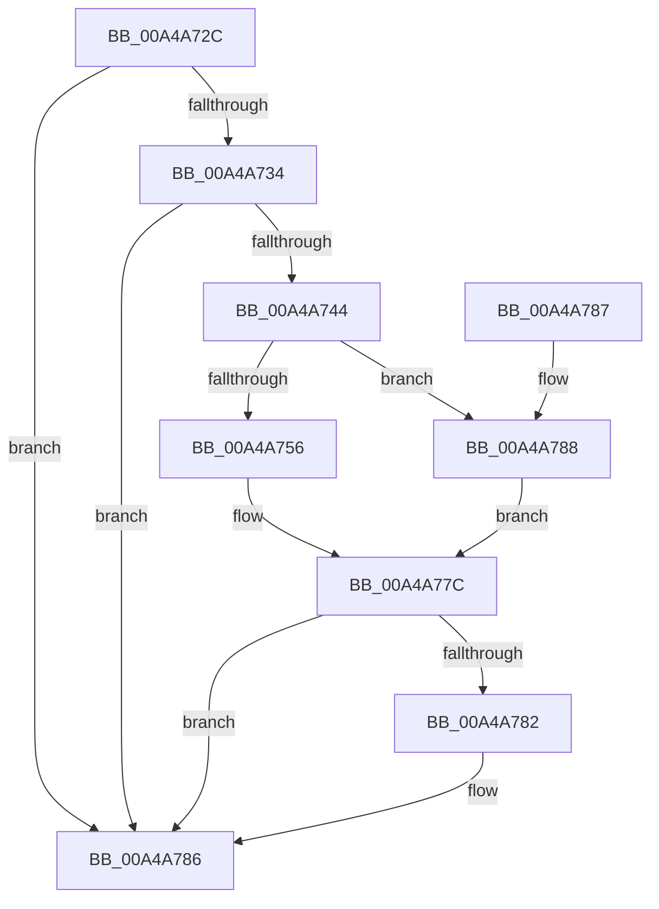

# AlpcpExposeCapturedContextAttribute

- RVA: `0x00A4A72C`–`0x00A4A7C7` (길이 `155` bytes)
- VA: `0x0000000140A4A72C`
- 실행 섹션: `PAGE`
- PDB 이름 있음: `예`; PDB Function 태그: `아니요`
- unwind 정보 RVA: `0x000DB714`
- 디코드: `42`개 명령, `155/155` bytes 표시
- 미해석 바이트: `0` (있으면 어셈블리에 `.byte`로 보존)

> 이 문서는 커널 이미지의 기계어와 PDB 기호를 분석해 생성했습니다. 4번과 5번은 함수 원형과 자료형을 바이너리 사용 방식에서 추정한 C 해석이며 원본 소스 복구 결과는 아닙니다.

## 1. Dependencies

- 직접 호출 지점: **0**; 고유 호출 대상: **0**
- 직접 호출자로 확인된 함수: **2**
- RIP 상대 이미지 참조: **0**

### Outgoing calls
- 직접 디코드된 call 명령이 없습니다.

### Direct callers
- [AlpcpReceiveMessage](../89/AlpcpReceiveMessage_function_00897ED0.md) at `0x00898408`
- [sub_00B226A4](../B2/Unknown_function_00B226A4.md) at `0x00B2271F`

### Static image references
- 디코드된 RIP-relative 메모리 참조가 없습니다.

## 2. Other-region calls and transfers

- 다른 실행 섹션으로 향하는 call: **0**
- 별도 외부 분기/꼬리 이동을 확인하지 못했습니다.

## 3. Assembly (complete function range)

```asm
00A4A72C  4C 8B D2                        mov r10, rdx
00A4A72F  4D 85 C9                        test r9, r9
00A4A732  74 52                           je 0x140a4a786
00A4A734  41 83 61 04 00                  and dword ptr [r9 + 4], 0
00A4A739  41 BB 00 00 00 20               mov r11d, 0x20000000
00A4A73F  45 85 C3                        test r11d, r8d
00A4A742  74 42                           je 0x140a4a786
00A4A744  49 63 D0                        movsxd rdx, r8d
00A4A747  41 81 E0 00 00 00 40            and r8d, 0x40000000
00A4A74E  48 C1 FA 3F                     sar rdx, 0x3f
00A4A752  85 C9                           test ecx, ecx
00A4A754  78 32                           js 0x140a4a788
00A4A756  41 0F 10 02                     movups xmm0, xmmword ptr [r10]
00A4A75A  83 E2 18                        and edx, 0x18
00A4A75D  48 83 C2 08                     add rdx, 8
00A4A761  45 85 C0                        test r8d, r8d
00A4A764  48 8D 42 20                     lea rax, [rdx + 0x20]
00A4A768  48 0F 44 C2                     cmove rax, rdx
00A4A76C  42 0F 11 04 08                  movups xmmword ptr [rax + r9], xmm0
00A4A771  41 0F 10 4A 10                  movups xmm1, xmmword ptr [r10 + 0x10]
00A4A776  42 0F 11 4C 08 10               movups xmmword ptr [rax + r9 + 0x10], xmm1
00A4A77C  49 83 3A 00                     cmp qword ptr [r10], 0
00A4A780  74 04                           je 0x140a4a786
00A4A782  45 09 59 04                     or dword ptr [r9 + 4], r11d
00A4A786  C3                              ret
00A4A787  CC                              int3
00A4A788  41 8B 02                        mov eax, dword ptr [r10]
00A4A78B  83 E2 0C                        and edx, 0xc
00A4A78E  48 83 C2 08                     add rdx, 8
00A4A792  45 85 C0                        test r8d, r8d
00A4A795  48 8D 4A 10                     lea rcx, [rdx + 0x10]
00A4A799  48 0F 44 CA                     cmove rcx, rdx
00A4A79D  42 89 04 09                     mov dword ptr [rcx + r9], eax
00A4A7A1  41 8B 42 08                     mov eax, dword ptr [r10 + 8]
00A4A7A5  42 89 44 09 04                  mov dword ptr [rcx + r9 + 4], eax
00A4A7AA  41 8B 42 10                     mov eax, dword ptr [r10 + 0x10]
00A4A7AE  42 89 44 09 08                  mov dword ptr [rcx + r9 + 8], eax
00A4A7B3  41 8B 42 14                     mov eax, dword ptr [r10 + 0x14]
00A4A7B7  42 89 44 09 0C                  mov dword ptr [rcx + r9 + 0xc], eax
00A4A7BC  41 8B 42 18                     mov eax, dword ptr [r10 + 0x18]
00A4A7C0  42 89 44 09 10                  mov dword ptr [rcx + r9 + 0x10], eax
00A4A7C5  EB B5                           jmp 0x140a4a77c
```

## 4. C-style interpretation (structured pseudocode)

```c
__int64 __fastcall AlpcpExposeCapturedContextAttribute(int a1, __int64 a2, int a3, __int64 a4)
{
    __int64 result;

    if (a4 == 0) goto loc_00A4A786;
    if ((((unsigned int)((unsigned int)(0x20000000ULL))) & (a3)) == 0) goto loc_00A4A786;
    a3 = (unsigned int)((a3) & (0x40000000ULL));
    a2 = ((int)(a3)) >> (63);
    if (sign_flag) goto loc_00A4A788;
    a2 = (unsigned int)((a2) & (24));
    a2 = (a2) + (8);
    result = a2 + 32;
    if (a3 == 0) { result = a2; }
    *(unsigned __int64 *)(result + a4 * 1) = v_xmm0;
    *(unsigned __int64 *)(result + a4 * 1 + 16) = v_xmm1;
loc_00A4A77C:
    if ((*(unsigned __int64 *)(a2)) != 0) {
    }
    return result;
loc_00A4A788:
    a2 = (unsigned int)((a2) & (12));
    a2 = (a2) + (8);
    a1 = a2 + 16;
    if (a3 == 0) { a1 = a2; }
    *(unsigned int *)(a1 + a4 * 1) = (unsigned int)((unsigned int)(*(unsigned int *)(a2)));
    *(unsigned int *)(a1 + a4 * 1 + 4) = (unsigned int)((unsigned int)(*(unsigned int *)(a2 + 8)));
    *(unsigned int *)(a1 + a4 * 1 + 8) = (unsigned int)((unsigned int)(*(unsigned int *)(a2 + 16)));
    *(unsigned int *)(a1 + a4 * 1 + 12) = (unsigned int)((unsigned int)(*(unsigned int *)(a2 + 20)));
    *(unsigned int *)(a1 + a4 * 1 + 16) = (unsigned int)((unsigned int)(*(unsigned int *)(a2 + 24)));
    goto loc_00A4A77C;
}
```

## 5. (Beta) C Style

```c
int64_t AlpcpExposeCapturedContextAttribute(int32_t Arg1, void *Arg2, int32_t Arg3, int64_t Arg4)
{
    uint8_t *arg2 = (uint8_t *)Arg2;

    int64_t result;

    if (Arg4 == 0) goto loc_00A4A786;
    if ((((uint32_t)((uint32_t)(0x20000000ULL))) & (Arg3)) == 0) goto loc_00A4A786;
    Arg3 = (uint32_t)((Arg3) & (0x40000000ULL));
    Arg2 = ((int32_t)(Arg3)) >> (63);
    if (sign_flag) goto loc_00A4A788;
    Arg2 = (uint32_t)((Arg2) & (24));
    Arg2 = (Arg2) + (8);
    result = Arg2 + 32;
    if (Arg3 == 0) { result = Arg2; }
    *(uint64_t *)(result + Arg4 * 1) = v_xmm0;
    *(uint64_t *)(result + Arg4 * 1 + 0x10) = v_xmm1;
loc_00A4A77C:
    if ((*(uint64_t *)(arg2)) != 0) {
    }
    return result;
loc_00A4A788:
    Arg2 = (uint32_t)((Arg2) & (12));
    Arg2 = (Arg2) + (8);
    Arg1 = Arg2 + 16;
    if (Arg3 == 0) { Arg1 = Arg2; }
    *(uint32_t *)(Arg1 + Arg4 * 1) = (uint32_t)((uint32_t)(*(uint32_t *)(arg2)));
    *(uint32_t *)(Arg1 + Arg4 * 1 + 0x4) = (uint32_t)((uint32_t)(*(uint32_t *)(arg2 + 0x8)));
    *(uint32_t *)(Arg1 + Arg4 * 1 + 0x8) = (uint32_t)((uint32_t)(*(uint32_t *)(arg2 + 0x10)));
    *(uint32_t *)(Arg1 + Arg4 * 1 + 0xC) = (uint32_t)((uint32_t)(*(uint32_t *)(arg2 + 0x14)));
    *(uint32_t *)(Arg1 + Arg4 * 1 + 0x10) = (uint32_t)((uint32_t)(*(uint32_t *)(arg2 + 0x18)));
    goto loc_00A4A77C;
}
```

### 관측된 메모리 오프셋

구조체 형식이 확인되지 않은 접근은 인자 기준의 오프셋으로만 기록했습니다.

| 기준 인자 | 오프셋 표현 | 폭 (bit) | 접근 |
|---|---:|---:|---|
| `Arg2` | `+ 0x0` | `32` | `R` |
| `Arg2` | `+ 0x0` | `64` | `R` |
| `Arg2` | `+ 0x0` | `128` | `R` |
| `Arg2` | `+ 0x8` | `32` | `R` |
| `Arg2` | `+ 0x10` | `32` | `R` |
| `Arg2` | `+ 0x10` | `128` | `R` |
| `Arg2` | `+ 0x14` | `32` | `R` |
| `Arg2` | `+ 0x18` | `32` | `R` |

## 6. Execution-region graph

[열기: 2D/3D 그래프와 함수 탐색 컨트롤 패널](../../../control-panel.html?section=page&rva=0x00A4A72C&view=graph)

- 2D 그래프는 위에서 아래로 흐르고, 3D 그래프는 빈 공간을 드래그해 회전합니다. Shift+드래그는 이동, 휠은 확대·축소, 함수 노드 선택은 대상 보고서 이동입니다.

### Static fallback


