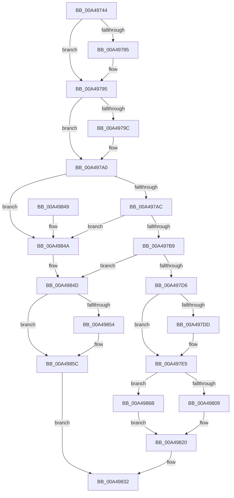

# AlpcpQueryRemoteView

- RVA: `0x00A49744`–`0x00A49872` (길이 `302` bytes)
- VA: `0x0000000140A49744`
- 실행 섹션: `PAGE`
- PDB 이름 있음: `예`; PDB Function 태그: `아니요`
- unwind 정보 RVA: `0x000AFE60`
- 디코드: `88`개 명령, `302/302` bytes 표시
- 미해석 바이트: `0` (있으면 어셈블리에 `.byte`로 보존)

> 이 문서는 커널 이미지의 기계어와 PDB 기호를 분석해 생성했습니다. 4번과 5번은 함수 원형과 자료형을 바이너리 사용 방식에서 추정한 C 해석이며 원본 소스 복구 결과는 아닙니다.

## 1. Dependencies

- 직접 호출 지점: **11**; 고유 호출 대상: **9**
- 직접 호출자로 확인된 함수: **1**
- RIP 상대 이미지 참조: **0**

### Outgoing calls
- `0x00A49770` → [KeAbPreAcquire](../../text/21/KeAbPreAcquire_function_00210230.md) (function, `0x00210230`)
- `0x00A49790` → [ExfAcquirePushLockSharedEx](../../text/21/ExfAcquirePushLockSharedEx_function_0021044C.md) (function, `0x0021044C`)
- `0x00A497CA` → [ObReferenceObjectSafe](../../text/41/ObReferenceObjectSafe_function_0041DAE0.md) (function, `0x0041DAE0`)
- `0x00A497E0` → [ExfReleasePushLockShared](../../text/26/ExfReleasePushLockShared_function_00263440.md) (function, `0x00263440`)
- `0x00A497E8` → [KeAbPostRelease](../../text/2E/KeAbPostRelease_function_002E1600.md) (function, `0x002E1600`)
- `0x00A497F4` → [AlpcpLockForCachedReferenceBlob](../88/AlpcpLockForCachedReferenceBlob_function_0088A8B0.md) (function, `0x0088A8B0`)
- `0x00A497FF` → [AlpcpLocateView](../89/AlpcpLocateView_function_008900E8.md) (function, `0x008900E8`)
- `0x00A49823` → [AlpcpUnlockBlob](../88/AlpcpUnlockBlob_function_0088B990.md) (function, `0x0088B990`)
- `0x00A4982B` → [ObfDereferenceObject](../../text/2F/ObfDereferenceObject_function_002F9350.md) (function, `0x002F9350`)
- `0x00A49857` → [ExfReleasePushLockShared](../../text/26/ExfReleasePushLockShared_function_00263440.md) (function, `0x00263440`)
- `0x00A4985F` → [KeAbPostRelease](../../text/2E/KeAbPostRelease_function_002E1600.md) (function, `0x002E1600`)

### Direct callers
- [AlpcpReceiveLegacyConnectionReply](../92/AlpcpReceiveLegacyConnectionReply_function_00921CA0.md) at `0x00921D4B`

### Static image references
- 디코드된 RIP-relative 메모리 참조가 없습니다.

## 2. Other-region calls and transfers

- 다른 실행 섹션으로 향하는 call: **8**
  - `0x00A49770` → [KeAbPreAcquire](../../text/21/KeAbPreAcquire_function_00210230.md) (`PAGE` → `.text`)
  - `0x00A49790` → [ExfAcquirePushLockSharedEx](../../text/21/ExfAcquirePushLockSharedEx_function_0021044C.md) (`PAGE` → `.text`)
  - `0x00A497CA` → [ObReferenceObjectSafe](../../text/41/ObReferenceObjectSafe_function_0041DAE0.md) (`PAGE` → `.text`)
  - `0x00A497E0` → [ExfReleasePushLockShared](../../text/26/ExfReleasePushLockShared_function_00263440.md) (`PAGE` → `.text`)
  - `0x00A497E8` → [KeAbPostRelease](../../text/2E/KeAbPostRelease_function_002E1600.md) (`PAGE` → `.text`)
  - `0x00A4982B` → [ObfDereferenceObject](../../text/2F/ObfDereferenceObject_function_002F9350.md) (`PAGE` → `.text`)
  - `0x00A49857` → [ExfReleasePushLockShared](../../text/26/ExfReleasePushLockShared_function_00263440.md) (`PAGE` → `.text`)
  - `0x00A4985F` → [KeAbPostRelease](../../text/2E/KeAbPostRelease_function_002E1600.md) (`PAGE` → `.text`)
- 별도 외부 분기/꼬리 이동을 확인하지 못했습니다.

## 3. Assembly (complete function range)

```asm
00A49744  48 89 5C 24 10                  mov qword ptr [rsp + 0x10], rbx
00A49749  48 89 6C 24 18                  mov qword ptr [rsp + 0x18], rbp
00A4974E  56                              push rsi
00A4974F  57                              push rdi
00A49750  41 54                           push r12
00A49752  41 56                           push r14
00A49754  41 57                           push r15
00A49756  48 83 EC 20                     sub rsp, 0x20
00A4975A  4C 8B 79 10                     mov r15, qword ptr [rcx + 0x10]
00A4975E  4D 8B F0                        mov r14, r8
00A49761  48 8B EA                        mov rbp, rdx
00A49764  45 33 C0                        xor r8d, r8d
00A49767  33 D2                           xor edx, edx
00A49769  49 8D 5F F0                     lea rbx, [r15 - 0x10]
00A4976D  48 8B CB                        mov rcx, rbx
00A49770  E8 BB 6A 7C FF                  call 0x140210230
00A49775  48 8B F0                        mov rsi, rax
00A49778  33 C0                           xor eax, eax
00A4977A  44 8D 60 11                     lea r12d, [rax + 0x11]
00A4977E  F0 4C 0F B1 23                  lock cmpxchg qword ptr [rbx], r12
00A49783  74 10                           je 0x140a49795
00A49785  4C 8B CB                        mov r9, rbx
00A49788  4C 8B C6                        mov r8, rsi
00A4978B  33 D2                           xor edx, edx
00A4978D  48 8B CB                        mov rcx, rbx
00A49790  E8 B7 6C 7C FF                  call 0x14021044c
00A49795  33 FF                           xor edi, edi
00A49797  48 85 F6                        test rsi, rsi
00A4979A  74 04                           je 0x140a497a0
00A4979C  C6 46 0A 01                     mov byte ptr [rsi + 0xa], 1
00A497A0  49 8B 17                        mov rdx, qword ptr [r15]
00A497A3  48 85 D2                        test rdx, rdx
00A497A6  0F 84 9E 00 00 00               je 0x140a4984a
00A497AC  49 8B 77 08                     mov rsi, qword ptr [r15 + 8]
00A497B0  48 85 F6                        test rsi, rsi
00A497B3  0F 84 91 00 00 00               je 0x140a4984a
00A497B9  F7 82 A0 01 00 00 00 10 00 00   test dword ptr [rdx + 0x1a0], 0x1000
00A497C3  48 0F 44 F2                     cmove rsi, rdx
00A497C7  48 8B CE                        mov rcx, rsi
00A497CA  E8 11 43 9D FF                  call 0x14041dae0
00A497CF  84 C0                           test al, al
00A497D1  49 8B C4                        mov rax, r12
00A497D4  74 77                           je 0x140a4984d
00A497D6  F0 48 0F B1 3B                  lock cmpxchg qword ptr [rbx], rdi
00A497DB  74 08                           je 0x140a497e5
00A497DD  48 8B CB                        mov rcx, rbx
00A497E0  E8 5B 9C 81 FF                  call 0x140263440
00A497E5  48 8B CB                        mov rcx, rbx
00A497E8  E8 13 7E 89 FF                  call 0x1402e1600
00A497ED  48 8B 5D 10                     mov rbx, qword ptr [rbp + 0x10]
00A497F1  48 8B CB                        mov rcx, rbx
00A497F4  E8 B7 10 E4 FF                  call 0x14088a8b0
00A497F9  48 8B D6                        mov rdx, rsi
00A497FC  48 8B CB                        mov rcx, rbx
00A497FF  E8 E4 68 E4 FF                  call 0x1408900e8
00A49804  48 85 C0                        test rax, rax
00A49807  74 62                           je 0x140a4986b
00A49809  41 C7 06 18 00 00 00            mov dword ptr [r14], 0x18
00A49810  48 8B 50 28                     mov rdx, qword ptr [rax + 0x28]
00A49814  49 89 56 10                     mov qword ptr [r14 + 0x10], rdx
00A49818  48 8B 50 30                     mov rdx, qword ptr [rax + 0x30]
00A4981C  49 89 56 08                     mov qword ptr [r14 + 8], rdx
00A49820  48 8B CB                        mov rcx, rbx
00A49823  E8 68 21 E4 FF                  call 0x14088b990
00A49828  48 8B CE                        mov rcx, rsi
00A4982B  E8 20 FB 8A FF                  call 0x1402f9350
00A49830  8B C7                           mov eax, edi
00A49832  48 8B 5C 24 58                  mov rbx, qword ptr [rsp + 0x58]
00A49837  48 8B 6C 24 60                  mov rbp, qword ptr [rsp + 0x60]
00A4983C  48 83 C4 20                     add rsp, 0x20
00A49840  41 5F                           pop r15
00A49842  41 5E                           pop r14
00A49844  41 5C                           pop r12
00A49846  5F                              pop rdi
00A49847  5E                              pop rsi
00A49848  C3                              ret
00A49849  CC                              int3
00A4984A  49 8B C4                        mov rax, r12
00A4984D  F0 48 0F B1 3B                  lock cmpxchg qword ptr [rbx], rdi
00A49852  74 08                           je 0x140a4985c
00A49854  48 8B CB                        mov rcx, rbx
00A49857  E8 E4 9B 81 FF                  call 0x140263440
00A4985C  48 8B CB                        mov rcx, rbx
00A4985F  E8 9C 7D 89 FF                  call 0x1402e1600
00A49864  B8 37 00 00 C0                  mov eax, 0xc0000037
00A49869  EB C7                           jmp 0x140a49832
00A4986B  BF 9A 00 00 C0                  mov edi, 0xc000009a
00A49870  EB AE                           jmp 0x140a49820
```

## 4. C-style interpretation (structured pseudocode)

```c
__int64 __fastcall AlpcpQueryRemoteView(__int64 a1, __int64 a2, __int64 a3)
{
    __int64 result;
    __int64 v_rdi;
    __int64 v_rsi;
    __int64 v_rsp;
    unsigned __int64 v_stack_p10;
    unsigned __int64 v_stack_p18;

    v_stack_p10 = v_rbx;
    v_stack_p18 = v_rbp;
    v_rsp = (v_rsp) - (32);
    a3 = 0;
    a2 = 0;
    result = KeAbPreAcquire(*(unsigned __int64 *)(a1 + 16) - 16, a2, a3, a4);
    result = 0;
    if (!(condition_is_equal)) {
        a4 = *(unsigned __int64 *)(a1 + 16) - 16;
        a3 = 0;
        a2 = 0;
        a1 = *(unsigned __int64 *)(a1 + 16) - 16;
        result = ExfAcquirePushLockSharedEx(a1, a2, a3, a4);
    }
    v_rdi = 0;
    if (result != 0) {
        *(unsigned __int8 *)(result + 10) = 1;
    }
    if (*(unsigned __int64 *)(*(unsigned __int64 *)(a1 + 16)) == 0) goto loc_00A4984A;
    if (*(unsigned __int64 *)(*(unsigned __int64 *)(a1 + 16) + 8) == 0) goto loc_00A4984A;
    v_rsi = *(unsigned __int64 *)(*(unsigned __int64 *)(a1 + 16) + 8);
    if (((*(unsigned int *)(*(unsigned __int64 *)(*(unsigned __int64 *)(a1 + 16)) + 416)) & (0x1000ULL)) == 0) { v_rsi = *(unsigned __int64 *)(*(unsigned __int64 *)(a1 + 16)); }
    result = ObReferenceObjectSafe(v_rsi, *(unsigned __int64 *)(*(unsigned __int64 *)(a1 + 16)), a3, a4);
    if ((unsigned __int8)(result) == 0) goto loc_00A4984D;
    result = result + 17;
    if ((unsigned __int8)(result) != 0) {
        a1 = *(unsigned __int64 *)(a1 + 16) - 16;
        result = ExfReleasePushLockShared(a1, *(unsigned __int64 *)(*(unsigned __int64 *)(a1 + 16)), a3, a4);
    }
    result = KeAbPostRelease(*(unsigned __int64 *)(a1 + 16) - 16, *(unsigned __int64 *)(*(unsigned __int64 *)(a1 + 16)), a3, a4);
    result = AlpcpLockForCachedReferenceBlob(*(unsigned __int64 *)(a2 + 16), *(unsigned __int64 *)(*(unsigned __int64 *)(a1 + 16)), a3, a4);
    result = AlpcpLocateView(*(unsigned __int64 *)(a2 + 16), v_rsi, a3, a4);
    if (result == 0) goto loc_00A4986B;
    *(unsigned int *)(a3) = 24;
    *(unsigned __int64 *)(a3 + 16) = *(unsigned __int64 *)(result + 40);
    *(unsigned __int64 *)(a3 + 8) = *(unsigned __int64 *)(result + 48);
loc_00A49820:
    result = AlpcpUnlockBlob(*(unsigned __int64 *)(a2 + 16), *(unsigned __int64 *)(result + 48), a3, a4);
    result = ObfDereferenceObject(v_rsi, *(unsigned __int64 *)(result + 48), a3, a4);
loc_00A49832:
    v_rsp = (v_rsp) + (32);
    return 0;
loc_00A4984A:
loc_00A4984D:
    result = result + 17;
    if (!(condition_is_equal)) {
        a1 = v_stack_p10;
        result = ExfReleasePushLockShared(a1, *(unsigned __int64 *)(result + 48), a3, a4);
    }
    result = KeAbPostRelease(v_stack_p10, *(unsigned __int64 *)(result + 48), a3, a4);
    goto loc_00A49832;
loc_00A4986B:
    goto loc_00A49820;
}
```

## 5. (Beta) C Style

```c
int64_t AlpcpQueryRemoteView(void *Arg1, void *Arg2, void *Arg3)
{
    uint8_t *arg1 = (uint8_t *)Arg1;
    uint8_t *arg2 = (uint8_t *)Arg2;
    uint8_t *arg3 = (uint8_t *)Arg3;

    int64_t result;
    int64_t local_rdi;
    int64_t local_rsi;
    int64_t local_rsp;
    uint64_t v_stack_p10;
    uint64_t v_stack_p18;

    v_stack_p10 = local_rbx;
    v_stack_p18 = local_rbp;
    local_rsp = (local_rsp) - (32);
    Arg3 = 0;
    Arg2 = 0;
    result = KeAbPreAcquire(*(uint64_t *)(arg1 + 0x10) - 16, Arg2, Arg3, a4);
    result = 0;
    if (!(condition_is_equal)) {
        a4 = *(uint64_t *)(arg1 + 0x10) - 16;
        Arg3 = 0;
        Arg2 = 0;
        Arg1 = *(uint64_t *)(arg1 + 0x10) - 16;
        result = ExfAcquirePushLockSharedEx(Arg1, Arg2, Arg3, a4);
    }
    local_rdi = 0;
    if (result != 0) {
        *(uint8_t *)(result + 0xA) = 1;
    }
    if (*(uint64_t *)(*(uint64_t *)(arg1 + 0x10)) == 0) goto loc_00A4984A;
    if (*(uint64_t *)(*(uint64_t *)(arg1 + 0x10) + 0x8) == 0) goto loc_00A4984A;
    local_rsi = *(uint64_t *)(*(uint64_t *)(arg1 + 0x10) + 0x8);
    if (((*(uint32_t *)(*(uint64_t *)(*(uint64_t *)(arg1 + 0x10)) + 0x1A0)) & (0x1000ULL)) == 0) { local_rsi = *(uint64_t *)(*(uint64_t *)(arg1 + 0x10)); }
    result = ObReferenceObjectSafe(local_rsi, *(uint64_t *)(*(uint64_t *)(arg1 + 0x10)), Arg3, a4);
    if ((uint8_t)(result) == 0) goto loc_00A4984D;
    result = result + 17;
    if ((uint8_t)(result) != 0) {
        Arg1 = *(uint64_t *)(arg1 + 0x10) - 16;
        result = ExfReleasePushLockShared(Arg1, *(uint64_t *)(*(uint64_t *)(arg1 + 0x10)), Arg3, a4);
    }
    result = KeAbPostRelease(*(uint64_t *)(arg1 + 0x10) - 16, *(uint64_t *)(*(uint64_t *)(arg1 + 0x10)), Arg3, a4);
    result = AlpcpLockForCachedReferenceBlob(*(uint64_t *)(arg2 + 0x10), *(uint64_t *)(*(uint64_t *)(arg1 + 0x10)), Arg3, a4);
    result = AlpcpLocateView(*(uint64_t *)(arg2 + 0x10), local_rsi, Arg3, a4);
    if (result == 0) goto loc_00A4986B;
    *(uint32_t *)(arg3) = 24;
    *(uint64_t *)(arg3 + 0x10) = *(uint64_t *)(result + 0x28);
    *(uint64_t *)(arg3 + 0x8) = *(uint64_t *)(result + 0x30);
loc_00A49820:
    result = AlpcpUnlockBlob(*(uint64_t *)(arg2 + 0x10), *(uint64_t *)(result + 0x30), Arg3, a4);
    result = ObfDereferenceObject(local_rsi, *(uint64_t *)(result + 0x30), Arg3, a4);
loc_00A49832:
    local_rsp = (local_rsp) + (32);
    return 0;
loc_00A4984A:
loc_00A4984D:
    result = result + 17;
    if (!(condition_is_equal)) {
        Arg1 = v_stack_p10;
        result = ExfReleasePushLockShared(Arg1, *(uint64_t *)(result + 0x30), Arg3, a4);
    }
    result = KeAbPostRelease(v_stack_p10, *(uint64_t *)(result + 0x30), Arg3, a4);
    goto loc_00A49832;
loc_00A4986B:
    goto loc_00A49820;
}
```

### 관측된 메모리 오프셋

구조체 형식이 확인되지 않은 접근은 인자 기준의 오프셋으로만 기록했습니다.

| 기준 인자 | 오프셋 표현 | 폭 (bit) | 접근 |
|---|---:|---:|---|
| `Arg1` | `+ 0x10` | `64` | `R` |
| `Arg2` | `+ 0x10` | `64` | `R` |
| `Arg3` | `+ 0x0` | `32` | `W` |
| `Arg3` | `+ 0x8` | `64` | `W` |
| `Arg3` | `+ 0x10` | `64` | `W` |

## 6. Execution-region graph

[열기: 2D/3D 그래프와 함수 탐색 컨트롤 패널](../../../control-panel.html?section=page&rva=0x00A49744&view=graph)

- 2D 그래프는 위에서 아래로 흐르고, 3D 그래프는 빈 공간을 드래그해 회전합니다. Shift+드래그는 이동, 휠은 확대·축소, 함수 노드 선택은 대상 보고서 이동입니다.

### Static fallback


